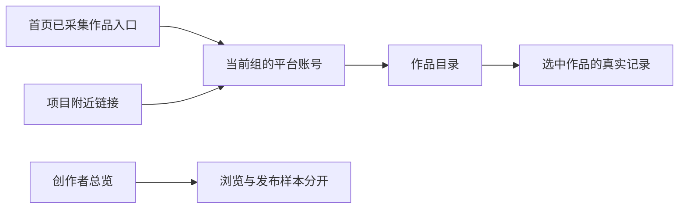

# T1362 独立实际画面复核

状态：独立实际画面复核完成，4张指定缺帧已闭合。已实际查看formal03原54张及formal04新增6张，共60张；formal04另外两张为正常窗0表与最小窗123表。逐文件SHA、图片像素、执行方声明视口和源身份见 `REVIEWED_FILES.json`。本报告只签已见像素，不代替任务完成或全局Gate。

## 范围与证据归属

- 本评审者只读任务合同、设计规范、执行方安全摘要及实际截图；未启动浏览器、服务或测试，未操作用户业务数据、生产代码或 workflow 真相源。
- 依据：T1362 SPEC、`control/PAGE_SPEC.md`、项目内 oil-ui-pro 0.10.0 与 T1022 `UI_RULES.md`。按存量界面评审协议做一轮，不评分、不更换主题、不提出风格改版。
- product-to-code-orchestrator 与项目流程均为 3.29.0；只读 context-plan 路由为 `4-build / implementation`。本子任务只负责实际画面判断，业务断言与前端收据由执行方负责。
- formal03 安全摘要记录源为 `d9346e0b409ab004c8d464d4787f62f46cd5fbc8`。执行方声明生产入口源等同 `5999a2369aeef10844e3f2f92385f969650e5198`。正常/最小业务截图像素分别为1366×900/1024×680；Chrome200%为执行方实际浏览器缩放，截图自身不能证明缩放实现方式。
- 数据是 fresh 私有 PG 中经真实服务建立的合成事实，不能外推真人平台采集或安装版恢复。

## 已见两窗口（formal03原件）

| 区域 | 实际像素观察 | 可签边界 |
|---|---|---|
| 首页引导 | “查看已采集的平台作品”、目录链接与独立“已查看，完成这一步”按钮同一行，先浏览再明确确认的语义清楚 | 入口和按钮可见；单帧不证明保存 |
| 组内选择 | 组名、小红书/快手及各自账号名同屏；选中账号用紫色边界和文字区分 | 当前对象可辨认；不靠颜色作为唯一身份 |
| 目录和详情 | “粉丝记录”独立；目录声明13件，未选作品提示选择左侧作品；详情显示点赞0、观看量123及记录时间 | 不把粉丝记录缺失当全部作品无数据；可见目录声明不等于截图逐条展示13件 |
| 真实零与未知 | 纯typed详情观看量0/点赞0；另一作品显示“暂无可查看的作品数据记录” | 已见0与无记录分开；数据真实性由公共同ID链证明 |
| 快手 | 同组快手选中、粉丝暂无、作品详情播放量7/点赞0 | 关键身份与值同时可读 |
| 切组/空/错误 | 目标组仅显示自身账号；加载时旧内容遮住；空组说明未绑定并留管理入口；越组错误说明原因并留当前组账号选择 | 可恢复入口可见；单帧不证明权限或请求取消 |
| 项目附近入口 | 标题说明下方有“已采集作品”，0与1项目状态均留此入口 | 入口容易发现，项目数量与目录未在视觉上混为一类 |
| 总览 | 123和0分别显示在“累计浏览（次）”；播放/阅读为—；下方说明1/1个账号有指标 | 摘要口径和真实零可读；原帧尚未展示下方完整平台表 |
| 暗色 | 账号入口和快手详情清晰，7/0可读，选中对象有文字及边界 | 未进行对比度测量，不签AA；入口帧侧栏尚显示加载账号组，不签全局稳定 |
| Chrome200% | 侧栏收窄，账号入口可见；XHS详情123/0及KS详情7/0放大后可读 | 只签关键区可读与执行方操作佐证，不签全页无遮挡 |

## 发现与保留边界

1. `pure-typed-completion-public-refresh-readback.png`（formal03两窗口，旧02亦如此）实际是“正在打开工作区…”与侧栏“载入账号组…”；没有稳定首页、组名或完成进度。即使执行方公共API已读回成功，该图仍只能作为加载状态，不得代签完成后首页。该旧帧原语义保留；formal04同scope稳定补帧已闭合，见下节。
2. 正常窗两张 `overview-typed-browse-*.png` 只拍到下方覆盖区域开头；最小窗仅拍到摘要。平台表列名、发布指标样本和浏览行均未入图。该旧帧仍不签表格；formal04有限滚动补帧已真实入图并闭合，见下节。
3. 项目1条记录帧的第一列标题可见被压窄并截断，描述与更新时间拥挤。1024最小窗该首列标题进一步不可见，右侧操作表头局部裁切。该区域是既有项目表布局风险，当前任务入口本身可见；沿已登记T1349保留，不将本次入口可达扩写为项目全页无裁切。
4. 200%下存在原固定外壳/右上充值控件及局部视口裁切；已见账号入口和关键指标数值可读，但不推断所有滚动位置均无遮挡。暗色品牌紫链接/选中态未量化对比度，不能签AA。

## 减法与细节

未发现本次入口需要追加按钮或说明。账号名、组名、粉丝/作品分区、0/无记录原因都承担识别责任；本评审不建议删除。未修改文案、样式或代码。时间戳采用既有原始格式、目录含既有平台作品标识，属于保留基线，不凭本次截图签“所有内部术语/标识泄漏已消除”。

本次只有一个已选定存量方向，没有候选横向比较或评分。没有动效记忆点的过程评审。键盘、返回、刷新、权限、保存持久化和未发后台任务，只引用执行方安全结果，不能由截图或本评审者自报通过。

## formal03原正式结果与当时补帧请求（历史保留）

安全摘要 `candidate-attempt03/SAFE_SUMMARY.json` 记录整轮 exitCode=1：正常窗147.443秒失败，在25业务点之后最后`idle()`等待pending.size由1变0超过120秒；最小窗21.907秒passed。该事实是执行方真实结果，本评审未执行或重现，不能把正常窗称完整通过。4张失败附件已看：两张为KS7/0业务页、一张Chrome外观设置100%、一张空白页；它们不能定位pending首因或代签旧scope已结束。

最小窗表现：侧栏折为图标，目录/详情仍两栏，组/账号身份与123/0/7读得清；总览五摘要卡重排为两列，累计浏览卡在第三行，0和123均完整。200%下详情变为上下排列，所拍XHS123/0与KS7/0可读。首页完成帧仍是加载状态，未用最小窗passed倒推稳定视觉。

已向执行方提出精确4张补帧，等原独占测试窗口释放后有限执行，不要求重跑整轮、改样式或重发业务：

| 帧 | 视口/范围 | 必须入图的内容 |
|---|---|---|
| normal-typed-home-stable | 1366×900，normal原纯typed z | 刷新后Provider就绪、真组名、人工完成后引导推进，不再停第3步 |
| minimum-typed-home-stable | 1024×680，minimum自身独立纯typed z | 同上；不能用normal或primary组替代 |
| normal-overview-primary-table | 1366×900，primary | 滚至平台表，样本1、浏览123、已有采集指标及相关表头 |
| minimum-overview-typed-table | 1024×680，minimum独立纯typed z | 滚至平台表，样本0、浏览0、已有采集指标及相关表头 |

以上为formal03当时请求，不追改原FAIL或loading帧。最终补件及现可签范围见下节；既有项目表裁切仍保留。

## formal04最终补帧与独立结论

已实际view_image查看 `candidate-attempt04/artifacts/` 下两窗各自的 `pure-typed-completion-public-refresh-readback.png`、`overview-typed-platform-row-123.png` 和 `overview-typed-platform-row-0.png`，共6张。未重看或代签未变化的其余formal04像素；目录、暗色与Chrome200%沿用已实际看过的formal03同生产源证据。

| 指定缺口 | 新帧实际观察 | 结论 |
|---|---|---|
| normal纯typed稳定首页 | 真组名“零浏览仍是已知值”同时显示于筛选区与侧栏，上手引导已完成3/7，内容为第4步“确定账号组的内容定位”；浏览0、其余未知—，无加载骨架 | 稳定首页完成后的视觉缺口闭合 |
| minimum独立纯typed稳定首页 | 真组名“窄窗独立已采集作品”，上手引导3/7与第4步完整，浏览0、点赞等未知—；侧栏按最小窗折叠 | 该窗口独立组完成后的视觉缺口闭合 |
| normal primary平台表 | “发布指标样本（条）”与“浏览（次）”分别成列，小红书行样本1、浏览123、点赞0及“已有采集指标”，更新时间10/08 10:00；摘要123仍可见 | 表头、发布样本和浏览口径可辨，未误把样本数当目录数 |
| minimum独立typed平台表 | 小红书行发布记录0、发布指标样本0、浏览0、其他未知—及“已有采集指标”；10/10 10:00换行显示；状态两行但内容完整 | 最小窗表格可读，真实0与未采集/未知未混写 |

另外实际查看的normal typed0表与minimum primary123表具有同一语义。正常窗表头单行；最小窗按字段换行，未见数字、列标题或小红书状态文本重叠裁切。无需追加按钮或更换布局。

正式安全来源为 `candidate-attempt04/SAFE_SUMMARY.json` 与 `WITNESS_SUMMARY_SAFE.json`：source `969d1cf40414b3cec3c414de56af1a124212f35e`，productCommit `5999a2369aeef10844e3f2f92385f969650e5198`；两窗分别25.050秒、23.315秒passed，整轮exit0。每窗28点、completed=true、pending=[]、pageErrors=[]；baseline和final均collectionSubmissions18 / aiTaskCount0 / scheduledJobCount23。以上是执行方真实运行见证，本评审只读复核，不自称操作、重现或亲自执行测试。测试源相对formal03的改动与生产逐字一致由执行方负责；本评审只将上述明确生产身份用于证据复用，不代签源码审查。

在已授权的T1362展示范围内，首页/项目近邻入口、当前组账号身份、目录与粉丝区分、选中作品123/0/7、未知记录、空组/越组恢复、两窗总览样本与浏览、暗色和200%关键区的独立像素证据已具备。两个历史缺帧已闭合，未发现需要本次追加视觉修改的阻碍。formal03正常窗FAIL及loading原图完整保留；不能据此签真人平台采集、视频号恢复、安装版可用性、全局Gate、全页无遮挡或AA。既有T1349项目表首列/动作裁切继续保留。
