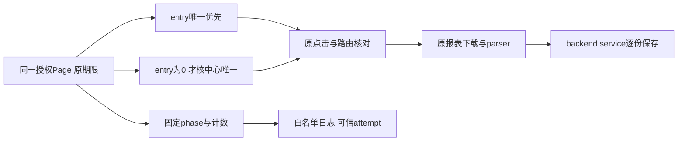

# T1363 独立实现审阅

审阅时间：2026-10-18T20:30:51.083228+00:00。结论：在本轮实际审到的冻结源码和差异中，未发现可定位且需修改的实现缺陷；`findings.json`为规范空findings。本结论仅为静态实现审阅，不是任务、完整Gate或真人采集验收。HEAD为`969d1cf40414b3cec3c414de56af1a124212f35e`，本任务尚在main工作区未提交；证据按下表精确文件SHA绑定，不能把共享HEAD当成已包含这些字节的提交。

本代理独立于生产作者，先前已完成本任务规格独评。本轮读取最终SPEC（SHA`6a8fdf09ddda85ed889404e8446234fc8aeeeff1c21543ad5c9d28ff4bbe5319`）、三生产差异、实际source/collector/组合根、两新增或修改测试、collector现保护测试和RED安全摘要；未运行测试、浏览器、平台、登录、服务、用户库或采集，未修改SPEC/生产/测试/中央状态，未commit。唯一新增内容在本目录。

## 实现核对

- `wechat-dom-witness.ts:200–233`只使用既有精确可见entry/centre。每轮先计entry，唯一则返回直接路径，完全不计无关centre，所以已审REV-001的entry=1/centre>1不会被新门拒绝；entry>1保原歧义。entry=0才看centre，需要点击centre前再核entry/centre，不使用first、猜selector或深链。centre仅在实际需要且唯一时点击一次；之后沿原子入口与目标path。followers原文本及works已在目标path绕过菜单的分支保留。
- 两菜单在同一个observe中竞争，原observe仍只建立一次end；不会因每轮或候选变化另开观察窗口。点击后的子入口仍是原独立阶段，而非重试菜单。每次动作继续使用原controls.timeoutMs与signal；新增异步count后有取消后检，中心/入口点击前仍由timeoutMs核原剩余deadline，点击后及路由后再核signal。页面对象不更换，操作前和循环检查官方origin，最终waitForURL仍核无用户名/密码、官方origin与精确目标path。
- source共享原deadline的operation/独立bounded外层、finally closeProfile及宿主真实onStopped均未改；collector的单次claim、原startedAt+30分钟、归属profile、串行onReport/parse/service commit、原取消/耗尽优先级、晚回调封闭、未实停不假释放也未改。新增诊断不创建任务、预算、租约或存储负责人。
- `wechat-browser-source.ts:67–76,280,317`把内部进度存于当前trace，在发出时重新投影六个固定phase、0..10000安全整数和boolean，只允许四个新字段。任意extra字段不被扩展输出；原code/name仍白名单。诊断回调异常由try/catch隔离，既不替换采集错误也不挡finally关闭；每份prepare清前份进度，成功路由清菜单进度，download错误不带旧prepare诊断。
- `persistence-client.ts:4720`唯一生产变化是现onDiagnostic闭包附加`options.attemptId`；它来自collector在claim/校验后传入的权威lease.attemptId。没有公开输入、自报profile/身份、新API或直连库路径。emitDiagnostic的原try/catch也包住console接收失败。

## 测试与运行证据边界

新增`wechat-channels-entry.integration.test.ts`代码定义24族：1个晚到主例、7个旧合法族、5个菜单负族、3个身份边界、4个取消点、3个受控时钟耗尽点与1个关闭未确认/日志失败组合。浏览器为真实Chromium，官方origin URL的所有响应由context.route合成并禁DNS外连，serviceWorkers阻断。普通页面/iframe、原生download、正式verified witness/source/parser/collector、平台collection service/transport和实际内存PGlite事务在组合中执行；createDb()未给dataDir，静态核对确为内存数据库。profile authority/acquire/停止及openProfile是合成窄端口，不是正式profileAuthority/host生命周期或用户真实授权证明。

主例代码断言同attempt complete、3报告/4committedPages、公开service读回、真实0值和无伪catalog。正常族保留直接/中心晚到/两者/无关重复中心/点击前入口出现等路径；同一主页面持有followers导航，works沿已到目标path免菜单。菜单负族实际失败沿source到collector再failRun并读service状态，不以mock prepare抛错替代入口行为。负族`fastMissingClock`用Date.now偏移跳过120秒等待；3个期限族也仅偏移Date.now，不触发真实墙钟deadline timer，其断言是source `EXECUTION_DEADLINE_EXCEEDED`经既有collector映射为failed/EXPORT_FAILED和0下载/0提交，不能冒充真实30分钟collector TASK_TIMEOUT优先级实测。现collector测试另有取消、原deadline、卡close、晚回调和续租保护，但本代理本次没有执行或代签。

source新增测试是明确prepare fixture，用于字段投影、非法phase/count/boolean、附带私密值、抛错日志接收者以及跨report/跨stage清理边界；这些单测不能代替DOM入口RED或公共持久链成功。未见本次组合根attempt闭包的新增独立运行测试，当前证据是已核的单行实际消费者，不能把fixture诊断冒正式组合根日志验收。

本轮读取的RED证据是作者已保存`SAFE_SUMMARY.json`与`red-input-sha256.txt`：摘要报告原源码下120312ms、晚到唯一入口而centre0、LINK_MISSING/EXPORT_FAILED、0commit、一次close/release；我未读取其raw red.log，也未独立执行，不对摘要以外的原始运行细节追签。摘要原测试SHA为`032456e5b32c03dbe889afec68af7ee38d7a133c095155be1217573e861fda47`，当前扩大为24族的测试SHA不同，需按各次运行输入分证；不能混称字节相同。GREEN正在作者独立执行，本审阅不消费或预签GREEN。后续测试、类型、LED047、timeout-policy、boundary/orphan及实际Gate由control按真实回执整合。

`centreClicked=true`只表示centre.click已成功await且紧接signal后检通过；若点击异常或取消，false并不能证明物理点击从未发生。phase/count是循环最新已取得值，不是原子DOM快照或当前登录证明。该布尔与诊断均不参与业务成功判定；原1499首因继续UNKNOWN，当前没有本次真人视频号采集成功证据，也没有原任务重发。

## 精确输入SHA256

| 路径 | SHA256 |
|---|---|
| `ai-worker/src/runtime/platform/wechat-dom-witness.ts` | `29026c21ca3744648919476dae0163e73c327b078ba91761f90f9ac501e618d6` |
| `ai-worker/src/runtime/platform/wechat-browser-source.ts` | `9f13ab36d297d6422f0f3b25e795dab957ef1db47e0ebc7038231e3bbf5e1b43` |
| `frontend/src/server/persistence-client.ts` | `9b5cd73843b332b31761f6892fd898a8fae98faee2fc608eb837850c556efd6c` |
| `ai-worker/src/runtime/platform/wechat-channels-entry.integration.test.ts` | `d208b50404158ad31d6f7a581f38f3c39fb17b3bc4510cf49df44feb1400d880` |
| `ai-worker/src/runtime/platform/wechat-browser-source.test.ts` | `eafec16d8ac2b72ebde9e940a8bda02ecb9282d013d3f4508ab7c53956bc20be` |
| `backend/src/application/collection/wechat-native-collector.ts` | `869bf687228bcd1a1fe70f86901e2cf9f872fbc742dd7cc293413208b500003b` |
| `backend/src/application/collection/wechat-native-collector.test.ts` | `008e10ed7e7c819261250e34ee9618c4533c70f9ad5ebad6f7a9c94bc1dfcfea` |
| `backend/src/db.ts` | `82420403de832caeae7a981e3677dd0c8ad062535da5115731c4a4f70411e6f6` |
| `contract/src/timeout-policy.ts` | `0ab2c32fe7f282bb1e7d9e3fc29d252bc3aef8d48a2385d46a13e089f6fbbb71` |
| `ai-worker/vitest.config.ts` | `98194b41915da18a6044883ab0b4cfcc0aaa1309031295b01812c8b5ab80939b` |
| `docs/features/t1363-wechat-video-report-entry-diagnosis.md` | `6a8fdf09ddda85ed889404e8446234fc8aeeeff1c21543ad5c9d28ff4bbe5319` |
| `docs/verification/t1363/implementation/SAFE_SUMMARY.json` | `149512b1afcf77a8af1ce936ce2b170d2c77dd101f78bc7c6212c0ad84c6312c` |
| `docs/verification/t1363/implementation/red-input-sha256.txt` | `b50e24b503b1fd5a6cc67b43e5ac9bc784a3516d1b19cea3f1e60298d17c6e90` |
