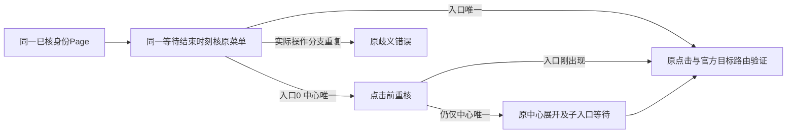

# T1363 视频号菜单等待窄修实施与交接

本轮按最终 SPEC SHA256 `6a8fdf09ddda85ed889404e8446234fc8aeeeff1c21543ad5c9d28ff4bbe5319`、第二轮独评 `REV:717233522ed1` 与 control 已执行的 START 实施。控制面、任务状态、最终审核、提交与打包仍由 Root/control 负责；本代理没有 commit，没有修改工作流或 T1362 产物。

**受控缺陷已 RED→GREEN，三份报告实际下载、解析、事务保存并按同 attempt 公开读回。原用户1499首因继续 UNKNOWN，真实视频号采集恢复尚未验证。** 本轮未接触用户 App、用户库、profile、凭据、旧原始 trace 或真实微信平台；没有新采集、重发、取消或改变原用户任务。

## 实际修了什么

原流程首次发现“视频数据”不可见后，之后只等“数据中心”。即使原本合法的直接入口随后出现，仍可能等满预算而失败。现在同一个 observe 结束时刻内继续核对原直接入口，唯一可见时优先直达；只有入口为0且需要点击中心时才检查中心唯一性，并在点击前重核菜单，防止把刚出现的子菜单折回。

- 只复用原精确可见 selector、原 Page/profile/expectedIdentity、原官方 origin；不加深链、词表、重试或 `.first()`。
- 直接入口唯一时不因无关中心重复而失败；实际 entry>1 或 entry=0且 centre>1 继续原歧义失败。
- 原 deadline、signal、登录后检、报表种类顺序、parser、service写入及真实停止责任不变。等待条件切换不创建新的联合观察预算。
- 内部进度只存固定 `entryPhase`、已经读到的可见计数、`centreClicked`；source重新做类型与字段白名单投影，正式组合根额外关联可信 `options.attemptId`。不记录正文、身份、URL/query/href、Cookie或profile路径。日志失败不影响原错误或停止。
- 后续 prepare 先清旧菜单进度；成功进入目标路由后清除菜单进度；download等后续错误不会附旧菜单阶段。

`centreClicked` 只代表 `await centre.click()` 已成功完成确认。`click_centre` 异常时 false **不能证明物理点击绝未发生**；应按 phase 与未确认边界解释。计数是循环中最后实际读到的值，不是新加的同时刻 DOM 全量快照，也不是任务成功依据。

## 实际 RED 与保留的前置失败

原生产输入字节见 `red-input-sha256.txt`；实际缺陷 RED 见 `red.log` 与不可覆盖的 `SAFE_SUMMARY.json`。

主测试使用真实 Chromium、真实同 Page DOM、可见 iframe、原生 download；所有官方 origin 请求均由本地 route 合成并禁外部 DNS，源 `openProfile` 只注入隔离新 context，不创建真实 profile。后端使用显式无 dataDir 的内存 PGlite，经正式 platform transport/start、collector 租约、verified witness/source、真实 parser、service事务与公开 report 读取，未以 mock prepare 抛错替代菜单行为。

实际输入：第一次真实 entry计数0；DOM随后渲染原“视频数据”，实际读回唯一可见1、centre0。修前仍经过 **120312ms** 的菜单观察，诊断 `prepare / channelsDaily / REPORT_LINK_MISSING`；collector failed/EXPORT_FAILED，下载0、提交0，open/close/release各1。该证据证明受控输入下的确定缺陷，不证明原1499经历相同DOM。

以下失败均保原件，没有算成缺陷 RED 或删除：

| 原件 | 真实边界与处理 |
|---|---|
| `red-load-failure.log` | 首次测试加载使用了 Vitest4已移除的参数位置；没有执行用例，不计 RED。仅修测试 options位置。 |
| `green-first.log` | 主采集已complete/三报告、1040ms、下载3，但随后测试直接service读取漏cursor，被schema正确拒绝；23个其它族通过。仅改测试走正式transport，显式cursor:null，不改生产。 |
| `worker-type.log` | 自有测试的toString返回类型与泛型helper产生3处类型错误；只修测试类型/直接typed调用。后续类型通过。 |

## 最终结果

所有命令均自然终态，禁用本轮测试自动重试；最终生产源与测试源摘要在 `FINAL_SHA256.txt`，结构化结果与全部日志SHA在 `CURRENT_SUMMARY.json`。

| 实际命令范围 | 结果 | 原件 |
|---|---|---|
| 新视频号真实DOM25族 + 既有公众号真实导航2族 | 2文件27 PASS；92.56s | `green-complete.log` |
| witness/source/Wujie定向回归 | 3文件139 PASS | `worker-regression.log` |
| backend native collector + 真实原生报表持久链 | 2文件38 PASS | `backend-native.log` |
| 正式persistence装配/绑定 + 完整LED047现命令8文件 | 10文件183 PASS | `frontend-wiring-binding-led047.log` |
| worker当前最终类型 | exit0 | `worker-type-complete.log` |
| frontend当前类型 | exit0 | `frontend-type.log` |
| 项目原timeout-policy verify完整入口 | exit0 | `timeout-policy.log` |
| boundary | exit0；5项旧基线、0新增 | `boundary.log` |
| orphan | exit0；0error、100既有warning | `orphan.log` |

新主用例最终实际 **1343ms**，同attempt complete/committedReports3/committedPages4；公开transport读回三种真实解析的报告与原组，DB实际3行报告、目录0行，真实0值保留；open/close/release各1、download3、held=false。没有把报告目录伪造成作品目录或Project。

25族明确覆盖：立即/晚到直接入口；中心/晚到中心展开；两者同时存在；entry唯一而centre重复；等待中entry出现且centre重复；点击中心前entry到达；followers原入口；works已在目标path；缺菜单、隐藏、实际入口/中心重复、中心后缺子入口；wrong identity、明确扫码、foreign origin；等待/中心点击/入口点击/路由阶段取消；等待/中心点击/路由阶段原source deadline耗尽；停止未确认及日志接收异常。

负族的菜单等待与 source绝对deadline输入使用受控 Node `Date.now` 推进，配置未缩短；它们证明真实DOM/源码的限时输入行为。**主 RED 的120秒是实际墙钟等待。** canonical collector TASK_TIMEOUT/取消优先级与真实停止协议另由原source/collector回归保持。本轮不扩修source错误到collector状态的既有映射：受控source deadline失败仍按原EXPORT_FAILED映射，未冒充真实外层timer触发的TASK_TIMEOUT。

## 资源与执行窗口

先遵 control 的 T1362独占窗口，只写独占新测试；control明确释放后才实际RED。RED真实完成后才改生产。生产编辑阶段窗口交回control收其clean候选UI；control正式04退出且端口清空后才运行GREEN。最终所有测试/类型/Gate自然结束后，已向control明确交回Chromium/Next/重测试窗口。

每例关闭自己的实际context与内存client，suite afterAll关闭自有Chromium。停止未确认用例先断言 source 保 held/pendingStop、release0；随后只由测试夹具关闭自己的原始context做清理，不冒充 source已有停止证明，不写真实profile租约。全部命令已终态，没有本代理遗留平台任务、Next、PG或浏览器。

## 精确交接白名单与剩余边界

本代理仅改以下6个源码/测试路径；没有改 `wechat-dom-witness.test.ts`、其它测试、中央配置、锁文件或任务状态：

1. `ai-worker/src/runtime/platform/wechat-dom-witness.ts`
2. `ai-worker/src/runtime/platform/wechat-browser-source.ts`
3. `ai-worker/src/runtime/platform/wechat-browser-source.test.ts`
4. `ai-worker/src/runtime/platform/wechat-channels-entry.integration.test.ts`（新文件）
5. `frontend/src/server/persistence-client.ts`（仅现Wechat onDiagnostic的可信attempt关联段）
6. `frontend/src/server/__module_integration__/platform-collection.persistence-client.test.ts`

另新增/维护本目录实施证据。先前 `independent-strategy/REPORT.md` 与两轮review原件没有覆盖。文档目录被本地 `.git/info/exclude` 排除；Root/control如需纳入需显式白名单，不能以git status为空误认没有证据。源码diff无空白错误；新测试末行/行尾另做机械核对。

最终三生产SHA始终保持独审冻结值：witness `29026c21ca3744648919476dae0163e73c327b078ba91761f90f9ac501e618d6`；source `9f13ab36d297d6422f0f3b25e795dab957ef1db47e0ebc7038231e3bbf5e1b43`；persistence `9b5cd73843b332b31761f6892fd898a8fae98faee2fc608eb837850c556efd6c`。最终新真实DOM测试SHA为 `d208b50404158ad31d6f7a581f38f3c39fb17b3bc4510cf49df44feb1400d880`；其余完整SHA在 `FINAL_SHA256.txt`。

本代理交接后停止扩测和改源。独立源码审、全局reconcile、正式任务Gate与提交/包/安装由Root/control继续；本报告不代签这些步骤。原1499/1502与原失败未改，视频号仍没有本轮真人采集成功证据。未来若Root按同源安装与当前归属核实后授权一次真实新采集，应另记新clientRequestId/attempt/终态，保原ID，不自动二次POST；本轮GREEN不能替代该证据。
