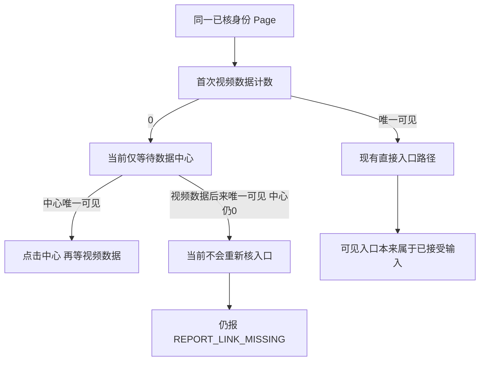

# T1363 视频号入口失败独立只读判断

记录时间：2026-10-19 04:03:59（Asia/Shanghai）。本报告由独立分析代理形成。先读 BACKLOG、T1363/T1362、PROJECT/CONTEXT、产品流程技能与阶段路由，再读现有两份只读报告和精确消费者。技能与项目流程版本均为 3.29.0；项目当前为 `4-build`，本次只交诊断建议，不领取或推进任务状态。

本次未修改生产、测试、流程、用户库、profile，未运行平台任务、浏览器、登录、采集或测试，未读取原始凭据或旧原始 trace，未提交 commit。唯一新增文件为本报告。以下静态执行推演不是当场 RED，也不是实际平台复现。

## 结论

1. **现有安全证据不能区分两个 `REPORT_LINK_MISSING` 站点。** 15:11 与 16:17 的旧事件只到 `prepare / channelsDaily`，没有菜单子步骤或原任务关联 ID；公开父任务/AI 子任务的 `failed / errorCode=null` 也不保存这两个站点。不能补判为等待超时、登录失效、中心菜单缺失或子菜单缺失。
2. **没有查到可直接调用、既不启动新平台执行又能恢复原菜单现场的公开操作。** 现有公开 GET 读已保存的状态、目录、指标或报表；任务 inspect/events 不拥有此浏览器的历史菜单现场。`platforms.collections.start` 会创建新采集并继续报表，不是“只观察入口”接口。内部浏览器观察协议不能凭一个旧 task ID 接管原采集 profile。
3. **发现一个可以进入窄 SPEC 的确定时序缺口候选。** `wechat-dom-witness.ts:201` 只在入口第一次计数为 0 时决定“之后只等数据中心”。如果已有受支持的直接入口稍后出现，而数据中心仍没有出现，代码不会重新看入口，仍在 `:203` 失败。它与当前 `:200–207` 已接受的直接入口输入不一致；不需要猜新 selector 或深链即可限定验证。**这不是原1499的已证根因，尚未运行受控验证，也未证当前微信页面实际发生这种时序。**
4. 可先按独评后的窄 SPEC，用真实 DOM 与真实 public collect 链验证上述确定输入族；安全子步骤日志使后续一次合法新采集有新区分力。Root已选择聚焦既有流程，不新增 entry-only 公开能力。新包内完成受控验证后，一次真实 owned 平台新采集可作为后续验收选项；必须明记新副作用、保原失败，不向睡觉的用户提问。本次仅分析，尚未执行放行。

## 原任务证据能说明什么

输入：`docs/verification/t1362/video-collection-readonly/REPORT.md` 与 `installed-entry-readonly/REPORT.md`。本次没有新查运行状态，不把这些历史时刻冒成本刻状态。

- 目标组 `grp_legacy_acct-ae1a8346-9`；视频号账号 `acct-0d742f83-1558`。
- 原父 `execution-task-bd28c55d-1499` 的最新既有公开观测为 failed，`errorCode=null`；原 AI `ai-task-bd28c55d-1502` 为 failed，引用 `exec_5d6972be-df6d-408d-9c4c-743eb2624211`。这是保存过的状态事实，不含入口分支证据。
- 两条旧安全菜单事件没有 task/run/account 关联，只能时间关联，不能严格绑定这次 attempt；更不能据此重写原持久错误或首因。
- source 先在同 Page 核真实稳定身份，再从 `channelsDaily` 开始。故菜单失败前身份 reader 已返回；它不证明后续全程登录有效。
- 同 Page 出现明确可见扫码提示，现 `isLoggedOut` 与 catch 后检已经可以抛 `LOGIN_REQUIRED`，collector 会映射 `needsAuth`。旧无归属 `login.html` tab 不足以推翻原菜单错误；补一个泛化登录检测没有首因证据。
- 没走过入口就不会走到 wujie、日期、原生下载或 parser。不能以这些后续模块的修复签原采集恢复。

## 精确消费者核对

| 消费者 | 当前行为与本次结论 |
|---|---|
| `ai-worker/src/runtime/platform/wechat-dom-witness.ts:198–208` | 已在目标 path 则跳入口；否则只用当前精确、可见菜单。入口初读为 0 才等中心；中心与入口两次 observe 都用 `REPORT_LINK_MISSING`。歧义为 `REPORT_LINK_AMBIGUOUS`。 |
| 同文件 `:26–28` | observe 保留一个结束时刻，循环只调用传入 reader；中心 reader 不会自动重新读取入口。250ms 是间隔，不是预算。 |
| 同文件 `:157–172` | 明确可见登录提示才返回 true；缺菜单、空白、网络失败或 login 路径本身不是登录失效证据。 |
| `ai-worker/src/runtime/platform/wechat-browser-source.ts:13–20,48,66–67` | Trace 只有 stage/kind；入口错误没有子步骤。现 observation 仅白名单覆盖 `REPORT_SECTION_MISSING`，不覆盖菜单缺失。 |
| 同文件 `:257–283,299–319` | source 拥有实际 Page，受原 deadline/signal 限制，失败后同 Page 登录后检并真实 close/onStopped。私有截图也只适用后面的 section 缺失及指定数据 path，不能读回本次入口现场。 |
| `frontend/src/server/persistence-client.ts:4711–4720` | 正式装配经过 profile authority、host lifecycle、native collector；diagnostic 只是 console 白名单事件，当前不带 `options.attemptId`。 |
| `backend/src/application/collection/wechat-native-collector.ts:59–64,175–181,218–228` | lease/归属/profile 有正式权威链；未知 source code 映射 `EXPORT_FAILED`，不能由父 task 的 null errorCode反推菜单站点。 |
| `contract/src/operations/platform-collection.ts` | GET 包含能力、既有 collection、目录、指标、报表；没有 entry-only 观察。POST start/bind/cancel 会发动作，不能伪称只读原任务诊断。 |
| `contract/src/operations/workbench.ts` | inspect/events 是执行账本，不会重建 native collector 没记录过的菜单子步骤。 |
| `contract/src/internal/execution-browser.ts` | 内部观察要求 session/宿主授权；不是持有账号 ID 就能接管已关闭的原 native Page。 |

## 可进入窄 SPEC 的输入与条款

### 静态可达缺口

以下是源码静态推演，尚无测试运行回执：

| 时刻 | 唯一可见视频数据数 | 唯一可见数据中心数 | 当前代码 |
|---|---:|---:|---|
| t0 | 0 | 0 | `:201` 进入中心分支 |
| 后续 t1 | 1 | 0 | `:203` 仍只读 centre.count，不再读 entry.count |
| 原观察结束 | 1 | 0 | 抛 `REPORT_LINK_MISSING`，未点击已合法可见的直接入口 |

合法性依据是**当前实现自己的直接入口分支**：若 t0 的 entry=1、centre=0，现代码直接走 `:206–208`，从来不要求 centre 存在。这里仅让相同已接受入口晚到，没有发明页面布局或更换 selector。它足以支持受控验证候选；不能由此断言微信实际会省略中心菜单。

### 建议交给 control 的窄条款

- 沿同一已授权 profile、同一 Page、真实 expectedIdentity 和当前官方 origin；不添加深链或猜菜单协议。
- 等待入口时允许**原本已合法的直接入口晚到**；发现唯一可见入口后继续原 entry click→官方目标 path 验证。
- 仅在没有可见入口、唯一可见中心时沿原合法中心展开路径。点击中心前再次核真实入口/中心计数，避免已出现入口时额外切换中心状态；不新增盲重试。
- 保留唯一性与可见性：隐藏同名模板不算合法入口，>1 个可见入口或中心仍明确歧义失败，不用 `.first()` 绕过。不能因为“entry0”就吞掉无中心/权限/未知状态。
- 观察、点击、路由等待继承原 deadline、原 signal 与既有至少120秒/更长预算；同一次等待不能因条件切换重新续期。取消、期限耗尽、wrong identity、停止未确认仍保持原优先级。
- 原错误码与给用户的中文文案保留；诊断信息只做脱敏工程元数据，不成为任务成功、登录失效或原错误改判条件。
- 不修改原1499/1502的状态、原 collection attempt、调度排期或已存报表；不自动重发原任务。

### 必需验证，不能以静态推演代签

应在已批准范围内以真实 DOM 操作穿过**正式 verified witness → createWechatBrowserSource.collectNativeReports → backend collector/service port**取得 RED→GREEN。浏览器/profile 只用受控隔离夹具，不连接用户 profile；不能直接 mock `prepare` 抛错误代替入口行为。

1. 缺口 RED：真实 DOM 初始两个菜单均无，随后只出现唯一可见原“视频数据”，不出现中心。记录当前实现原 LINK_MISSING、entry未点击、无下载/提交、原停止；修后同输入走真实入口点击与目标 path，后续接既有合法报表或明确受控检查点。缺失历史 RED 就记待验证，不补写过去通过。
2. 旧合法族：入口立即可见且无中心；中心晚到后实际点击才出现入口；两者均初始存在时走直接入口；`channelsFollowers` 使用既有“关注者数据”；`channelsWorks` 已在目标 path 时保原免菜单路径。报表种类及顺序保持。
3. 负族：两个入口均不出现；可见重复入口/中心；隐藏模板；中心click后子入口仍不出现；导航非官方origin；错误身份；明确登录提示。各走原码/状态，不硬改成成功或授权失效。
4. 竞态族：入口在中心等待中出现；入口在中心点击前最后核对时出现；取消/原 deadline 在等待、点击、路径等待中发生；关闭未确认。无晚点击、晚下载、晚提交或租约假释放，不新开观察预算。
5. 完整公共链：至少一个合法报表集合仍下载/parse/逐份commit→终页完成，一个菜单失败仍安全 failRun；确保不因新增诊断把上一版合法采集变成整单失败。原 LED053、timeout-policy 和受影响边界门按正式 SPEC 执行。

这些受控族只能证明代码对合同输入的行为；不能证明当前平台菜单结构、原用户首因或真实平台采集恢复。

## 最小实际信息与可观察性方案

要区分旧两处失败，最少需要**发生失败的同一次授权 Page**上的固定子步骤：`wait_center` 或 `wait_entry_after_center`，以及是否真正 click 过中心。现有证据已经丢失这几位信息，不能再从 task failed、两个时间戳或旧 tab 找回。

建议复用现有 `onDiagnostic` 窄端口，不开原始 DOM/截图/URL 导出：

- 固定枚举 `entryPhase`：初检/等待中心或直接入口/点击中心/等待子入口/点击入口/等待目标路由；旧 code、stage、kind 继续保留。
- 必要时记录初末的 exact/visible count、中心click是否实际完成、document.readyState、官方 pathname **固定类别**（identity/platform/statistic/login/otherOfficial/foreign/unknown），不记录任意 pathname、URL query、href、正文、身份、标题、Cookie、profile路径。
- 复用本次已经发生的同 Page 登录后检，记录 `true/false/unknown`，不能为了日志再创建一个不受原 deadline 约束的探针；false 只表示未见明确登录提示。
- composition root 注入可信 attemptId/诊断 reference 与时间，避免只靠时间关联。若添加父task/account等关联，必须来自 backend现有权威关联、白名单投影，不能接受模型或客户端自报。更深的 generation/fence 仍由现 lease 所有者维护。
- 诊断失败只省略字段，不覆盖原错误、不延长预算、不阻断 close、不保存晚到快照。优先复用循环中已经取得的计数；不在原观察耗尽后另开完整观察窗口。
- 旧历史事件无字段仍保 `unknown`，不推断、回填或迁移其首因。

### 一次有区分力的真实 owned 新采集：后续选项，未获本次执行放行

Root已明确不采用新的 entry-only 公开能力：它扩大契约，超出本次等待时序窄修。推荐复用既有公开入口，在新包安装并完成受控验证后，按真实 group/account **发起一次合法新采集**。这是真实外部执行，可能下载并保存报表，不称“无副作用只读探针”。用户授权自测可作为此选项的依据；本报告本身不代替 Root 的执行判断。

所需动作和证据边界：

1. 启动前用现有公开能力重新确认当前组、真实active成员账号、绑定事实与平台能力；正常入口仍由 backend读当前权威身份并通过 `profileAuthority.authorizeBindingTarget` / `hostProfileLifecycle.acquire`。不接受公开profile路径、任意网址、selector或客户端自报expectedIdentity，不替换账号或登录身份。
2. 保全原1499/1502及原collection的既有状态与ID；新请求用一个全新、事先记录的 `clientRequestId`，调用现有 `platforms.collections.start` 或已正式接线的相同业务入口一次。记录其实际返回的attempt及真实task关联；不假定每个入口都创建AI父子任务。网络等待结束保留同新ID查询，不重新POST或更换幂等键。
3. 采集走既有完整链与真实副作用：按原budget/lease/identity/报告顺序下载、parse、service commit；不得以仅过入口代签整个采集成功。记录实际保存的报表与终态，区分本次新数据、原历史数据和旧失败。
4. 安全诊断已在正式组合根启用并关联本次可信attempt；若再缺入口，子步骤/计数/官方path类别提供新区分力。日志不含query、正文、身份、凭据或profile路径；日志读取只取白名单事件，不输出原始trace。
5. 明确登录提示则按原合同记录 `needsAuth / LOGIN_REQUIRED`，不自动扫码、不清会话、不换profile、不向用户索要动作；其它失败保持真实码/阶段，取消/期限耗尽/资源停止未确认仍按原优先级。不因失败自动二次启动。
6. 运行后只读核对新attempt的真实终态、报表列表及必要已保存指标，并核原任务状态仍保留。profile由真实close/onStopped释放；停止不确认不假释放。若新采集完成，只能签“本次新采集成功”，不能追认原15:11/16:17首因。

这次新采集既可能完成用户需要的真实数据，又能在继续失败时淘汰“当前中心等待未通过”和“中心已点击但子入口等待未通过”等候选。它不会重建原失败DOM；必须在新包确实包含本次修复与安全日志后才有该区分价值。未经过受控验证/安装身份核验或当前合法profile权威链不能核实时，不能拿另一个profile或盲重发来替代。

## 本次输入字节

| 路径 | SHA256 |
|---|---|
| `docs/features/t1363-wechat-video-report-entry-diagnosis.md` | `b4840abd59a10ab73836ee6616eda513f9ef7b2e46c09be9b36a78dcff6fef0c` |
| `docs/verification/t1362/video-collection-readonly/REPORT.md` | `61986519ae8ce5bf1c9b7203aa4a2ebe8f603c4f3e0931e770578bdd601bdfa3` |
| `docs/verification/t1362/installed-entry-readonly/REPORT.md` | `facf77504f60d4a37d84d7f0ffc646a1edcd72969904c1804272b6edab4fa295` |
| `ai-worker/src/runtime/platform/wechat-dom-witness.ts` | `eb22acc8cfc9115f5a20c0f2b104eb91d7e7100ddd83cd63d23cd48c4dfe2d52` |
| `ai-worker/src/runtime/platform/wechat-browser-source.ts` | `6f123299ea111a17db56a690c5b9e53f3cb3736bfcc73b9e8ef5ecf9a65e5a36` |
| `backend/src/application/collection/wechat-native-collector.ts` | `869bf687228bcd1a1fe70f86901e2cf9f872fbc742dd7cc293413208b500003b` |
| `frontend/src/server/persistence-client.ts` | `c534a5f251fa3e844a7ee6e106800b39291bab069aa64a2f1c3d3208ffdf5b12` |
| `contract/src/operations/platform-collection.ts` | `6d77eacf587b7abe1710e75e5c99bd834e59a130d1aacc3aab8826433539f136` |
| `contract/src/operations/workbench.ts` | `10940f09cf7c76b1473776c366e307fa5225a15e920b9079362ce5c04d9aaeda` |
| `contract/src/internal/execution-browser.ts` | `9d4ed2a68417e6a7fbd0d9d6fd3c3168f78ca406b44106c8e351c5f7511fb94d` |
