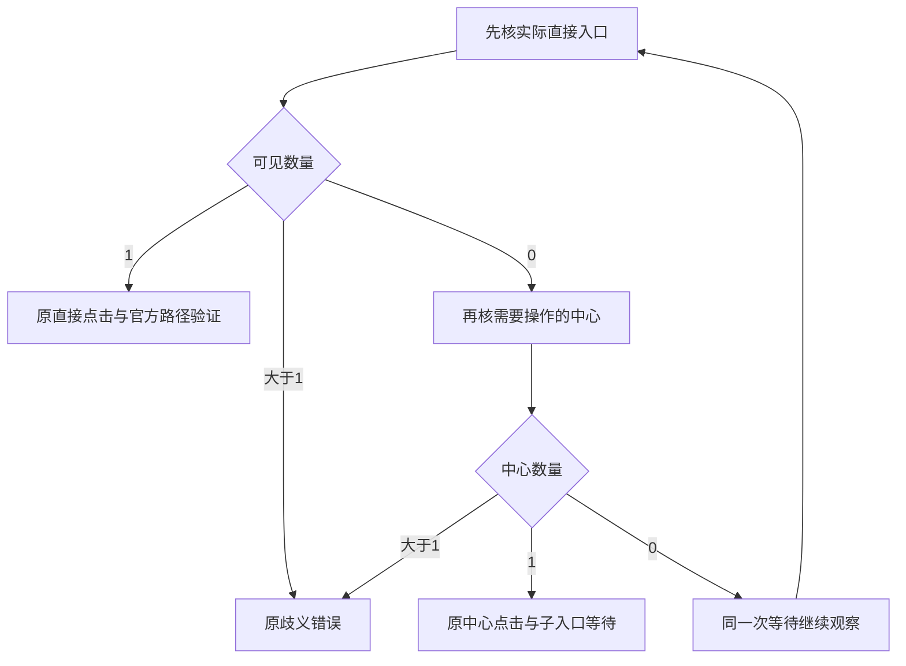

# T1363 窄规格首轮独立审查原件

本轮只审规格；规范 finding 为同目录 `findings.json`，实际裁决由 control 使用 reviewctl 计算。审查时间：2026-10-18T20:10:45.017750+00:00。

按 BACKLOG → 当前 SPEC → PROJECT/PROJECT_CONTEXT → product-to-code-orchestrator 与 stage-router → 物理架构读取。技能和项目流程版本同为3.29.0，context-plan实际返回4-build。独立性如实登记为 homogeneous（当前授权 GPT-6.1 Sol/high）；Root仅审方向，本代理不改规格或状态。原件SPEC为 `SPEC.input.md`，SHA256：de038fecea2c250e4fe2e6285660e999c1892b036174af05f6b48cf412ccedb4。

本次未改生产、测试、SPEC、BACKLOG、manifest或工作流状态；未运行平台、浏览器、采集、登录、测试、服务或数据库，未读用户profile、凭据或原始trace，未commit。只写本目录报告、规范finding、被审SPEC快照及输入SHA。代码结论均为静态阅读，不能冒作当场RED。

## REV-001

FR1363-1的“任一实际可见重复候选保持原歧义错误”与同条“入口唯一可见优先沿现直接路径”冲突。现正式witness `wechat-dom-witness.ts:200–208`：先取entry；只有entry计数为0时才构造、计数或点击centre。entry计数为1时完全不查centre，随后原entry observe与click、官方目标path验证继续。即使centre重复，只要实际entry唯一且后续页面合法，该旧分支也能继续。本轮不能把更严的无关中心门称作“保持原歧义”。

| 输入 | 当前真实消费者的静态分支 | SPEC笼统重复门允许的实现 |
|---|---|---|
| entry=1，centre>1 | 不读取centre，原直接入口click/path | centre重复即REPORT_LINK_AMBIGUOUS |
| 原等待中entry变为1，centre>1 | 新增晚到支持应采用已合法直接入口 | 先判centre重复导致新支持仍被拒绝 |
| entry>1 | 原entry observe报REPORT_LINK_AMBIGUOUS | 仍应失败 |
| entry=0，需要点击centre且centre>1 | 原centre observe报REPORT_LINK_AMBIGUOUS | 仍应失败 |

最小约束是保留实际点击对象的唯一性，不因无关中心重复否决已有合法直接入口。必需验收2中“重复”负族需限定分支，同时补entry=1/centre>1与等待中entry变唯一而centre重复的保护族。该约束不增加selector、深链、公开API或范围，只防新增门反杀合法任务；实现仍需真实公共链验证，本文没有运行通过证明。

## 精确消费者与证明边界

- 正式source `collectNativeReports:299–324` 先同Page身份核验，按channelsDaily→channelsFollowers→channelsWorks执行。入口缺失在prepare，早于日期、下载、parser与commit；当前错误只有stage/kind，无法区分原两个LINK_MISSING等待站点。SPEC承认原1499首因UNKNOWN，候选修复不追认首因，证据边界正确。
- `wechat-browser-source.ts:13–20,48,66–67` 已有typed诊断与白名单；`:257–283` 共享原deadline/signal并finally真实close；新增phase/计数必须在该现有结构内白名单投影，诊断异常不影响原错误/close。SPEC FR1363-3及写集已限定此点。当前没有新字段实现，本轮不代签实际脱敏。
- `wechat-native-collector.ts:175–181` 从已claim lease把可信attemptId、expectedPlatformIdentity、授权profile、原deadline传给collectReports；`persistence-client.ts:4711–4720` 正式组合根可在现onDiagnostic闭包取options.attemptId，故关联不需要公开参数或新存储。callback submit仍经parseReport→service commit，worker无需写库。
- collector原deadline来自run.startedAt+30分钟，原取消/耗尽优先于未停资源；晚onReport被active/acceptingReports与check挡住，真实onStopped才释放profile。SPEC保持这些结果，要求取消/等待/点击/路由/close竞态与同ID完整commit/failRun，不能用prepare替身抛错或孤立helper代签。
- 现wujie-regression为明确合成浏览器/JSDOM；现official-binding integration为真实隔离Chromium但只证公众号身份。两者均不足以代替本任务将要取得的真实DOM入口RED与完整source→backend collector/service port报表GREEN。该证据是尚待执行的验收条件，并非本轮已通过。
- SPEC第7段仅是旧“无副作用最小观察”的条件边界；第9/28/42行明确真实新采集不由本规格自动触发。后续若采用现platforms.collections.start，这是新外部执行且可能下载/保存报表，必须另记副作用、全新clientRequestId/实际attempt/终态与报表，保原1499/1502，不自动第二次POST；不能把它称只读观察。本轮未执行或放行该动作。

本轮只有REV-001这一项major，未把尚未发生的RED、GREEN或真人平台结果写成PASS；不另增公开能力、登录流程、质量门或新威胁模型要求。修订后按现reviewctl复审销账，不能覆盖本轮原件。

## 被审输入SHA256

| 路径 | SHA256 |
|---|---|
| `docs/features/t1363-wechat-video-report-entry-diagnosis.md` | `de038fecea2c250e4fe2e6285660e999c1892b036174af05f6b48cf412ccedb4` |
| `docs/verification/t1363/independent-strategy/REPORT.md` | `dc65f62e1d565905f7389960d6a02e4c44fa9cdbb38a979dae01ad42be8e6165` |
| `docs/verification/t1362/video-collection-readonly/REPORT.md` | `61986519ae8ce5bf1c9b7203aa4a2ebe8f603c4f3e0931e770578bdd601bdfa3` |
| `docs/verification/t1362/installed-entry-readonly/REPORT.md` | `facf77504f60d4a37d84d7f0ffc646a1edcd72969904c1804272b6edab4fa295` |
| `ai-worker/src/runtime/platform/wechat-dom-witness.ts` | `eb22acc8cfc9115f5a20c0f2b104eb91d7e7100ddd83cd63d23cd48c4dfe2d52` |
| `ai-worker/src/runtime/platform/wechat-browser-source.ts` | `6f123299ea111a17db56a690c5b9e53f3cb3736bfcc73b9e8ef5ecf9a65e5a36` |
| `backend/src/application/collection/wechat-native-collector.ts` | `869bf687228bcd1a1fe70f86901e2cf9f872fbc742dd7cc293413208b500003b` |
| `frontend/src/server/persistence-client.ts` | `c534a5f251fa3e844a7ee6e106800b39291bab069aa64a2f1c3d3208ffdf5b12` |
| `contract/src/operations/platform-collection.ts` | `6d77eacf587b7abe1710e75e5c99bd834e59a130d1aacc3aab8826433539f136` |
| `ai-worker/src/runtime/platform/wechat-dom-witness.test.ts` | `aaa5c61c38eec8aaf75c293cf354c8513c086df48cf4a077b1f0a7f7e888ad6a` |
| `ai-worker/src/runtime/platform/wechat-browser-source.test.ts` | `3b23c702247a0e3d30cf1001e9cbf3ad41a863a13a634eb3cfb01258c05e532b` |
| `ai-worker/src/runtime/platform/wechat-wujie-regression.test.ts` | `b581ee9f3448ecc73aecd3a092d68c3d1faa0cf228b5eb611713843c554c1548` |
| `ai-worker/src/runtime/platform/wechat-official-binding-navigation.integration.test.ts` | `f3a3e5ffb025ff5cca11bbdacf9ffb07036ad7d35e8c348d7f8a7c0226494329` |
| `backend/src/application/collection/wechat-native-collector.test.ts` | `008e10ed7e7c819261250e34ee9618c4533c70f9ad5ebad6f7a9c94bc1dfcfea` |
| `orchestrator/SYSTEM_ARCHITECTURE.md` | `eb1826d4c09054df622d9718c38ca372bd19833e72bd1a752757631a5747c1df` |
| `orchestrator/THREAT_MODEL.json` | `c92cb81ee7fd3e213d4b866b49214939fdda58108ff7f242d5add3a9bf2e7574` |
| `orchestrator/process/boundaries.config.json` | `2796209f9d7c22722032f69ec16e6ecc64585fbbe548ee933af4b13abb68cf5f` |
| `orchestrator/process/.skill-version` | `059101410c6bd35df37979a7fc91d59aa840a79aa794736772fe04c45a43838d` |
| `/Users/zyongzhu/.codex/skills/product-to-code-orchestrator/SKILL.md` | `5796cf1b3b9f3de2d45c8e754e3df2146735aa14b266b7c32e2cb4c8638f4c1f` |
| `/Users/zyongzhu/.codex/skills/product-to-code-orchestrator/VERSION` | `db8c5f26ffadff528c3c988af09e26339ee629b449372f4a62f0c357f7329dfc` |
| `/Users/zyongzhu/.codex/skills/product-to-code-orchestrator/prompts/stage-router.md` | `dd656d4b0d886aee9fafa10b61a1db9554e1d424c533dd79693f28ff7447cf1e` |
| `/Users/zyongzhu/.codex/skills/product-to-code-orchestrator/prompts/spec-reviewer.md` | `2b6b78c945d95c06c1d5da76d5ed45e66c1fc19049c41d571be48d7e56800cfb` |
