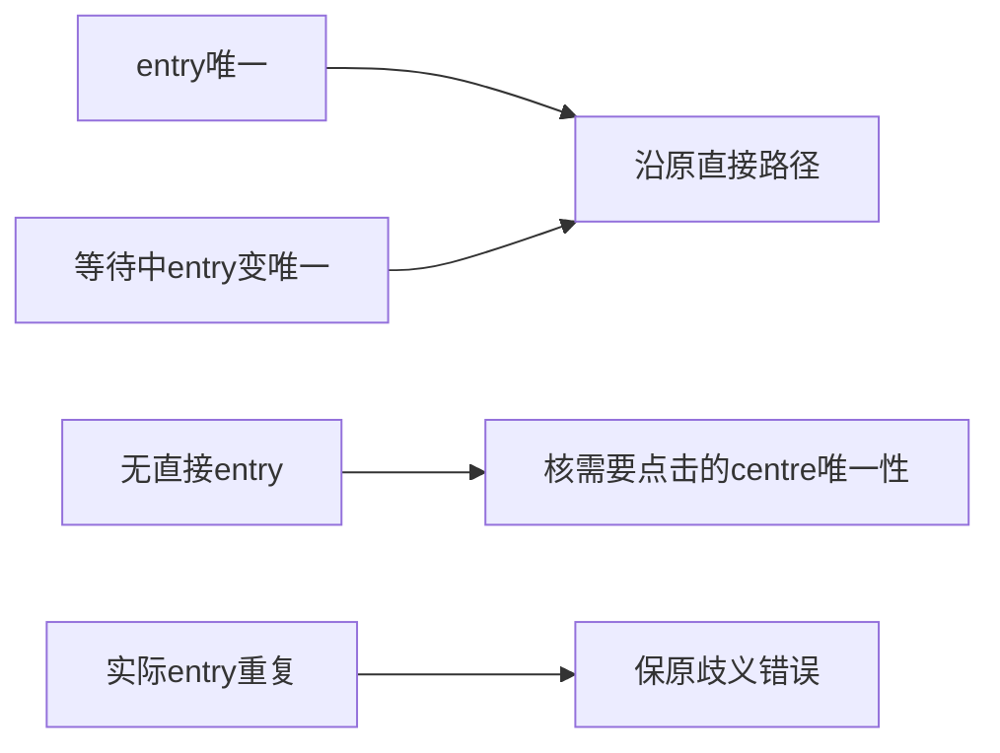

# T1363 窄规格第二轮独立复审原件

复审时间：2026-10-18T20:12:06.501969+00:00。规范packet为同目录 `findings.json`，由control使用reviewctl计算正式裁决。本轮不自行写verdict或中央状态。独立性沿首轮如实登记homogeneous（授权GPT-6.1 Sol/high）。

account_control已确认当前SPEC冻结；本代理已要求交付前保持字节不变。当前被审SPEC SHA256：`6a8fdf09ddda85ed889404e8446234fc8aeeeff1c21543ad5c9d28ff4bbe5319`，原件保存在 `SPEC.input.md`。首轮hash与recheck-context一致；本轮相对首轮仅第25、40行变化，精确差异保存在 `SPEC.diff`，两个changed_line_refs均经行指纹核对。

## REV-001销账

当前FR1363-1明确三个决定：entry=1优先原直接路径且不因无关centre>1失败；entry>1保持原入口歧义；只有entry=0且需要点击centre时才核centre唯一性。等待中entry变唯一同样优先直达。该约束与首轮已核正式witness的直接分支一致，消除了“任一重复均失败”对旧合法路径的反杀风险。

验收2同步增加“entry=1且centre>1”和“等待中entry变唯一且centre重复”两个旧合法保护族，把重复负族限定为entry>1或entry=0且centre>1。原缺菜单、隐藏、中心后缺入口、非官方、错误身份、明确扫码、取消/期限/关闭确认与完整公共collect验收仍保留。

因此REV-001仅以规格文本和精确diff证据标为resolved。规范packet完整携带首轮finding，除status与resolution_evidence外所有字段逐项保持，severity仍为major；没有删除或改写冻结通过条件，没有新增finding。本轮差异未引入新公开操作、selector、深链、登录流程、预算、存储或产品方向。

本次未改生产、测试、SPEC、BACKLOG、manifest或工作流状态；未运行测试、浏览器、平台、采集、登录、服务或数据库，未commit。真实DOM公共链RED→GREEN及新实现的取消/停止/脱敏等行为仍待执行。原1499首因继续UNKNOWN，不能由规格销账推成真人平台采集已恢复。

## 输入SHA256

| 路径 | SHA256 |
|---|---|
| `docs/features/t1363-wechat-video-report-entry-diagnosis.md` | `6a8fdf09ddda85ed889404e8446234fc8aeeeff1c21543ad5c9d28ff4bbe5319` |
| `docs/verification/t1363/spec-review/round-1/findings.json` | `5e72d63856698f6aef675e5807615e6c3d26f0b7cf1939ace670090e6815d703` |
| `docs/verification/t1363/spec-review/round-1/recheck-context.json` | `28b10a518142e22bdf42d2a895c787d074cb121f8b3f497691dcbdab92d67fdd` |
| `docs/verification/t1363/spec-review/round-1/SPEC.input.md` | `de038fecea2c250e4fe2e6285660e999c1892b036174af05f6b48cf412ccedb4` |
| `docs/verification/t1363/spec-review/round-1/REPORT.md` | `97e54cd5375f7b2e2a6362367d16c73aa2dbd8e7f663c9ec96392fa553ca1435` |
| `ai-worker/src/runtime/platform/wechat-dom-witness.ts` | `eb22acc8cfc9115f5a20c0f2b104eb91d7e7100ddd83cd63d23cd48c4dfe2d52` |
| `ai-worker/src/runtime/platform/wechat-browser-source.ts` | `6f123299ea111a17db56a690c5b9e53f3cb3736bfcc73b9e8ef5ecf9a65e5a36` |
| `backend/src/application/collection/wechat-native-collector.ts` | `869bf687228bcd1a1fe70f86901e2cf9f872fbc742dd7cc293413208b500003b` |
| `frontend/src/server/persistence-client.ts` | `c534a5f251fa3e844a7ee6e106800b39291bab069aa64a2f1c3d3208ffdf5b12` |
