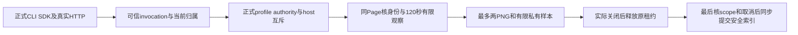

# T1364 backend / canonical 实现交付

> 后续独审发现的私有错误泄漏与scope未知误判已另做窄修。当前候选请以 `SOURCE_FREEZE_STORAGE_FIX.json` 及 `STORAGE_REVIEW_FIX.md` 为准；本页公共04六例和旧SHA是保留的当场历史，未冒充新八例全链重跑。

受控诊断能力已打通；本轮没有打开真人微信后台，也没有重发采集。原281、1499、1502、1726及安装e676保持原事实，不能由本轮合成成功签采集恢复。

## 冻结范围与接口

28个源码/测试文件的SHA见`SOURCE_FREEZE.json`。最终公共运行前后SHA完全一致，清单摘要`46585cb5ddc6df104e19d5798590bf02a1a92b0e72b5365e90abaaeb006ff15e`，见`public-final-04-meta.json`。

新增唯一`accounts.wechatNavigation.diagnose` / `POST /accounts/:accountId/wechat-navigation-diagnosis`，strict accountId/空body、group scope、write/gateway；默认off，仅正式可信CLI invocation可启动。四canonical包装只向该op传真实signal与可信invocation第四参，旧op保持三参。backend持有当前归属冻结、跨重启wx一次准入、私有manifest与缓存scope复核。worker不读写DB。host lifecycle只追加readonly真实auditReceipt，不改恢复、排队或释放算法。

总预算2580000的真实消费者及提交线性化点见`BUDGET.md`。最终IO准备前后的取消、scope变化不会生成有效旧图索引；实停与DB释放分开记录，未停/释放失败保持pending和原资源。

## 当场验证

- 公共最终六例PASS，131.88秒：真实Chromium中文投影、默认off、坏配置旧操作可用、原120秒正链/两PNG真实解码与SHA/私有manifest/样本、同key缓存与scope变更拒绝、同key running及不同input冲突、真实TCP断连的Next ResponseAborted→实际close/lease、截图期间真实成员转组与证据隔离。没有创建或更新CollectionRun。
- backend业务及host lifecycle 29PASS；contract新op schema/policy/scope/观测库存/endpoint bootstrap 60PASS；原frontend dispatch/pagecache/platform-account 36PASS，spy类型修正后pagecache最终4PASS。
- backend、contract、frontend最终类型exit0；worker四文件168PASS及worker types0见`../worker/RESULT.md`。
- timeout-policy完整八组检查完成；boundary新增0（保基线5）、semantic通过、orphan 0error/100warning。完整原件均在本目录，不把这些结果扩写为全局reconcile全绿。

## 保留的失败与因果边界

公共RED02的新op缺失404只证明原能力缺失。准备01相对import错误0test不计RED；其后私有根夹具、中文响应charset、内存固定时钟的缓存scope夹具失败均保留原日志，修正真实夹具条件而未放宽断言。最终缓存变更以正式group service递增version验证。

registry仍1FAIL：旧prediction-lock GET source与POST start二路由缺库存。`git archive e676`隔离同入口实跑同样4PASS/1FAIL、相同两缺项；原件/源码SHA见`contract-base-registry.log`及`BASE_REGISTRY_IDENTITY.json`。本delta只补当前新op route，未顺手补旧两项。

## 正式配置与下一步边界

可信配置消费在新service，异常JSON只拒该op，不阻断bundle/旧读。变量`CREATOROS_WECHAT_NAVIGATION_DIAGNOSIS_CONFIG`含authorizationId、准确group/account、canonical私有根及冻结source SHA；请求不可覆盖。静态已核Tauri lib.rs的std::process::Command构造不env_clear，标准环境继承可达正式sidecar；尚未实际启用。后续Root若放行，须按正式安装/单runtime身份验证执行，不能用开发实例共享用户库或热改安装资源。

本次未commit、未taskctl、未改中央文书。代码候选与证据交Root/control整合及独立实现审阅；真实导航与打包仍由Root另行放行。
