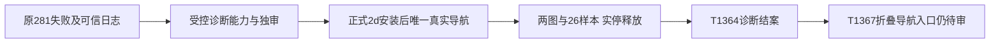

# T1364 真实只读导航诊断结案

唯一真实导航诊断已完成，Root已实际看两图并确认下一步。**这里只完成诊断；视频号采集仍未恢复，原281失败页面与首因仍未证明。**后续修复需求已置顶登记T1367，待真实折叠导航证据补齐和独审，未start。

## 本次实际结果

正式安装源`2d3826ef164241860437daa393d336d9b042f980`，后续文书HEAD不冒安装源。唯一canonical调用为`req-3547e2dc-238` / `cli-inv-3547e2dc-239`，2026-10-19T00:56:37.833Z开始，实际127.918733秒、completed/reason null、identityMatched=true、sampleCount=26。CLI外8400000ms/backend原2580000ms不变，未续期、未第二次POST、未collect/bind/login/retry/publish。

物理关闭2026-10-19T00:58:45.381Z、原lease callback释放00:58:45.385Z，stopPending=false；browserOpened/contextCloseStarted/physicalStopConfirmed/hostLeaseReleaseConfirmed均true。执行helper核真实leaseId/hostOperationId及manifest一致；未另独立CLI重读DB租约，不能把存在receipt本身当关闭证据。原authorization/marker/私有图保留，不删标记制造新额度。

Root已实际查看identity_verified与observation_end两帧：首帧加载中，末帧后台首页作品已正常加载，左侧仅折叠图标。两图SHA分别为`876c3c4a5617f77188c756532d7dc2adec06c7554d9487509d27678ce14141bd`与`a8082367780bbacf7a67e3f998e1de2c717b08e2fe69a33c24b27ea5b1d1a17a`。26样本top readyState complete、entryExact2/visible0、centreExact2/visible0；navContainer unknown、menuCandidates空、overlay0。匹配文字存在但不可见；尚缺隐藏标签祖先role/tag/可访问名/bbox/命中信息，不能据此签任一fallback覆盖真实DOM，更不能猜selector或强点隐藏标签。原私有export rootActuallyViewed=false是先前快照，保原不回写；Root后来实看旁证单独引用。

实停释放后fresh活动0，正常退出配置实例与子树；正式main无诊断config启动PID55420，5.826389秒Ready，source/main/tar/stamp仍同2d。没有第二次diagnose探off，也没有重复安装连续120秒门。T1365安装原PID47707/startup125.669秒/独立连续120.430秒属于先前安装验证，当前默认恢复时间分别记录，不能混用。

## 保留的失败与下一步

原`collection-92ecb053-281`仍为2026-10-18T22:45:43.005Z—22:47:48.452Z、125.447秒failed/EXPORT_FAILED、committedPages0、generation2。原1499/1502与公众号1726仍失败，公众号accountId=null且未真人新绑定。当前导航观察不倒推原281页面；受控T1363/T1364工程通过也不代签真实采集。

下一步T1367《恢复视频号折叠导航下的报表入口》先补实际导航结构、可见合法动作与旧输入保护，再冻结精确合同/写集/公共RED交独审。当前仅文书登记，无新平台操作、产品修法、打包或安装。

候选2d唯一完整reconcile原exit1/1300.595秒、56ERROR0WARN保留：44旧身份非全同因、2本次宽收据、8缺旧ignored产物、2新LED fire。两单门后验环境缺件与原full子因UNKNOWN分开；沿T1366登记，不写全局通过。本次无产品变化，按Root明确授权复用该实际对账，仅pmem同步/taskctl结案和纯文书提交，不重跑full/旧UI/构建。

## 证据与隐私

机械最终白名单为同目录FINAL_DIAGNOSIS_RESULT.json，输入路径/SHA在SAFE_INPUT_SHA256.json；只读取Root明确允许的新根脱敏摘要和执行报告。私有截图、真实稳定identity/scope证明、正文URL、key/config/env/raw和私有manifest均未复制入Git。原生App pixels及dirty接口未验，平台浏览器两图不冒App像素。foreign9及T1255原行当场逐字保护。
