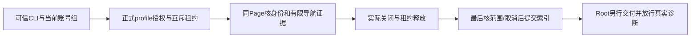

# T1364 独立实现审阅

已审最终冻结字节，未发现未关闭的可定位实现缺陷，规范`findings.json`为空。此结论仅覆盖本轮实现与受控证据，不是已安装App、新真人导航或视频号采集恢复证明。R2 SPEC SHA为`bd1e0a0691ba51c9865a3fd1e94335c6e2a4e164210de1e70798b0a86004b119`，正式规格收据REV:87037c871295未替代本次实现审。

审阅对象为`/Users/zyongzhu/.codex/worktrees/t1364-wechat-navigation/Thirdspace-creator`相对e676的未提交字节。逐文件复核最终28项冻结清单，27项实际变化（17生产、10测试），另1项原dispatch测试作为保护输入未变；没有清单外产品改动。最终清单摘要为`6a8589e98d8b03d3701a51fb1925515edb0273b371eb1466f9258005e5c7d9a5`。独立保存的精确变化见`REVIEWED.diff`，SHA256为`025ab56f7372d6f8c5638a7e663db0435a87e0deb72a8281bf60f70b0f2ef1dc`。完整source/test、只读消费者和证据文件SHA在`inputs.json`。

大白话：这次做成的是“安全看清同一账号后台导航”的能力。受控页面已经能走通；真实微信页面还没有执行，不能说采集已经恢复。

本审仅写主树implementation-review目录，没有执行测试、浏览器、平台、打包安装或任何POST，没有读取真实profile、凭据或用户库，没有修改产品/中央状态或提交commit。以下测试结果均来自亲读执行者保全的原件，不冒充Reviewer自行重跑。流程版本3.29.0；按4-build已批准窄写集审阅，无新增UI或产品方向要求。

## 实现与消费者核对

- canonical新op为`accounts.wechatNavigation.diagnose`：strict accountId、空body、拒query及任意浏览器/目录/预算输入，group scope、write/gateway、默认关闭。dispatch只从真实req.signal和gateway invocation构造可信第四参；失效无CLI invocation不能启动。page invalidation、composite、application owner、platform transport均只向该op转发第四参，旧op仍三参。新配置延迟消费，坏JSON只拒新能力，未把可选配置错误变成bundle/旧账号读取失败。
- backend要求非空真实组，以assertOwnedAccount及真实account/group/membership read ports冻结user、active、WechatVideo稳定身份、group version、membership id/version和account updatedAt；不虚构account数值version。正式目录仅经原profileAuthority与host lifecycle取得，不接外部profile或借generic Lane。host排队后、guard启动尝试后首次goto前、身份、采样/截图前后及发布前都有新鲜检查；membership ABA由id/version识别。
- 一次准入以受信authorizationId的私有wx标记绑定首可信invocation，启动前消耗；重启仅回原安全结果，同invocation缺索引为UNKNOWN，不再launch。不同invocation不能靠换key绕过。成功缓存走同backend scope port复核当前冻结证明及私有索引完整性，变化/未核实均拒旧图，不再次执行。marker损坏保原件，不删标记重获额度。
- worker新增observeNavigation复用同Page、身份witness与guard；不调用report prepare/date/download/parser/业务commit，不领或改原CollectionRun。先核expected稳定身份再观察普通官方页面，不猜深链或菜单，不登录/绑定。结构可区分top/frame/跨域frame/open Shadow/不可读Shadow、隐藏、遮挡、真实候选文字与无容器UNKNOWN；closed Shadow不被伪装成已读内部。两viewport帧及最多32份私有样本真实保留，初末0/0仍能见中间菜单出现；中间样本只存有限机械汇总，菜单文字仅两snapshot、每帧128项×80字符。无全DOM/body/URL/query/href/网络正文输出。
- backend私有根/run与文件核canonical、owner、0700/0600、非symlink和大小；worker额外核固定/tmp根及路径组件，wx临时写和原子完成。公开DTO仅安全状态/时间/计数、opaque artifact/hash与停止事实，不包含正式profile、平台稳定身份、菜单正文或私有路径。取证失败不另开浏览器或重跑诊断。
- source旧collect/login/readIdentity不采用新诊断的有限close等待；旧witness selector、collector/parser及通用guard算法未改。可选诊断IO失败仍不反杀旧采集错误。host lifecycle只追加Object.freeze的真实leaseId/hostOperationId审计引用；引用存在不代表已停止。guard实际close成功/close事件之后才onStopped，DB释放成功才置release confirmed。未启动释放与物理关闭分证，close/释放失败保stopPending、原占用与shutdown重试职责。
- 最终预算为2580000ms：host120000 + source2330000（含自身completion10000）+ backend结算120000 +末端10000。相对先前2570000补足的是source原aggregate余量；同一新run只冻结一次startedAt/deadline，不续原281或本run。真实CLI8100000/8280000观察未改。耗尽/取消停止后续动作，清理等待不重给预算。

最终有效结果的完成点已落实：manifest/result.prepared异步准备，最后await既定scope读回，随后在同一无await段核原signal、绝对deadline及canonical目录，用renameSync提交result.json并返回。此前已收到取消/范围变化/未核实只提交无图隔离安全摘要；此后才到的取消不倒改已完成事实。没有将竞态要求无穷延展到未来响应发送事件。临时文件不是有效结果索引。

## 审阅中关闭的问题

1. **嵌套frame可见性**：最初display:none推演被真实Chrome反证PASS，未记成RED；随后visibility:hidden和opacity:0两族实际RED证实内层root被误记可见。最终按祖先深度处理frame并传播祖先及本frame视觉可见性；两真实红例保留，相关13例GREEN及最终168例包含原断言。该窄修不触selector或平台动作。
2. **close/最终IO期间取消晚发布**：先前backend可收到已观察结果后置cancelled，仍提交旧图；最终已将取消与发布授权守到上述同步完成点。close期取消、私有IO准备后的取消都有窄保护，取消后的有效图索引清空、原私有观察隔离；同scope无图安全终态仍可同invocation回读，真实scope变化则拒旧证据，缓存策略一致。
3. **私有错误与未知归因**：fs/JSON异常先前经dispatch原样返回路径/私有片段；两真实HTTP RED已证实。最终仅新diagnose/assertCachedScope包safeDiagnosticPort，固定本op协议/合法typed拒绝之外统一STORAGE_UNAVAILABLE，不改旧op全局错误语义。另先前把暂时scope读取错误误报SCOPE_CHANGED，实际一RED已证实；现仅真实hash差异或明确ownership/active/platform失效标范围变化，未知读取为SCOPE_UNVERIFIED/unknown、停止并隔离。缓存未核实固定拒绝，无私有message/stack/details泄漏。

当前未保留open finding；上列修正均已重新读最终源码与对应证据，不因作者称“已修”直接销账。

## 真实受控证据与边界

证据均在该worktree的`docs/verification/t1364/worker/`与`backend-public/`，其SHA完整记录于inputs。

|实际运行|亲读结果及边界|
|---|---|
|公共RED02|旧版新op缺失404导致真实CLI→HTTP断言失败，只证新能力缺失，不证平台首因；准备import错误0test不计产品RED。|
|worker最终05|4文件168PASS、134.13s、retry0，含原source86、新结构18、原entry27/witness37；真实120秒、两PNG原生解码/canvas/SHA/0600及0prepare/0download；注入释放回调不代真实DB lease。|
|公共final04|6PASS、131.88s、exit0，28项运行前后零漂移；真实SDK/fetch→TCP HTTP→Next16.2.9生产适配器→POST/四包装→合成owner/authority/host lease→真实Chromium/source。涵盖正常120秒/两PNG、成功缓存/变scope拒绝、同key状态/冲突、真实ResponseAborted断连、真实成员转组、实际context关闭及DB lease releasedAt。它对应旧清单46585cb5…，不是最终3文件窄修后重跑。|
|最终错误窄delta|仅新service、其unit、公共test三文件变化。storage-error-red-02两FAIL→green-02两PASS；其余原6例筛选skip，不能称当前八例全链重跑。backend全30PASS含未知读取及原host保护。静态核新增生产差异只包错误端口/区分未知，不改公共04已验的正常导航、身份、取消完成点、租约或worker。|
|其它定向门|contract直接60PASS及types0；原frontend保护36PASS、pagecache最终4PASS；backend及最终frontend types实际0，worker types0。timeout-observed-final-meta记录真实subprocess returncode0；新boundary/semantic/orphan meta各0，boundary保基线5，orphan0error/100warnings。不是全局reconcile全绿。|

Next信号装配另作过只读生产消费者核对：本机16.2.9 app-route模板正用NodeNextRequest与signalFromNodeResponse(res)，default app-route请求代理透传signal；项目/api proxy无rewrite，handler等待期间未提前结束ServerResponse。因此本机HTTP装配能验证FR10所需TCP断连→服务停止链。公共测试在body已读、observer活跃且res未finish时断开，核真实ResponseAborted、无晚截图、context实停与原lease释放；正常finish→close不误取消。该证据不覆盖已安装Next路由、打包链或真人页面，后续交付仍须独立验证。

保留旧失败：worker首轮私有根夹具及Sharp依赖失败；public01根路径、02中文charset、03固定内存时钟未改变account updatedAt的夹具失败；最终缓存保护改用真实group version递增，不放宽断言。新增HTTP test首次unknown属性访问类型exit2原件保留，等价toHaveProperty修正后最终types0及两负例重新通过。

contract registry仍有1FAIL：两条prediction-lock路由缺库存。隔离git archive e676同入口真实4PASS/1FAIL且缺项相同，本delta只增加新诊断单route；未补旧两项或将其写绿。原global44、foreign9/T1255、281/1499/1502/1726、已安装e676与历史false快照不由本审改写。

当前实现审允许Root依据上述最终字节及分证结果作后续工程裁定；没有预签commit、打包、安装、真实配置开启或平台诊断。真实导航仍须正式单一受管运行时与Root的唯一执行放行；其结果不能回填原281页面/登录态，也不能直接证明采集恢复。
