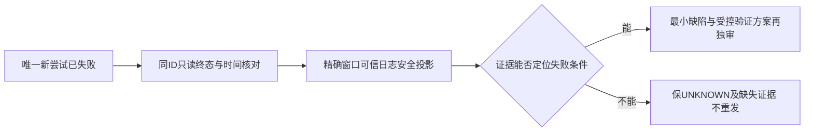

# T1364 核对新安装版一次视频号采集失败

## 用户目标与当场事实

用户明确视频号采集失败，其它平台已成功采集却看不到作品，并要求不再问他、由Agent自主测试验证。T1362已闭合真实作品入口；T1363只闭合“既有直接入口晚到”的受控缺陷和安全诊断，不能把其受控GREEN写成真实视频号恢复。Root 2026-10-19在e676同源安装核验后，另行放行唯一一次新owned采集。

Root交接的新真实attempt为`collection-92ecb053-281`：从UTC时刻`22:45:43.005Z`至`22:47:48.452Z`，125.447秒后`failed / EXPORT_FAILED`，`committedPages=0`、`generation=2`。完整UTC日期、对应account/group和来源文件由随后安全原件绑定，当前不补造。唯一POST使用预先保全的同一key；本任务不读取或复制该key，不重POST。generation不是执行次数，不能从gen2推出两次POST或两次实际采集。

新包源码`e6769b474fde3db583bf08b04104e4f3a57bd6c9`；其产品为eb19124ed、实际UI strict为721，六产品目录tree全等，见T1359 SOURCE_FREEZE。原视频号`execution-task-bd28c55d-1499`及AI1502、原公众号1726和所有旧失败完整保留。125.447秒不能单独证明120秒超时，EXPORT_FAILED不直接证明失败在下载或selector；0页只证明无已提交页，不推出尚未开窗或从未下载。

大白话：新版这一次仍没有采集成功。先把“这次真正走到哪一步、在哪个已证条件下失败”查清，再决定最小修法；不能再发一遍去碰运气。

## 诊断合同

- **FR1364-1 原尝试与归属冻结**：只关联本次真实attempt及其实际user/group/account/运行窗口；公开GET只跟踪同ID，不发retry/resume/cancel/new collect/login/bind。原1499/1502与所有旧状态、报表、profile/auth不改。若public读回或日志没有归属字段，记UNKNOWN，不靠时间接近或相同错误码拼成同一attempt。
- **FR1364-2 可信日志最小投影**：承接Root已授权且正在执行的精确attempt+窗口日志读取，仅保存stage/kind/code/entryObservation及必须的时间/可信attempt关联字段；entryObservation只沿生产已有固定phase/计数/是否点中心白名单。保原密文/原件的私有路径、SHA和采集方法，不复制密钥、整明文、DOM正文、URL/query/href、Cookie、profile内容或用户采集正文。已有事件没有字段就未知，不回填。
- **FR1364-3 因果与候选分开**：将公开终态、现有安全事件及e676实际source/witness/collector消费链逐项对照，区分入口观察、点击、目标路由、日期、下载、解析、提交、关闭/租约等实际能证范围。没有可信事件时不猜selector、登录状态、超时首因或T1363仍未生效；原任务与新attempt的不同来源不能互相代签。
- **FR1364-4 不扩大执行或产品写集**：本轮仅证据诊断，不新POST、不读写凭据/用户库、不改产品或运行参数、不延长原期限、不重包、不重跑reconcile/Next/大门。若证据支持某个确定缺陷，先给可区分的受控公共RED/保护族和精确源写集，另行修订SPEC并独审后才实施；若需要进一步真实动作，由Root先限定owner、原deadline和唯一动作，不自动继承此次已用完的一次POST额度。用户已睡觉，不索要扫码、截图或回答。
- **FR1364-5 安装交付分证**：T1359真实构建、安装、连续稳定与清旧事实可按其证据结案；不得将本次新视频号failed改写为恢复。构建前false历史快照不回改；最终全局44ERROR分类、foreign9和T1255工作原行保护继续。

## 精确写集与只读输入

写集仅`docs/verification/t1364/**`与本SPEC；BACKLOG/DEC/阶段登记由control唯一writer维护。独审者只写分配的review子目录。没有生产、测试、契约、存储、App资源或用户数据写集。

只读：T1359 SOURCE_FREEZE/安装安全摘要及本次新attempt的Root安全投影；T1363原RED/GREEN/实现与诊断类型；`wechat-dom-witness.ts`、`wechat-browser-source.ts`、`wechat-native-collector.ts`及persistence现onDiagnostic装配消费者。需要源身份时以e676 Git对象/安装attestation核对，不把主树foreign字节当安装源码。私有原件只由当前已授权执行者按精确范围读取，本任务不派第二组重复decoder/日志扫描。

## 验收与停止条件

1. 新attempt同ID终态、UTC完整时间、可信归属与single-POST事实有原安全来源和SHA；未知字段明确保留，不补造父任务ID或业务计数。
2. 安全投影和当前消费链能区分“已证失败阶段/错误”与候选/UNKNOWN；保此前T1363受控成功、原1499失败和本次281失败三份独立证据。
3. 给出最小下一步：证据支持时精确受控验证/保护族；证据不足时写明缺少哪项观测及为何现有字段不足。不输出无依据修法，不以再次POST、模糊选择器或增timeout代替调查。
4. 独立SPEC审阅通过后方可进入本任务正式执行/收尾；待审登记不阻止Root已单独授权的在途只读投影。诊断无源码变化，不触发重复全局或无关UI测试；后续若扩实现，按实际消费者重新定门。

当前仅待独立审阅，未taskctl start、未修改生产或发任何新请求。原用户任务继续排查，不能因T1359安装成功结束问题处理。
