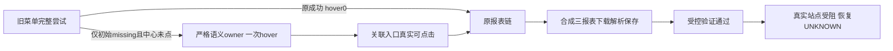

# T1367 受控实现结果与实际平台受阻

本轮代码已完成受控实现与验证，尚未证明真实视频号采集恢复。正式App仍为已验证2d，新的受控代码665没有打包或安装；site-safety已拒绝目标页面观测，不通过collect、诊断、另一浏览器或CDP绕过。T1367仍未完成，已按Root终审授权由taskctl block记录外部验证受阻。

## 产品与安全边界

产品commit `665508e66ee4bf46a6ebe3267ce4887c92964e18`，精确4变更：witness、source与source测试、原channels公共集成测试。witness.test未改，但作为五库存保护输入绑定。独立实现审无未关闭finding，报告及最终SHA见implementation-review/与control/PRODUCT_INTEGRATION.json。主树和独立新tree产品字节全等，foreign9/T1255未纳入。

只在原initial wait_entry_or_centre确切REPORT_LINK_MISSING且中心未点击时，才在原持久期限内独立恢复。旧成功不受新门、25原输入族hover均0；恢复要求精确标准语义owner和DOM或明确aria-controls关联entry，tooltip/无关浮层不点，不猜坐标/深链/宽祖先。hover前owner可行动，hover后保身份/语义/关联，真正entry点击前仍严格可见enabled命中。每报表增加三个真实120秒串行成本，source默认7370000→8450000ms，原collector绝对期限照旧裁剪，不续期或借清理余量；不是性能优化。

## 实际验证与原失败

|输入与来源|真实结果|边界|
|---|---|---|
|旧生产公共RED|exit1，实际120319ms入口missing、0hover/0下载/0提交|不是手抛错误；原测试快照/行号漂移说明保留|
|89d6完整公共|60PASS，exit0，304.05秒；主121374ms/首次hover120322ms|新源只继承未变观察时序，不继承整个总结果|
|IMPL001后置owner RED02→GREEN01|7.87秒exit1→8.67秒exit0，五项真实DOM proof成立|首RED01只hover自身超时不冒后置缺陷RED；旧FAIL保|
|最终d1公共|60PASS/1skip，exit0，182.81秒|唯一skip是前版真实120主例；不称最终61实跑；旧25集合各hover0|
|最终模块|source89PASS；witness/Wujie/公众号3文件59PASS；worker types/timeout静态exit0|原types六FAIL和辅助夹具FAIL不覆盖|
|完整既有timeout门|174PASS/exit0|19消费者hash未变有限继承，不冒最终重跑|
|最终三扫描|boundary/semantic/orphan均exit0|旧boundary5/orphan100warn保；非全局对账通过|

全部平台origin请求由本地合成route处理，其余abort并阻断真实DNS，私有合成profile/内存PGlite，实际source/collector/parser/service事务和公开同run读回；physical close与DB lease释放分别真实确认。未访问被拒真实页面、用户库或正式profile，没有真实collect/诊断/登录/发布/付费或App变化。

## 真实未解决部分

T1364两图仅证当时左栏折叠、固定标签隐藏；真实owner结构和hover机制仍缺证。原281仍failed/EXPORT_FAILED/0提交页/gen2，原1499/1502与公众号1726仍失败，公众号未真人新绑定。受控GREEN不能倒推原281首因，不能签真实平台恢复或整个用户需求完成。

## 全局对账与收尾

原唯一665完整reconcile子进程已结束，原输出58ERROR/0WARN；对旧2d的56个错误身份全保留，新增LED-053与LED-060两个fire。原子检查输出被ignore，两新fire首因仍UNKNOWN；旧timeout174PASS或最终静态0不能覆盖本轮失败。同身份T1354旧source漂移仍在，本次又增加witness字节的宽收据交叉，不能藏进旧债或另计成新错误身份；T1356 persistence仍是原漂移，本次未改该路径。

wrapper在child.wait返回后生成元数据时，git status因index.lock写入ENOSPC退出128，wrapper自身exit1；child实际退出码未保存，必须保UNKNOWN，不能从footer或wrapper1推断。权威原件索引为control/RECONCILE_665_META.json与RECONCILE_665_IDENTITY_DIFF.json，安全分类见control/RECONCILE_SCOPE_CLASSIFICATION.json；原日志已按该索引私有保全，没有第二次full。

Root已授权T1368仅做两条原门各一次的精确后验和实际消费者/hash分类，现经独审及Root复核完成。LED053在获批系统沙箱内一次真实退出0、37.626秒，174PASS/静态0且八组全部执行；环境不同于原full，不倒填本轮首因或child退出码。LED060一次真实退出0、23.307秒，完整build→worker19PASS→backend52PASS；原两fire首因仍UNKNOWN。范围、原件和消费者分类见../t1368/REPORT.md，T1354宽收据未刷新。T1367真实恢复仍UNKNOWN/site-safety受阻，taskctl block已实际exit0并记事件，未complete；T1368诊断taskctl complete亦实际exit0并记事件，不能代签本产品恢复。

安全汇总在control/CONTROLLED_RESULT.json，执行者原件在worker/、source-validation/、central-gates/final-d1/。所有合成原失败/原日志私有保全，映射及SHA在control/EVIDENCE_PRESERVATION_INDEX.json；只将安全报告/摘要/哈希和独审原件纳Git。真实截图/稳定身份/正文URL/key/config/env/raw私有平台工件未复制。正式安装源仍2d，中央文书后续HEAD另列。
