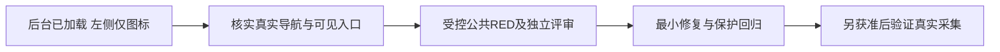

# T1367 恢复视频号折叠导航下的报表入口

## 用户目标与当前阶段

用户明确视频号采集失败，要求自主测试、验证、尝试，不再向其提问。本任务继续解决这一未完需求：在真实后台的折叠导航状态下，让既有合法报表入口可达，再通过实际公共采集链验证。当前仅登记事实与最小候选，处于 PLAN / CONTRACT 待定稿；未 start、未指定生产修法。Root已委派只读源分析，须据其结论补齐精确合同、写集与公共 RED，独立评审后才进入实现。

大白话：后台已经打开，作品也加载出来了，但左侧只显示图标，原来依赖可见文字的找入口方法没有找到报表。先确认该导航实际怎么展开或打开，再修合法操作；不能强点不可见文字来碰运气。

## 已发生事实

- 已安装产品源为 `2d3826ef164241860437daa393d336d9b042f980`。T1364唯一真实只读诊断为 `cli-inv-3547e2dc-239` / `req-3547e2dc-238`，实际127.919秒、completed、identityMatched=true、26次采样；该操作不是采集。
- Root实际查看两张私有图：左侧导航仅图标、文字不可见；末帧后台首页作品已正常加载。26样本均top readyState=complete，entryExact=2/visible=0、centreExact=2/visible=0；navContainer=unknown、menuCandidates为空、overlay=0。上述空/unknown不证明页面没有入口，也不证明其具体DOM结构。
- 初始图SHA256 `876c3c4a5617f77188c756532d7dc2adec06c7554d9487509d27678ce14141bd`；末图SHA256 `a8082367780bbacf7a67e3f998e1de2c717b08e2fe69a33c24b27ea5b1d1a17a`。只保存哈希和必要状态；图片、正文、真实稳定身份、页面URL和私有manifest不入Git。
- 实际物理close为2026-10-19T00:58:45.381Z，原lease callback释放为00:58:45.385Z，stopPending=false。执行者已恢复无诊断配置的默认off，正常App PID55420，Ready5.827秒，产品main/tar仍同2d；最终安全报告待收。此处是Root已读结果，不补造执行方原件。
- 原 `collection-92ecb053-281` 仍failed/EXPORT_FAILED、committedPages=0、generation=2，125.447秒；原1499/1502及其它失败不动。当前页面只证明本次导航诊断状态，不能倒推原281页面或原始首因。T1363受控修复和T1364诊断完成均不等于真实采集恢复。

## 最小候选与未证事项

候选仅为：现有依赖可见精确标签的入口观察，在合法折叠图标导航状态下可能遗漏实际可达路径。当前还缺隐藏标签祖先的role/tag/可访问名/bbox/命中信息；尚未证明展开控件的可访问名称、角色、状态、真实容器、点击分支唯一性、展开后原标签可见性，也未证明应走展开、悬停或另一现有合法导航动作。不得据截图猜selector、深链URL或预定修法。

只读源分析应首先回答：实际入口/导航消费者在哪里、当前观察遗漏哪些确定状态、能否沿现有语义与可见控件恢复、哪些旧合法输入必须保持。若现有私有证据不足以确定真实DOM，应明确缺证及下一次有区分力的最小动作，先交Root审范围，不重跑collect获取同一个失败码。

## 必须保留的实现与验证边界

1. 仅同owner、同真实账号、同Page/受管profile、官方origin、原signal/deadline/资源租约的合法导航。保当前身份校验、scope变化取消、唯一性、物理关闭与lease释放分证。
2. 不强点隐藏标签、不通过nth/坐标猜目标、不注入DOM改变可见性、不硬编码未知页面路径、不放宽重复候选为任取一个、不把等待重新起算或吞掉非目标错误。旧直接入口/中心入口/延迟入口及歧义、取消、登录/归属错误仍需各自保护。
3. 公共RED必须经真实入口调用及受控真实DOM，不以手抛错误/helper自报替代。GREEN要证明同一合法折叠态能到报表且仍有真实采集/解析/保存的适用保护，不把仅展开菜单或只读诊断完成写成采集完成。具体族与命令待源分析定稿。
4. 本次登记不授权新POST、复用已消耗的诊断准入、删除marker、改凭据/用户库、热改安装资源、第二个共享用户库/正式profile的开发实例或重新打包。后续真实诊断/采集须按Root明确单次范围执行，保同ID终态、不盲重发。
5. 安全材料仅保stage/kind/code/计数/资源回执/必要哈希；私有图、稳定身份、scope明文、正文URL、key/config/env/raw不复制入仓。已有global56/T1366与foreign9/T1255保持原件，不以新诊断完成洗绿历史。

## 当前写集、依赖与验收待定

当前写集仅本SPEC、`BACKLOG.md`对应新行、`orchestrator/DECISION_LOG.md`的DEC-136701与`docs/verification/t1367/**`安全上下文。生产/测试写集尚未授权；只读分析可核现有wechat witness/source及其真实调用方，不能据候选提前改它们。

依赖：T1364执行方最终安全摘要用于正式诊断结案；Root已读的本次实际页面事实用于本任务定位；只读源分析给出确定的候选合同/精确写集/RED计划后冻结SPEC并独立评审。T1367不能通过前述诊断结果提前complete，也不以必须先complete本任务阻止T1364诊断如实结案。

当前无新测试、无新Gate、无新full reconcile、无产品或安装改动；待审不等于已实现或已恢复。
