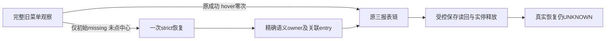

# T1367 独立实现审阅

最终冻结字节未发现未关闭的可定位实现缺陷，findings.json为空。审查中发现的IMPL-001已由真实公共合成RED→GREEN关闭，原件和失败尝试均保留。本结论只覆盖受控实现与证据；实际视频号owner结构、原281首因及真实采集恢复仍UNKNOWN，site-safety限制有效，不支持任务complete或安装真人验收。

审查树为 `/Users/zyongzhu/.codex/worktrees/t1367-collapsed-navigation/Thirdspace-creator`，base `00b7b21ae0bb505aabed3edeb6b4f71ded3f3f94`；冻结SPEC为aef632、正式R2收据c7a98f074848。实际tracked diff为4文件（2生产/2测试），未改witness.test但将其作为保护输入绑定。精确diff见REVIEWED.diff；完整source/test/消费者及证据SHA见inputs.json。

大白话：旧办法先完整尝试，确定没找到入口后，才对能严格证明归属的图标悬停一次。受控页面能走通，不意味着真实站点已修好。

## 最终实现核对

- catch仅包视频号原initial菜单observe；限WechatBrowserSourceError/REPORT_LINK_MISSING且centreClicked=false。原centre点击后子入口missing、route/frame/date/download、歧义、错源、取消和到期不被恢复吞掉。原可见direct/centre、任意原窗口内晚到节点、中心点击前晚到、唯一entry且centre重复均保旧流程，新动作不提前插入；最终25条原集合安全记录hover均0（按真实case集合计数，不沿历史口述27凑数）。
- 新owner只用标准Playwright精确可访问名button/menuitem/link，包含真实aria-labelledby语义；Locator.or集合后按DOMidentity去重。行动前唯一、connected、可见enabled并中心hit，不从div/title/cursor/宽祖先推断。selected owner后续按原节点身份而不因新增同名child误当替换；两真实actionable entry仍歧义。
- 每prepare最多一次hover。entry限owner自身/后代或明确aria-controls同document关联面板；目标ID重复、controls或panel/owner替换/脱离、名称变化均停止。关联内去重/唯一，不让全Page无关同名浮层参与选择或重复计数；tooltip及祖先tooltip、隐藏、disabled、遮挡均不可点。点击前重新解析并确认同一entry，实际目标路由/frame/shadow/日期/下载判断接回原链。
- 独立owner观察、hover、关联entry观察各120000ms实际串行成本计入每report，三report source默认7370000→8450000ms；entry click/route原各一次预算复用，没有用清理余量。withProfile仍取localEnd与原collector持久deadline最小值，原signal合成取消关闭context；新阶段end固定且timeout/返回前复核，旧observe先读value行为未改。恢复失败保原missing，但诊断phase保实际recover_owner/hover_owner/wait_associated_entry；仅固定enum及计数经白名单投影，日志失败不替换原错误或实停。
- 真实消费者仍是source身份→prepare/download→collector/parser→backend service/PGlite提交与公开同run读回，正式组合根onDiagnostic只追加可信attemptId，没有新API/任意Page端口、profile输入、UI或宿主算法。资源保护沿原context close、physical stopped、DB lease releasedAt分证，故意停止未确认族仍占用并保pending，不冒释放。

## IMPL-001 闭环

89d6的sameOwner在hover后继续用actionableNodes，合法关联面板盖住旧owner中心也会拒绝后续可点击entry。首个同步覆盖例实际只造成hover自身TimeoutError，128.04秒/exit1，不能当后置缺陷RED。随后在真实handle.hover已resolve、交回witness前，有限合成DOM barrier改变面板位置，机械核owner connected、name/controls不变、旧中心被panel实际命中、entry实际可见enabled可命中五项全true。RED02仍REPORT_NOT_READY/hover_owner/0下载，7.87秒/exit1，才确认原推演。

d1仅分开前置行动资格与后置身份/精确语义：hover前仍完整actionable；之后精确role/name查询加原connected DOMidentity，并保controls/panel检查；entry自身仍严格actionable。GREEN01同五proof全true，8.67秒/exit0、一次hover和三报告。新源受影响公共族再验60PASS/1SKIP。原finding、源码片段与关闭证据见observations及CLOSED_FINDINGS.json。

## 证据适用范围与继承

|实证|实际结果|适用范围|
|---|---|---|
|原2d公共RED|exit1；执行120319ms，0hover/0下载/0提交；suite128.35s|旧witness29026/source9ff3；原测试快照与SHA保留。运行中另补辅助测试导致终端stack当前行偏移，未将RED输入谎称始终无漂移，也未补拍成PASS。|
|89d6完整公共|60PASS/exit0，304.05s；主执行121374ms、首次hover120322ms|测试259dc；三报告及公开同run读回、实际close先于DB release。|
|IMPL001 RED02/GREEN01|exit1→0，7.87s→8.67s|真实hover与真实DOM barrier，受控时钟；非真人站点。|
|最终d1公共|60PASS/1SKIP/exit0，182.81s|测试66d27；新cover及其余全部新族/旧25集合实际重验。唯一SKIP为旧120主族，不能写d1全61实跑。|
|最终source安全phase/预算|89PASS/exit0，1.305s|b694 source/cdf测试，运行前后输入稳定。|
|最终旧witness/Wujie/公众号|3文件59PASS/exit0，5.573s|d1最终witness，运行前后输入稳定。|
|最终worker类型/timeout静态|各exit0，26.571s/14.436s|最终字节；原types六FAIL仍保。|
|完整timeout既有门|174PASS/exit0，35.442s|19实际脚本/测试最终hash未变，分证继承；不声称最终重跑全门。|
|最终三扫描|boundary/semantic/orphan均实际exit0|d1最终五文件前后稳定，旧boundary5/orphan100warn保；不冒full reconcile。|

89d6→d1机械精确diff仅namedAction可选includeHidden（默认false）和sameOwner后置复核两hunk；旧observe、catch、预算、取消和主流程不变。POST_FIX_ONLY.diff及hash一致的旧源码反向重建用于本次静态核对，明确不冒历史保存快照。因此只继承未变的原菜单真实120秒时序消费者，后修效果由窄RED/GREEN与新60项证明，不平移旧60总结果。最初AUX两轮FAIL及各版types/测试校准均保原件，不抹成全程GREEN。

全部浏览器输入为本地合成官方origin，route全拦截并阻断DNS/其它请求，隔离PGlite与合成profile/身份，不读取用户库或正式profile。Reviewer只读源码/已有证据并写本目录，没有运行测试、浏览器、平台、POST、打包安装、修改产品/SPEC/中央状态或commit。site-safety不得以collect/诊断/换浏览器/CDP间接绕过。本次不签global56/T1366等全局欠债消失、不签真实恢复或T1367完成。
