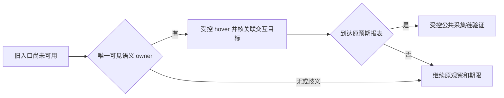

# T1367 独立只读策略意见

结论：优先评审 A 的严格条件版，在本地受控真实 DOM 中修复和验证；当前证据不足以确认真实视频号页面具备所需语义 owner，也不足以宣布 hover 是真实故障根因。无需先扩建诊断框架或反复整包。本文是策略意见，不是正式 SPEC 或实现评审结论。

## 已核事实及限制

已读当前 SPEC 与 witness/source/导航观察实现。witness 第200–232行依赖唯一可见精确文字，直接入口优先，随后才操作中心；不存在 hover 分支。观察器只在标准 nav/aside/navigation/menu/menubar 容器内枚举菜单，故 `navContainer=unknown/menus=[]` 不能证明没有语义控件。26次两个精确文字各2、可见均0，也不能证明这几个隐藏节点就是可操作图标的标签或真实菜单。

真实诊断的页面、登录及截图事实在本报告中仅引用 SPEC 与 Root 的已读安全事实；本次未重新访问平台或读取私有图、profile、凭据。Root 随后明确转述 CUA 对 `channels.weixin.qq.com` 的 site-safety 阻止，原始拒绝原文尚未交本审查方。本意见按该限制停止新访问：不得换 browser/CDP、正式 collect 或 owned 诊断间接获取被阻内容。当前可完成边界是静态审查与另行获准的本地受控实现/测试；不能签真实站点恢复或真实采集通过。

## A 可落地的最小规则

1. 仅在原可见 entry/centre 均未就绪时尝试新增分支。沿用既有精确目标名称，以标准可访问名匹配唯一可见语义交互 owner（如 button/menuitem/link）；`aria-labelledby` 应遵循实际可访问名计算，不把其属性字符串或隐藏文字的任意祖先等同于 owner。跨 role 命中先按实际 DOM identity 去重；动作前重新解析、重核唯一性和可操作状态，避免 stale 节点。
2. owner 不存在、不唯一或没有明确语义关系时不猜动作，继续旧观察直到原 deadline。禁止宽泛 closest div/li、任意层祖先、坐标/nth、force 点击隐藏文字、注入可见性或猜未知 URL。新增分支不能因其前提不足反杀旧入口稍后合法出现；旧唯一直接入口优先及无关 centre 重复保护保持。
3. hover 只针对上述 owner，动作后仍须确认可导航目标。hover 出现同名 tooltip 不等于报表入口；不能随后用全页 getByText 直接点提示浮层。新增分支的候选须属于已核实 owner 的交互分支或其明确 ARIA 关联面板，并排除 tooltip/孤立浮层；无法建立关系则保留 UNKNOWN，不放宽选择。原本就合法的直接 entry/centre 分支不因新增规则被重新设门。
4. 同 Page、官方 origin、原身份/scope、signal、租约及 deadline 继续约束动作。多一步 hover 不允许重新起算等待或续期；缺余量按原期限结束。保留真实 close 与释放回执，不吞取消、归属或其他非目标错误。

## 验证与 B 的必要性

A 的 RED/GREEN 应走现有公共入口、真实浏览器 DOM、合法折叠 owner、实际预期报表到达及适用采集/解析/保存消费者，不能仅证明文字出现或 helper 返回成功。至少保护 tooltip-only、无语义 owner、owner 重复、隐藏 owner、关联不成立、hover 无效，以及旧直接/中心/晚到/entry唯一但centre重复、歧义、官方域、身份、取消、deadline 和关闭。它们只证明受控输入族，不能标为已知真实站点结构或真实恢复。本审查未运行这些测试。

若后续合法观测表明 A 的严格前提无法判断，B 仅需针对两个既有精确标签的少量匹配节点，私有记录本节点 tag/role/可访问名、可见性/有界 bbox 与明确语义 owner、ARIA 关联；无需全 DOM、页面正文、网络正文、凭据或通用操作 API。不能把该切片直接变成自动选择宽祖先的规则。当前访问限制下不执行 B，也不借此重新包装或重跑 collect；真实适配结论仍待合法证据。
