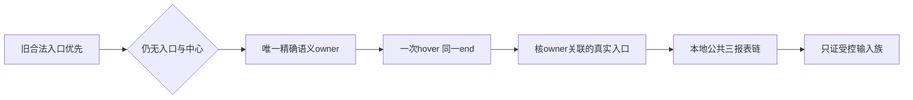

# T1367 正式 SPEC 独立初审原件

审查输入为冻结 SPEC `450f897fe8f1f15cc223f60a3f990c0970e3282fedb5d86658544c8e4ed0e28b`。本轮有一项 open major：新增 hover 后的“子入口”需要明确与 owner 的关联，详见规范 findings.json；本报告不输出或登记流程 verdict。

## 审查范围

按 BACKLOG→SPEC→PROJECT/PROJECT_CONTEXT→product-to-code-orchestrator→stage-router→architecture 顺序核读。技能与项目均3.29.0。项目为既有 BUILD，当前任务停在 CONTRACT 初审；没有 taskctl start 或生产执行授权。现用宪法为 SYSTEM_ARCHITECTURE（前序正式review-events可追溯），不是不存在的根 PRODUCT_SPEC.md。源码、现有测试及安全结果均只读；没有接触真实 profile、凭据、用户库或新取页面。

核对了 witness prepare 的全Page精确可见文字消费者、source 的身份→同Page prepare/download/onReport 与绝对期限裁剪、现 channels 集成测试的真实 Chromium/source/collector/backend service/PGlite 事务与公开读回。原公共集成已具全请求本地 route、禁DNS及隔离DB/身份条件，可承接受控 RED/GREEN；本轮不执行、也不代签将来的测试结果。

## REV-001

FR1367-2/3冻结的是 hover owner 的语义与动作前状态，FR1367-4没有把后续子入口明确绑定到这个 owner。举例：owner有精确“数据中心”可访问名，hover 后出现一个无关同名报表按钮（非tooltip、可见、enabled、可命中），关联面板内尚无合法报表入口。按全Page状态条件实现会点击，按“子入口”关系实现应继续观察/保缺证。现全PagegetByText入口可被前一种实现直接复用；这属于纸面可定位的分歧，非已发生平台误点或受控运行RED。

最小结果约束是只给新增hover分支定义owner自身/后代或明确ARIA关联面板，并保护无关同名可操作浮层。tooltip排除本身不足以建立关联。旧直接/centre路径已经被FR1明确保留，不能借此次修订把新增关联门加到旧成功路径。规范finding冻结通过条件；不要求通用导航框架、全DOM或补一次真人诊断。

## 已确认的实现与验收边界

- 原直接entry优先、entry=1/centre重复、晚到entry/centre及中心点击前再查均有明文保护；重复owner也不能反杀原路径。unknown/歧义owner只是不具备新分支前提，仍服从FR1/FR5原观察直到结束，不应立即终止尚可能成功的旧等待。
- 精确可访问名应走实际标准语义，含aria-labelledby的优先级与归一化；不能按属性字符串、textContent包含或title/cursor/tabindex把普通宽容器变成owner。多种角色路径必须以真实DOMidentity去重，行动前重新确认原节点而不自动改点替换owner。
- FR5已要求新增动作共享原菜单end；这是必须落实的消费者约束。现observe内部end私有、read()无end入参，且先接收非null结果再查end。仅在hover传controls.timeoutMs()会拿source剩余而可能跨过菜单end。实现需使新分支取得同一end并在动作timeout及动作后/返回前核剩余，不能只修改source聚合预算或在hover后新开observe。可用窄回调参数或等价局部机制，保持旧无参回调及旧分支行为；此为FR5既定结果的实现核查点，不另添产品范围。
- 同end验证须有实际经过消费者的elapsed/cancel与到期后无晚click/download/submit证据；mockDate只覆盖一种时钟控制，不能单独冒实等待/取消已验。保留原更长外层及持久deadline，不借清理余量。具体测试实现由作者负责。
- FR6/7要求先完整公共RED，再同链三报告下载、parser、保存、公开同run读回及实停/释放；同时保旧27族和实际受影响source/witness/native/binding消费者。不可把“文字可见”“hover返回”或helper/mock DTO当GREEN。
- 已亲读安全拒绝原文。当前site-safety禁止为同目的换浏览器/CDP/间接执行；本地合成route不取得被拒站点内容，不以collect/导航诊断绕过。受控输入族通过仍不证明实际站点owner结构、原281首因或真实恢复；任务不能据此complete。未发生Auto-review，不能误称自动审核拒绝。

## 原件与权限

findings.json为可交reviewctl消费的initial packet；SPEC.input.md保留本轮字节；inputs.json列输入SHA。由control正式record，审查方不写verdict、事件、看板或manifest。本次没有执行测试、浏览器、平台、打包安装，也没有修改生产、测试、SPEC或中央状态。未代签真实采集或未来实现。
