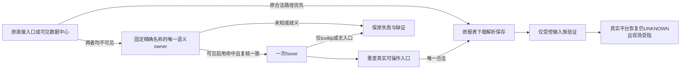

# T1367 恢复视频号折叠导航下的报表入口

## 用户目标、事实与当前交付边界

用户明确视频号采集失败，要求自主测试、验证、尝试，不再向其提问。Root选择最小A：为既有视频号报表prepare增加严格语义owner条件式hover，保全部旧合法入口；不增加诊断框架、公开contract/backend/UI或通用浏览器能力。当前先冻结本SPEC供独立评审，未start、未改生产。

大白话：后台已加载，但左栏只显示图标，原来的可见文字入口没出现。只有图标本身能被现成按钮或菜单语义准确证明属于该入口，才允许悬停一次；还必须看到真正可操作的报表入口才能继续。猜坐标、强点隐藏字和只出现提示气泡都不能算成功。

### 已发生事实（不得扩大结论）

安装源`2d3826ef164241860437daa393d336d9b042f980`。T1364唯一真实只读诊断`cli-inv-3547e2dc-239`/`req-3547e2dc-238`实际127.919秒completed、identityMatched=true、26样本；Root实际看两图，末帧后台首页作品正常加载、左栏仅折叠图标。样本top readyState complete，固定叶文字entryExact=2/visible=0、centreExact=2/visible=0；navContainer unknown、menuCandidates空、overlay0。叶文字机械数量不等于prepare中Playwright locator数量；不能写成生产定位器确证两项。

两图SHA256为`876c3c4a5617f77188c756532d7dc2adec06c7554d9487509d27678ce14141bd`、`a8082367780bbacf7a67e3f998e1de2c717b08e2fe69a33c24b27ea5b1d1a17a`。物理close00:58:45.381Z、原lease callback释放.385Z、stopPending=false，随后默认off已恢复；完整实证见T1364 final/REPORT.md，诊断已如实结案，非采集恢复。

仍缺实际隐藏标签祖先role/tag/可访问名/bbox/命中信息，未证明实际站点owner结构或hover机制。因此受控fixture只能证明明确合法输入族兼容，不得称其为真实平台DOM复刻、原281首因或真实恢复。原`collection-92ecb053-281`仍125.447秒failed/EXPORT_FAILED、committedPages0/gen2；1499/1502/1726及全部旧失败不改。

CUA site-safety已明确拒绝目标页面观测，未触发Auto-review或用户prompt，且禁止同目的替代浏览器/CDP/间接执行。真实验收当前受阻；不得通过正式collect/诊断、另浏览器、CDP或其它手段绕过，不向已睡觉用户追问。可做离线受控实现与验证，但不能提前complete本任务或宣称视频号恢复。安全拒绝原文与边界见existing-session-inventory/REFUSAL_BOUNDARY_SAFE.json和TOOL_REFUSAL_SAFE.md。

## 行为合同

- **FR1367-1 旧路径优先与分支唯一性**：只改现wechatVideo报表prepare。原唯一可见“视频数据/关注者数据”直接入口首先处理，原可见“数据中心”路径、点击中心前重查晚到直接入口、既有目标路由/frame/shadow/日期/下载判断原样保留。已有合法直接入口不因无关centre或折叠owner重复被反杀。只在当前kind直接入口与centre均0时才考虑新候选；若后续原直接入口/centre出现，优先复用原路径，不额外hover。
- **FR1367-2 严格语义owner**：限同Page官方origin、固定当前报表精确名称及“数据中心”。候选只来自精确可访问名的button/menuitem/link（含对应原生button/a[href]语义），或通过明确aria-labelledby引用既有固定exact标签且形成相同精确可访问名的语义owner。不能仅凭普通div/宽祖先/textContent包含/title/cursor/tabindex/图标外观升级成owner；不取任意祖先或页面任意文本，不猜class/URL。原生与ARIA路径须服从真实可访问名语义，名称冲突或不精确不能降格接受。
- **FR1367-3 真实节点去重和行动前复核**：按真实DOM节点identity去重，不按名称、坐标或索引合并。两隐藏标签映射同一owner可归一，隐藏responsive副本不冒可见候选；多个真实可见候选不任选。行动owner须唯一、connected、真实可见、enabled且可命中；中心hit-test须是该节点或其后代，不能被遮挡。动作前重核原节点/语义/官方origin/signal/剩余期限，并再查晚到原入口；owner脱离/替换/身份改变后不得对陈旧节点操作，也不得自动改点替代owner。
- **FR1367-4 一次hover后仍核真实入口**：每次当前report prepare的折叠入口状态最多一次hover，不click未知owner、不反复hover续观察，不新goto/深链。hover后重新解析唯一真实actionable子入口，仍守精确名称、真实可见enabled命中、同Page官方origin与分支唯一性；tooltip及其后代不能充当centre或报表entry。若只能看到tooltip/隐藏副本/未知容器，保原失败/缺证，不强点。真实子入口点击后接回原路由和完整报表链，不能仅以hover成功签报表或采集成功。
- **FR1367-5 期限、取消和资源归属**：沿原collector绝对期限、source withProfile同账号/组/authority/profile/Page及原hostlease；不重发原失败、不重置deadline或观察结束时刻。新增候选观察、hover、子入口复核均受当前菜单观察原end约束，剩余期限不足即停；不因DOM更新或hover开启另一轮菜单观察。原独立后续步骤期限仍按既有合同。每个真实串行消费者的有限预算须显式审计，必要时仅在source聚合预算中加足实际成本且由原持久任务剩余期限裁剪；不得借关闭/清理余量，亦不得扩大原执行期限。实际取消/超时后无晚click、download、submit；physical close与lease释放继续分证，不改算法或另加资源框架。
- **FR1367-6 受控公共RED及GREEN**：先在现channels真实Chromium集成测试构造明确合成的合法折叠语义owner/隐藏固定标签，一次hover后真实actionable菜单出现；旧witness须经真实source→collector→backend service/PGlite链在入口失败，保当场RED。GREEN须同完整入口链真实三报表下载、parser解析、保存、公开同run读回及资源清理；不是手抛错误、只验helper或mock成功DTO。全请求本地route拦截并阻断外网；仅私有合成DB/profile/身份/目录，不读真实用户库/正式profile或被site-safety拒绝的页面；测试阻止真实DNS、所有平台origin请求本地合成、其它请求abort，不访问真实平台。
- **FR1367-7 保护全部旧合法输入**：原直接/中心/晚到direct/centre与点击前晚到优先、entry=1且centre重复、已到目标路由、三报告下载解析保存等旧合法族保；未知/隐藏无语义、宽容器、相反名称、disabled/遮挡、两owner歧义、同owner重复标签、hidden响应式副本、仅tooltip、两个子entry、owner替换/脱离、取消/到期各阶段、新入口出现时旧路径优先均需有对应保护。保登录/身份/跨源/冻结归属/实停原保护，不因新增质量门反杀旧合法任务。
- **FR1367-8 结果诚实与安全边界**：输出仅固定phase/计数/错误码/必要合成run和哈希，不扩DOM收集或诊断API，不落真实页面正文、身份、scope、截图/URL、凭据、key/config/env/raw到Git。受控通过、真实现场受阻、真实恢复UNKNOWN分开。global56/T1366、foreign9/T1255及旧失败完整保留；本阶段不授权新collect/诊断/登录/打包安装。若实际需要超出严格语义owner的站点特例，先保缺证并重新审范围，不能在实现中偷偷加fallback。

## 精确写集与禁止扩展

|类型|精确路径与用途|
|---|---|
|必需生产|`ai-worker/src/runtime/platform/wechat-dom-witness.ts`：仅视频号prepare及局部语义owner机械定位/复核，SEMANTIC_BOUNDARY_ALLOW说明不做平台内容含义判断|
|必需公共测试|`ai-worker/src/runtime/platform/wechat-channels-entry.integration.test.ts`：现真实Chromium/source/collector/service/PGlite公共RED/GREEN及上述族|
|必要消费者保护|`ai-worker/src/runtime/platform/wechat-dom-witness.test.ts`：仅有意义的语义关系/旧路径保护；若该现文件不存在不得为镜像实现新建，保护留在真实集成测试|
|条件生产/测试|`ai-worker/src/runtime/platform/wechat-browser-source.ts`及`.test.ts`：只有新增真实串行成本或固定entryPhase类型/安全投影需要时，补预算/enum与测试；不能扩任意诊断字段或改变旧op|
|中央文书|本SPEC、`docs/verification/t1367/**`与BACKLOG/DEC/review/context/事件，由control唯一维护|

实现必须在独立managed worktree（计划name `t1367-collapsed-navigation`）进行：SPEC过审后由control统一创建并指定准确ref，基底产品树仍为2d；不使用默认分支、不复用或改动e676账号绑定候选及2d导航诊断两棵保留冻结树。依赖只按冻结manifest核对后复用/标准离线链接，不复制正式Library/profile。当前不创建worktree、不运行安装/编译。

不改contract/backend/frontend/UI、collector/parser、schema/迁移、scheduler、profileauthority/hostlifecycle、通用browser guard、既有导航诊断观察器、旧安装资源或CLI默认预算。本次非UI变更，不新增用户界面或启动oil视觉方向流程。没有extra探针、通用浏览器端口、任意Page回调、真实平台脚本或新公开API。清单外变更须先明示有限增补并独审。

## 验收与完成边界

1. SPEC独审和正式record通过、taskctl start及Root实施放行后才能写生产；初始事实SPEC与只读分析/安全拒绝原件保留，不借T1364旧审签新能力。
2. 实际完整公共RED原件→GREEN，以及FR7输入族/旧27与受影响source/witness/native/binding保护有真实退出码/source SHA；取消和deadline含公共实际消费者，不仅helper。
3. 必要worker类型、timeout-policy、boundary/semantic/orphan及独立实现审按真实写集执行；既有registry/56错误分证，不借旧44或上轮结果冒新源全绿，不为纯文书重复full。
4. 只有受控输入族通过时记录“受控实现与验证完成，实际站点owner/真实恢复UNKNOWN，site-safety受阻”。不得taskctl complete或将真实视频采集写成功；原失败不动，外部受阻状态由Root据事实决定。后续真实验收须在允许且不绕安全拒绝的条件下另明确范围，不能凭已授权自主测试绕过限制。
5. 如实际现场安全允许后再验证，必须真实新run/同ID终态、报表/目录与指标提交、资源释放各有证据才能宣称恢复；本SPEC不预授权这一动作，不用安装或导航成功替代。
