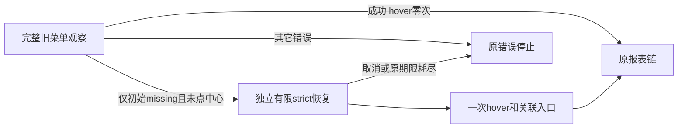

# T1367 R2 独立复审原件

复审冻结输入为 `aef632c5dc25ded3dbd020e4bf22b612959ab3f9f8dafd4fe6a2940cfd5e9971`；正式前史仅首轮450f及 CONCERNS REV8de3ac93ccae。按真实 round2-context、冻结finding与精确diff复核，REV-001已销账，没有新增finding。不输出流程verdict，由control正式登记。

## REV-001 销账

FR4现明确新增恢复入口只能是已复核owner自身/后代，或owner明确aria-controls指向并重新核实的同document面板内目标。关联内按DOMidentity去重且唯一，排除tooltip及其后代，不将无关同名actionable浮层当入口或计入关联内重复。FR7同时补无关浮层负族与“关联内唯一且存在无关浮层”的合法保护，覆盖首轮要求。规范packet仅更改原finding的status/resolution_evidence，其余字段与正式前史一致。

## 修订增量核查

FR1将新动作移至旧流程真实失败后，避免在同一时段猜一个新同名button究竟是旧late还是hover浮层。旧可见direct/centre、任意原窗口内晚到节点和中心点击前重查完整保留；原成功时hover0次，新owner歧义/未知不能提前杀掉旧路径。catch只包wechatVideo初始wait_entry_or_centre的WechatBrowserSourceError/REPORT_LINK_MISSING且centreClicked=false，且原signal/deadline/origin仍有效。已经点击centre后的子入口missing与route/frame/date/download等错误均不能进入恢复。

进入恢复后只走strict关联路径，不再重开全Page旧观察，不承诺原窗口结束后无关联新节点仍可通行。这不会改变旧实现已成功的原窗口；也无需引入hover前节点集合或时间顺序去伪造DOM因果。恢复观察不附加持续0/0门，因而不会把新合法关联面板出现再次否决。

FR5现把追加恢复与原观察区分：原end不重置；owner观察、一次hover、关联entry观察至少三项120000ms真实串行成本，source按每report/三个report加足。原已计且只执行一次的入口点击与路由等待按实际次数核算，任何额外有限执行不得借清理余量，所有步骤仍裁原collector持久绝对截止。每个恢复观察end只建立一次，可窄传给callback；新动作timeout及动作后/返回前复核受该阶段end约束，旧observe先读value行为不全局改写。该合同可在精确witness/source写集落实，无需改collector/公开API或资源算法。

FR6保实际旧120秒观察后再hover的主公共墙钟证据，辅助加速族分列；完整真实Chromium/source/collector/service/PGlite链须先RED再三报告download/parser/保存/公开同run读回与真实close/释放。FR7覆盖旧成功、catch排除、owner重复/hidden副本、tooltip、无关浮层、关联变化/脱离、各阶段取消/期限及无晚动作。它们仍是实施验收要求，本轮没有运行或代签。

实际站点owner/hover机制仍未知；历史26样本与图片不倒推281首因。site-safety原文禁止同目的替代/间接访问，SPEC维持仅本地合成请求、阻断外网、不得据受控通过complete或宣称真实恢复。本轮仅复审文书和既有消费者，未测试、平台、构建安装、修改生产/测试/SPEC/中央状态或提交。中间未正式登记稿不作为review历史，不借T1364旧审签新能力。
