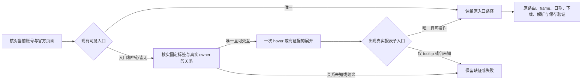

# T1367 折叠导航入口：只读工程策略

结论：本次页面在完成加载后仍为图标侧栏，固定「视频数据」「数据中心」标签存在但不可见。当前采集只等待可见文字，因此缺少折叠导航路径。现证据没有记录这些隐藏标签的祖先关系，尚不能确定应该 hover 哪个真实节点、两份标签是否属于同一个节点，也不能确认 hover 后是提示气泡还是报表子菜单。应修实际 prepare 入口；不根据图标位置、猜测 class 或深链直接操作。

本文是被委派的工程分析，不替代中央 SPEC。T1367 中央事实 SPEC 初始 SHA c0f8861888c487b858cda976a5126600abb7ba1d96aca10ae22a6a2b6c8a8db9；尚未据此开始产品实现。本轮没有改产品/测试、没有开平台或执行任何新 op/collect。

## 事实与适用范围

- 只读源码基线：managed tree HEAD 2d3826ef164241860437daa393d336d9b042f980。
- 本次 installed2d 诊断 cli-inv-3547e2dc-239 完成；约127.919秒，identityMatched、实际 context 停止与租约释放均为 true。这个页面不能倒签 collection-92ecb053-281 失败当时的页面。
- 实际查看两图：identity_verified.png SHA 876c3c4a5617f77188c756532d7dc2adec06c7554d9487509d27678ce14141bd；observation_end.png SHA a8082367780bbacf7a67e3f998e1de2c717b08e2fe69a33c24b27ea5b1d1a17a。末图首页内容已加载，约88px左栏仍仅图标。未据图标形状/坐标选入口，未将图中的身份或作品内容抄入此文。
- 私有 manifest SHA 40d446fffb542b82309173c174bcbfb2e802488d3f259f900dd5656e4041770f。只投影 observation 的机械 roots/nav 字段：26份样本 top ready complete，entryExactCount=2/entryVisibleCount=0、centreExactCount=2/centreVisibleCount=0，navigationContainerState=unknown，menuCandidates=[]，overlayCount=0；open shadow 无固定入口，一个隐藏同官方 frame。
- 探针 exactCount 是固定文本的叶元素机械统计，不等价于 prepare 中 Playwright getByText exact 的实际 locator 原始数量。不能将它记成生产 locator 已实证的“两项”。

## 现有消费者与不打包补证的边界

1. `ai-worker/src/runtime/platform/wechat-dom-witness.ts` 的 reportWitness.prepare 视频号分支：唯一可见「视频数据/关注者数据」优先；没有则等待唯一可见「数据中心」，点击前再查直接入口，点击中心后等唯一可见子入口，最后核官方目标路由。当前没有 hover、action owner 或可访问名分支。进入报表后，原 frame/shadow、日期、下载见证不应变化。
2. `ai-worker/src/runtime/platform/wechat-browser-source.ts`：collectNativeReports 在同一 withProfile/Page 上完成稳定身份与 prepare、下载。withProfile 是内部闭包；对外只有 login/readIdentity/observeNavigation/collectNativeReports，没有可传任意 Page callback 或交互指令的入口。
3. `wechat-navigation-observation.ts`：全局数固定叶文本，但 menuCandidates 仅来自 nav/aside/role navigation/menu/menubar 容器内；当前 candidates 虽有 tag/role/expanded/bbox/visible/occluded，却没有 hidden exact label 的 ancestor/owner 映射、可访问名或 aria-controls。menus=[] 因容器未识别而没有候选；不表示 DOM 中没有行动节点。26样本也不能反向恢复没有采集的字段。
4. `contract/src/operations/platform-accounts.ts`：accounts.wechatNavigation.diagnose 的 body 严格为 `{}`，accountId 为唯一业务输入。可信配置只有 authorizationId/groupId/accountId/privateRoot/sourceSha；不存在 capture mode/ancestor/aria/bbox 选项。换 CLI 参数或重放同 invocation 不能补这些字段；已缓存结果也不重新导航。
5. `frontend/src/server/persistence-client.ts:4642` 装配正式链：当前 ctx -> account/group/member -> profileAuthority.authorizeBindingTarget -> hostProfileLifecycle.acquire -> wechatSource.observeNavigation。`backend/src/modules/execution/host-browser-profile-lifecycle.ts` 返回 authDir/onStopped/auditReceipt，并不返回 Page/CDP。复用租约函数本身不会产生浏览器读取能力。
6. 当前契约里的 browserSessions.openLogin 只提供登录会话开启/状态，另有 clear；没有面向上述正式绑定 profile 的 read DOM/hover/click/screenshot 接口。不能把另一路通用 browser session 当作该账号正式 profile 的同一页面。

因此，2d 现有正式 op 没有通过固定选项补齐这段 DOM 的办法。若 delivery 能从现存浏览器库存找到尚存、且能证明与正式账号 profile/owner 一致的原页面，可在 Root 已授权范围内读取固定导航关系；这要以库存实际结果为准。本次诊断实际 context 已关闭，不能声称其 Page 仍可连接。若库存没有该页面，不能靠“正常应用还在运行”推导出可用浏览器接口；应在正式窄 SPEC 里决定最小入口修复或既有有限观察的必要补字段。不要热改安装文件、复制 profile、绕过租约、另造通用诊断 API。

## 最少还缺的实证

只需围绕三种固定协议标签（视频数据、关注者数据、数据中心），不是全 DOM：

| 问题 | 最少有限属性 | 决策用途 |
|---|---|---|
| 两份隐藏标签属于谁 | 各标签最多8级祖先的 tag/role、opaque 节点编号与 parent 编号；最近 action owner 编号 | 分清同 owner 的重复标签、隐藏响应式副本、不同活 owner |
| 能不能实际 hover/展开 | owner 的 native/ARIA action 类型、有效 visible/enabled、有限 bbox、中心 hit 是否 owner/后代、hidden/display/visibility/opacity 原因枚举 | 拒绝隐藏、遮挡、disabled、宽泛容器；不能仅凭 cursor/tabindex 判行动资格 |
| owner 是否确指该固定入口 | 固定标签的后代关系、可访问名对目标标签为 exact/empty/other，aria-label/title 是否为固定目标；不输出任意内容 | 排除有相反名称的控制、祖先同时包含多个菜单项 |
| hover 是什么机制 | aria-expanded/haspopup；aria-controls 指向同 document 的目标个数/role/visible，以 opaque 关联表示；必要时一次受控 hover 前后固定标签和 action owner 的有限变化 | tooltip 不是可点击数据中心或报表子菜单；不能 hover 成功便当入口成功 |

不需要 Cookie/token/profile内容、网络正文、全页面正文、任意 href/URL、事件处理器源码或用户真实身份。若最近祖先没有原生/ARIA 语义，现证据就不能确认它是 action owner；此时先记录实际有限 DOM 结构/关联与真实 hover 结果，再批准一个针对实证结构的最窄关系规则，不能将所有 div、pointer cursor、祖先容器自动升级为 action owner。字段建议用于明确补证边界，不意味着本轮获准扩探针或执行 hover。

## 最小入口修复候选

- 原有唯一可见直接入口始终先走；原有可见中心路径和“点击前直接入口晚到”保护保持。新增候选不应因无关重复 owner 反杀已有合法直接入口。
- 只有直接入口与中心均不可见，才从固定 exact 标签/精确可访问名解析最近行动节点。原生 button/a[href] 或明确 role=button/menuitem 可作为行动语义；具体真实标签/关系要以补齐证据为准。不能从屏幕坐标、图标、nth/first、字符串相似度或任意宽祖先定位。
- 候选按真实 DOM 节点 identity 去重。两个隐藏文字映射同 owner 可归一；两个真实可见 owner 不允许任选。隐藏 responsive owner 不与真实可见 owner 混计。必须满足唯一、有效可见、enabled、命中及官方同源，操作前重新确认节点仍同一/归属未变。
- 最小新增动作优先是一次 hover，且在同 attempt 的原有限观察内只触发一次；随后重解唯一真实报表子入口。hover 无结果或仅 tooltip 则保留失败/未知；不强点 tooltip 或隐藏文字。
- 如真实结构表明必须 click 展开，只在真实语义 owner 或明确 disclosure 关系已证且 SPEC批准后点该 owner。aria-controls/expanded 可辅助证明，不把缺省属性当已证展开行为。click 后仍核唯一真实子入口及原官方目标路由。
- 新路径到达报表后完全接回既有 native report 准备/下载/解析/落库链，不用 guessed goto 替代平台菜单。
- 继续复用同 owner/account/group/Page/profile/signal/deadline/hostlease。所有新增动作均检查原 signal/剩余期限；不重置原持久任务期限、不重发原失败任务。新增串行阶段需在 source 聚合预算中显式计入，但仍由原任务绝对截止裁剪，不能把增加 timeout 当作修复。

这个候选是安全的机械定位合同，尚不是“已证明覆盖真实平台”。在 owner 和展开机制未证实前，不能把仅合成原生 button 的 GREEN 宣称实际修复。

## 当场 RED 和保护门（尚未运行）

公共 RED 入口优先复用 `wechat-channels-entry.integration.test.ts`：真实 Chromium、隔离合成官方 origin、现 source/native collector/backend service/PGlite 链。构造与已证真实结构一致的折叠菜单，固定标签隐藏但唯一真实 owner 可 hover/展开，真实子入口出现后进入既有报表 frame，走实际下载、解析和 service 提交/公开读回。当前 prepare 应在该合成页 REPORT_LINK_MISSING 且未作 hover；先保当场 RED 再改实现。只测试 helper 返回 selector 或 hover 调用次数不够。

必要新增保护族：

- 同 owner 的两份隐藏标签；隐藏 responsive 副本；两个可见 owner 歧义；无 action owner 的旧 hidden fixture仍失败；宽容器/相反可访问名/disabled/遮挡无动作。
- hover 只出 tooltip仍不能点击报表；hover 出唯一真实 entry 成功；出两个 entry拒绝；owner DOM替换/脱离后不能对旧节点误动作。
- 直接入口先出现、晚出现、在中心点击前出现仍优先；无关重复折叠候选不破坏原成功路径；原27族保留。
- 取消/原 deadline 覆盖 owner观察、hover/展开、子入口观察/点击；各观察窗口不因轮询、hover重试或 DOM更新续期；跨源/身份/组归属变化停止；无 force/坐标/nth/注入样式/猜深链。
- 真正 context 停止与 DB lease release 仍分别回执；不借某个成功 hover 代签 stop。现有 source/hostlease 保护复用，不重写生命周期算法。
- 若变动 source预算/诊断phase，跑对应安全投影/预算回归、timeout-policy和实际公共完整链；不得以 helper-only 替代公共链。

后续真实验收由 Root 按正式批准组织：实际公共 collect 原 ID/原状态保存；新运行真实 reports/works 提交且有完整性证据才算采集恢复。T1364 首页图和历史 failed281不作为此 GREEN。

## 建议精确写集

必需最小产品消费者：`ai-worker/src/runtime/platform/wechat-dom-witness.ts`，限视频号菜单 prepare 与其局部机械 owner helper；测试 `wechat-channels-entry.integration.test.ts`。`wechat-dom-witness.test.ts` 仅补有意义的机械关系保护，不取代真实公共链。

条件写集：若新增实际串行步骤/安全阶段投影，才写 `wechat-browser-source.ts` 与其 test，明确 stage预算与固定 enum，不能输出 raw selector/URL/私有文本。若必须补实际 DOM证据，先在 SPEC 明确额外读取范围后再决定是否只扩既有 `wechat-navigation-observation.ts/.test.ts` 的有限固定标签 owner 投影；不先开新能力。

没有证据要求修改 contract/backend/前端UI/原生 parser/持久 scheduler/profileauthority/hostlifecycle，也不建议新增通用 browser port。当前仍需 Root 在真实 DOM库存结果与上述最小缺证之间做正式范围决定；本分析不提前扩大写集。
