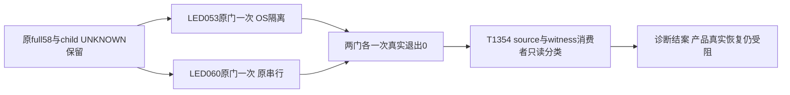

# T1368 两新fire的精确后验与消费者交叉诊断

两条原门均已各执行一次并真实退出0：LED053在获批系统沙箱内174PASS、37.626秒；LED060完整build→worker19PASS→backend52PASS、23.307秒。消费者只读分类与执行后保护核验均已完成，经独审和Root终审后，taskctl complete已实际exit0并记录T1368诊断结案。原665唯一完整检查仍为58ERROR/0WARN，child实际退出码UNKNOWN，wrapper退出1；本报告不回填原首因或宣称真实视频号恢复。

大白话：先把完整检查已经亮出的两盏新灯原样留住，再各检查一次，区分本次失败发生在哪一步和哪些消费者碰到了新字节。检查失败也要保留，不能把失败解释成成功。

## 已发生的控制证据

- 冻结SPEC：`docs/features/t1368-collapsed-navigation-reconcile-drift.md`，SHA256 `d27a03352a6d641786410eecc1203578b3a270b65ff8d9ef7d2289c91881b408`。
- 全新初审原JSON：`control/SPEC_REVIEW_INITIAL.json`；正式record实际exit0，收据`PASS[REV:0de9a2c1753d]`，作者与审查关系homogeneous，模型`gpt-6.1-sol`，constitution为`orchestrator/SYSTEM_ARCHITECTURE.md`。
- taskctl start实际exit0，T1368由📋转🔨并记事件；两配置仅新增T1368一个diagnosis step，无运行lease或completion写入。
- context-compile实际exit0；任务包`orchestrator/context/T-1368.md`，SHA256 `147d08188196e94fcf3905915effb0a8ada19c341aadbf1bdac6895401ccc582`。真实控制摘要见`control/CONTROL_PREPARATION_RESULT.json`。

## 实际诊断结果

|项目|当前状态|证明边界|
|---|---|---|
|LED053顶层原命令一次|退出0，37.626秒；174PASS、静态0，八组全部执行，rc先fsync|系统沙箱禁止全部网络及用户HyperFrames配置写；有效原生开关仅本次子进程，环境不同于原full|
|LED060顶层原配置整条一次|退出0，23.307秒；完整build→worker19PASS→backend52PASS|保原build与两个后续阶段的&&失败截断；合成127.0.0.1与内存PGlite|
|T1354实际消费者/hash交叉|只读分类`execution/CONSUMER_AUDIT.json`已通过收尾独审及Root终审|旧source漂移与本次新增witness字节分列，T1356原persistence漂移另列|

LED053实际回执为`execution/LED-053_EXIT.json`：PID48707，04:11:36.880419Z开始、04:12:14.506633Z结束，returnCode/exitCode均0、signal=null；顺序为wait→退出JSON flush/fsync→log fsync→metadata。`LED-053_START.json`保原命令、实际sandbox argv、仅两个环境开关及15项source/config SHA；`LED-053_OUTPUT_META.json`记录5888字节原输出及SHA256 `0ed588f95606c9c6f5e0795a6caafe0877b203b0232b54b1a7463db078672b26`，完整原输出留private目录，不纳Git。该结果不能声称与原full同环境，也不能确定原fire首因。

LED060实际回执为`execution/LED-060_EXIT.json`：PID49785，04:12:45.285525Z开始、04:13:08.592406Z结束，returnCode/exitCode均0、signal=null，同样先持久化真实退出再生成元数据。`LED-060_START.json`保原`/bin/bash -c`整条&&命令，无环境覆盖或新增外层硬timeout；`LED-060_OUTPUT_META.json`记录6264字节原输出及SHA256 `a3dd02d55e9a135d3439e6c3dc249a1345928107a8831a925f9100bd05056f9f`。三个阶段均实际完成；没有按失败阶段拆开补跑，原完整门LED060 fire首因仍UNKNOWN。

消费者核对绑定旧验收源721、前版2d与当前665的两个文件SHA：旧receipt→2d只有source漂移；2d→665的source继续变化并新增witness字节。实际三report新增恢复预算只在wechatVideo，wechatOfficial预算未变；共享observe callback增加end实参，旧无参消费者仍沿原分支，新增hover恢复仅视频号。最终相同source/witness已有59项witness/Wujie/公众号受控保护只是已有结果引用，不重签T1354宽receipt。T1356的persistence从2d到665未变，保原漂移。完整定位、SHA与边界以`execution/CONSUMER_AUDIT.json`为准，不从源码分类推断真人绑定或真实采集恢复。

`execution/POSTFLIGHT.json`与执行方`execution/REPORT.md`已收尾：开始/结束候选HEAD均665且clean，15项source/config和安装CLI SHA稳定；构建自然重写的11个ignored dist内容SHA与运行前全等，未删除迁移缓存。用户HyperFrames目录及子项132项metadata前后全等，只查metadata未读正文；两自有进程组结束后残留0。T7保全的原full三原件bytes/SHA再次匹配META。完整安全工件索引为`execution/SAFE_ARTIFACT_INDEX.json`，原始日志/私有metadata仅私有保全，不纳Git；本次未重试或再运行其它测试。

原full权威来源为`../t1367/control/RECONCILE_665_META.json`与`RECONCILE_665_IDENTITY_DIFF.json`，私有原件按该索引保全。后验即使通过，也不能倒推原LED053/060首因或补造child退出码；若失败，只按实际stage/已证环境阻断分类，不擅自重试或修产品、依赖和环境。

## 验收与未解决边界

AC1368-1两门实际退出与完整输出哈希均已落盘；AC1368-2消费者只读分类已落；AC1368-3保原full与真实平台受阻，执行后保护核验亦已完成。收尾独审`control/FINAL_REVIEW.md`为homogeneous/gpt-6.1-sol，只读无新测试、无阻断，Root据此裁定AC1..3闭合；taskctl complete实际exit0。本任务无UI写集或frontend journey contract，验收类别`—`只表示不适用frontend旅程执行，未豁免任何诊断AC或产品门。

context所需的diagnosis step仍是pending，这是本轮未经过progress独立步骤状态迁移的队列标志，不能解释为测试未执行；两门真实结果已由EXIT原件证明。当前interactive模式下taskctl完成和pmem同步均不会写progress，BACKLOG/taskctl事件才是任务状态真相。本轮不手改pending或调用progress done/verify/claim，不虚构e2e、lease或步骤完成；细节见`control/CONTROL_PREPARATION_RESULT.json`。

T1367真实恢复UNKNOWN，site-safety拒绝边界保持，不访问目标站点或借替代通道绕行，不新collect/诊断、打包安装或付费。原失败、三棵保留树、ignored历史证据、主树foreign9/T1255均保留；T1367 taskctl block实际exit0并记事件，不complete。前后两次pmem sync均实际exit0，最终任务状态以BACKLOG/events为准，项目记忆已刷新；无第二full、不声称全局全绿，提交另待Root放行。
