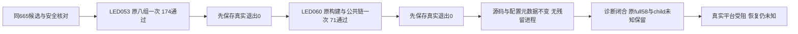

# T1368 两项精确后验与消费者分类

冻结SPEC `d27a03352a6d641786410eecc1203578b3a270b65ff8d9ef7d2289c91881b408`、正式评审 `PASS[REV:0de9a2c1753d]`、taskctl start及Root明确执行放行后，按Task Packet在既有665候选树串行执行两项原顶层命令，各一次。两门均自然结束，未重试、补依赖、改产品/测试、重跑full或触发真实平台操作。

大白话：这次把新亮的两盏灯各查了一次，都通过了；上一次检查的失败和缺失退出码仍然保留。这次结果不能解释上次为什么失败，也不能证明真实视频号恢复。

|本次检查|实际结果|证明范围|
|---|---|---|
|LED053 原八组|exit0，37.626秒，174PASS/0FAIL/0skip；静态扫描通过|OS沙箱禁止全部网络及用户HyperFrames配置写入，另关闭遥测和自动安装；完整原内部串行执行|
|LED060 原`&&`链|exit0，23.307秒；build完成，模型响应19PASS，后端公共链52PASS|本地合成127.0.0.1服务、内存PGlite、真实构建Worker/服务端口与读回；全部阶段执行|

真实wait结果分别在 `LED-053_EXIT.json`、`LED-060_EXIT.json` 先flush/fsync持久化，之后才计算输出hash或查询Git。捕获器wrapper退出0与两条真实child退出0分别记录；没有新增硬外层总timeout，观察返回未冒充执行终态。完整原始stdout/stderr仅在 `private/LED-053_RAW.log`、`private/LED-060_RAW.log` 保全，不纳Git；安全字节数/hash在对应 `OUTPUT_META.json`。`run-gate.py`仅为本次证据捕获，不加入产品执行链。

## 同源和副作用核对

候选 `/Users/zyongzhu/.codex/worktrees/t1367-collapsed-navigation/Thirdspace-creator` 开始/结束HEAD均 `665508e66ee4bf46a6ebe3267ce4887c92964e18`，两门之间及结束均clean。15个source/config输入SHA未变，HyperFrames实际CLI的SHA仍为锁定的 `1250669d951c4a462b7e4b5d574256f61978797ba3b941cc8491d620e3ef925b`。构建自然重写11个ignored `ai-worker/dist/*.cjs`，最终11个文件的内容SHA与运行前全等；未删除或迁移任何旧产物/缓存。两个自有进程组结束后均无残留进程。

LED053有效前缀严格采用Packet的 `sandbox-exec` profile与两个环境开关，沙箱启动成功。`~/.hyperframes`目录及子项共132项的mode/size/mtime/inode/symlink元数据开始/结束全等；只查metadata，不读用户配置正文。当前候选各包无常见`.env`文件；未复制用户配置或修改HOME。

安全前提来自实际安装CLI源码：`frontend/node_modules/hyperframes/dist/cli.js:79116`消费遥测关闭开关；`:60186`和`:60232`为用户config读取与写入/rename；`:185792`调度顶层更新检查；`:83175`更新fetch仍可运行，`:185186`和`:185242`允许关闭后台安装，`:185328`日志也在同一用户目录；`:185353`、`:83527`为skills远端检查。原测试 `tools/timeout-policy/hyperframes.test.mjs:43` 的 `HYPERFRAMES_TELEMETRY=0`未被CLI消费，因此本次明确使用已审环境边界，不能称与原full同环境。

LED060保留原命令和内部预算，未套LED053的断网profile。`pi-provider-json-compat.test.ts:21`、`radar-model-result-unknown.repro.test.ts:74`、`transcribe-postprocess.integration.test.ts:52`均实际绑定127.0.0.1；两后端文件调用无dataDir的`createDb()`，由`backend/src/db.ts:239`创建内存PGlite。bundle消费者在`transcribe-postprocess.integration.test.ts:176`，经合成service端口回写与公开同ID读回；可选证据环境变量未设。这里以已审输入、实际本地请求计数及断言证明合成公共链，没有额外进行系统级网络抓包，不宣称运行了真实模型供应商或平台采集。

## T1354交叉责任

`CONSUMER_AUDIT.json`保留逐ref SHA及真实diff。T1354原receipt目标`721dfacf…`到2d只改变source；2d到665同时改变source和witness，因此原source漂移和本次新增witness字节责任分列，属于同错误身份。`PAGE_SPEC.md:36`的宽watched路径与原报告均未改，当前失效事实不重签。

source的新增聚合成本只在wechatVideo分支；witness新增恢复只在视频号prepare分支。共享`observe`增加callback的end实参，公众号无参callback继续按原语义运行；公众号身份/报表分支分别见`wechat-dom-witness.ts:279`、`:297`。最终相同source/witness SHA已有59项witness/Wujie/公众号消费者结果，引用 `docs/verification/t1367/source-validation/REPORT.md:13`，本次不重演旧UI或真人绑定。T1356的persistence原漂移另列，本次2d→665该路径无变化。

## 不可扩大结论

665唯一full仍为58ERROR/0WARN，56旧身份与两新fire均保留；childExitCode仍UNKNOWN、wrapperExitCode=1，两新fire原首因仍UNKNOWN。T7原log/RUNNING/GENERATED_INPUTS三原件的bytes/SHA收尾再次匹配META。后验两门通过不能倒填原full首因、原child退出码或旧receipt。

本次仅闭合T1368诊断后验与消费者分类。T1367真实站点owner/采集恢复仍UNKNOWN，site-safety受阻；没有collect、诊断、真实站点访问、正式profile/用户数据库读写、登录、付费、打包或安装。本代理不写中央状态，最终taskctl处置由Root/中央执行者核对。

安全明细：`SAFE_SUMMARY.json`、`PREFLIGHT.json`、`POSTFLIGHT.json`、`CONSUMER_AUDIT.json`、两组START/EXIT/OUTPUT_META及`PROCESS_RECEIPTS.json`。私有metadata和raw均在`private/`，不纳Git。
