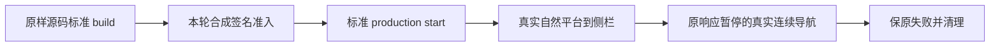

# T1369：一次隔离 production 首页连续导航诊断追加提案

本文件是待中央冻结与独审的测试追加方案，尚未执行 build/start、签发测试 token 或删除缓存。用户首页卡死目标仍未完成。本轮只区分 Next dev 装配与 production 路由，不将构建成功、独立 API 快读或合成实验通过冒充安装版恢复。

## 已核事实与准入

- 产品基底 HEAD 为 `10cab133f97821cface88f9d1c0f8426acad763a`，两生产文件原字节未改。现追加不更新基底，不改 Next/React/依赖/产品门或数据实现。
- `frontend/package.json` 标准 `prebuild` 为 `node ../ai-worker/scripts/build.mjs && node scripts/verify-built-in-course.mjs`，`build=next build`，`start=next start`。完整使用 `pnpm --dir frontend build`，保留 worker 本地 bundle、课程校验、Next 编译和标准类型检查，不跳 prebuild、不忽略 build error。worker 脚本只打包现有源码、不启动模型；课程 manifest 已存在。
- `instrumentation.ts:31-32` 对 Node 运行时原样调用 verdict 门。`server/verdict-token-gate.ts:24-35` 仅非 production 的 DEV_MODE 豁免，production 无签名 token 会退出。因此普通 build/start 本身不能无凭据起 UI，不能以改 NODE_ENV/禁 instrumentation/补安装握手解决。
- Root 已明确授权使用现正式 `scripts/desktop/verdict-key-material.mjs:createBuildSmokeVerdictToken` 的纯合成测试准入。驱动仅新生成随机 Ed25519 对，在本进程内构造 helper 的显式 env 对象，不读取现有签名/许可/安装连接材料。匹配公钥只写本轮本树 `.next/server/verdict-verify-key.json` 可再生产物。seed 不进入 server env、日志、命令参数、Git；优先只在驱动内存，必要暂存仅本轮 0700 root/0600，清理时销毁。
- 已核锁定Next16.2.9 `dist/server/lib/router-utils/instrumentation-globals.external.js:52-56` 在原 `phase-production-build` 直接跳过 register，故正常 build 阶段无需签发。build 阶段不签 token；完整 build 成功、独占端口已核且即将 spawn 标准 start 时才调用正式 helper。使用 helper 现有端口绑定、`machineId=build-smoke`、`licenseMode=build_smoke`、TTL 最大 300000ms 原上限，不改 helper、不延长或重新签发。未能在原启动 TTL 内通过原门即失败停止，不续原 token。
- TTL 是单进程启动准入有效期，不是导航执行 deadline。源码只在 instrumentation 启动验证一次并写 VERDICT_MODE；不据此宣称覆盖桌面许可心跳/持续授权。原 start 若退出、签名/端口/公钥不符或激活重定向，不另启、不绕门、不代签真实许可。此机制只用于本轮合成进程，绝不用于已安装 App、发布或部署。

## 运行形态与隔离

- 使用普通 web production（不设置 CREATOROS_DESKTOP、不打 standalone、不组装 Tauri/安装包；不设置 HANDSHAKE_REQUIRED=0或注入任何握手头/token，verdict与loopback握手是独立边界），标准 `pnpm --dir frontend start --hostname 127.0.0.1 --port <独占端口>`，并设置同值 PORT。这只能比较 dev 与 production 的编译/路由差异；仍不是已安装 production standalone/Tauri/WebKit 证明。
- 独占 app/PG/host 新端口，执行前核空闲；与 control 的两项 strict 串行，不争抢 Next 窗。使用现 T1355 宿主+T1356 seed，新的空 0700 私有 root，nonce/root/UID/pgdata/身份交叉核验。旧根与三旧树不复用、不修改。
- privateEnv 沿用原配置：DATABASE_URL 指私有 loopback PG，PGLITE_DATA_DIR、CREATOROS_DB_DIR、media/backup/workspaces/auth/profiles 均在新 root；禁 background drivers/scheduler。只允许受控本地合成身份；不登录、采集、模型、写真实业务/用户库/profile。
- 驱动采用显式最小环境，清除继承的业务连接/模型/安装身份变量，不读取其值；无 `.env/.env.local/.env.production/.env.production.local`（已只读核查本树均不存在）。NEXT_TELEMETRY_DISABLED=1、CI=1，不安装任何资源。
- 整个 build/fixture/start/Chromium 子树经本机现存 `/usr/bin/sandbox-exec` 限制网络，复用仓库 `scripts/build-doocs-request-budget.mjs:141` 已用 SBPL 网络规则：`(deny network*) (allow network-bind network-inbound (local ip "localhost:*")) (allow network-outbound (remote ip "localhost:*"))`。另拒绝读取用户 Application Support 与 Keychains 目录；本树/依赖/现有 Chromium 二进制与私有 root 正常可读写。保 policy 原件/SHA/受控进程命令。
- 正式启动前做一次受 sandbox 约束的本地回环正向探针（不访问外网），确认 sandbox 可执行且子进程继承。若 sandbox 初始化/资源权限不支持即失败停止，不降级到不受控出网。浏览器仍保现有 HTTP/WS 外部拦截与 serviceWorkers=block；OS 层约束服务/编译子进程，不能仅靠浏览器 route 宣称全栈禁网。任何远程依赖请求被阻止时保环境失败，不下载/放行。

## 唯一诊断与证据

- 仅一次 normal 1366×900 Chromium、worker1/retries0。新 context 不碰用户 Tauri profile。保原动态真实 RSC/dispatch/document observers、scope 检查、完整 finished/body/SHA、实际 URL/页面/等待状态与截图，UNKNOWN 边界不变。
- 标准 production auth/me readiness 后校验合成身份，设置原合成 scope。保三个真实目标 GET 的独立 600000ms 绝对 deadline+完整 body 预热，不填浏览器 RouterCache，不 rewrite DTO/Flight/响应。
- 先一次自然首页平台小红书→立即侧栏 `/overview`，要求实际提交与 pending 清除；不重跑完整账号/日期/ABA/双视口族。自然失败原件保并停止本轮，不硬进入受控部分。
- 自然成功后通过 full document home 重进复位 client router cache，再执行已审 response-stage A 原首页小红书响应收到 200 头后暂停、B=`/overview` 完整真实 body、A仍held时B真实UI提交、释放A后B不倒退；同一次 normal context做 `/settings` 轻目标对照。保持原 A-held/B-full 次序；本次不新增 A早释放/B仍pending/C后发的另一竞争序。
- A真实取消是允许终态；若它已由 requestfailed 证明取消，CDP continueResponse 的无效 interceptionId 只记控制器分证，不当产品导航RED。若无法证实已取消而释放失败，保控制器失败/UNKNOWN，不能掩盖主链原失败。不得通过回填网络终态制造 GREEN。
- 保现补充的 failure capture/cleanup：失败 catch/finally无 DOM evaluate；先卸异步 response/Fetch 监听、冻结observer，保同步网络终态直到 context 关闭；context close 独立120s，失败/UNKNOWN才 owned browser fallback另120s；observer结算另120s。observer/request任何未终态保原ID+UNKNOWN且禁止GREEN；原失败即使恢复仍FAIL。
- build/start/预热/自然/受控/UI提交/服务日志/cleanup分阶段，不把 build 完成或 HTTP200头冒成用户页面完成。没有真实可定位产品RED不改生产；有RED先报最小因果/范围delta，当前追加本身不放行产品修复。

## 完整预算与失败停止

- 网络隔离本地探针360s（探针两个120s步骤+清理120s）。fixture host300s；标准 frontend build单独7200s，含完整串行prebuild与Next build。新诊断预算不称性能目标。
- T1356 seed 放在 build 成功后的原 readiness600s 绝对阶段内（沿用既有 `seed && start` 的共同600s边界），不单独漏算或另起期限。此阶段从seed开始即固定deadline：seed只用其剩余预算，seed成功且剩余有效才落本轮公钥、临spawn签唯一token并立刻标准start；随后auth/me完整readiness也只用该原deadline剩余，不能seed后重置600s。build期间只有已就绪的私有宿主/PG，不启动production Next；build不依赖业务seed完成来冒用用户库。若build意外要求不存在的业务数据，保build失败停止，不临场扩seed/改原门。
- production seed+start+readiness600s；test保现9360s原更长完整预算（含3×600s全文预热、原7200s主体、三个独立120s清理），用户动作/导航/有限观察原120s不延长。
- 顶层独立外层18300s：360+300+7200+600+9360+240进程结算+120调度余量=18180s，另留120s。子阶段沿同一原绝对deadline，失败或预算耗尽不续期、不自动重发。工具早yield，持续阶段报告；不阻塞数小时不报状态。
- build/start/seed/预热失败立即保存原件、正常停止本轮owned进程/PG并释放端口，不能循环重试。原无响应记录、natural GREEN、response02 FAIL/interrupt、supplement03预热FAIL、安装403解释更正全部保留。

## 磁盘与精确缓存边界

- 本次只读 `df -k` 可用10215052 KiB（约9.74GiB），不是产品可用空间承诺。现本树 `.next` 唯一子目录dev，`du -sk frontend/.next/dev=923316 KiB`（约0.88GiB）；它是本轮自有路径、realpath相同、UID一致、非symlink且dev/lock不存在。ai-worker/dist约22844KiB。
- 本轮已存在 `.next/dev/trace` 全量181754B已保到本次0700 private root、0600文件，SHA `d47794c2f3a4942b24dafd389cb37a34ac099aee8d7a535107fdfe3672a2cf53`；已核原trace与私有副本相同。浏览器trace/原执行源/命令/日志/失败/清理原件均留 verification，不删。
- 仅批准后、确有需要且再次确认无自有/未知进程使用，才允许回收精确路径 `/Users/zyongzhu/.codex/worktrees/t1369-filter-navigation/Thirdspace-creator/frontend/.next/dev` 可再生缓存；不清整棵workspace/依赖/旧树/主树/用户cache。不以du推断APFS必释放等量物理空间，之后重测df。
- production构建增量尚未量测，不能承诺1GiB等猜测。避免 standalone/sidecar/浏览器复制；所有新产物只在本树.next、ai-worker/dist及本次私有root。启动前要求至少8GiB可用；运行期间每5s只读采样，低于3GiB即有界停止owned构建/服务并记RESOURCE_LIMIT，不靠清用户缓存续跑。阈值是实验资源上限，不改产品可用性门；本轮最多消费约剩余空间减3GiB的可观测增量，不声称硬配额或精确物理上限。

## 写集与缺口

新增 `frontend/playwright.t1369.production.config.ts`、`docs/verification/t1369/production/**`驱动/策略/安全报告；窄改现 `frontend/tests/e2e/t1369-dashboard-filter-sidebar-navigation.spec.ts` 仅增加production minimal模式和A取消分证。原config/旧实验源快照/原SPEC历史不改。构建允许更新本树可再生ignored `.next/**`、`ai-worker/dist/**`、Next自动生成类型/tsbuildinfo；若标准build意外改任何tracked产品/config/package，保diff并失败停止，不悄悄接受。

中央负责SPEC追加/DEC/审核记录，当前只交提案。此实验仍不能直接观察用户Tauri WebView的路由队列、实际请求先后及真实UI。若production也无真实导航RED，下一必要缺口是支持的现安装App只读UI/RSC观测或用户自然操作时的可信请求与画面关联；不把独立Chromium/API样本当真机，不再机械重做同dev链。
