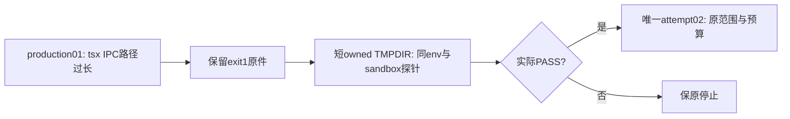

# production01 前置失败与最窄夹具调整

2026-10-19，中央只读核对执行方原件；未在中央运行实验。Root已明确授权本次夹具修正，无新增产品范围或许可循环。

## 已发生事实

- 原生sandbox本地探针实际exit0；production01随后在T1355 fixture的tsx CLI bootstrap自然exit1，耗时5.155582667秒，无外层超时或资源限额触发。
- Unix socket路径119字节，超过macOS该路径103字节边界，真实错误为`listen EINVAL`。仅可判长owned TMPDIR导致IPC前置失败；这不是导航产品RED，也不证明短路径在同SBPL下已可用。
- fixture owner/ready未建立，production server阶段文件不存在；build/seed/签token/start/UI均未进入。原结果与日志保留，不覆盖、改签或计作导航测试成功。
- 执行退出后owned端口41387/41388/41389均无listener。
- 执行方原件：`docs/verification/t1369/production/BOOTSTRAP_FAILURE_SAFE.json`（nav隔离树），SHA256 `5143d3359b925099902d8708088edaaca29bc83cd2e47c442f21d79bb6d1ffa5`；其`execution.json` SHA256 `44b16a8f5a7599851863904bab394998ec4c25b3e1df13084928263d4006db5e`。含临时绝对路径的原件保执行树，本记录只投影必要事实。

## 已授权调整与判定

Root授权一次最窄夹具修正：只将TMPDIR改为本次独占、短的`/private/tmp`下0700 owned目录，保原身份/私有目录校验、同一sandbox及网络限制。先在相同env/sandbox中以有界tsx IPC探针实证；探针PASS才准新attempt02按原production完整范围和预算一次继续。探针或该次运行失败即保原停止，不能放宽网络、改guard/依赖、改产品或自动再试。

原production01失败与attempt02分别记账；本次调整只解决夹具IPC路径上限，不改变core120秒、build7200秒、seed/start共享600秒、test9360秒、outer18300秒及清理预算，不重置在途期限。未发生的探针/attempt02退出仍待实际，不能预签PASS。

大白话：还没开始构建，测试工具就在过长的临时路径上启动失败；先把这条自有临时路径缩短，安全限制和被测产品都不变。

冻结SPEC SHA256 `6f8114cc1f5fbc686abed00a695c4f2ffb8b33d389e47f964cf45d38d36078cb`及proposal `c74d22eb0366e98fe9a0cdebfaac3292ae46c5b057438c01dcfed727b3a66729`原字节保持，R3审结不倒改；本记录与DEC-136905保留已发生失败及Root最窄夹具执行指令。T1369仍进行中，不能据诊断完成或前置失败宣称用户问题已修复。

## production02：短路径同沙箱探针实际失败，改用标准Node loader的授权

原短TMPDIR修正后的唯一探针真实FAIL：exit1、422.091ms，innerTimeout=false，预期marker缺失。原始短Unix socket报`listen EPERM`，与production01长路径`EINVAL`分证；同一SBPL SHA256 `5cd42c928b4211f5502db1e4e2faae4bfc8f8f006526a45583a7c27bfe3aba67`，没有放宽网络。探针失败后PASS断言阻断production，build/seed/token/start/UI仍未开始，不冒产品RED。探针原预算120秒、前槽480秒，连原production18300秒外包络18780秒；实际前置失败不是一次完整production测试。

Root现明确选定仅自有驱动的启动方式调整：用标准`node --import tsx`加载原TypeScript宿主与seed，保同sandbox/网络规则及全部原保护，不新增UnixIPC网络例外、不改原宿主/seed或guard。执行方与独审先核全部直接/间接消费者；独立loader探针实际PASS后，才准同原完整范围与预算的一次production03。该启动调整避开tsx CLI自身IPC需求，不代表绕过产品业务门。失败仍保原停止，未实际结果不预签PASS。冻结SPEC/proposal/R3历史不倒改，不重开合同或许可层。

大白话：临时路径缩短后，沙箱仍拒绝测试CLI自己的Unix socket；保持这条安全规则，用Node原生loader直接加载同一份测试宿主与种子。

中央只读核对原安全投影：`production-attempt02/TSX_IPC_PROBE_SAFE.json` SHA256 `9b004eeba690e131c9b064d811215809f2cd00bf83f003608edef86821030345`，`TSX_IPC_FAILURE_SAFE.json` SHA256 `0eebfd3e141ef65addb1dd1afd2d618c76cf2c798d7bc6efb65eb33810d97ec4`。实际socket原字节为46B（从原错误地址UTF-8计）；早期口头54B不当原件事实，长度变化不改变EPERM前置分类。原临时绝对路径只留执行方原件。
