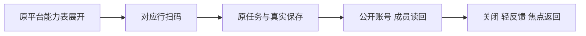

# T1370 行内扫码归并实际结果

平台能力原表已移到原顶部按钮区并展开；扫码在平台对应行，原五按钮/说明、成员“查看数据”和“状态见账号数据”已移除。表格只展示合同已装配的能力，错误/读取中/真实空集合分开；原Dialog、AccountBindingPanel、fresh intent、真实readback、focus、组选中/归档/busy守卫保留。动态列自然随右栏收缩，未沿原四能力列36rem硬撑，使用旧tokens/组件/左右布局。

## 真实验证

| 证据 | 自然退出与结果 |
|---|---|
| component-red01 | 1；原36通过、新4失败；8.385秒，生产未改 |
| public-red01 | 1；原表hidden的可见性断言真实等待120秒失败；child 224.765秒，实际/accounts成功渲染，非readiness失败 |
| component-green01 | 0；43通过；4.827秒 |
| LED-047 | 0；原8文件174通过；8.929秒 |
| public-green01 | 0；1366×900及1024×680均通过；child 110.421秒，两旅程19.5/15.8秒 |
| 静态检查 | frontend types 0/50.541秒；backend types 0/42.889秒；boundary 0/0.251秒、基线5且无新增；semantic 0/0.258秒 |

时长以先落盘EXIT JSON的child wait为准；终端224.887/110.566包含后置hash计算，不当child时间。原RED/日志/trace不覆盖，私有原件只引用路径/SHA，见SAFE_SUMMARY.json与STATIC_GATES.json。

每窗真实私有PG与Next账号/组成员回读5个成功账号，6个唯一binding run/intent、7次start请求中1次为明确的原unknown同key核对，没有新run；包括同平台第二账号、跨平台、公众号导航上下文丢失恢复、详情失败重读、unknown重开不重发、失败原任务、键盘/focus及实际返回刷新。pageErrors/proxyErrors均0，collect/AI均0。原合成种子scheduledJobCount=2，禁止后台驱动，不宣称该种子计数为0；两次主动网络失败注入产生4条原开发console错误，未洗掉开发徽标。

## AC与视觉

AC1370-1：两窗表已展开且每列/按钮水平视口内；已亲看[原正常基线](visual/before-normal.png)、[正常结果](visual/after-normal.png)、[最小窗口](visual/after-minimum.png)以及长账号成功反馈原件。1024表右缘984<1024，三列/五行扫码完整，主内容可正常纵向滚动。

AC1370-2：组件证明loading/错误重试/真空、混合能力、非当前组、归档及busy守卫；不支持行列/项无假按钮。AC1370-3：上述实际公共链与成员同ID读回闭合。AC1370-4：当前定向与静态门已通过、独立源审与公共证据复核无阻断；源码已2d4f32e2f整合，前瞻控制10238309c；taskctl实际strict两窗通过并完成，收据deac4c8faea8、child0/98.174秒。当前full安全预检受阻未执行，Root审为范围外T1373欠债，不假称全局全绿。

本证据来自受控身份宿主与真实私有PG/Next，非真人扫码或已安装App；未打包安装、真实collect/模型/外发。只改manager及本任务测试/配置/安全证据，不改Panel、contract/backend/其它数据页。原全局58/childUNKNOWN、T1367 site-safety与T1369未完成状态不由本结果替代；foreign9/T1255不在隔离产品写集。

当前已安装App仍为`2d`旧源；本次源码候选尚未替换该安装，源码通过不等于用户App已更新。

最终严格执行与独审见[strict安全摘要](strict-final01/SAFE_SUMMARY.json)、[前瞻正式报告](control/FRONTEND_REPORT.md)及[独立收据终核](control/FINAL_STRICT_REVIEW.md)。原RED/GREEN不覆盖；当前全局未执行根因见[安全预检](../t1373/PREFLIGHT_BLOCKER.json)与[原生隔离只读结论](../t1373/OS_ISOLATION_READONLY_ASSESSMENT.md)。
