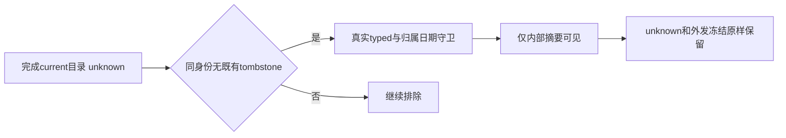

# T1371 小红书unknown指标内部摘要实际结果

已确认遗漏发生在总览查询准入：原目录/typed指标真实存在，原scopedWorks仅public分支排除了保守unknown。最窄修复保原public与双冻结null分支，只额外纳入完成current目录（generation>0、completed_at非空）且同user/account/platform/externalId无任何既有tombstone的unknown内部摘要候选。原unknown、冻结字段、parser、commitPage、schema及外发资格均未改变；不是重采集或把unknown伪装成public。

## 原失败与同源结果

[后端真实消费者报告](backend/REPORT.md)保留首轮22项16通过6失败/54.47秒：5项实际摘要遗漏RED与1项deleted夹具被现有removed协议拒绝单列。后续只校准夹具为真实removed删除语义，新增2项public冻结保护；24项dashboard消费者加原23项collection集成，共47通过/64.96秒。same-ID visibility/tombstone/uncertainty/outboundFrozenAt等完整字段前后全等；没有实际外发E2E。

首次双视口公共UI自然child0/56.846秒，1366×900及1024×680均通过（总Playwright56.1秒）；9项source及整体dirty hash前后全等，六隔离端口收尾均无listener。真实service私有合成保存→实际Next/HTTP总览路径：侧栏进入、平台小红书、日期10/3、全部账号123；选本账号仍123；日期9/1为999；还原10/3与已采集作品返回/刷新仍123；切真实零值/最新不可用/无指标三组合依次0/—/—。每步公开DTO逐值核DOM，目录同ID/current/unknown证据读前读后全等，semantic mutation requests与pageErrors均0，collect/AI/job计数前后不变。

共同静态检查见[同源静态结果](../t1370/STATIC_GATES.json)：frontend types0/50.541秒、backend types0/42.889秒、boundary0/0.251秒（原5基线、无新增）、semantic0/0.258秒。原installed catalog112/summary0只作已核原诊断事实，当前合成123不是用户真实实绩或已安装恢复证明。

## 验收对应

AC1371-1/2：真实service消费者RED→GREEN及两窗当前页面读回覆盖完成目录unknown、public原分支、gen0/未完成/旧代、private/hidden/removed后更新unknown、归属/日期/冲突/0-null。AC1371-3：同ID完整字段不变与现有collection冻结守卫47通过，不签不存在的真实外发链。AC1371-4：公共两窗及当前静态门、独立源审/证据复核已通过；源码已2d4f32e2f整合、控制10238309c；taskctl实际strict两窗通过并完成，收据d5729ef84fe8、child0/56.434秒。当前full安全预检受阻未执行，Root审为范围外T1373欠债，不假称全局全绿。

已亲看[正常123](visual/current-unknown-normal.png)与[最小窗口123](visual/current-unknown-minimum.png)，沿旧页面响应式卡片/日期平台筛选，无新主题或页面。每窗其余0/—原图保在ignored e2e-artifacts，安全数值投影见SAFE_SUMMARY.json；raw、nonce、临时root与用户截图不纳Git。

未新登录/采集真人平台、未模型/发布/安装/full。T1369连续导航仍单独未完成，T1367受site-safety阻断及原全局58/childUNKNOWN继续保留；不将两项当前GREEN称全局全绿。

当前已安装App仍为`2d`旧源；本次源码候选尚未替换该安装，源码通过不等于用户App已更新。

最终严格执行与独审见[strict安全摘要](strict-final01/SAFE_SUMMARY.json)、[前瞻正式报告](control/FRONTEND_REPORT.md)及[独立收据终核](control/FINAL_STRICT_REVIEW.md)。原RED/GREEN不覆盖；当前全局未执行根因见[安全预检](../t1373/PREFLIGHT_BLOCKER.json)与[原生隔离只读结论](../t1373/OS_ISOLATION_READONLY_ASSESSMENT.md)。
