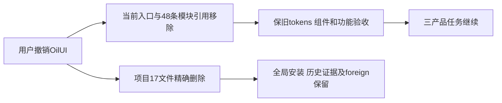

# T1372 项目OilUI撤销结果

已按用户10/19明确授权，精确删除本项目OilUI目录内17个Git跟踪文件，解除当前入口强制接入。全局技能及其它技能未动；原有tokens、组件、布局、状态和真实操作验收原则保留，页面工作改为参照已有稳定页面，不再引入第二套视觉。三个产品问题T1369/T1370/T1371继续，删除技能不冒其修复已完成。

大白话：项目内强制用OilUI的工具和要求已去掉，页面照原来风格修；导航、扫码和小红书数据仍各自按功能合同验收。

`AGENTS.md`只替换旧强制段；`UI_RULES.md`只改前两节，`视觉与组件`及之后原布局/状态/验收内容与HEAD逐字相同。CLAUDE无引用，未修改。modules中29个旧模块共48条Oil前缀读/步读/写/步骤写引用机械移除，其它字段和命令保原；T1372自身仅声明17个精确删除write_set，无Oil读取路径，该声明不恢复技能接入。

删除前目录实际17文件均tracked、无额外foreign或目录内修改，删除后目录不存在；清单与逐模块移除记录见`control/REMOVAL_SCOPE.json`。当前入口强制路径为0，其它模块前缀引用为0；JSON解析、精确diff/check及保护核对均实际exit0，详见`control/CHECK_RESULT.json`。

taskctl start实际exit0并记事件。真实单配置step绑定/Packet已生成，context-compile两次均exit0，第二次是Root确认删除write_set例外后刷新SPEC绑定；最新Packet SHA为`3062cc95766fbaf9c652ce19ed2dd1f6a1d1c088d95d848999252f64bbbc838e`。没有运行lease、e2e、progress done/verify/claim或伪造步骤完成标记。

本任务只删除工具流程配置，无产品行为变化或UI journey，审核/验收`—`按已核工具契约适用；未运行产品测试、full、安装或任何真实collect/登录/模型/付费。不把配置检查冒视觉或产品验收。历史SPEC/context/review事件、原全局58ERROR/0WARN/childUNKNOWN等失败保留；主树foreign9各SHA与旧快照匹配，T1255原工作区行保留。taskctl complete及前后两次pmem sync均实际exit0，T1372已完成并记事件；诊断步骤pending仅表示未作progress独立步骤迁移，不否认实际配置检查。当前尚未提交，Root先审差异与精确范围。
