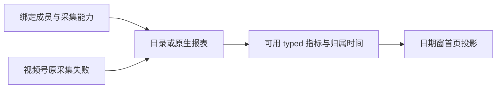

# T1374 绑定平台公开只读矩阵

本轮重新读取了用户已选账号组，四个当前成员分别为抖音、视频号、快手、小红书。小红书、快手的目录与 typed 指标真实存在；安装版首页投影没有计入这些作品。视频号当前原生报表为空，已知原采集记录真实失败。各平台不能统一归因为“没有采集”。本文件不是修复验收，也不宣称用户页面已恢复。

日期窗为北京时间 **2026-09-20 至 2026-10-19**，平台概览未指定 accountId。所有身份匹配只在私有目录内完成，公开文件不含账号、作品、任务或采集 ID。完整安全计数、每类指标、响应 SHA256 和耗时见同目录 `PUBLIC_READ_MATRIX.json`。

| 平台 | 当前目录 / generation | 截图窗内作品 | typed 作品指标历史行 / 终页 | 截图窗首页内容数 / collected catalog | 主要区分 |
| --- | --- | ---: | --- | --- | --- |
| 抖音 | 46 / 0，legacyPartial | 11 | 5870 / 59 页已结束 | 11 / 0 | 旧 publication 路径仍显示 11 条，videoViews=122722；不能拿它证明 collected 投影正常 |
| 小红书 | 112 / 10，verifiedComplete | 11 | 5600 / 56 页已结束 | 0 / 0 | 112 条全部 visibility=unknown；窗内 11 条均有五类可用指标 |
| 快手 | 1 / 10，verifiedComplete | 0 | 30 / 1 页已结束 | 0 / 0 | 唯一作品发表于 4 月 5 日；账号 follower_count=1 可见 |
| 视频号 | 0 / null，none | 0 | 0 / 1 页已结束 | 0 / 0 | 原生报表 fresh total=0；已知原采集 failed / EXPORT_FAILED / committedPages=0 |

所有作品目录实际 nextCursor 都已读到 null；目录总数与唯一作品数相等，typed 快照 ID 无重复，作品指标全部能匹配本账号的目录作品。四平台计划均为 active、collectAvailable=true、planEvidence=verified。可见账号清单共 7 个，选定组当前成员 4 个；其余账号未跨组查询。可见清单及本组均无公众号绑定；不能推断所有历史组都不存在公众号。

## 小红书：数据存在，默认窗投影为零

目录 generation=10，completedAt=`2026-10-19T06:07:22.473Z`；112 条全部为 current、unavailable=0，全部 visibility=unknown，发布时间无缺失。北京时间日期范围为 2023-05-20 至 2026-10-16；截图窗内有 11 条。

这 11 条作品对应 550 行历史 typed 指标、55 个作品与指标键组合：view_count、like_count、comment_count、favorite_count、share_count 每类都覆盖 11 条作品，全部 available、unit=count、window=lifetime、value 非 null。550 行指标的不可变 ingestedAt 全晚于当前 joinedAt：入组 `2026-10-18T15:13:56.373Z`，指标写入范围 `2026-10-18T15:21:43.225Z` 至 `2026-10-19T06:09:19.146Z`。这项归属核对使用指标时间，并非以作品 ingestedAt 代替。

按 observedAt 优先、capturedAt 次之机械选择每个作品与指标键的最新样本，同刻冲突为 0；窗内累计值合计 view=3379、like=51、comment=4、favorite=81、share=5。它们是累计样本合计，**不是日期窗新增量，也不是绕过生产 tombstone、历史成员重叠等条件后的最终投影保证**。默认窗公开概览 content/publication/catalog/eligible 均为 0，三类浏览读数与 followers 为 null。

## 快手：日期窗与归属必须分开

目录 generation=10，completedAt=`2026-10-19T06:10:51.429Z`；唯一 current 作品 visibility=unknown，发表于北京时间 **2026-04-05**，作品写入日为 10 月 19 日。截图窗内没有作品属于真实日期范围差异。

该作品的 play_count、like_count、comment_count 各有 10 行历史快照，全部 available、count、lifetime、value 非 null。30 行指标 ingestedAt 均晚于当前 joinedAt：入组 `2026-10-18T15:12:26.156Z`，指标写入范围 `2026-10-18T15:12:57.062Z` 至 `2026-10-19T06:11:39.794Z`。按上述 observedAt/capturedAt 排序，累计样本为播放 3116、点赞 19、评论 0，同刻冲突为 0。账号另有 10 行 follower_count 快照。

另以同组、明确当前账号、平台快手、起止均为 2026-04-05 实际读取公开概览，完整解析耗时 1833.697ms：content/publication/catalog/eligible 仍为 0，videoViews=null，followers=1。该日期早于当前入组，**仅此查询不能独立证明成员历史归属错误**；必须保留 T1371 的不可变指标写入与历史成员规则。

## 视频号与公众号：原生报表分族

视频号 reports.list 实际返回 items=0、total=0、nextCursor=null。没有报表行可核 kind、group/membershipVersion、日期含义、unit 或 accumulation，均保留无样本，不能从 catalog=0 推断所有原生数据通路不存在。

仅依据已有合法公开回执中的原 attemptId，以本轮当前视频号成员重新 collections.get：capability=nativeReports，status=failed，reasonCode=EXPORT_FAILED，generation=2，committedPages=0，completeCatalogGeneration=null。原开始时间为 `2026-10-18T22:45:43.005Z`，更新至 `2026-10-18T22:47:48.452Z`。这是**已知原采集**，不是最新采集。已知原父任务 fresh get 为 HTTP_404，任务当前状态 UNKNOWN；没有重试或转向私有存储。

当前公开操作库存未提供 collection latest/list；小红书、快手没有找到可合法引用的同账号原 attempt 回执，latest attempt 保留 UNKNOWN，generation=10 不可代作 attempt 身份。公众号未在当前组绑定，也没有可见账号；未猜账号或新采集。

## 一致性、安全与限制

本轮公开取样时段约北京时间 2026-10-19 15:09 至 15:21。结束时只重读 group 与每平台 pageSize=1 的目录元信息，组 version=1、成员全字段及四平台 generation/complete/total 元信息均与开头一致；这是跨请求观察，不是事务快照，未锁定 metrics 写入。

所有操作先动态 describe，均为 effect=read，显式 group；平台目标另显式当前 account。沿既有 CLI 正常准入，不读取连接文件、密钥、浏览器状态、真实数据库；无 collect/login/model、业务写、真实平台网页请求或 403/site-safety 绕过。每个 CLI 命令外层保留 8520 秒，覆盖既有 8280 秒全链期限和清理；本轮命令均实际自然返回，HTTP_404 保原失败。私有原响应目录为 0700，文件为 0600，raw 不入 Git。JSON 只含计数、时间、语义字段及原响应哈希。

公开 CLI 元数据未提供 sourceSHA。中央本轮以安装文件实际哈希与专门 safe 元数据匹配，确认安装源码为 `2d3826ef164241860437daa393d336d9b042f980`，并非 T1371 新源码；该结论由中央安装版本证据负责，当前矩阵不伪称通过 CLI 独立获知源码。T1369 production04 仍未执行。本轮未修改产品、契约或旧 harness。

此前快报使用 capturedAt 优先排序；最终 JSON 与本文件已按生产 observedAt 优先、capturedAt 次之重算，ingestedAt 不参与 rank，同刻冲突不任意选赢；本轮关键累计结果未变。
