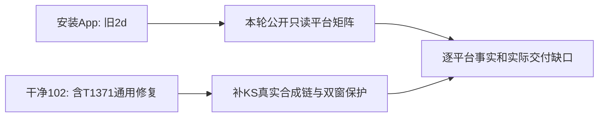

# T1374 逐平台数据恢复：本轮证据与范围

当前任务已由taskctl实际block为⏸️，事件已记，未complete。用户已纠正为“除抖音外其它媒体都缺数据”，尚未签全部恢复；本报告按实际证据补齐，不用旧平台快照代fresh矩阵。

## 安装来源当场核对

只读`/Applications/CreatorOS.app`非凭据元数据与公开构建来源，未读Application Support/profile/token、用户数据库或连接配置，未解包执行/安装：

|项|本次实际值|
|---|---|
|Info.plist版本|1.2.0|
|安装CreatorOS可执行SHA256|`dd3c655a79b09c5fec4e776c6ee3dfa600e934210abb1159ce1671d8ca70a807`|
|安装sidecar.tar.gz SHA256|`1ab286281bd1f97ae192cbd1d55605db807dd243da14d9018745725ce7d99f85`|
|sidecar内frontend/.next/BUILD_ID|`NQoA8ApE_eRMLMRdqA8bv`（Next构建ID，不是git SHA）|
|来源commit|`2d3826ef164241860437daa393d336d9b042f980`|

上述可执行与sidecar的实际SHA均匹配T1365新根专门脱敏来源元数据`/Volumes/T7-MacData/CodexBuilds/t1365-final-20261019-2d3826ef1642/checks/SAFE_SUMMARY.json`中artifact的sourceCommit与两项SHA；只投影本次来源字段，没有复制历史原件。安装包仍旧2d，不含后续T1371通用unknown摘要修复。源码已通过不代表用户安装已恢复。

大白话：这次确认用户运行的还是旧包。现在看到的缺数，必须先区分“新源码已经修过但还没安装”和“新源码仍有缺陷”。

## 当前源码消费者边界

首页有组与创作者总览同用getGroupOverview；作品页catalog族沿listWorks/readMetrics，全历史目录与按作品发布日期过滤的组摘要不是同口径。微信两平台在原作品入口走NativeReportPanel/独立nativeReports，不要求或制造typed目录；独立视频号趋势只消费channelsDaily，公众号原no_total_channel不能假改为总量成功。以上为源级消费者事实，不预定本轮全部首因或新增页面。

现T1371通用SQL保持原public分支双冻结null，新增完成current/正gen/无同身份任意tombstone的unknown内部摘要。XHS已真实验过，KS生产normalizer也产unknown，但旧KS合成夹具为public，故必须补真实KS输入族，不能拿XHS单例签KS或所有平台。原native采集失败/无报表与typed漏显示分证。

## 当前执行状态

T1374初评已正式PASS[REV:141db0b03e7c]，taskctl实际start并留events；三文件零生产delta正式复评PASS[REV:16648a3ea984]。已亲读独立fresh矩阵，最终MD SHA256 `87db951d196bf172911d0f849820251b62bc653f953852becdb934d012036388`、JSON SHA256 `56953b306cde381fd8d7b5fd3a8e82c42198dd55bed28f9d56600f38348cfcf4`，文件位于本报告同目录PUBLIC_READ_MATRIX.md/json。生产/契约/config原字节，当前只在原clean102树三既有test/seed中补回归；backend attempt01实际2文件52PASS/exit0/71.217858秒，KS normalizer现叶子3PASS/exit0/2.811630秒，所有受核输入前后SHA一致；真实退出先fsync再做postflight，细节见TARGETED_GATES_SAFE.json。三源固定后已交独立Sol串行执行双视口公共UI；attempt01仅自有启动driver将git porcelain前导空格strip掉导致路径断言，PW/host/PG/seed/Next均未启动，原FAIL保留，不当产品RED。Root授权同scope仅rstrip换行修正、独立新attempt02/root，三源与预算不变；该次真实双窗2PASS、child0/71.747063秒、driver0/71.872385秒，各10points/0pageErrors/0semantic mutations。原XHS123/999/0/—、KS窗外null→09-01播放321/点赞0/粉丝9→账号/返回刷新→日期还原、本轮新增Douyin5/200及去重归属保护均通过。完整UI safe文件已独立核对并逐字复制，旧T1371证据与8源/whole dirty前后全等。

原video旧attempt路径与JSON字段已私下交诊断方，只以已知历史身份fresh get，不猜latest。公开inventory暂无collection list，目录gen10不证明某个旧gen9 attempt就是当前；XHS/KS原attempt缺失时保UNKNOWN，不读实际库/连接/profile补齐。

T1369新cycle仍未获用户授权，production04未执行；本轮full因T1373安全预检受阻而未运行。foreign9/T1255/旧worktree/私有原件保持。最终仅根据实际逐平台结果与交付边界决定是否可完成，不能以本报告或测试计划结案。

## 本轮fresh矩阵收敛

|平台|当前源事实|旧安装同scope显示|本轮边界|
|---|---|---|---|
|抖音|legacyPartial gen0/46目录；默认窗11条旧publication|内容/发布各11，videoViews122722|旧发布链正对照，不证明新collected链全正常|
|小红书|verifiedComplete gen10/112 current unknown；默认窗11作品，五指标550行/55键，均available/count/lifetime且入库晚于joined|默认窗content/publication/catalog/eligible均0，browse null|最新样本机械sum3379/51/4/81/5；不是增量或全资格最终投影|
|快手|verifiedComplete gen10/1 current unknown；默认窗窗外，30行三指标都available/count/lifetime且入库晚于joined|合法单日窗口仍catalog0/videoViews null，followers1|最新样本play3116/like19/comment0；日期与归属分证，不把默认窗空本身判bug|
|视频号|nativeReports total0；原已知attempt本轮get仍failed/EXPORT_FAILED/gen2/0页|当前无原生报表可展示|原已知attempt非latest、原父get404；latest UNKNOWN，采集恢复仍受阻|
|公众号|当前组/可见账号清单未绑定|无本组该平台样本|不能冒空平台通过，不推其它历史组|

矩阵实际全部cursor终止且无重复ID、typed匹配同账号目录；首尾group version/成员及各目录元信息稳定。它是跨请求观察，未锁定metrics，不能冒事务快照。公开口不能穷尽历史tombstone/重叠membership，仍UNKNOWN；XHS/KS latest attempt缺合法公开回执，不靠gen10猜。所有实际账号/组显示名与原始正文不入本安全矩阵Git，私有原响应权限0700/0600保。

## 实际回归、清理与最终判断

- 后端2文件52PASS/exit0/71.217858秒；快手现纯normalizer叶子3PASS/exit0/2.811630秒。不是新产品修复RED，而是既有通用SQL新增跨平台实证。
- 双窗公共UI实际2PASS；Root与独立Sol已亲看正常/最小图的321播放及9粉丝、沿原样式。0点赞在图下方，仅签真实DOM断言，不冒图片可见。
- 前端tsc exit0/45.310176秒、后端tsc exit0/38.280414秒、boundary exit0/0.240427秒（原5基线无新增）、diff-check exit0/0.082762秒。每阶段真实child退出先持久化，再做原log/SHA/postflight；受核8源全等。
- PW自然exit0后独立核本轮nonce/root与owned helper/PG PID均不运行、41417/41418/41419端口空、postmaster.pid消失。STOPPED.json未生成，保缺失，不补造正常host shutdown回执。原attempt01 driver启动失败单独保。

执行基底102、三处测试/seed实际源及不变生产/配置/原harness/seed的SHA见SOURCES_MANIFEST_SAFE.json；本轮正常追加KS合成样本，旧XHS和原typed记录未覆盖。主树只精确收此三文件与本任务安全控制/报告，不修改产品逻辑、contract、配置、依赖或旧证据。T1371旧strict收据仍是102当场执行历史，测试扩展后不重写其源hash/PASS，不冒新当前全量已对账。

Root最终接受受控源码跨平台回归证据，同时明确T1374完整目标尚未达成：安装App仍2d、未交付本修复；视频号原已知attempt仍EXPORT_FAILED/0页、nativeReports0、真实站点观测受既有site-safety明确拒绝，latest仍UNKNOWN。taskctl block实际exit0，原因已留事件，未complete；T1371原完成状态保。无本轮安装/发布/真实collect/login/模型或绕站操作。

完整reconcile本轮因T1373原安全预检阻断未运行，无新full退出/数量，不用旧665的58项结果冒当前，也不声称全绿。本轮阶段证据通过不等于全部媒体真实恢复；后续交付与原视频号恢复仍须明确授权和实际结果，不能靠本报告或测试计划签完。
