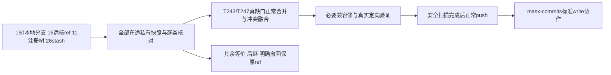

# T1375 现有代码整合记录

大白话：全部在途代码先保全；main真正缺的模型权益消费者、Windows构建链和一项按次凭据读取保护正在精确整合。旧分支已等价、被正式后继替代或被用户明确撤回的实现保留原ref，不回放旧行为。源码整合不代表安装App已替换，也不把原导航/平台采集问题签完成。

## 盘点与来源

- 仓库为私有 `zzyong24/Thirdspace-creator`，默认main。保全基底 `f530722c25f627c8c59740aebfecfd6be2c05185`，fetch后origin/main为`1963e4ebe48f15ec084a1efe7dac2f195675b92f`。13条合法README活动图更新已正常merge为`02854e8fe6e96e7c904b1a5efd638c080e13a5dd`。
- 私有0700/0600保全根：`/private/var/folders/0f/yn6rgq1j2lj2n8_868n28jzc0000gn/T/creatoros-t1375-preserve-q7wxf0_9`。各树原HEAD/工作区和index二进制patch、非ignored未跟踪文件已存并核原状态未漂移；原分支、工作树、26stash及ignored原件不删除。
- [ref逐项表](REF_CLASSIFICATION.json)绑定原冻结OID，176 heads/remotes中93祖先、31全patch等价、31旧worker后继、8采集后继、13其它逐审聚类。非祖先不是缺功能。v1候选曾明确撤回的env白名单/ASR第二账本由`41c50538d`排除；仅未撤回且符合现合同的per_request一行及原T763测试精准补入，不能冒整b81已合或等价。
- [stash逐路径表](STASH_CLASSIFICATION.json)保26stash/2257路径记录；原型按真实ASR/粗剪/模板/组隔离后继核，不机械apply。表内“非精确”不等于漏功能，后继证据以独审结论与本段为准。
- T243产品tip `e3151ce89`是T247 `8e39d20a77baa5317aa1082609f71beb37f48c14`祖先，不重复回放。T243最终tip `d4432b6110a753c661581c1531bed9c469c41e1c`另有Growth T246交付文档/工具提交，不是T247祖先；其16项安全历史源码（11工具+HTML/4patch）已按T243_DELIVERY_TOOL_SOURCE_MANIFEST.json精确选取，原生产manifest/raw/截图不整合，先前口述tip祖先关系已据实际exit1纠正。T243模型权益/真null scope/取消与恢复消费者，T247 Windows闭包/签名及受控中转是实际缺口。6处冲突融合保main T1313/T1338 owner、真实ctx锁/原fingerprint和封面业务配对，叠加原模型准备及取消端口。
- 原foreign7与T1255已获本次用户明确纳入；7产品文件与临时T238树逐SHA相同，未重复覆盖。临时树4541个删除是残缺冻结布局，不当产品删除。独有`client-config.t243-consumer.test.ts`89829B原SHA`5db997e133f4f0c1848cfab3809129ebbeb889cd45f0513a416d3b8164610195`已保存并纳入，只将缺跨仓v3向量的单case显式标缺失skip。
- T1369原02/03纯工具`bootstrap_probe.py`/`loader-probe.mts`精确纳入；04不调用它们，04未运行。其余nav源/共享树三测试已与既有main逐SHA相同，不重复搬。

## 本次必要兼容修

1. 实际根captureConfiguration和persistent transcribe各一次RED，确认新官方准备门先拒绝了原本地ASR退路。只对明确availability保原official unavailable + existing-local-asr完整冻结身份；签名/协议/归属/身份/取消仍拒绝。fresh security_error对象另有真实RED，保持原安全结果，不改成unreachable；合法重新验签可恢复。未运行真实模型推理。
2. b81原T763消费者真实RED证明per_request错误读取长期getter一次；只纳原predicate和回归，不加第二账本/费用DTO/旧迁移。
3. T247 API/中转mock真实RED后请求至少120秒，blob1200秒保长窗口，原整体不续期7200秒、CI150分钟覆盖串行与审计收尾；不真实GitHub下载/上传或发布。
4. Windows测试装配保首FAIL：使用正确Vitest/Node runner；owned TMPDIR先realpath（不弱化noLinks）；迁移期望来自受控Git完整源集合（当前799、冻结引用634），不从被测返回值抄期望；受控87行workflow抽取件用Node>=24原生同步ESM加载，实际迟到CAS spy负控制保持。

## 验证与交付状态

实际逐门退出、原首FAIL、日志hash及source绑定见[GATES_SAFE.json](GATES_SAFE.json)，最终源码见[SOURCE_MANIFEST_SAFE.json](SOURCE_MANIFEST_SAFE.json)。原日志/生成夹具仅私有目录，不纳Git；旧T1313测试硬编码取证输出执行前保全，执行后逐字恢复，当前新输出另私有保。frontend旧跨仓向量单case未验，Node的Windows UNC专属case在macOS skip，分别列出，不冒全通过。

已验：前端418+最终ASR27、后台156、Windows Node70/Vitest16、Python27+11、超时174均通过；明确skip分别为旧跨仓向量1、真实PG锁观察8、macOS的Windows UNC1。两types、boundary原5无新增、semantic/diff均0。Rust首离线目标exit101因原sidecar.tar.gz资源缺失未到单测；最终仅本次debug单目标使用原build.rs允许的TAURI_CONFIG bundle.resources=[]，实际exit0/27.186秒、1PASS/291filtered。未改正式打包配置、未造资源或运行App，不代发布验证。

安全审计已证实旧raw证据含两项环境凭据、真实进程桥接参数与上传URL令牌，因此push/协作者仍HOLD；不能仅当前tree删除就带原父历史外发。原本地历史/ref私有保全，安全tree将以origin/main为父精确准备并核代码字节，不force/reset、不未经许可改已发布历史。全量reconcile因T1373真实副作用预检阻断，本轮不跑、不借旧58冒当前结果。无安装、真实collect/login/模型或发布；安装App仍旧2d，T1374⏸️与T1369🔨/04未执行等原任务状态不因整合改变。

历史交付patch原字节保留：cached diff检查在两份`.diff`归档自身报告3处原空白（非现产品源），不能修白后冒原hash。排除归档patch的实际代码/文书diff检查通过；归档不执行。

安全分享候选以origin/main 1963为唯一父，精确排除17份已证敏感raw整件，剩余原树blob逐一相等，83项最终代码hash逐一相等。原本地merge 59940d23及全部历史由保全ref留存；候选仍须独立新树全量规则扫描，未push。远端T247已发布污染历史未改，协作邀请仍HOLD，不能以新main安全掩盖旧ref。

最终安全投影另按独审精确清单排17,726项：16,640生成运行输出及1,086与canonical当前源同blob的复制件；保全部独有代码、39项当前显式文件依赖及额外静态相对资源。83源码与排除表交集为0并逐SHA相等。旧独立验收原件只在本地保全历史，不以移出分享树回签历史。

本轮REF_CLASSIFICATION/STASH_CLASSIFICATION/T243_DELIVERY_TOOL_SOURCE_MANIFEST为已审安全来源清单，精确恢复原599 blob，作为排除表三项保留例外，报告链接保持有效。
