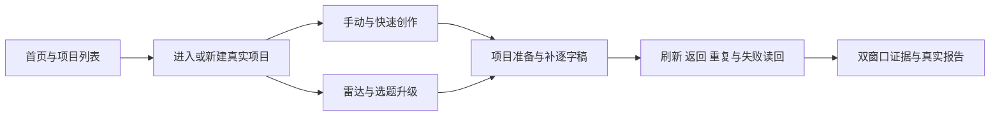

# T-1382 十条真实页面旅程合约

本合约登记下一次真实运行的检查范围，不代表已运行。大白话：从首页走到项目，检查手动、快速创作、雷达和选题入口；项目准备的保存、重复操作、异常和补稿要能读回。两档窗口都走完同样十条路径，页面截图与可见文字随运行保存。



运行使用已装账号库的只读复制品，所有写入限于本轮私有副本。实际 Next 与 Chromium 通过真实 HTTP 和服务读写，禁止 route.fulfill、成功 DTO 替身或改写响应。异常可以实际断开指定请求，并记录它确实被阻断。外网、模型登录、平台登录和调度隔离由运行器核验，不以“没看到调用”代替隔离证据。

```frontend-journey-contract
{
  "schema": "frontend-journey-contract/v2",
  "task_id": "T-1382",
  "copy_guard": { "forbid_internal_ids": true },
  "required_checks": [
    { "id": "AC-1382-HOME", "test_id": "J01-home-navigation", "description": "首页真实导航及页面可见内容与入口可用" },
    { "id": "AC-1382-PROJECT", "test_id": "J02-project-list-detail", "description": "项目列表到实际工作页、刷新后真实项目一致" },
    { "id": "AC-1382-MANUAL", "test_id": "J03-manual-create", "description": "手动建项经真实保存进入项目，无来源不伪造准备完成" },
    { "id": "AC-1382-QUICK-SOURCE", "test_id": "J04-quick-source", "description": "快速创作携真实来源引用进入项目，页面及服务读回一致" },
    { "id": "AC-1382-QUICK-EMPTY", "test_id": "J05-quick-empty", "description": "快速创作无来源时真实保存，不虚构来源和准备任务" },
    { "id": "AC-1382-RADAR", "test_id": "J06-radar-idempotency", "description": "雷达选作品升级/查看真实项目，重复动作返回同一项目" },
    { "id": "AC-1382-TOPIC", "test_id": "J07-topic-upgrade", "description": "选题升级进入真实项目，来源保持选题，重复进入不多建" },
    { "id": "AC-1382-CONTROLS", "test_id": "J08-preparation-controls", "description": "项目准备真实暂停、恢复命令回执及取消后读回，Codex未登录提示与原任务有限观察，失败不丢项目或伪造成功" },
    { "id": "AC-1382-TRANSCRIPT", "test_id": "J09-transcript-ready", "description": "项目内补逐字稿经真实服务保存，显示逐字稿就绪并刷新读回" },
    { "id": "AC-1382-SETTINGS-REF", "test_id": "J10-settings-assistant-reference", "description": "设置、编导和来源引用入口真实打开，可用与不可用状态如实显示" }
  ],
  "coherence_groups": [],
  "required_conditions": ["refresh", "back", "repeat", "empty", "error"],
  "viewports": [{"width":1366,"height":900},{"width":1024,"height":680}],
  "watched_paths": [
    "backend/src/application/projects/project-intake.ts",
    "backend/src/modules/projects/project-intake.service.ts",
    "backend/src/modules/projects/project-preparation.service.ts",
    "backend/src/modules/projects/project-preparation.service.test.ts",
    "backend/src/modules/projects/project-preparation-generation.service.ts",
    "backend/src/modules/execution/persistent-task.service.ts",
    "backend/src/modules/projects/projects.transport.ts",
    "contract/src/operations/projects.ts",
    "contract/src/resources/projects.ts",
    "frontend/src/server/persistence-client.ts",
    "frontend/src/features/projects/project-creation.ts",
    "frontend/src/features/projects/quick-create-work.tsx",
    "frontend/src/components/overlays/new-project-dialog.tsx",
    "frontend/src/features/intelligence/radar-upgrade-action.tsx",
    "frontend/src/features/intelligence/use-project-upgrade-queue.ts",
    "frontend/src/features/topics/topics-interactive-region.tsx",
    "frontend/src/features/draft-workbench/project-pipeline-panel.tsx",
    "frontend/src/features/draft-workbench/project-pipeline-panel.test.tsx",
    "frontend/src/features/copilot/ai-copilot-content.tsx",
    "frontend/src/features/copilot/project-mention.ts",
    "frontend/src/features/copilot/project-mention-menu.tsx",
    "frontend/tests/e2e/t1382-unified-intake-journeys.spec.ts",
    "frontend/playwright.t1382.config.ts",
    "docs/verification/t1382/control/PAGE_SPEC.md",
    "docs/verification/t1382/control/run-journeys.mjs",
    "docs/verification/t1382/control/generate-report.mjs",
    "docs/verification/t1382/control/supervise-journeys.mjs",
    "orchestrator/process/reconcile.config.json",
    "docs/features/t1382-unified-project-intake.md",
    "frontend/src/features/projects/new-project-form.tsx",
    "frontend/src/features/draft-workbench/project-preparation-context.tsx",
    "backend/src/modules/execution/project-preparation-state.service.ts",
    "backend/src/application/projects/project-preparation-chat.ts",
    "backend/src/modules/execution/model-engine-error.ts",
    "backend/src/modules/ai-runtime/local-codex-status.service.ts",
    "ai-worker/src/execution/codex-status-entry.ts",
    "ai-worker/src/execution/codex-app-server.ts"
  ]
}
```

每一 check 必须在 1366×900 和 1024×680 两个真实窗口各有一次完整通过的旅程、独立 witness、截图、真实服务读回与可见文案。共 20 个用例，禁止 skip、预期失败和自动重试后拿最后一次结果覆盖失败。每个 required condition 在两窗都要有真实操作与证据，不用视口尺寸充当异常覆盖。项目列表与详情的连续性由 AC-1382-PROJECT 的具体断言覆盖；这套旅程不是可筛选主从工作区验收，不虚构 master-detail 四项检查。

RED 只能来自指定真实请求已被阻断、指定原本应成功的旅程断言确实失败的运行；启动失败、登录失败、缺数据、缺截图或 preflight 失败均不构成此 RED。报告生成器同时校验 RED Playwright 非零退出、失败 error、失败 witness 和阻断 sentinel。工件缺失时记录真实证据缺口，不能手写 PASS。

本合约不扩称：六来源全部模型生成/采纳、真实模型调用、外部平台采集、真实 PostgreSQL 迁移、完整纯组 worker 装配、已安装桌面 App 重启、发布和打包。上述未验证范围沿 final.md 原记录保留；本套 UI 旅程通过也不能自动把这些范围写成全绿。

Phase C2 已补父任务暂停/恢复/取消控件，按服务端可用动作接既有执行控制命令；控制回执尚待确认时观察原父任务，有限观察结束后保留原状态，不自动重发。J08 保留全部检查并新增恢复命令成功回执断言。J10 按既有提及规则输入标题的连续前缀，仍要求按真实项目 ID 选中、显示完整标题及移除输入中的提及文本。组件与服务测试不代替双视口真实验收，外部重跑结果仍待验证。
