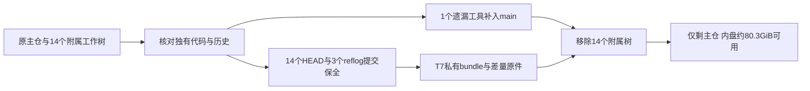

# T-1384 工作树整合与清理完成记录

2026-10-20至21，执行用户“优先清理工作树，未合并代码合入main”的授权。**14个附属工作树全部移除，当前仅保留主目录1棵工作树。**

## 实际磁盘与Git结果

- 工作树：15 → 1；移除8个内盘树和6个T7源码树。没有新建工作树。
- 内盘可用：243.2 MiB → **80.31 GiB**。
- T7可用：814.06 GiB → **846.31 GiB**，已包含本轮约14.72 GiB私有保全。
- 先清的可重建缓存目录统计18.026 GiB；后续工作树目录统计与`df`不能直接等同，APFS共享块及同期其他进程写入/清理会影响磁盘差额。报告以上述真实`df`观察为准，不将全部差额严格归因为本操作。
- `git worktree list --porcelain`最终只有主目录，17个保留引用存在；主目录依赖目录与原正式App目录仍在。未重装、推送或发布；没有覆盖T-1382等正在进行的主目录代码。

## 逐树代码结论

| 编号 | 原工作树父目录 | 原HEAD | 处置依据 | 结果 |
|---|---|---|---|---|
| 01 | `t1375-final-safe-main-p18f0s59` | `c8b96fd91` | HEAD已是main祖先 | 已移除 |
| 02 | `t1375-safe-main-gb5pdvbt` | `06b64933c` | 既有整合或后继实现已覆盖 | 已移除 |
| 03 | `t238-creator-00i2if0x` | `3aa1bf72d` | 既有整合或后继实现已覆盖 | 已移除 |
| 04 | `account-binding-daily-candidate` | `e6769b474` | 既有整合或后继实现已覆盖 | 已移除 |
| 05 | `t1364-wechat-navigation` | `2d3826ef1` | 既有整合或后继实现已覆盖 | 已移除 |
| 06 | `t1367-collapsed-navigation` | `665508e66` | 既有整合或后继实现已覆盖 | 已移除 |
| 07 | `t1369-filter-navigation` | `10cab133f` | 既有整合或后继实现已覆盖 | 已移除 |
| 08 | `t1370-t1371-ui-data` | `10238309c` | 既有整合或后继实现已覆盖 | 已移除 |
| 09 | `CreatorT247Windows-20261017` | `8e39d20a7` | 既有整合或后继实现已覆盖 | 已移除 |
| 10 | `t1300-final-20261017-7f371055a6ac` | `806a42e67` | 既有整合或后继实现已覆盖 | 已移除 |
| 11 | `T1376-20261019-923_wag6` | `dedc4b367` | HEAD已是main祖先 | 已移除 |
| 12 | `T1380-local-collaborator` | `55841ceaf` | main已含该HEAD；T1380取消方案不恢复 | 已移除 |
| 13 | `T238-20261017` | `3cd2446ca` | 既有整合或后继实现已覆盖 | 已移除 |
| 14 | `T243-CreatorOS-20261017` | `d4432b611` | 补入唯一遗漏的browser-font-r1.mjs；其余已覆盖或私有保全 | 已移除 |

旧历史不是main祖先不等于遗漏代码：T-1375将`59940d23d`安全投影成`c8b96fd9`，后者已在main。已核投影没有意外删除，83项保护源码保留；当前82项逐字相同，另1项是已确认的UI后继实现。五个Codex树的6个在途文件与main逐SHA一致。T238的残缺冻结布局删除不当作产品删除。T243的16项已选工具与main相同，另一个未跟踪工具为本次唯一需要补入的代码。

独有工具：`docs/build/growth-t243/activate-font/browser-r1/browser-font-r1.mjs`，SHA256 `193436801a9f39b08fc0c7364836ec2c4318024940a8b7ee98fb3fffe855374c`。已原字节提交到main：`7db6036be`。`node --check`实际退出0；它是绑定旧包及原浏览器任务的历史验收工具，本轮没有重新执行浏览器验收或真实激活。

## 恢复与原件

私有保全目录：`/Volumes/T7-MacData/CreatorOS-Archives/T1384-worktrees-20261020-bnm7_2jj`。恢复方法见该目录`恢复说明.md`。

- 主bundle包含14个HEAD和完整可达Git历史；补充bundle包含3个仅reflog保留的提交，两项前置提交都已证明包含在主bundle。两bundle均通过`git bundle verify`及逐ref/OID核对。
- 保留每树原Git管理目录、索引、staged/working二进制patch（含删除）、未提交/未跟踪及不可再生ignored文件；源码软链保留链接目标。
- `files.tar`与补充归档逐条核SHA/软链；补存构建时序原件、实际程序、sidecar、安装包及签名。删除前再次核源内容、索引、patch、tar总SHA及当前文件集合，无新遗漏才执行Git移除。
- T7仅删除`source`，父目录的Windows安装器、review、其它交付物与取消记录保留。正式用户数据库和登录目录不在操作范围。
- 3个reflog旧提交`26f652b5`、`59ffbbd6`、`02917375`没有独有待补产品代码：前两项仅旧报告/控制记录；后一项27个源码/测试文件与正式后继一致。保历史，不回放旧状态。

## 验证与边界

三路独立只读核查覆盖全部14树；后续独立保全审查发现并补齐reflog、管理目录、构建时序及实际交付物。首次Mac归档因自动附带`._`元数据被校验拒绝，使用`COPYFILE_DISABLE=1`重做并逐字验证；一次t1364占用匹配导致删除停止，后续重新核ps/lsof无匹配后才继续，未终止进程。最终引用清单首个前缀查询未匹配到分支，纠正为显式Git glob后实际核对17个引用，未将错误查询写成历史PASS。

已执行只读context-plan（4-build）、pmem sync、独有工具语法检查、全部归档和删除前检查、最终Git/目录/空间核对。完整reconcile沿T-1373已知副作用限制未运行；当前3.29运行器没有quick/read-only分支，不把无效参数当成只读检查。流程技能3.30/项目3.29漂移未借清理升级。未运行新的产品TDD、功能测试、真实模型、浏览器或安装验收，不代签旧T1369/T1374等任务。

已在AGENTS.md与DEC-138401记录按需创建、及时回收工作树的要求，保留必要并行写入隔离；恢复引用与差量原件替代长期保存整树和可重建缓存。
