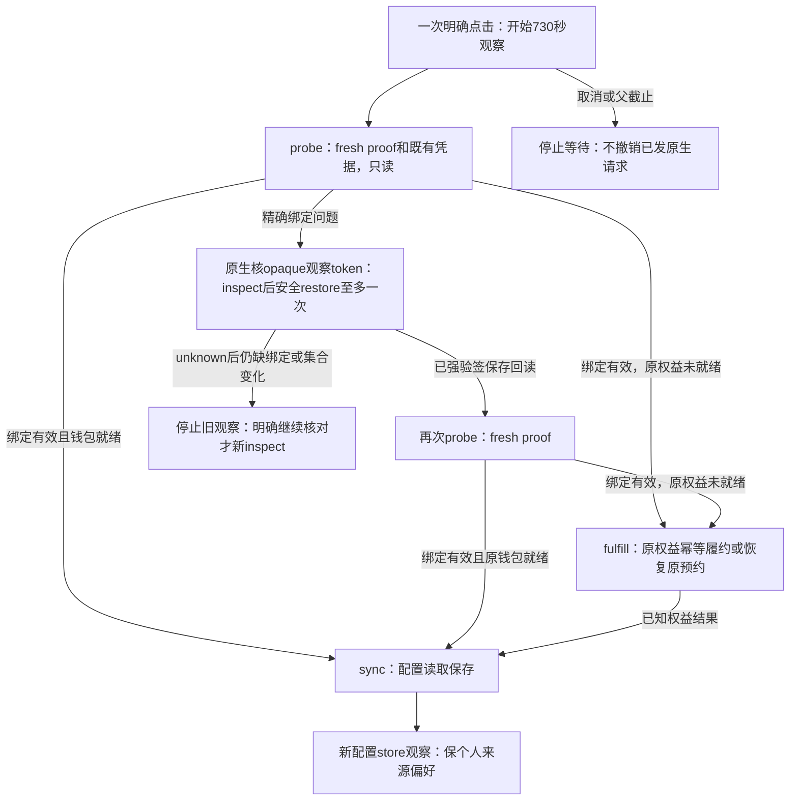

# T-1402 Creator 完整消费合同

2026-10-23；状态：待独立契约复审。本文不是实现/测试通过收据。

工作树：`/Users/zyongzhu/.codex/worktrees/legacy-license-upgrade/Thirdspace-creator`，起点 `9c585dd4db5f263d228bb71bb832700dfd81f64e`。已读主仓最新 SPEC（含本地范围授权及 unknown 六行表）、本树 Packet §1–5/7–9，写前核 §6。本轮只允许写本文档，未修改产品源、主控制面或 T-1401 候选。

上游权威：`docs/features/t1402-legacy-license-one-click-upgrade.md`；Activity 专用 `POST /api/license/restore-current`。Activity 完整候选合同：`/Volumes/T7-MacData/CodexBuilds/Activity-T1402-20261023/source/docs/contracts/T-1402-license-restore-current-contract.md`，本轮最终读取 SHA256 `b586757b7cae06f2f606c99465d94eab98a6b6f3c4dcc866a115485eab50806d`；与本文共同独审。最终稿明确当前目标已合法绑定优先返回零写no-op、activatedAt取原usedAt及目标期限必须严格晚于当前now。以下具体值不是既有服务器上线能力的声明。

## 1. 一次点击及状态迁移

设置沿原样式提供“升级原激活码，启用模型权益”。已保存原码者不重输码、不抄编号、不 reset。用户点击后自动串行完成能安全完成的步骤；不增加逐阶段确认。



- probe 成功才证明当前模型绑定有效；正常许可 status 的 active/allowed、缓存目录、IPC ready 都不能替代 fresh proof。
- probe 需要恢复只说明需由权威进一步核对。现 `MODEL_BENEFIT_BINDING_STALE` 包含空绑定、墓碑和设备不匹配，**不授予**任意释放权限；新专用恢复服务在事务内判定。
- 第一次 probe 绑定拒绝必须是尚未发送 fulfill 的阶段。fulfill 后配置失败不得回退恢复/重赠。
- 原生成功后再 probe；再次拒绝则停止，不在同一观察内循环 restore。
- 权益 ready 但配置失败，保存“原权益已就绪，配置待核对”；下一次只续 sync/store，不重做许可或首赠。只要任一阶段未知，不能宣称全部升级成功。
- 当前正式 v1 资格已涵盖历史合法 TIME/COUNT、旧自配和 null 渠道。永久是权威 TIME 的实际截止为 null；COUNT 无截止仍是次数码。本地 TIME/`perpetual` 展示不能自行授予永久资格或改为试用政策。

## 2. Activity wire 的准确消费

### 2.1 请求与签名

固定路径 `POST /api/license/restore-current`；签名 request target 必须是 `post /api/license/restore-current`。不允许 query、redirect、alternate host、改发普通 activate 或管理端 upgrade-lifetime。请求 JSON UTF-8、至多4096字节；Content-Type application/json（可有UTF-8 charset），响应要求 no-store。code/machine各1–256 UTF-8字节、无首尾空白或 U+0000–001F/U+007F；projectKey满足 `[a-z][a-z0-9_-]{0,63}`，不改变原码大小写或格式。

inspect exact object：

```ts
{
  contractVersion: "license-restore-current-v1",
  action: "inspect",
  projectKey: string,
  code: string,
  machineId: string,
  nonce: string
}
```

restore 只在上述字段之外增加 `expectedStateDigest: string`，action 改为 `"restore"`。project/code/machine 全部由 Rust 当前可信上下文取得，不来自 IPC 参数、JS 或 Node 展示副本。nonce 每次 HTTP 请求独立生成 32 随机字节 canonical base64url（43 字符）；不得复用。digest 是 `sha256:` + 64 位小写十六进制。

`expectedStateDigest` 只能使用**本次 inspect 的同一原对象结果**。它不是授权或释放清单，没有独立 TTL；restore 仍由服务端锁内重新判当前期限和全部事实。旧观察收到 STATE_CHANGED 后不重新取新摘要并静默提交。

### 2.2 响应 exact object

所有已完成业务响应：

```ts
{
  contractVersion: "license-restore-current-v1",
  action: "inspect" | "restore" | null,
  nonce: string | null,
  serverTime: string,
  outcome: "ready_missing" | "already_bound" | "restored" | "denied",
  code: RestoreServerCode | null,
  expectedStateDigest: string | null,
  invalidBindingCount: number,
  license: RestoreLicense | null
}
```

`RestoreLicense` exact object：

```ts
{
  projectKey: string,
  licenseMode: "TIME" | "COUNT",
  activatedAt: string,
  expiresAt: string | null,
  remainingCount: number | null,
  channelRef: string | null,
  entitlementBindingHash: string,
  authorizationVersion: number,
  deviceStateVersion: number,
  isActivated: true,
  bindingValid: boolean
}
```

时间均为合法、往返一致的24字符 `YYYY-MM-DDTHH:mm:ss.sssZ`；activatedAt 是原 `usedAt`，不可为 null。COUNT remainingCount 为正安全整数（且 expiresAt=null）；TIME remainingCount=null。authorizationVersion/deviceStateVersion为正安全整数。entitlementBindingHash严格为 `sha256:`+64小写hex；channelRef原字符串或null，不把`__unassigned__`归一为null，不按当前包换渠道。不把这些身份返回 WebView。invalidBindingCount必须非负安全整数；already_bound/denied恒0，restored是本次释放的不同其他授权数量，不当设备数/钱包数。

- `ready_missing`：仅 inspect；code=null，digest 非 null，license 非 null 且 bindingValid=false，invalidBindingCount 为当前精确失效集合数量。此结果不能安装为有效新快照。
- `already_bound` / `restored`：code=null、digest=null，license 非 null、isActivated=true、bindingValid=true。already_bound 是当下状态，不证明上一次请求执行历史。restored 只能来自 restore。install 前仍验完整签名、identity 和期限。
- `denied`：稳定 code；license=null、digest=null、invalidBindingCount=0。合法请求必须 action/nonce 原样 echo；malformed 请求可返回 null，但本原生调用自行构造合法请求，任何不匹配均不能安装或信为本操作结果。
- 顶层没有旧 `success`、`valid`、`message` 等字段；未知/额外字段拒绝。**不能直接用旧 WireBody 或普通 Activate normalizer 解析。**

目标已合法绑定时，专用 path 按当前目标资格和精确绑定先返回 already_bound/no-op；其他后来出现的有效/失效绑定也不释放。只有目标确实缺绑定才检查其他有效冲突和releaseSet。Creator 不以其他绑定后来出现为理由强迫再恢复或换摘要写。目标TIME的有效期限必须严格 `expiresAt > now`（null永久除外）；精确等于now也不能返回安装成功。其他占位的失效分类不由客户端计算。

### 2.3 拒绝枚举及旧服务行为

| HTTP | RestoreServerCode 白名单 |
| --- | --- |
| 422 / 413 / 405 / 404 | RESTORE_REQUEST_INVALID / RESTORE_BODY_TOO_LARGE / RESTORE_METHOD_NOT_ALLOWED / RESTORE_LICENSE_NOT_FOUND |
| 403 | RESTORE_PROJECT_DISABLED、RESTORE_LICENSE_REVOKED |
| 409 | RESTORE_NOT_PREVIOUSLY_ACTIVATED、RESTORE_UNSUPPORTED_LICENSE、RESTORE_LICENSE_EXPIRED、RESTORE_COUNT_DEPLETED、RESTORE_SCOPE_MISMATCH、RESTORE_ACTIVE_BINDING_CONFLICT、RESTORE_TARGET_BOUND_ELSEWHERE、RESTORE_BINDING_NOT_RECOVERABLE、RESTORE_STATE_CHANGED、RESTORE_HISTORY_INCOMPLETE |
| 503 | RESTORE_BINDING_UNAVAILABLE、RESTORE_SIGNING_UNAVAILABLE、RESTORE_UNAVAILABLE |

正常成功/错误都用既有 withLicenseSignature 签名出口；服务端签名能力缺失必须在写前拒绝。缺私钥产生的 503 可能无法签名，原生只能将其视为“不可安全验证”，不能信任其 body 或保存许可。旧服务 404/405、HTML、redirect、未知版本、缺签名同样停止，不回退 activate。用户安全文案不照搬任意网络/body 错误。

新端点时间验证采用其更严格边界：签名 X-License-Date 的 RFC1123时间与 body.serverTime 相差≤2000ms；serverTime与本机当前墙钟相差≤120000ms；并保既有可信 last-seen/回拨拒绝。不能误沿旧链300秒容差。签名原始输入是固定target、允许host、原date、最终body SHA-256 digest四行（无尾换行）。成功只允许HTTP200；HTTP状态与outcome/code不匹配或合法请求nonce/action不匹配均拒绝。

## 3. 最小 opaque 参数 native IPC

新增 `license_restore_saved`，参数 exact `{observationToken: string}`，只接受§10的单一opaque `enc:v1:` token，不接收原码/机器/路径或前端构造的许可事实。初稿无参方案因跨请求换码反例被§10替代。候选 exact response：

```ts
{
  contractVersion: "creatoros-license-restore-result-v1",
  status: "ready" | "pending" | "blocked" | "unknown",
  reasonCode: NativeRestoreReason,
  bindingStatus: "verified" | "unverified",
  persistence: "confirmed" | "unchanged" | "unknown",
  retryable: boolean
}
```

NativeRestoreReason 白名单：`RESTORE_READY`、`RESTORE_IN_PROGRESS`、`RESTORE_CONTINUE_REQUIRED`、`RESTORE_LOCAL_LICENSE_UNAVAILABLE`、`RESTORE_IDENTITY_CHANGED`、`RESTORE_RESPONSE_UNVERIFIED`、`RESTORE_STORAGE_UNCONFIRMED`、`RESTORE_SERVICE_UNSUPPORTED`，以及上节已验证业务响应中的 RestoreServerCode。任意其他码归并 RESPONSE_UNVERIFIED，不向 UI 透传 body。

约束：ready 必须 bindingStatus=verified 且 persistence=confirmed；pending 仅表示既有原生请求仍在执行，不新增网络写；unknown 表示提交或保存不能确认；blocked 是明确拒绝/本地缺原码。没有原码、机器摘要、签名、Key、scope hash、原始服务端 message 或钱包金额。UI 以本地固定文案映射 reasonCode，不接受上游指定 action。

完整允许组合（未列的一律拒绝；`unchanged`表示本命令未确认安装新候选，不声称外部没有改文件）：

| status | reasonCode | bindingStatus | persistence | retryable |
| --- | --- | --- | --- | --- |
| ready | RESTORE_READY | verified | confirmed | false |
| pending | RESTORE_IN_PROGRESS | unverified | unchanged | true |
| blocked | LOCAL_LICENSE_UNAVAILABLE / IDENTITY_CHANGED / SERVICE_UNSUPPORTED / RESPONSE_UNVERIFIED（均带RESTORE_前缀） | unverified | unchanged | false |
| blocked | 已强验签业务拒绝码（除STATE_CHANGED及503三项） | unverified | unchanged | false |
| blocked | RESTORE_STATE_CHANGED / RESTORE_BINDING_UNAVAILABLE / RESTORE_SIGNING_UNAVAILABLE / RESTORE_UNAVAILABLE | unverified | unchanged | true |
| blocked | RESTORE_CONTINUE_REQUIRED（token过期/重复/未知或观察失效） | unverified | unchanged | true |
| blocked | RESTORE_STORAGE_UNCONFIRMED（回读旧值） | verified | unchanged | true |
| blocked | RESTORE_RESPONSE_UNVERIFIED（checked候选已确认，但既有runtime gate/notify拒绝） | verified | confirmed | false |
| unknown | RESTORE_CONTINUE_REQUIRED（restore已发，续查仍missing/变更/不可验证） | unverified | unchanged | true |
| unknown | RESTORE_RESPONSE_UNVERIFIED（restore已发且无法完成只读续查） | unverified | unchanged | true |
| unknown | RESTORE_STORAGE_UNCONFIRMED（回读既非旧亦非候选） | verified | unknown | true |

上述 REASON 简写展开后必须等于完整枚举。pending 不用于任意业务503。blocked RESPONSE_UNVERIFIED 的 unverified+unchanged 行仅恢复写尚未发出；写已发且响应不能核实时按unknown行；checked候选已confirmed后runtime gate拒绝则用上表专用 verified+confirmed 行，不谎称未保存/存储未知、不继续经济链。runtime gate不通过不得返回ready，不安装未经确认的放行状态。

### 3.1 原生固定流程与锁

1. 命令入场即 acquire 全局 atomic flight guard；已有 flight 直接返回 pending/IN_PROGRESS，不能排队变成第二个恢复写。flight 在 Rust 持有到真实操作收尾，UI 取消不会释放。
2. 固定锁序：升级 flight → 既有 `chain_lock` 的 try_lock。锁等待也受原生入场时开始的绝对截止约束，不允许无界 blocking lock 后再开始370秒。在 chain_lock 下从固定 appData `.license` 解密读取当下原码和快照，取得 `ctx.machine_id`、产品 projectKey。保存码与本次请求共用同一身份临界区。不能外层拿 chain_lock 后再调用会拿同一锁的 `run_chain_and_persist`。
3. 不读取 activation_state/剪贴板/任意路径，不返回原码。快照缺失/损坏或当前 project/machine 不一致，准确拒绝，不补猜、不 reset。
4. **无条件 strict**：忽略旧 cfg.strict_verify=false 兼容 flag，复用 `verify_response_signature` 的 digest、Ed25519、target/host/date 和 nonce 校验；强制合法 key、当前 serverTime、可信时钟偏差、产品归属。无签名或离线 grace 都不能算升级成功。原 activate/status 兼容行为保持。
5. HTTP 最多三个：inspect 一次；只有 ready_missing 才 restore 一次；restore 响应未知时最多再 inspect 一次。独立 HTTP adapter 将 timeout 设为 min(120000, native 剩余ms)，并限制响应读取/解析仍在同一截止内；旧 ReqwestHttp 的 timeout 下限不适合直接复用。新 nonce，全部受原生入场即开始的唯一 370000 ms deadline 约束。不继承旧 MAX_ONLINE_ATTEMPTS 去重发 restore 三次，也不在 unknown 时重新取摘要自动再 restore。
6. 初次 inspect already_bound，或 unknown 后 inspect already_bound，可消费其强验签许可结果并 checked 保存。unknown 后 inspect 仍缺失/集合变化/不可验证，则返回 unknown/CONTINUE_REQUIRED；旧观察结束。用户明确点击“继续核对”才允许新 inspect，并由当前 fence 决定是否 restore。
7. 保存前重新读取固定原快照，核对 code、machine、project、licenseMode、channel 与原期限身份未变；外部文件替换同样检测。不要以持锁为由省略保存前身份 fence。
8. 不调用旧 `license_activate` 包装器、不发其异步 Activation；新命令只处理许可，经济链由 UI 的同一次点击顺序推进。

### 3.2 安全保存及现许可保持

从强验签 RestoreLicense 单独构造候选快照：code 仍来自本地原码；machine/project 为当前宿主且与 wire 一致；保原模式/渠道/原实际 expiresAt 和原许可性质；activatedAt 取服务端签名的原 usedAt，绝不置为本次 wall/serverTime。旧本地 activatedAt 可能被历史普通重激活刷新，因此不能把它强等于服务端 usedAt 后误挡历史用户。

inspect 的许可身份只在 Rust 内存保留；restore 或 unknown 后 already_bound 的 project、licenseMode、activatedAt、expiresAt、remainingCount、channelRef、entitlementBindingHash 必须与本次 inspect 同一原对象一致。authorizationVersion/deviceStateVersion允许反映真实当前epoch，但必须正安全整数且不得倒退；它们变化不生成新经济身份。服务端fence拒绝不能由客户端忽略。初次inspect already_bound没有先前wire时，仍校验当前本地原对象和权威许可，再以freshproof守住后续模型身份。

原期限不由客户端重算；若已保存原期限与权威原期限出现不一致，停止并显示身份/期限需核对，不自行把永久改限时或反向延长。remainingCount 仅校验，不消费、不补次数；快照既有离线 grace 参数保持。用签名可信时间更新在线确认时间/last-seen，保留既有防回拨和运行期 gate。

只在 already_bound/restored 且 bindingValid=true 时，使用 `write_snapshot_file_checked` 原子写 + 权威文件回读：

| 回读结果 | 结果 |
| --- | --- |
| 与新候选完全一致 | confirmed；即便 replace 后 fsync 报错也以真实回读收敛 |
| 与旧快照一致 | unchanged；不报升级保存成功，保原授权 |
| 既非旧值亦非候选、无法解密或无法读回 | unknown；停止，不盲覆盖/删除或反复重写 |

恢复业务/验签失败不沿普通 Activate 的 failed 分支把原快照改为 expired/inactive，也不因此广播 licensed=false 把已可用用户踢出 App。真实撤销/过期由原许可链按既有规则处理；新恢复报告拒绝而不伪造许可状态。既有runtime gate自身的安全降级/事件语义保持；checked已confirmed而gate拒绝按上表真实元组返回，不拦截旧gate或假报存储失败。

checked 确认后才更新既有安全 GateDecision 缓存/事件；其结果仍经过原运行期放行门。新路径不额外调用旧 blocking 120 秒 license-sync mirror：此次保原业务展示字段，sidecar 模型权威直接读 `.license`；展示副本沿现正常许可同步维护，不承担升级成功真实性。这样新原生流程没有隐藏第四个网络阶段或后台 fulfill。

不自动 relaunch；当前用户 already allowed。若具体宿主 token 状态确需重启，应在实现前以真实反例补合同，不能照搬 ActivateForm 无条件重启，也不能悄悄杀未保存工作。

## 4. TS 数据端口与 typed 投影

复用现空 POST `/api/v1/local/client-config`，保 loopback handshake、session/账号范围、no-store、空 body 守卫；增加白名单 trigger `legacy_upgrade` 和枚举 header `x-creatoros-upgrade-action: probe | fulfill | sync`。无此 trigger 时原端点协议保持；非法组合/未知 action 返回 422 安全错误，不接受任意操作名、URL、原码或 proof 参数。

三个动作的 exact 安全投影：

```ts
{
  contractVersion: "creatoros-legacy-model-upgrade-v1",
  action: "probe" | "fulfill" | "sync",
  phase: "proof" | "credentials" | "fulfillment" | "configuration",
  outcome: "ready" | "restore_required" | "pending" | "blocked" | "unknown",
  reasonCode: UpgradeReason,
  bindingStatus: "verified" | "unverified",
  entitlementStatus: "not_started" | "ready" | "pending" | "unknown" | "not_eligible",
  configurationStatus: "not_started" | "ready" | "pending",
  retryable: boolean
}
```

UpgradeReason 白名单：`UPGRADE_READY`、`UPGRADE_BINDING_RECHECK_REQUIRED`、`UPGRADE_LICENSE_INELIGIBLE`、`UPGRADE_LICENSE_REVOKED`、`UPGRADE_IDENTITY_CHANGED`、`UPGRADE_AUTHORITY_UNVERIFIED`、`UPGRADE_ENTITLEMENT_NOT_READY`、`UPGRADE_WALLET_NOT_LINKED`、`UPGRADE_ENTITLEMENT_UNKNOWN`、`UPGRADE_EXISTING_OPERATION_PENDING`、`UPGRADE_CONFIGURATION_PENDING`、`UPGRADE_SERVICE_UNAVAILABLE`。安全文案由 UI 固定映射。内部精确服务码仅用于守卫/固定码日志；不直接把任意上游 action、身份、凭据、签名或完整错误透出。

完整组合矩阵，未列组合拒绝；`not_started`是本动作尚未读取/提交该阶段，**不是**宣称服务端没有历史经济对象。既有更早ready事实由UI分阶段保留，不被not_started覆盖。

| action / phase | outcome / reasonCode（UPGRADE_前缀） | bindingStatus | entitlementStatus | configurationStatus | retryable |
| --- | --- | --- | --- | --- | --- |
| 任一 / proof | restore_required / BINDING_RECHECK_REQUIRED | unverified | not_started | not_started | false |
| 任一 / proof | blocked / LICENSE_INELIGIBLE或LICENSE_REVOKED | unverified | not_eligible | not_started | false |
| 任一 / proof | blocked / IDENTITY_CHANGED或AUTHORITY_UNVERIFIED | unverified | not_started | not_started | false |
| 任一 / proof | unknown / SERVICE_UNAVAILABLE | unverified | not_started | not_started | true |
| probe / credentials | ready / READY | verified | ready | not_started | false |
| probe / credentials | pending / WALLET_NOT_LINKED（200 linked=false） | verified | pending | not_started | true |
| probe / credentials | pending / ENTITLEMENT_NOT_READY（404） | verified | unknown | not_started | true |
| probe / credentials | unknown / ENTITLEMENT_UNKNOWN（明确unknown或网络未知） | verified | unknown | not_started | true |
| probe / credentials | blocked / EXISTING_OPERATION_PENDING（paid bootstrap或状态冲突） | verified | pending | not_started | true |
| fulfill / fulfillment | ready / READY | verified | ready | not_started | false |
| fulfill / fulfillment | pending / WALLET_NOT_LINKED或ENTITLEMENT_NOT_READY | verified | pending | not_started | true |
| fulfill / fulfillment | unknown / ENTITLEMENT_UNKNOWN或SERVICE_UNAVAILABLE | verified | unknown | not_started | true |
| fulfill / fulfillment | blocked / EXISTING_OPERATION_PENDING | verified | pending | not_started | true |
| fulfill / fulfillment | blocked / LICENSE_INELIGIBLE或LICENSE_REVOKED | verified | not_eligible | not_started | false |
| fulfill / fulfillment | blocked / IDENTITY_CHANGED或AUTHORITY_UNVERIFIED | unverified | unknown | not_started | false |
| sync / configuration | ready / READY | verified | ready | ready | false |
| sync / configuration | pending / CONFIGURATION_PENDING | verified | ready、pending或unknown（由实际本次凭据读回决定） | pending | true |
| sync / configuration | blocked / IDENTITY_CHANGED或AUTHORITY_UNVERIFIED | unverified | unknown | pending | false |

例如 probe+configurationStatus=ready、ready+unverified、fulfill+配置ready、blocked+任意自由码均非法。sync内若前置proof失败走共享proof行；成功读取凭据后写入失败才允许保entitlement=ready。probe网络不可用不使绑定“已验证”；credential阶段网络未知只保此前已验证的proof。

| 动作 | 实际数据链 | 准确结果及副作用 |
| --- | --- | --- |
| probe | 现 fresh Activity v1 proof → Growth credentials 既有对象查询；proof/credential closed 验证；全程 server-only | proof 绑定拒绝：restore_required，entitlement=not_started；proof 未过不发 Growth。绑定有效且原 Key/钱包 linked：entitlement=ready。原钱包未就绪/unknown：pending/unknown。无 fulfill/provider create；不写路由偏好。 |
| fulfill | fresh proof → 现 Growth fulfill，原 project+entitlement+service 业务幂等 → 仅验证并保留经济结果 | 每次明确观察最多一条逻辑 fulfill；已有 unknown 只恢复原预约，新 provider POST=0。不换经济身份、不建 client journal；ready 不等同配置完成。取消/丢响应记 unknown，后续先 probe。 |
| sync | fresh proof → directory → existing-only credentials → 现 settings service port 保存凭据及加密配置 | 零经济写；沿原身份/generation/commit fence，不能用配置读取补赠。原权益 ready 已知结果不被本步失败覆盖。 |

既有凭据查询 `not_configured/provisioning/unknown` 不能解释为此前经济写从未发生；Growth 已确认正式 fulfill 对原 entitlement+service 幂等。原预约存在时只 recover 原 Key 名/金额，不新建 provider Key。若首次网络请求根本未到达、服务端无预约，明确启用/继续可成为合法首次履约，不能承诺所有 network-unknown 全程 provider POST=0。该语义以真实服务结果/跨仓向量验收，不靠随机 Idempotency-Key 当证明。

Growth 的真实协议只允许请求 `{contractVersion:"growth-model-benefit-request-v1", modelBenefitProof}`；不得增 existingOnly、activationFulfillment、serviceId、operationId、expectedStateDigest 或 query。三路均 POST；随机 HTTP Idempotency-Key 实际仅 link-session 消费，不参与 fulfill/credentials/directory 经济身份。`credentials → 200` 还必须 wallet.linked=true 才算原凭据/钱包 ready；200 linked=false 可按明确升级动作 fulfill 恢复原预算，不能当新首赠。404 MODEL_CREDENTIAL_NOT_CONFIGURED 可能是 failed 未知预约，不证明从未开户。409 ACTIVATION_ACCOUNT_PROVISIONING / MODEL_PROVIDER_CREATION_UNKNOWN 保原预约；AI_CREDIT_BOOTSTRAP_PENDING / ACTIVATION_CREDENTIAL_STATE_CONFLICT 保原付费/冲突归属并停止，不抢占另开。

可消费 Growth 工件：`/Users/zyongzhu/Workbase/Thirdspace-growth/docs/build/T-249-validation/FORMAL_V1_ECONOMIC_PROTOCOL.md`、`formal-v1-economy-r1/CONSUMER_VECTORS.json`（SHA256 `a7c9ae53ce13c955e8bfcc219085edc04e483ef6da9cc10e5863f3bccf3d069d`）。其真实 Growth router/service + SQLite 内存/fake provider 的4场景本地通过，production/真实provider/外网调用0；OUTPUT_CHECK 明示 CreatorActualConsumerRun=false。这是未来消费输入，不是本文或 Creator 已通过验收。

模型目录/credential/proof v1 fields、policy、scope 摘要不变。T-1402 主树不包含 T-1401 v2 产品差异，不在这里复制试用 v2；未来集成要重新绑定源码回归。正式 probe 不把弱本地 TIME fallback 当新资格。

HTTP：合法动作已得到可信 typed 业务结果返回 200（可含 blocked/pending/unknown）；422 非法调用，401/403 保原上下文守卫；无法构造可信投影返回 503 安全错误。UI 不依赖 !response.ok 覆盖已知阶段状态，仍必须校验 exact schema 和 action 一致。

本合同采用独立 `upgradeModelBenefits`/`probeModelBenefits` 类型端口，不扩大旧 ActivationIncludedCreditResult 的语义，不为 startup/scheduled/manual_revalidate 增加 fulfill。旧 activation 主流程可另保已知部分成功，但不能借此扩大原定时经济行为。

## 5. unknown、继续与当前范围

遵循 SPEC unknown 六行表的行为：

1. fresh proof 有效：读取原凭据；未就绪时沿同权益/service fulfill 恢复原预约。
2. 精确需要恢复且本次未提交过 restore：native inspect → 原 fence 下 restore 一次 → 强验签保存回读 → probe。
3. restore 发出未知：native 只读 inspect；already_bound 强验签结果可 checked 保存；随后 probe。不是声称历史请求执行结果。
4. unknown 后仍 missing 或集合变化：本次停止；明确显示“原绑定结果尚未确认，请继续核对”。用户点击“继续核对”才开始新的观察和新 inspect；不要求编号、原码或额外阶段确认。
5. 经济 unknown：先 probe 原凭据；已有 linked 续 sync。初次明确“升级/启用”尚未在本观察提交履约时，即使credentials404，也可由本次明确点击继续同权益fulfill；不能宣称从未开户。若本观察已提交并得到unknown，或409明确unknown，只读后仍未确认必须停止，用户明确“继续核对”才同权益/service fulfill。有原预约只recover、新providerPOST=0；无预约的合法首次履约不冒称恢复原请求。每次观察最多一条逻辑fulfill，不后台循环。
6. 已知经济 ready、配置失败：只 sync 与 store，不再 restore/首赠。

UI 当前 scope 为 group/account，使用当前事件和 generation 隔离；换组/换账号/关闭/旧身份失效清本观察状态，不提交后续阶段。late native 成功也不能直接写回新组提示，需新观察重新读原对象。

原生 flight 是进程内真实执行 guard，超时/取消时仍持到收尾。下次点击遇 flight 未完成只提示/只读，不排队为新写；收尾后用户明确新点击才可在新事实下 inspect。重启不创建操作数据库：先 probe/既有凭据和专用 inspect 收敛；只有真实不能收敛的反例才另审最小持久 op，当前不默认引入。

## 6. 绝对预算与取消

父观察截止保持现 `INCLUDED_CREDIT_WAIT_MS = 730000`，从最初按钮点击起创建唯一 AbortController/定时器与 `deadlineAt`。所有 fetch、import、JSON、IPC 等待和 store 读取等待都由同一 parent signal 包裹。恢复后、unknown 继续原观察、加入 shared flight 均不重新开始 730 秒。

| 阶段 | 上限及规则 |
| --- | --- |
| 每条 TS 网络 | 复用现 120000 ms 单请求上限，父剩余更短时父先结束；不因 retry/join 续期。原 proof/read 观察保原身份/截止。 |
| native 总操作 | 370000 ms，至多 inspect/restore/unknown-inspect 各一次，HTTP 各至多 120000；本地校验/checked 保存/事件收尾在原剩余预算内。无旧 mirror 第四请求。 |
| TS fulfill/config | 受同一父剩余约束；既有 730000/370000 局部保护只取更早截止，不形成新的整段等待预算。 |
| 新 store 读回 | 复用实际 routing 共享观察的既有有限上界；父先到即停止本观察，不另起完整计时。 |

730000 是用户**观察**上限，不承诺所有串行最坏阶段一次都完成。理论串行上界可超过它，但不得把按钮等待扩到 25 分钟；截止时保留 ready/unknown 等已知事实，用户明确继续。没有无限轮询、静默扩大 fence 或无界延长。

IPC 一经发送不能由 AbortController 撤销。UI parent 到期只停止等待/后续 TS 阶段；native 保固定自身预算和 guard 直到真实收尾。原生操作过期前若已发 restore，响应未知应按上表收敛，不以超时假装未提交。原生阶段间/保存前检查自身剩余预算，不能过去 deadline 再开始写；已开始原子保存必须收尾后再释放 guard并按真实回读报告。

客户端取消文案：“已停止等待，已提交的授权恢复仍可能完成；请稍后继续核对。”未发 native/fulfill 的取消不描述为已提交；不宣称回滚授权或赠额。不阻塞 App 其他页面。

## 7. 配置 store 的新观察

`loadModelRouting(true)` 当前可能 join 升级前旧 GET，并吞失败（`frontend/src/features/copilot/assistant-engine.ts:79–91`）；不能机械 await 后宣成功。

新增明确 `refreshModelRoutingAfterUpgrade(signal)`：在同 scope/generation 下建立完成屏障，等待旧读合法收尾（等待受 parent 限制），随后最多启动一条屏障之后的新 GET；若已有屏障之后相同 scope 的新读可共用其结果。返回明确成功/失败或抛可识别错误，不吞。不能取消其他观察者或写偏好；新读覆盖前重核 scope/generation，旧结果不能追写。若用户正在保存来源或已切 scope，停止当前升级展示，不中断真实保存。

UI 完成条件为：当前 fresh proof 有效、原权益 ready、配置已安全保存、屏障后新 store 读回成功。用户原自配/Codex 选择保持；官方能力可用不等于强制改为官方。失败保“权益已就绪，界面配置待核对”，不可报已全部升级。

## 8. 最小准确候选写集与分工

当前均为**拟准入**；Root 更新 Packet 和独评 PASS 后才写。本文不是产品写权限。

### Native（可由 Root 独占实现，避免与 TS 作者交叠）

1. 新增 `frontend/src-tauri/src/license_restore.rs`：仅opaque token参数的命令、closed parser、strict 校验组合、global atomic flight/chain_lock、独立剩余预算 HTTP adapter、checked回读、候选构造和 inline `#[cfg(test)]` 测试。仅复用 license.rs 已有 pub/pub(crate) 加解密、签名、checked 保存与安全判定通知原语；不改 `license.rs` 的旧 activate/status 行为。
2. `frontend/src-tauri/src/lib.rs`：只注册新 IPC 和必要 flight 状态装配。
3. `frontend/src-tauri/build.rs`：app manifest 新命令声明。
4. `frontend/src-tauri/secure_strings_build.rs`：新增真实专用 path，生成表数量同步；保既有序号不重排。
5. `frontend/src-tauri/src/secure_strings.rs`：新 ID/target 和生成表 cache 数量同步；debug/release 使用同一真实协议。
6. `frontend/src-tauri/capabilities/remote-sidecar.json`：仅现主窗口 sidecar origin 新增 `allow-license-restore-saved`，不加任意域/shell。
7. `frontend/src-tauri/permissions/autogenerated/license_restore_saved.toml`：真实 Tauri 生成许可工件，非手填生成收据。
8. `frontend/src-tauri/src/license.rs`：仅将现 `prod_points` 可见性改为 `pub(crate)`，复用原双冗余last-seen存储和现回拨算法；不改函数逻辑、旧许可链或兼容flag。若实现证明已有公开端口足够，可不修改该文件，不能扩大成旧行为重构。

Root 已明确原生独立模块路径为 `license_restore.rs`；`lib.rs` 增加模块及 command 注册；`license.rs` 仅上述可见性例外。`owned_devices.rs` 只作 checked 回读模式参考，不改其业务。

### TS（本作者后续承担）

1. 新增 `frontend/src/lib/legacy-license-upgrade.ts` 与 `frontend/src/lib/legacy-license-upgrade.test.ts`：上述纯安全 DTO/closed parser、白名单和不含秘密的协议常量；不放许可或经济业务。
2. `frontend/src/server/activation/model-benefit.server.ts` 与现 `.test.ts`：probe/fulfill/sync 的实际端口、精确阶段错误和部分成功、原 formal v1 防回归。
3. `frontend/src/app/api/v1/local/client-config/route.ts` 与现 `.test.ts`：空 POST 的白名单 trigger/action、上下文与 typed 结果，不扩定时经济行为。
4. `frontend/src/features/settings/channel-model-configuration.tsx` 与现 `.test.tsx`：一键及继续旅程、真实组件接线、原生 invoke mock、父绝对预算、late callback/scope隔离、部分成功。按钮不再因已有钱包而把升级/核对入口整体隐藏。
5. `frontend/src/features/copilot/assistant-engine.ts` 与新增 `frontend/src/features/copilot/assistant-engine-model-routing-refresh.test.ts`：新观察屏障和明确读回结果；原 `assistant-engine-server.test.ts`、`use-assistant-engine.test.tsx` 作为只读回归，不默增写。
6. `frontend/src/server/activation/ai-credit-link.server.ts` 与现 `.test.ts`：保留白名单 proof 绑定错误，避免后续额度按钮仍吞成通用不可用；其他异常安全归并。

无需修改 `client-config.server.ts` 的旧 ActivationIncludedCreditResult、ActivateForm、激活 redirect、reset、机器 ID、worker、钱包 schema/账本或模型路由 PUT。若最终实现需要其中任何路径，先用具体调用点说明并补 Packet；不能用“内部 helper”暗扩。

## 9. 验收向量与完成语义

| 必测向量 | 确切断言 |
| --- | --- |
| 历史永久TIME / 有期TIME / COUNT | 正式 v1及原scope不变，保原期限/原次数/usedAt；COUNT不冒永久、不扣次数 |
| 当前host/保存码来源 | JS无原码输入/输出；project/machine/channel/原身份变化在写前和保存前拒绝 |
| strict=false环境 / 缺头/nonce/target/date/digest/签名/额外字段 | 新IPC仍强验签；拒绝新结果且保原快照，不离线成功 |
| 旧服务/未知版本/签名不可用 | 无旧activate fallback，恢复写0，原App仍可用 |
| inspect already_bound | 不发restore；强验签checked保存，freshproof后消费 |
| ready_missing → restore | 同digest一次restore；有效冲突/墓碑/历史不完整不释放；事务准入由Activity真实PG验收 |
| restore lost response → inspect already_bound | 无第二restore；安装当下真实许可，不伪造历史回执 |
| restore lost response → inspect missing/state_changed | 同观察停止；只有明确继续新观察才取新digest；无持久journal必选 |
| checked old/new/unknown与replace后fsync异常 | 三分真实；不会沿失败Activate把旧许可覆盖expired |
| 双击/并发IPC/取消/晚到/父截止/另一窗口换码 | native guard持到收尾、不排队新写；UI不追写新组；同父预算不续期 |
| 原经济5元/30元/充值/unknown | 同权益/service复用，唯一首赠不重发、不补差；已有unknown预约只recover且新providerPOST=0；无预约的合法首次履约与历史未知不混称 |
| 配置失败与fresh store旧GET延迟 | 保经济ready；新观察确认才完整成功；偏好PUT=0 |
| no-wallet cold start / null渠道 / 原自配 | 正式统一资格；不依赖已有账户按钮隐藏、不强切来源 |
| T1401边界 | 不混入冻结候选；以后真实集成另做正式v1与试用v2全回归 |

native 测试完全注入 HTTP/clock/store，不读取真实密钥/许可或 invoke/relaunch。TS 每轮独立 PGLITE_DATA_DIR、空真实数据库连接；不调用真实模型、Key、激活钱包。Activity 真实隔离发行/签名和 Growth 原服务输出向量到位后才称跨仓消费 PASS，不手填冒通过。

聚焦 RED/Green、原许可与配置回归、完整6144 MiB/并发1 typecheck、quality/timeout-policy/boundary、独审分别记录；真实 App 一键旅程、打包安装、本机限定对象恢复及其他用户分发/生产部署分别验收。本文仅冻结候选实现合同。

## 10. 跨请求与 native 同一原对象 fence（精确增补）

已复现的设计反例：单条access的observationGeneration/licenseDigest不能覆盖probe A后另窗口换码B，再fulfill B或无参native恢复B。既有licenseDigest还缺mode/expiry；完整快照hash又会因合法恢复epoch/activatedAt/lastSeen变化误拒。本节只补本轮21路径内的进程内有界fence，无DB/journal/经济operation，不修改Activity wire。

### 10.1 单一header及创建规则

- 唯一header `x-creatoros-upgrade-observation`，值就是下述opaque token，不另传一套UUID。初次明确probe不带该header，**仅此动作可创建**；服务端生成canonical lowercase UUIDv4，在proof之前读取当前可信快照并钉稳定身份，响应header返回token。即使proof精确拒绝绑定，仍可返回该已钉身份token供native核对。
- 后续probe/fulfill/sync必须发送同一token，服务端Map按完整token exact命中；未命中、过期或actor不符绝不自动重建/重新pin。无header的fulfill/sync拒绝。随机client UUID不被当作创建/复活授权。
- Map最多256条活跃记录；不踢活跃对象，满则安全拒绝新建；过期可有界清理。issuedAt/expiresAt首次固定，TTL精确730000ms，不因调用/重试/加入flight刷新。响应header在主体之外，原body exact DTO不变。
- Map绑定真实RequestContext.userId/accountId/groupId，不信客户端自报principal。成功proof后再钉policy/modelScope/entitlementBindingHash，允许合法恢复epoch变化，不因此造新经济身份。
- 每阶段、每次Growth请求前及vault/cache写前后重新读取当前稳定身份、检查actor/TTL/Map原条目；非仅route开头。每entry只允许一个inFlight动作。实际发送fulfill前置fulfillSent，同token第二条逻辑fulfill拒绝；用户明确继续可在新观察下依原业务身份恢复。
- 一次明确click使用一个token；所有阶段和native使用同一值。partial-only-sync继续沿原token；失效后显示需要重新核对，不静默换token去同步另一身份。新的明确完整核对click才允许新probe创建token，清旧阶段假定。

### 10.2 加密字节与稳定identity

key精确为 `SHA256(masterRaw32 || UTF8('creatoros-legacy-upgrade-fence-v1'))`。复用backend `encryptSecret`现有AES-256-GCM标准封包：`enc:v1:` + 标准canonical base64(`iv12 | tag16 | ciphertext`)；随机IV、不新增AAD、不接受明文fallback。缺失/降级master key或缺启动握手即拒绝，不 mint可被其他安装接受的token。

明文 exact object（顺序不作为语义；Node fixture提供实际字节）：

```ts
{
  contractVersion: "creatoros-legacy-upgrade-observation-v1",
  observationId: string,       // canonical lowercase UUIDv4
  licenseIdentityHash: string,// sha256:+64lowerhex
  issuedAt: string,           // UTC24
  expiresAt: string,          // UTC24，精确issuedAt+730000ms
  bootNonceHash: string       // sha256:+SHA256(UTF8当前CREATOROS_SIDECAR_HANDSHAKE_TOKEN)
}
```

稳定hash精确计算：

```ts
sha256(UTF8(JSON.stringify([
  "creatoros-legacy-upgrade-license-identity-v1",
  projectKey, originalCode, machineId, licenseMode,
  channelRef ?? null,
  expiresAt === null ? null : parsedExpiryMilliseconds
]))) // 输出加sha256:前缀
```

所有tuple项为string/null/安全整数；expiry缺失或非法拒绝，不把undefined当永久；licenseMode必须是当前快照非空string，不从expiresAt猜模式。expiry规范毫秒值消除旧ISO格式不同的假变化；不含epoch/activatedAt/lastSeen。原channel的`__unassigned__`不改null。ctx保留在服务端Map，不把原码/机器/hash明文交JS。

### 10.3 native消费

native仅接 `{observationToken}`：字符串≤4096 ASCII，严格`enc:v1:`加canonical标准base64（解码/再编码一致，至少iv12+tag16+非空密文），拒明文透传；解封后closed字段验证。沿现主密钥和purpose派生解封。取得chain_lock后，核当前启动bootNonceHash、issued/expires、TTL精确值和固定当前snapshot稳定hash；issuedAt不得晚于本地可信当前时间（墙钟与既有last-seen取max），过期严格拒绝；任一失败零HTTP/写。token的opaque性质不允许省略Activity独立强验签。原生guard仍入场就持有；使用单调剩余预算min(入场370000ms,token原剩余ms)，各阶段/写前复核，不重置截止；已发restore和原子save仍按真实收尾。

本启动内维护最多256条的有界used observationId集合，按原token截止清理、不踢活跃；真正调度inspect之前消费ID。重复/过期/无法确认token按blocked RESTORE_CONTINUE_REQUIRED/unverified/unchanged/retryable=true返回，不冒称网络unknown。旧启动token因boot绑定拒绝。先前已发native仍由guard收尾，不能用新token并行写。

Node应输出公开合成32B key/boot nonce/原tuple、实际encryptSecret token、明文与SHA供Rust真实解封/一致hash测试；不得读真实主密钥或手写密文冒互通。新增RED覆盖跨请求换码/改expiry、错actor、过期/失联不复活、写前变更、同token双fulfill、恢复epoch与ISO等价格式仍同原身份；原生由Root补token错误/换码/过期/重放零HTTP向量。
