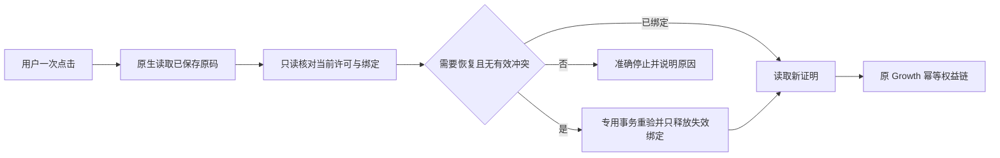

# T-1402 Activity 许可恢复只读审计与最小合同候选

2026-10-23。状态：**现有能力不足；以下为待独评、待用户逐范围批准的本地实现候选，未实施、未部署。**

## 结论

历史永久码已属于正式模型政策，无须另造永久枚举、经济资格或批量回填。缺口是安全恢复原绑定：现有普通 `activate` 明确允许换码，会释放当前机器同项目的其他绑定，包含有效授权。客户端先查状态再普通激活不能消除并发窗口，不能用来承诺“只释放失效绑定”。

建议新增独立、严格解析的 `restore-current` 许可端点，在同一数据库事务中重读并限制恢复范围。旧服务器不认识新路径时停止，绝不回退普通激活。仅恢复绑定，不新激活未使用的码、不移动其他机器授权、不消费次数、不重起期限、不发款。无需为本功能新增经济账本或通用 operation 数据库。

## 审计来源与证据边界

- Creator 任务包：`orchestrator/context/T-1402.md` §1–5、7–9；规格：`docs/features/t1402-legacy-license-one-click-upgrade.md`。本报告仅落在已准许的验证文档写集。
- Activity 生产参考根：`/Volumes/T7-MacData/CodexBuilds/Activity-T243-T244-20261017/source`，Git HEAD `a3f92b0001c062c079daeb101a550c26c6680395`。这是本地生产参考，未访问生产数据库或证明当前部署字节。
- T250 候选根：`/Volumes/T7-MacData/CodexBuilds/Activity-T250-20261023/source`，同 HEAD 上有先前获准的未提交改动。下列六个普通许可文件相对其 HEAD 的 `git diff` 为空；T250 不补本次安全恢复合同。
- 本轮仅静态读取，**没有执行 Activity 测试、编译、接口请求、真实激活、发款或状态变更**。下表测试是已存在的回归位置，不写成此次运行 PASS。T250 原本地报告不能代替 T1402 恢复测试。

| 生产参考相对路径 | 当前 SHA-256（候选同字节） |
|---|---|
| `src/lib/license-service.ts` | `de967e4b7f7b9ee92db22957b12087e53ab144bf518a7f54e956f5da13511d1a` |
| `src/lib/license-binding-service.ts` | `195e334143109ca639edf8800b4f25c2c0baf5cf2c48cadb7686a1a18ec82677` |
| `src/lib/license-binding-preflight-service.ts` | `889666dcd0e58892c5bc65d21c1f2393551d85ec035929e46598695f92862084` |
| `src/lib/license-device-binding-service.ts` | `cfda1ae3f534312025bde6637026e8911e67e7d011f755dce759200eb2716c64` |
| `src/lib/license-activation-flow-service.ts` | `80db688bfa6c0e335bd10f45c80fc85178eed04c52254687fe905aa6bc222c83` |
| `src/lib/license-status.ts` | `50d21dd4a1d591942b2549f2b90822d9743367e6839f5e469222656526f1273f` |

## 已有真实行为

以下 Activity 行号均指生产参考根。

| 问题 | 源码事实与影响 |
|---|---|
| 永久码类型 | `src/lib/license-status.ts:1,38–59` 只有 `TIME/COUNT/TRIAL/DEVICE_TRIAL`。正式永久是 `TIME` 且实际到期时间为 null；通常 `validDays=null` 且无固定到期。不能只看存储 `expiresAt=null`：已使用的 TIME 如有正 `validDays`，实际期限由 `usedAt+validDays` 得到。COUNT 的到期为 null 不等于永久时间卡。`src/lib/license-generation-service.ts:103–130,143–164` 支持该表示。 |
| 正式模型资格 | `src/lib/model-benefit-proof.ts:18–19,122–140` 已用正式 v1 政策覆盖已使用、有效的 TIME/COUNT；核项目、码及关联 grant 状态、归属、期限/剩余次数。没有“历史创建时间之前不准入”条件。恢复后仍走该原政策，不改变 Growth 账本主体。 |
| 状态有效不等于绑定完整 | `src/lib/license-code-access-service.ts:79–81` 可对 `usedBy=null` 的码继续返回对象；`model-benefit-proof.ts:146–169` 却要求匹配 active 设备行，或无任何登记行时匹配 legacy usedBy。缺 usedBy 返回 `MODEL_BENEFIT_BINDING_STALE` 409；已有 removed 墓碑不可回退裸 usedBy。这能解释“许可状态可用但模型证明409”，不应靠绕过 proof 修复。 |
| 普通激活释放范围 | `src/lib/license-service.ts:134–139` 固定 `allowActiveCodeSwitch:true`；`license-binding-preflight-service.ts:60–84` 随后调用 `releaseMachineBindingsForCodeSwitch`；`license-binding-service.ts:219–268` 对同机同项目全部其他绑定执行释放，仅排除目标 ID，没有有效/失效过滤。它是显式换码政策，不是受限恢复政策。 |
| 现有原子性 | `license-transaction-preparation-service.ts:39–46` 锁项目、受影响码并重读；`license-device-binding-service.ts:33–48` 提供 PG 项目锁及排序码锁。`prisma/schema.prisma:89,717–719` 有 legacy 同项目机器唯一约束及设备 active-machine 唯一约束。但现有事务原子执行的是较宽换码策略；锁不自动赋予“仅失效”语义。普通非 annual 分支部分业务失败以 result 返回，不应把“在事务里”当成已写操作必回滚的证明（`license-service.ts:169–174`）。 |
| 原时间/次数能否保持 | `license-activation-flow-service.ts:99–134` 的已使用 TIME 缺绑定分支仅恢复绑定字段，保 usedAt/validDays/expiresAt。首次激活分支 `136–175` 会设置 usedAt/期限，不能复用于旧码恢复。COUNT 激活 `20–73` 保已有 usedAt，不扣 remainingCount；消费是另外动作。专用服务仍需显式冻结这些字段，而非不加限制地调用整个 activate。 |
| 其他机器与墓碑 | `license-auto-rebind-service.ts:57–215` 会按自动换绑策略移动绑定并记换绑次数；本任务不得进入它。`license-device-binding-service.ts:148–155` 对 removed 行按历史事件决定能否重绑，并非所有删除都可复活；未知 digest kid 要拒绝，不能猜机器。 |

## 现成账号设备连接为何不能直接替代

Creator `/Users/zyongzhu/Workbase/Thirdspace-creator/frontend/src-tauri/src/owned_devices.rs:882–921` 的 `link_owner` 先需要本机可信有效快照和 Activity config ticket；`register_device` 建立 Growth 连接会话后要求官方页面验证手机号并确认产品。`1010–1090` 轮询确认、处理回执；`710–765` 的候选安装仍调用普通 `LicenseOp::Activate`，随后核 TIME、渠道、原期限及 ticket。它不是无交互的安全恢复接口，也不能承诺 legacy usedBy 丢失时已有 ticket 仍可取得。

Activity 已有 `src/lib/growth-device-binding-route-handlers.ts:58–105` 的 list/register/release/set-policy 链，可复用其项目/码锁和设备登记原语；但调用资格是 Growth HMAC 精确 action/scope + ownerProof，变更还要求 fresh phone_otp operationProof、expectedDeviceStateVersion。`src/lib/growth-device-binding-contract.ts` 明确定义这些闭合要求。客户端持有原码不能自己生成此资格，不能冒充 Growth/账号 OTP。其 list 还可能调用 `ensureLegacyDeviceBinding` 补行，不能直接称为零写预检。

`license-device-binding-service.ts:200–235` 已有“其他有效授权冲突、仅清失效占位”的 `assertMachineAvailable/registerOwnedDevice` 思路，但服务入口限定账号设备登记、普通 TIME、已使用、现有 owner/OTP 证据；不完整覆盖当前原生保存码的一键恢复。可以复用底层安全原语，不能绕过其授权包装拿它当现成公开能力。

## 最小候选接口（尚未准入）

候选新路径：`POST /api/license/restore-current`，`contractVersion: license-restore-current-v1`。不在旧 `/activate` 加安全布尔字段：`src/lib/license-api.ts:75–90` 旧解析只取已知参数，新字段会被忽略，旧服务仍按宽换码处理。

建议同一路径闭合区分 `action: inspect | restore`。共同请求只有原生内部 `projectKey/code/machineId/nonce` 和版本；`restore` 再带预检的 `expectedStateDigest`。所有未知字段、错误类型/版本拒绝。前端仅收脱敏阶段/原因，不收原码、机器标识、其他码或可用作授权的 token。

- **inspect**：只读原码资格、当前机器绑定和准确失效集合，返回 `ready/already_bound/conflict/ineligible/recovery_required`、真实 `licenseMode/expiresAt/remainingCount`、失效数量与不透明状态摘要。不能调用会补行/更新 lastSeen 的普通 preparation/list/status helper。原始行编号不需用户抄写。
- **restore**：用户一次点击内，由原生自动 inspect 后提交；不是第二次人工输入。事务内按项目（现有项目锁足以串行化同 product/machine）→排序受影响码锁，重读目标、项目、全部 grant、同机 current/previous digest 绑定、目标其他机器和墓碑、当前期限。重算摘要，与预检不符即409零写。摘要绑定用途/项目/目标不可变身份及 epoch、deviceStateVersion、当前机器摘要、精确失效绑定集合及其版本/期限；它只是乐观并发约束，**不是新授权凭证**，伪造/旧摘要不能覆盖服务器当前有效冲突判断。
- 已合法绑定当前机器时仅返回 `already_bound`，不释放后来出现的其他绑定；目标仍须有效且当前事实可核。缺绑定时，任何同机同项目其他有效授权都409；任何目标其他机器 active、人工释放/撤权墓碑、未知 kid、不可辨识历史都停止自助恢复。不能放宽 maxDevices、进入 auto-rebind、恢复试用或被撤销授权。
- 目标必须本来已激活（`isUsed=true` 且原始开始事实完整），TIME/COUNT 且当前合法。未激活原码返回 `NOT_PREVIOUSLY_ACTIVATED`，不经该接口首次激活。annual/其他复杂 grant 如无法保证原 term 不动则明确转原许可路径，不偷偷走首次激活/续期。
- 只释放锁内确认失效且在摘要精确集合中的**当前机器同项目**占位；目标不在释放集合。失效应基于实际 expiry/COUNT耗尽/权威撤销事实，不能只复用漏查关联 grant 的简化分类。释放与目标重新登记及审计一起提交；任何后续失败必须抛出并回滚全部写入，不允许先释放再返回失败 result。
- 不改原 `isUsed/usedAt/validDays/expiresAt/totalCount/remainingCount`、渠道/plan/授权主体、maxDevices/换绑额度；不建新码，不调用 consume、不新增 term。允许的变更只有合法设备绑定字段、设备行、既有版本与绑定历史。锁等待后、最终响应前均按当前时钟重新核对有效期，跨期不得 native valid。
- 成功与错误均沿 `withLicenseSignature` 的原 Ed25519 路径绑定签名，回显新鲜 nonce，并明确合同版本、恢复结果和真实 `licenseMode`，保留原到期/剩余次数及 serverTime。生产签名不可用时必须在任何 mutation 前拒绝，不能提交后才发现无法签名。客户端验证新路径、签名、nonce、版本/模式后才保存；404/405/旧响应绝不 fallback 到 activate。

### 未知结果与幂等：无需默认加 operation 表

绑定恢复是把**同一原授权**置为当前机器合法绑定，不含扣次/发款。响应丢失后，原生以同一保存码/机器重新 inspect：当前已合法绑定即取得 fresh proof 并读回许可；仍待恢复则重新预检提交，其他机器/撤权/冲突则明确停止。重复 restore 在项目锁内只有一次绑定状态变更，后续纯 no-op，不重复释放/累加换绑计数。fresh nonce 是新响应关联，不是业务幂等身份。

若另一操作已经释放/移动目标，不能凭“曾提交过”强行恢复，也不能宣称原操作成功；以当前权威结果展示冲突或待恢复。这种当前状态收敛足以满足本任务，不承诺不可证明的原请求执行回执。Growth 钱包/首赠仍用其原业务身份和既有查询，不从恢复次数推断经济结果。只有将来要求精确永久回放原操作回执时，才另提持久 operation 设计及明确反例。

## 拟申请的准确本地写集与数据边界

这不是授权。实施应另建隔离候选，绝不直接改生产参考树。建议以下新增产品/测试路径（均相对将来的 Activity 候选根）：

| 路径 | 必要职责 |
|---|---|
| `src/app/api/license/restore-current/route.ts` | 新闭合端点；无旧 activate 回退；统一签名出口。 |
| `src/lib/license-restore-current-contract.ts` | 严格 action/request/result、状态摘要输入、稳定错误，不含钱包字段。 |
| `src/lib/license-restore-current-service.ts` | 只读 inspect、项目/码锁内原子重验、受限恢复与整事务回滚；复用现有锁/设备原语，避免修改普通激活语义。 |
| `tests/license-restore-current-contract.test.ts` | 闭合请求、签名/nonce/模式/旧端点不回退、失败零写。 |
| `tests/license-restore-current-service.test.ts` | 时间/次数/墓碑/失效分类/no-op/未知状态及当前时钟边界。 |
| `tests/t1402-license-restore-current-local-pg.test.ts` | 自有隔离 PG 真实并发锁、唯一约束、回滚及历史缺绑定场景。 |

必要规格/状态登记候选仅：`PRODUCT_SPEC.md`、`BACKLOG.md`、新增 `docs/contracts/T-1402-license-restore-current-contract.md`、`orchestrator/ARTIFACT_MANIFEST.yaml`、`orchestrator/DECISION_LOG.md`、`orchestrator/TRACEABILITY_MATRIX.md`；若获准使用 taskctl，限定本任务产生的 `orchestrator/events.ndjson` 追加，不改历史。具体任务 ID 和 taskctl 可用性在获准后核对，不预签完成。其他规则/控制文件如必须变更先报新增范围。

**不需要**改 Prisma 三份 schema、迁移、普通 activate/status/consume、Growth 权益/钱包、Activity 管理页面或部署配置。上述是最小候选，不预先授权“必要时改所有 helper”；如现有 helper 无法安全复用，必须先报精确新增文件及必要性。

数据只在自行创建拥有的测试数据库及 fixture 中写入，不连接生产/旧验收实例。实现测试不等于部署授权；不提交、push、部署、重启、实赠、真实激活/换绑、批量修库或解除 Activity 锁。

兼容性：新增路径，旧客户端/原 activate 保持原行为；新客户端遇旧服务安全停止。回滚本地候选即可；未来若另行批准部署，移除新入口时客户端应显示暂不可用，不退回宽激活。实际生产恢复的回滚不能用全库回滚或任意解绑代替，必须另按真实绑定状态及用户授权处理。

## 必须验证的矩阵与现有回归定位

| 场景 | 必须结果 |
|---|---|
| 已绑定历史永久 TIME；缺绑定永久 TIME | 原 `expiresAt=null` 和 usedAt 保持；前者零写，后者合法恢复后正式 v1 proof 可得。 |
| 已激活限时 TIME、COUNT；未激活、已到期、耗尽、撤销 | 前两者原期限/次数逐字段相等；其余拒绝，所有绑定零写。COUNT 不扣次、不补次。 |
| 1个失效占位；有效占位；有效+失效混合 | 仅第一种精确释放；后两种整事务零写，不能先清失效部分再报有效冲突。 |
| 目标在其他机器、manual removed、未知 kid、历史事实不足 | 不做自动换机、不复活墓碑、不猜机器；typed recovery/conflict。 |
| inspect 后其他机器绑定/撤权/到期/新增有效码/失效集合变化 | PG barrier 下重读并拒绝旧摘要；有效授权始终保留。 |
| 同机不同目标并发、同目标不同机并发、同目标重复请求 | 项目锁与唯一约束使最多一个合法恢复；无丢绑定、跨项目释放或换绑计数重复。 |
| 释放后目标写失败、审计失败、签名缺失 | 事务整体回滚；签名缺失在写前拒绝；无成功假象。 |
| 响应丢失/客户端重启/迟到响应 | 同原码状态查询+fresh proof 收敛；不盲目再激活、不重新领款；旧 nonce/版本不落本机。 |
| 锁等待/最终 readback 跨期限 | 最终签名不得宣称已过期授权有效。 |
| 旧服务器/旧 activate 忽略额外字段 | 专用路径失败即停；真实断言无 activate 请求。 |

既有回归源码均在生产参考 `tests/`：`license-activation-flow-service.test.ts:42`（COUNT 保已有 usedAt）、`license-binding-service.test.ts:183,275`（可复用释放与显式换码分离）、`license-binding-preflight-service.test.ts:34,65,113,177`、`license-binding-constraint.test.ts:317`、`license-device-binding-service.test.ts`、`growth-device-binding-routes.test.ts:43`、`model-benefit-proof.test.ts:32,38,45,49,59`。这些只能复用为回归定位，尚没有本任务受限恢复/PG barrier 运行证据。

## 待独评/审批前冻结的事项

1. 确认上述新端点与“当前状态收敛、无 operation 表”满足原生未知结果恢复；状态摘要精确字段与错误枚举在新合同冻结，不让客户端自行挑其他码释放。
2. 明确 legacy 缺绑定但原激活事实完整且无禁止墓碑时，沿既有“持有码+机器输入”许可权限恢复；不把本地保存快照说成服务器可验证的硬件所有权证明。若要求更强 owner 证明，应复用既有账号确认链并明确用户影响，不能暗中削弱或伪造 OTP。
3. 当前本机真实授权只涵盖已查明失效旧绑定1、其他有效0；root 操作前必须 fresh 核对，数量/身份变化即停。此报告未执行预检，不代签本机当前事实。
4. 由根会话独评后向用户展示必要性、上述准确范围、兼容/回滚，再依据 Activity AGENTS 明确询问“确认允许修改 Activity 上述范围吗？”。本报告不代发许可问题，也不把 T250 旧授权继承为 T1402 授权。
