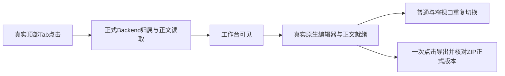

# T-1404 隔离源码真实浏览器验收

## 环境与证据归属

- 使用 `ego-browser` 技能（guide v2.1.0），整个目标唯一 TaskSpace 为 **54**，页面 `p1`。
- 当前源码 Next dev 仅监听 `http://127.0.0.1:60919`，由本次验收启动 PID `15868`；数据根 `/tmp/creatoros-t1404-browser-K5FXn5`，数据库、媒体、两类登录目录、工作区和临时目录均在该隔离根下。
- `DATABASE_URL` 置空、`CREATOROS_DESKTOP=0`、`CREATOROS_DEV_MODE=1`；关闭本次隔离进程后台驱动、调度与配置拉取，未执行模型、平台登录或外部采集。业务生产代码的后台行为未修改。
- 白名单环境启动，生成仅本次使用的随机 master key。验收 preload 在读取前将工作区 `.env*` 返回空内容，未读取真实配置、密钥、真实媒体或真实账号库。
- 只通过正式 `/api/v1/dispatch` 创建中性组、项目、主脚本 artifact、文章版本、图文版本和视频 output。精确 ID 与创建调用结果保存在 [browser-entities.json](browser-entities.json)。未使用 fixture 模式或 mock HTTP 响应。



## 真实结果

1. 普通 `1366×900` 和窄 `1024×768` 各两轮脚本、文章、图文、视频与返回，16 次完整切换均达到真实正文/Native ready；窗口错误、未处理 Promise 拒绝和捕获的 `console.error` 为空。视频 Native 是本次空工程，真实时间轴与画面控件已挂载，不冒充已经有视频素材。
2. 文章挂载期间没有再发客户端 `articles.get`；首读来自服务端已验证正文。文章和图文 Shadow DOM 内标题/正文与正式保存版本一致。
3. 默认文章点击前隐藏 Doocs 实例为 0；只点一次“导出 HTML + 图片 ZIP”，自动下载完成，`download.failure=null`。`manifest.json` 的作品/版本精确匹配正式稿，`index.html` 含真实标题和两段正文。见 [browser-article-export.json](browser-article-export.json) 与 [browser-article-export.zip](browser-article-export.zip)。
4. 脚本通过真实界面编辑与“保存”，生成 `artifactversion-d544fcdd-566`；正式版本 API 回读 200，切到文章再返回，新增正文完整保留。见 [browser-script-save.json](browser-script-save.json) 与 [browser-script-saved-editor.png](browser-script-saved-editor.png)。
5. 图文点击“导出分页 ZIP”真实下载成功，包含 3 张有效 PNG，未发生浏览器运行错误。尺寸、字节数见 [browser-graphic-png-check.json](browser-graphic-png-check.json)，产物见 [browser-graphic-export.zip](browser-graphic-export.zip)。

## 分段耗时及测量限制

冷态与暖态分别记录。冷态 Next 日志：首次项目列表 `37.2s`（应用初始化 `35.7s`）；首个脚本路由 `3.9s`（编译 `2.2s`）；首个文章 `10.1s`（编译 `9.9s`）；首个图文 `4.4s`（编译 `4.3s`）；首个视频 `4.6s`（编译 `4.5s`）。这些不是安装版 Tab 业务耗时。

暖态使用 DOM 真实 click 捕获起点，并由文档及 Shadow DOM 的 `MutationObserver` 分别标记工作台可见和正文/控件 ready，剔除 Ego 指针移动时间。一次八段测量见 [browser-click-switches.json](browser-click-switches.json)：

| 视口 | 文章 ready | 图文 ready | 视频 ready | 脚本 ready |
| --- | ---: | ---: | ---: | ---: |
| 1366×900 | 301ms | 173ms | 176ms | 192ms |
| 1024×768 | 214ms | 180ms | 449ms | 182ms |

可重跑 Gate 会先完整导航重置页面，再真实点击及下载，其后续 smoke 样本为 `201–1110ms`，保留首次 Native 装载成本，不能只挑较快样本。**最新提交的真实 Gate 结果以 [browser-gate-result.json](browser-gate-result.json) 中当次 HEAD、产品源码 SHA、runId 与时间为准。** 没有修改前同条件浏览器基线，不声称提升百分比；本轮未替换当前安装客户端，未代签安装版最终体感。

## 可重跑 Gate

```bash
ego-browser nodejs < docs/verification/t1404/browser-verify.mjs
```

输入为 `browser-runtime.json`、`browser-entities.json` 和仍活动的唯一 TaskSpace 54。每次实跑两个视口的 8 个 Tab 与 2 次单击文章 ZIP 下载，检查隐藏 Doocs 按需创建及正式版本内容；不重建实体或调用模型。写入新 `browser-gate-result.json`，包含当前 HEAD、12 个产品文件 SHA 及聚合 SHA、逐段 ready 证据、下载哈希；各视口/Tab 的 `browser-gate-*.txt` 包含页面与 Shadow 内文案，供文案守卫读取。命令失败会写 fail 和真实错误，不能重放旧 PASS。

正式提交后 Gate 于北京时间 **2026-10-24 21:47:50–21:48:15** 实跑通过：提交 `cfd165baad057b73898a97263f43754d40896082`，12 个产品文件工作区状态为空，聚合源码 SHA 为 `7e885cd24e1173162633d95ed2c9d4b4c475b17f1eff23a100edbb9ad05d4592`，runId 为 `77b38a47-b23d-4d6f-9656-4428e1037142`；8 个 Tab 与 2 个正式版本 ZIP 全部通过。主会话随后完成正式 frontend Gate 及 `taskctl complete`，任务为 `T-1404 ✅ / PASS:51cb1ab67f76`。精确结果保留在 [browser-gate-result.json](browser-gate-result.json)，未以旧 smoke 代签。

## 诚实记录的非产品失败与边界

- 第一版 ready 探针选中了同名视频外层 wrapper，120 秒超时；真实 Native 宿主已经存在且可操作。保留 [browser-round-05.log](browser-round-05.log)，修正宿主 selector 后完整通过。该超时未计作产品耗时或成功证据。
- 早期脚本从 Node Fetch 错用 `response.ok()`，在创建首个隔离组后失败；修正为 `response.ok` 后正式创建数据成功。只影响本次临时库，原始 [browser-seed.log](browser-seed.log) 保留。
- 本次无审核报告，`scriptReviews.getLatest` 返回真实 404，页面如实显示未审核；切离附属请求可因取消产生 `AbortError`，未将它们伪装成全部 HTTP 200。窗口与 React 运行错误为空。
- Ego 提示可升级（当前 `0.6.0.16`）；本轮未升级或重启用户应用。
- 正式 Gate 完成并获主会话收尾授权后，已于北京时间 **2026-10-24 21:49:47** 对唯一 TaskSpace 54 执行一次 `finish({keep:[]})` 并等待成功；**21:50:12** 核验本次隔离 Next 进程组全部退出（PID `15868`、`15875`、`15886`、`15889`），端口 `60919` 已关闭。未触碰用户安装应用或其他进程；隔离数据目录与全部证据保留。真实收尾记录见 [browser-cleanup.json](browser-cleanup.json)。当前服务与 TaskSpace 已关闭，不能再直接运行上述 runner；后续验收须另行准备并记录新的隔离运行环境，不得重放本次 PASS。
