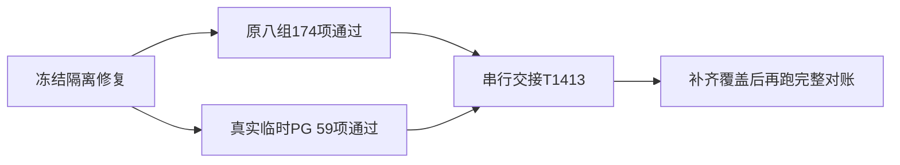

# T-1412 干净提交复验与串行交接

2026-10-25。候选 `4fb509fff576184c0b3bf3b73ca14178ace690a6`。原八组与归档原三目标都已在干净 managed worktree 实际执行通过；本记录不把最终 full 或官方对话计为通过。

| 原入口 | 结果 | 实际进程边界 |
| --- | --- | --- |
| `node tools/timeout-policy/verify.mjs` | 8 组全部通过，静态检查加 174 项测试，0 skip。各组 11 / 5 / 20 / 37 / 68 / 28 / 5 项。 | exit 0 / signal null / 46609 ms，完整关闭、无残留 owned 进程组。 |
| `node docs/verification/t1022/run-archive-guard.mjs` | 原 3 文件 59 PASS，0 skip。 | exit 0 / signal null / 79038 ms，完整关闭；本轮 owned PostgreSQL 原 stop 完成且根已删除。 |

候选 checkout 无活动用户 `.env` 文件；子 HOME/config/cache/tmp 为本轮私有目录，环境白名单没有用户凭据、DB/S3 或 NODE_PATH。PG 仅投影四个专用变量，没有设置全局 DATABASE_URL；Vitest 内存 PGlite 语义保持。首次 offline 重链接后实际发现残留主树 NODE_PATH，原失败保留；172 个复制的生成脚本仅重定位依赖路径，265 个 `.bin` 复查无残留，4998 符号链接无外逃，66 个原生文件不变，依赖及候选源码独立复核见 `clean-validation-environment-review.md`。

本轮完整输出、命令、cwd、开始结束/预算/退出/信号与进程组结果在 `clean-validation/`。两份日志使用 gzip 保留原始字节，压缩前扫描正文 exit 0，原文件 SHA 与传输 SHA 见 `log-transport.json`。该目录中本机环境与 PG nonce 原件仍只在本地保留，未批量提交。

T-1412 继续进行中：最终完整对账按已审规格留待与 T-1413 合并配置后执行。T-1413 已按 taskctl 开工，尚未声称实现或通过；六处失效引用、正式封面参考约束等继续修复。官方图片幂等资格未证保持 unknown、不启用重提。官方 Pi 正式聊天仍 HTTP 402 / waiting_user，额度页面为用户跳过，均不由本门代签。尚未推送。
