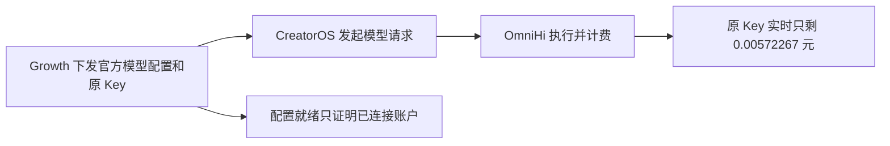

# 官方模型 402：Growth 与供应商定向核对

2026-10-25 23:38:23（北京时间），经既有 SSH 运维认证在生产 Growth 的原 release 内执行一次定向只读查询。未改生产数据、额度、Key 或配置，未发模型生成请求。T1427 此次诊断合同独审为 `PASS[REV:e9724b83fcdb]`；这不是官方对话验收通过。

## 查到的事实

T249 已核为这台 Mac 原授权的 credential、provider key、加密 token 和 wallet 四个一致性标签，当前仍唯一匹配。原 credential 为 active，原钱包总额为 250000 units（5 元），目标预算也是 5 元，无待同步错误。没有发现额度未下发或本次查询导致新 Key。

| 同一原权益 | Growth 已保存快照 | 供应商本次实时快照 |
| --- | ---: | ---: |
| 总预算（元） | 5.00000000 | 5.00000000 |
| 已用（元） | 0 | 4.99427733 |
| 冻结（元） | 0 | 0 |
| 剩余（元） | 5.00000000 | **0.00572267** |
| 采样时间 | 2026-08-19 16:54:10 +08 | 2026-10-25 23:38:23 +08 |

供应商已用、冻结、剩余之和精确等于总额；原预算已用约 99.8855%，只剩约 0.57 分钱。该原 Key 的实时预算几乎用尽，是当前官方失败最有力的原因候选。冻结为零，不能把本次问题归因为冻结额度未扣。Growth 历史赠额与 sync_status=ready 不能证明现在仍有 5 元可用。

## 为什么配置同步后旧快照还在

生产 `server/modules/client_config/service.py:2291–2307` 的 existing_only 分支会在缓存超过 15 秒时查询 provider 实时预算、修改本次返回的 wallet.availableUnits；按合同不更新 ORM 缓存、渠道或时间。Creator 的 `frontend/src/server/activation/client-config.server.ts:290–329` 正常拉凭据时明确传 `existingOnly=1`，只持久化凭据并保留账户存在状态，金额及 accountRef 不传给 Web。因此旧 DB 快照并不证明“同步请求没有查供应商”。

生产 `_account_payload` 与 `_managed_credential_response` 的钱包剩余公式未减去 provider 冻结额，但 Growth T137 §3.3 本来就规定这个钱包口径。本次冻结又为零；没有据此改账或把既有合同误报成确定实现缺陷。

## 与客户端失败的关联及限制

- 已安装 b4e174a84 的同能力 `copilot.assist` 探针：128 输出上限收到真实非空流；8192 输出上限返回 HTTP 402。证据是 `docs/verification/t1417/installed-cli/020-probe-128.json` 与 `022-probe-8192.json`。128 在首段非空内容即结束，不能算完整对话成功。
- 上述请求预算差异与剩余不足一分钱的原 Key 相吻合。探针也在 AI SDK 路径失败，因此没有证据把问题归因于 Pi 引擎独有故障。普通对话的 8192 上限与创作的 32768 上限不能靠这次 128 探针代验。
- 当前 CLI 只公开 serviceId、hasSecret、updatedAt，不公开当前客户端 Key 与 Growth 原权益的关联标识；此次未读本地私有运行态，也未 reveal Key。因此四重标签确认的是 **T249 原同机权益现在的状态**，不能单凭它完成“这次 402 必定使用该 Key”的直接关联证明。
- 未拿到供应商对该次 402 的具体原因正文、预占计算公式或请求账单。剩余正数仍可能不足以承接一次请求；不能把“预算几乎用尽”伪装成已核实供应商预扣算法，也不能保证充值后所有模型都会恢复。
- 显式 Codex 在 `backend/src/modules/ai-runtime/capability-model-routing.ts` 会将主路由来源设为 codex。用户模式只有自配模型、Codex、官方模型。原报告的 official/codex 与 self/codex 成功属于 Codex 调用，不能证明官方或自配 API 成功。

## 当前结论与后续边界

已把“未知 402”推进为有生产实时证据的原官方预算近乎耗尽；未发现需要通过更换 Pi、重装、重发额度或新建 Key 来恢复的证据。恢复该原 Key 的常规预算需要走正常额度补充流程，不能通过代码把钱包记成未消费。此次未代充、调账、刷新缓存或部署，也未消耗受保护原任务的最后一次恢复。

当前官方普通对话验收仍未通过，保留“通过后才推送”。此次只增加诊断工件和范围记录，没有产品实现变更；不重跑剪辑、编辑器或全量模型组合。后续应在原账户预算条件恢复后，先用公开/正常入口确认原关联，再按相同官方来源完成真实回复、跨轮记忆/计算、同组只读工具三轮，之后才处理推送。

## 取证文件

- `production-version.json`：当前 release、API PID、相关线上源码 SHA 与方法原文。运行版本是 `/opt/thirdspace/releases/growth-95cd62e-t24377-r2-20261017`，API PID 3930976。
- `production-account-budget.json`：四重唯一目标的只读事务、原钱包已保存快照、原 provider Key 实时预算；provider 只发生一次登录 POST 和一次名单 GET，均为 200。API PID 查询前后相同。
- `usage-snapshot-paths.json`：生产 existingOnly 分支的准确源码片段及完整文件 SHA，另附 Creator 正常拉取分支；生产 SHA 守卫通过后才输出片段。
- `historical-target-tags.json`：目标标签来自 T249 2026-10-23 同机原权益脱敏回执，不含原身份或 Key。
- `collect-account-readonly.py` / `remote-host-readonly.py`：执行源码；固定域名/方法/路径守卫、30 秒 provider 硬总限、原 release 校验、只读事务回滚、精确环境白名单和脱敏输出。敏感认证材料只在服务器可信进程中使用。

Growth、Moonlit 开发工作区原有大量改动未动。生产源码与本地 Growth 工作区不完全相同；上述运行判断以本次生产源码为准。

## 本轮验证

两份取证脚本 Python AST 解析通过，`git diff --check` 通过；`node orchestrator/process/pmem.mjs sync` 成功，`reconcile.mjs --profile quick --read-only --concise` 完成23项控制检查，0错误、13项历史警告。只读快速检查不代表 full 或官方对话通过。最初尝试的裸 `pmem` 不在 PATH、`reconcile --quick` 参数不存在，随后使用仓库正式入口成功，未将最初命令写为通过。
