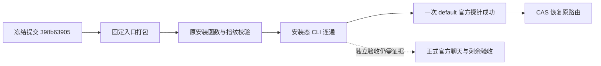

# 398b63905 本地安装与最小官方探针独立复核

> 接手说明：本轮只追加证据可得性备注；原结论和哈希仍指原验收时版本，不代表本机重跑。原文保留于提交 c8589fe7f。原件所在电脑依用户接手规划说明，本轮只核对本仓库。

日期：2026-10-25。审核角色：独立只读审核 `/root/t1427_contract_review`。本报告只记录已归档证据的核对结果，不执行安装、业务 CLI、模型请求或恢复操作，不读取实时数据库、凭据或用户工作目录，不修改原始回执、产品代码、SPEC 或控制面。

## 结论

**在本轮限定范围内，未发现阻断性问题。** 证据支持：提交 `398b63905d6208aca89b6359af15720fa96de8f6` 经仓库固定本地打包入口构建，再通过仓库原有安装函数安装到 `/Applications/CreatorOS.app`；安装后的主程序和 sidecar 指纹与构建产物相同，公开 CLI 连通；“月明水清深”组的一次官方 `default` 最小模型探针收到流式回复，随后路由经 CAS 恢复。

**上述结论不代表正式官方聊天恢复或 T1427 全部验收通过。** 同一探针驱动末尾保存的原任务回执仍为 `blocked` / `waiting_user`，`errorCode` 为 `http_402`、`attempt` 为 `2`。最小探针脚本没有新建正式聊天、发送聊天消息或恢复原任务。随后补充审阅的独立正式聊天回执也显示首轮 `CHANNEL_MODEL_PAYMENT_REQUIRED` / HTTP 402，后两轮未执行（详见下文）；多轮记忆、计算、组内只读工具及模型组合矩阵没有因此通过。不得用最小探针抵消这些失败，或声称官方 402 已全部修复。

## 构建、安装与来源绑定

复核了 `docs/verification/t1411/local-package/combined-candidate-manifest.json`、`installed-candidate-proof.json`、`verify-and-install-local.py`、`build.log`、`install-driver.log`、`install-and-launch.txt`、DMG 校验及签名校验日志，以及仓库 `frontend/scripts/desktop/package-local.mjs` 的 `installAndLaunchLocalMacApp` 实现。

| 核对项 | 实际证据与判定 |
| --- | --- |
| 候选提交 | `398b63905d6208aca89b6359af15720fa96de8f6`；Git tree `238ea2a23c6e8e80068624164f166c8b110c3a4d`。独立读取该提交的 Git 对象，manifest 中 19 项源码 SHA-256 全部匹配，tree 匹配。 |
| 冻结条件 | 驱动在安装前后核对 HEAD、工作树干净及 manifest 源码哈希；回执 `sourceDrift: []`、`standardCleanCommittedFreeze: true`、`localHashFreezeException: false`。这是归档执行证据，不是本审核重新执行冻结检查。 |
| 固定打包入口 | 构建日志记录 `desktop:package-local` → `node scripts/desktop/package-local.mjs`，产生 `release-fast` App 与 DMG。构建阶段设置 `CREATOROS_LOCAL_SKIP_INSTALL=1`，因此不能描述成“打包命令当场自动安装”。 |
| 后续安装入口 | 校验驱动导入并调用同一仓库入口导出的 `installAndLaunchLocalMacApp`。该函数从 `src-tauri/target/release-fast/bundle/macos/CreatorOS.app` 经同卷暂存复制到 `/Applications/CreatorOS.app`，随后启动并检查真实进程。回执为 `skipped: false`、PID `92182`。 |
| 安装主程序 | 构建与安装 SHA-256 均为 `c135dcda9f169ae68c611a39bc77b6eda6ecce76721ed8300d4597a46db8fbaf`。 |
| 安装 sidecar | 构建与安装 SHA-256 均为 `a9be9fbbd90253bc3ab37423e54c6a6d3f1503d25c7fa9dbd0107e4c0d6b7750`，不同于此前安装的 `f814863c1d9ab8a5c64e2e64446901b704f8a130eb7e3b33624d520d5f9ea423`。这里只证明所记录主程序与 sidecar 的一致性，不虚称已逐文件计算整个 App 的总指纹。 |
| DMG | `/Users/zyongzhu/Downloads/CreatorOS-1.2.0.dmg`；SHA-256 `bd2c31d89f7b82625486132192cd8e10c29849a83e643b8d7215cc9b7879500a`。归档 `hdiutil verify` 显示校验有效。 |
| 回退副本 | 驱动先复制旧 App 到临时回退目录并核对旧 sidecar 指纹，再替换正式路径；报告只确认回执中的保全步骤，不声称实际执行过回退。 |
| 安装态 CLI | 安装回执与 `official-probe/001-status.json` 均为 `installed`、`connected: true`、`access: full`，产品 `creatoros`、包 `cloud.aitongban.creatoros`、PID `92182`。 |

驱动对构建与安装 App 执行 `codesign --verify --deep --strict` 并要求命令成功；空签名日志本身不是独立成功证明，应结合驱动完成回执理解。该产物采用本地 adhoc 签名，`notarized: false`，不是 Developer ID 签名、公证或公开发布凭据。构建日志保留 warnings，并明确额外冒烟、TLS 与产物扫描未运行；本报告不把它们改记为已通过。

## 最小官方探针与路由恢复

复核 `probe-installed-official.py`、`probe-driver.log`、`official-probe/probe-result.json`，并对照 `official-probe/` 下 status、组、路由写入/读回、探针及原任务 inspect/events 的逐次归档回执。

1. 驱动只使用公开 `creatoros` CLI；以组 ID `grp_legacy_acct-ae1a8346-9` 读取组并核实名称“月明水清深”。没有改用其它组，没有调用钱包或登录接口。
2. 初始路由为 revision `62`：`text/vision/image` 走 `codex`，`video/audio/embed` 走 `official`。写入前重读并核对完整 choices 与 revision，以 `expectedRevision` CAS 仅把 `text` 改为 `official`；写入及读回为 revision `63`。
3. 仅执行一次 `settings.models.test`，参数为 `capability: default`。归档 `015-probe.json` 与 `probe-result.json` 记录 CLI exit `0`，外层与结果 `ok: true`，provider/model 为 `channel-managed`，返回固定提示“已收到最小测试请求的流式回复，连通。”请求 ID 为 `req-4ba04d39-189`，记录用时约 `19.263` 秒。
4. 驱动的 `finally` 路径执行 CAS 恢复；revision `63` 重读、revision `64` 写入及读回一致，完整 choices 回到初始值。持久化 `routing-state.json` 的 original 与最终 choices 一致。不是仅凭打印“恢复”判断成功。
5. 随后只读查看原任务 `execution-task-5e73167d-402`。`023-inspect.json` 保留 `blocked`、`attempt: 2`、`http_402`；`025-events.json` 保留 `waiting_user`、`attempt: 2`、`eventCount: 0`。驱动未消耗该任务的恢复尝试，也未声称它恢复。

`settings.models.test` 的成功证明这次配置与路径的最小请求收到了响应。它不能替代正式聊天链路、真实工具执行、模型与思考档组合测试或性能验收。此处的约 19.263 秒是公开 CLI 最小探针的整体耗时，不应挪用为 UI 路径计时结果。

## 补充正式聊天回执：仍失败

收到根会话补充授权后，读取 `docs/verification/t1427/installed-398b63905-result.md`，并对照 `local-package/official-chat-retest-398b63905/` 的 `matrix.json`、`live-inspect.json`、`live-ai-task.json`、`route-restoration.json` 及必要的路由、等待回执。摘要对正式聊天失败的表述与这些原始回执一致： 【2026-10-28 接手补注：该正式对话原始回执目录未入库；原始日志和截图在朱志勇机器上，未入库。】

- 新对话 `ai-conv-4ba04d39-417`，AI 任务 `ai-task-4ba04d39-421`，执行任务 `execution-task-4ba04d39-422`；矩阵仅记录一次提交、一个 turn。首轮错误为 `CHANNEL_MODEL_PAYMENT_REQUIRED`，固定领域说明明确 HTTP 402。
- 执行任务回读为 `blocked`、`runtimeStatus: waiting_user`、`attempt: 1`、`maxAttempts: 3`。AI 任务外层 `status: running` 同时存在，不能据此声称仍在正常生成或忽略执行层失败。
- `tasks wait --timeout 120` 回执 exit `2`，错误明确后台任务未取消；随后回读确认上述等待状态。矩阵 `wallSeconds: 130.382` 是首轮观察总时长，不能当成模型生成耗时，也不能把 CLI 等待超时误说成成功或已取消任务。
- 正式复验从 revision `64` CAS 切到官方 `65`，再以 `expectedRevision: 65` 恢复到 `66`；最终读回完整 choices 与 original 相等、text 为 `codex`。这是第二段复验的恢复，与最小探针恢复至 `64` 不冲突。
- 后两轮没有结果，不能计为已通过；也没有证据支持将现场支付或权益拒绝精确归因于余额不足、冻结金额或某项额度。用户跳过额度页验收的决定没有使该正式聊天失败转为通过。

因此，本轮新增正式证据进一步确认“最小探针可用、正式聊天仍失败”的区别。摘要中的“尚未推送”是根会话的执行状态说明；本审核未查询远端，不为合并或推送状态另作认证。

## 数据保全摘要核对

复核 `docs/verification/t1427/local-package/auth-fix-data-preservation-proof.json`，并仅在既有 `projects-before-auth-fix.json` / `projects-after-auth-fix.json` 归档中比较项目 ID 集合，在 `group-before-auth-fix.json` / `group-after-auth-fix.json` 中比较成员列表；没有发起实时查询，未在报告复制项目内容或成员资料。 【2026-10-28 接手补注：auth-fix-data-preservation-proof.json 摘要已入库，四份 before/after 原回执未入库。原始日志和截图在朱志勇机器上，未入库。】

独立重算与摘要完全一致：此前 `65` 个项目 ID 全部存在，之后 `66` 个，删除 `0`、新增 `1`；前后 `5` 个组成员列表完全一致。两份项目回执中的 total 也分别为 `65` 与 `66`，实际归档列表覆盖这两个数量。新增项目归档创建时间为 `2026-10-25T07:28:51.462Z`，晚于安装回执完成时间 `2026-10-25T07:21:36.241778+00:00`；这支持“安装完成后创建”，不能进一步归因于安装。新增一项不违反保全要求，不能把“总数不严格相等”判成数据丢失。

该证据仅支持这组项目 ID 与成员列表的保全结论，不扩展为逐字段内容、所有文件、全部账号数据或整个数据库的完整性认证。

## 证据指纹与审核边界

以下 SHA-256 为本轮直接读取归档文件所得，便于识别被审版本。所有 `t1411` 路径位于 `docs/verification/t1411/local-package/`；数据摘要位于 `docs/verification/t1427/local-package/`。

| 文件 | SHA-256 |
| --- | --- |
| `combined-candidate-manifest.json` | `c85e435671babfe75f89c4dfe071ccb16b9e87ad5520afda3bac4a95c14258eb` |
| `installed-candidate-proof.json` | `d2006b6867adaf12ff0d45f90a23ea5e58cd03b6eeface75017fb172254bb1a8` |
| `verify-and-install-local.py` | `94d17c5617c8bea066b71ad95873d794d97a10e501ce753a152a49c9befa01f2` |
| `probe-installed-official.py` | `14e39cc8e79dc0c68d73f1c00f957c48a55f54f346a3fd1131f472920ed12370` |
| `probe-driver.log` | `fd868e729b6862387444c3d03099ab321f7d266111b837633dd34881ac1ac823` |
| `official-probe/probe-result.json` | `b7c8a78db1f88191a01637e21da7ff903da39ab75d1e2c89da864952439843f2` |
| `auth-fix-data-preservation-proof.json` | `7cdb13442726be9a157f73dd6e0b0a5909d5ae8218d8ac444349a24252311a3a` |

补充摘要 `docs/verification/t1427/installed-398b63905-result.md` 的 SHA-256 为 `9e605a97c6f46e4743ec20886237e433dafe3fa208dc40b43a171a21c5271628`。正式聊天原件 `matrix.json` 为 `9960287857da1669a9392b4c7a9c0a69dde1948d9d19366ee11a6de1c5af6970`，`live-inspect.json` 为 `9d6182a99c72837a1463b8a507c7bf7e7b7b01334173ae8c3dbea29efab5b611`，`route-restoration.json` 为 `b8cadfa83d2b0378d5f69e736ede3d9466a7f647fc5ac90ea8a03359d706b89b`。 【2026-10-28 接手补注：本段聊天原件未入库，保留历史哈希，不视为本轮重算；原始日志和截图在朱志勇机器上，未入库。】

本审核没有重新运行安装或模型测试，没有重新散列当前 `/Applications` 实物；依据是上述归档运行证据、驱动代码和候选 Git 对象的交叉核对。没有宣称合并、推送、全套 Gate 或正式聊天验收完成；后续 T1412 实现仍须独立审核。
