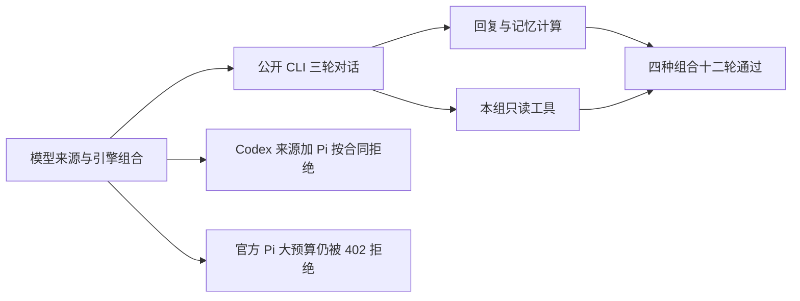

# 已安装版文本对话模型组合复验

2026-10-25，实际安装候选 `b4e174a8433e21f75bbc6b2f69b2e065855b7698`，通过用户已授权的公开 `creatoros` CLI，使用已确认的“月明水清深”。本轮聚焦文本对话，按用户最新指令停止剪辑及无关业务测试。

| 来源设置 | 引擎 | 结果 | 各轮观察墙钟秒（包含 CLI） |
| --- | --- | --- | --- |
| codex | codex | 3 轮通过 | 43.16 / 50.394 / 80.227 |
| codex | pi | 产品不支持，409 明确拒绝，无任务 | — |
| official | codex | 3 轮通过 | 38.209 / 41.645 / 48.485 |
| self | pi | 3 轮通过 | 30.414 / 26.784 / 42.392 |
| self | codex | 3 轮通过 | 42.723 / 41.933 / 61.489 |
| official | pi | 未通过：同安装版最小探针 128 成功，8192 返回 HTTP 402；正式三轮未通过 | 两档探针约 15.59 / 2.39 秒 |

四种成功组合合计 12 轮，均已逐条核对最终 assistant 内容与任务终态：首轮中文回复带指定代号；第二轮精确 `月光731｜323`；第三轮仅一次 `accountGroups.get`，读取本对话绑定的真实组，工具结果 `ok` 且 `sideEffect=none`。前两轮没有工具；所有回复 `actualEngine` 与所选引擎一致、`completeness=completed`。没有修改、采纳、发布业务内容。自配文本默认模型的公开配置为 MiniMax-M3。

Codex 引擎的三种来源设置都可执行，只证明设置组合与该引擎可用，不证明分别调用了官方或自配底层 API。公开元数据中实际引擎为 Codex，不能将这些成功拿来抵消官方 Pi 的 402。自配 Pi 的模型调用回执和工具流参数一致性均为有效。

观察墙钟包含 CLI 提交、等待与回读，不能当精确模型生成时间；本轮为 26.784–80.227 秒。功能通过不代表体验毫无问题：响应偏慢，自配 Pi 的第三轮回答还附带了不必要的内部组 ID 与成员概述，表达可以更简洁。

## 官方 Pi 的剩余问题

同安装候选、同 capability=copilot.assist、同官方来源窗口只改变输出上限的两次真实请求，128 收到首个非空流式回复，8192 返回支付/权益拒绝 HTTP 402。它说明请求预算与拒绝相关，但不证明实际余额、冻结算法或 128 能完成正式长回复和工具调用。正式普通聊天上限仍为 8192；没有以降低上限、静默换源或改成功状态掩盖故障。

该两档实验完整证据与独立复核在 `docs/verification/t1417/installed-summary.json`、`installed-review.md`。本轮没有重复相同官方失败请求、没有消耗原任务最后一次恢复、没有操作钱包，也没有重启用户已跳过的额度页验收。供应商公开首页给出的文档入口 `https://omnihi.ai/docs/` 在本轮正常浏览器访问返回 403 Forbidden，保留 `provider-public-docs.json`；未取得权威的 402 预算规则，不推断为余额不足。

## 配置与提交边界

驱动正常退出 0，随后 `verify-results.py` 串行逐条核对通过。配置采用 revision CAS，终态 revision=80，choices 与测试前完整相等。驱动退出码只证明驱动完成，不代表官方 Pi 业务成功。原始会话、账号组成员与业务回执只留本地；本报告、摘要、哈希清单和核对脚本可提交。

T-1417 受限诊断已完成，T-1427 官方 Pi 对话仍未通过；本轮记录和已实现修复只做本地提交，未推送。旧剪辑失败继续保留，但不再作为本轮模型组合的测试目标。

