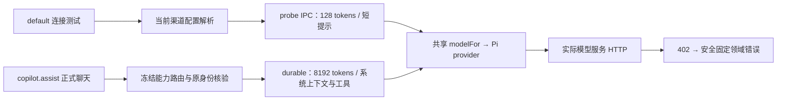

# T-1427 官方 Pi：连接测试与正式聊天请求差异诊断

日期：2026-10-25。作者：独立只读代理 `/root/t1427_pi_diagnosis`。

## 结论与证据边界

**这次官方聊天仍未验收通过；402 的具体业务原因尚未证实。** 已证实默认连接测试与正式聊天共享 Pi provider，但不是同一请求：输出上限分别为 128 和 8192，能力分别为 `default` 与 `copilot.assist`，后者还有系统上下文、工具定义、冻结路由和凭证准备。128 请求成功不能证明 8192 请求具备足够预算，也不能单独证明两次使用了同一个实际服务、模型及凭证。

“上游按较大的请求额度预留而拒绝”是有源码依据的候选解释，尚无现场的拒绝业务码或网关预扣算法支持，**不能写成已定位根因，更不能据此声称余额不足**。当前没有依据直接降低聊天上限、修改用户配置、自动换源或重发原任务。

另证实一个独立的测试覆盖缺陷：文本 probe 的严格 IPC schema 与 service 投影都不传 `authStyle`，正式聊天会传。对于自定义 Anthropic endpoint，probe 与聊天可能分别使用 `x-api-key` 与 Bearer。是否涉及本次官方路由未知；该缺陷不是本次 402 的已证实原因。

本轮只读开发源码与 Root 已保存的公开 CLI 回执，只写本报告。未读取用户数据库、密钥、连接文件或部署秘密，未执行模型/上游 API，未修改产品、路由、控制面、其他任务或原任务重试预算。已读 T-1427/T-1428 任务包要求章节及 SPEC。

## 已发生的真实观测

| 观测 | 公开结果 | 能证明的范围 |
| --- | --- | --- |
| `local-package/official-probe/probe-result.json` | `settings.models.test(default)`，`data.ok=true`，公开身份均为 `channel-managed` | 最小文本探针获得流式文本；不能证明完整聊天完成 |
| `local-package/official-chat-retest/matrix.json` 及 `receipts/` | 新对话 `ai-conv-4be54f78-256`；任务 `ai-task-4be54f78-261` / `execution-task-4be54f78-262`；`copilot.assist`，`waiting_user` / `CHANNEL_MODEL_PAYMENT_REQUIRED` | 新安装后正式聊天仍被支付或权益核验拒绝，未获得 assistant 回复 |
| `local-package/official-copilot-probe/probe-result.json` | 外层 `ok=true`，内层 `data.ok=false`：“该能力(copilot.assist)暂无内置连接测试。” | 没有发起该能力的模型调用，不能用来隔离能力路由或 token 差异 |

三次操作均由 Root 串行通过公开 CLI 执行，本代理未调用。测试属于已确认的“月明水清深”组。`modelCalls` 与 events 空不等于未调用：当前公开摘要只包含符合其投影条件的记录，未成功结算的模型调用不能以空摘要销账。矩阵轮询耗时也不是模型 HTTP 单次耗时。

## 源码链路与请求差异

以下 Creator 源码对应 HEAD `778ea4559850b0d8dfbf279c312dc4c21d72866e`；检查的请求构造、路由、Pi/provider 与 probe 生产路径相对该 commit 无差异。

| 项目 | 连接测试 | 正式聊天 | 精确依据 |
| --- | --- | --- | --- |
| 能力入口 | 仅 `default` / `script.review` 进入主文本探针；`chat.fallback` 专配另分支 | 本次实际 `copilot.assist` | `frontend/src/server/settings-model-test-wrap.ts:405`、`:590`；本次矩阵 |
| 路由 | `resolveLlmConfig` 读取当前渠道配置、选项、credential；未使用该聊天任务的 frozen route | assembly 后按实际 capability 与 text/vision 冻结；dispatch 按原任务 route 重新核身份并取 credential | `frontend/src/server/persistence-client.ts:6728`、`:7295`；`frontend/src/server/prepare-chat-reply.ts:43`、`:69` |
| 能力默认回退 | 解析 `default` 池 | 存在专门 `copilot.assist` 池时按专池；没有时允许回 `default`，选项也从对应池读取 | `backend/src/modules/ai-runtime/llm/resolve.ts:33`；`backend/src/modules/ai-runtime/capability-model-routing.ts:135` |
| endpoint 与 model | 从本次 resolve 得到 | 从原冻结身份得到 | 两者共用 `resolveChannelCapabilityRoute`；公开的 `channel-managed` 标签无法证明实际值相同 |
| 输出上限 | 固定 128 | 普通聊天固定 8192；有 `creationTarget` 时 32768 | `ai-worker/src/io/model-probe-worker-entry.ts:20`；`frontend/src/server/prepare-chat-reply.ts:72` |
| 输入与工具 | 单条“连接测试。请只回复 OK。”；不传 tools/system | assembly 的 system、冻结消息、工具定义；正常首轮并不因用户写“不要调用工具”而删除 schema | `frontend/src/server/prepare-chat-reply.ts:52`；`ai-worker/src/runtime/chat/chat-pi-loop.ts:67`、`:95`、`:98` |
| 温度、推理、重试 | 未额外指定温度或推理；`maxRetries=0` | 此主循环同样未额外指定温度或推理；`maxRetries=0` | probe `:20`；chat loop `:98`；Pi `:28` |
| 成功门槛 | 第一段非空 text/reasoning 即结束读取，finally abort | 需要正式流、durable 回执、消息与任务结果落稳 | probe `:22–40`；`ai-worker/src/execution/durable-stream-model.ts:99` 起 |
| 鉴权参数 | IPC 丢弃 `authStyle` | frozen spec 保留 `authStyle` | `contract/src/internal/model-probe-io.ts:5`；`backend/src/modules/ai-runtime/model-probe-io.service.ts:9`；`frontend/src/server/persistence-client.ts:6027` |

实际 protocol adapter 由 `apiFormat` 决定：`anthropic-messages` / `openai-completions` / `openai-responses`；Anthropic base URL 统一去尾部 `/v1`。两条路径进入同一函数，因此若实际 spec 相同，endpoint 构造算法相同；当前公开证据不能确认实际 spec 相同。见 `ai-worker/src/runtime/pi-provider.ts:11–18`。

输出上限确实传到 wire，并非只在 UI 中显示。`pi-provider.ts:28` 将 `request.maxOutputTokens` 传为 Pi `maxTokens`；`pi-provider-codec.ts:94` 起的 payload 转换没有覆盖该上限。当前安装依赖的 `@earendil-works/pi-ai/dist/api/openai-completions.js:463–469` 将其写为 `max_tokens` 或 `max_completion_tokens`；`openai-responses.js:201–202` 写 `max_output_tokens`（下界 16）；`anthropic-messages.js:717` 使用 `options.maxTokens`。因此不能把 Pi model 元数据 `maxTokens:32768`（`:15`）误认成本次普通聊天实际请求的上限。

冻结 settings schema 可保存 `maxTokens`（`contract/src/internal/model-routing.ts:74`），但正式文本 `resolveFrozenExecutionSpec` 只从 settings 取 `structuredOutputs`（`persistence-client.ts:6027–6028`），本次主聊天上限仍由 `prepare-chat-reply.ts:72` 决定。尚无当前私有配置数据可证明存在被忽略的特定上限，也未证明该通用字段在此能力上的产品合同要求，因此不将它直接定为现场缺陷。

## 凭证准备与错误来源

正式任务在冻结前调用 `prepareModelAuthority`，dispatch 时 `resolveFrozenCredential` 再对原 scope 调用 `ensureOfficialAuthority`；这不是每次无条件换 Key。有效缓存且原 credential 存在时直接返回；仅缺少有效配置或 credential 时走 refresh。相关位置：`frontend/src/server/persistence-client.ts:5812–5846`、`:6248–6255`；`frontend/src/server/activation/model-benefit.server.ts:344–351`。

原身份核验之后，persistent credential 沿同一 `scopeId/serviceId` 读取，当前默认选项不能替换原任务。身份不一致会报 `MODEL_ROUTE_IDENTITY_CHANGED`，缺凭证报 `MODEL_CREDENTIAL_UNAVAILABLE`。见 `backend/src/modules/ai-runtime/capability-model-routing.ts:258–312`。这证明代码有防漂移边界，不能证明现场两次凭证字节相同；本轮没有读取字节，也没有证据显示发生了错误轮换。

Pi 记录实际 `onResponse.status`，无输出且 HTTP >= 400 才以受控 classifier 处理（`ai-worker/src/runtime/pi-provider.ts:51–65`）。受管分类器先识别明确额度信号，其余 status 402 才映射 `payment_required`（`ai-worker/src/runtime/provider-factory.ts:243–282`）。所以这次领域码说明没有保留下可认定额度耗尽的白名单证据，不能反向猜原始 provider 文案。

宿主本地执行 token 预算与上游货币预算是两个边界。本地 reserve 计算输入协议字节估值 + 1024 + 冻结输出上限，并在超过本地总预算时产生 `ExecutionBudgetError` / `EXECUTION_BUDGET_EXHAUSTED`，不是 HTTP 402。见 `backend/src/modules/execution/execution-generation-ports.service.ts:53–68`、`execution.errors.ts:21–24`、`execution-call-ledger.service.ts:100`。因此没有依据把本次 `CHANNEL_MODEL_PAYMENT_REQUIRED` 归因于宿主的百万 token 总预算。

## Growth 源码能证明什么

经 Root 指定，只读 `/Users/zyongzhu/Workbase/Thirdspace-growth` 的 AGENTS 与相关源码。该工作树 HEAD 为 `0fb61a9dd3cf80bbb6675415f4110738f3b17ba1`，下列两个文件有他人未提交修改；这里引用的是读取时工作树，不是部署证明：

- `server/integrations/managed_model/omnihi.py`，SHA-256 `afbe713f159734a31125c3113b38885736b347dd7ca27bdc95c65305a02bd5c4`。
- `server/application/ai_credit_service.py`，SHA-256 `bfc0baa0300e9f55ab8ae2210e49eddc7a7ba5c4d5095b1036fbf439a1fea6a3`。

Key adapter 创建凭证时要求 `budget_enabled=true` 与指定货币上限（`omnihi.py:328–337`），并从上游按原 Key 读取 `budget_amount / budget_used / budget_frozen / budget_remaining`（`:384–425`）。因此“受管 Key 有预算与冻结状态”得到源码支持。但是该项目不是模型聊天流量网关：已查相关 Python transport、managed adapter 与 credit service，没有找到聊天请求 `max_tokens` 预扣公式或生成聊天 HTTP 402 的分支。预扣是否按输出上限、上游错误码、现场实时余额均仍未知。

正常额度页面的刷新入口由本人登录授权（`server/transport/http/ai_credits.py:487–501`）；`refresh_usage` 会读取 provider 预算、核对预算目标并保存已用/冻结/剩余快照（`ai_credit_service.py:1180–1236`），不借此修改 provider 预算。但公开 `remainingUnits` 是 `wallet_total-used-asr_committed-asr_reserved`，不是直接暴露 provider 的 `budget_remaining`；`frozenUnits` 单列，另有 `pendingUnits/syncStatus/lastUsageRefreshedAt`（`:1135–1156`，HEAD 相同逻辑已复核）。故页面刷新后的同步状态、冻结数和时间有诊断价值；单看“剩余大于零”不能证明一次 8192 输出上限的请求可被接受，也不能定位请求被哪条网关规则拒绝。本轮未访问页面或刷新上游。

## 下一步最小可证伪方案与红测建议

1. **先补实际请求的可比较条件，保留原任务。** 若批准新合同，可在正式路由所有者内部比较同组 `default` 与 `copilot.assist` 的有效路由是否相同，只输出“相同/不同/无法确认”、协议/鉴权类型与请求大小等安全事实；不公开 token、provider/model/URL、正文、headers 或这些秘密的可猜测散列。现有 `settings.models.test(copilot.assist)` 未调用模型，不能当作这项诊断。需要真实对比时只新建受控测试任务，不改原冻结请求、不消耗原任务最后一次恢复预算。
2. **确定的覆盖缺陷：probe 鉴权传递。** 精确候选写集为 `contract/src/internal/model-probe-io.ts`、`backend/src/modules/ai-runtime/model-probe-io.service.ts` 及其现有测试、`frontend/src/server/settings-model-test-wrap.test.ts`。先用真实原 worker-entry + IPC + 本地 HTTP 断言 Anthropic custom endpoint 收到 Bearer，官方 Anthropic 仍用 x-api-key，token 不出错误回执，单次调用。当前严格 schema/投影会使 Bearer 用例红；不能只 mock 带 authStyle 的 `modelFor`。修复不应顺便扩大公开测试能力或输出上限。
3. **请求规模假说的可证伪测试。** 用同一个合成路由、同一个 credential、同一正式 Pi adapter，对本地假网关分别捕获 probe 与正式组装聊天：断言 wire 为 128 / 8192、工具数量、系统/消息字节数及零自动重试。假网关可按请求上限返回合成 402，证明“探针成功而聊天拒绝”在该机制下可重现；该合成测试只能证明机制，不能证明生产就是此规则。真实根因仍需当前已认证额度/冻结/同步事实或上游安全业务原因与现场拒绝对应。
4. **如有权威证据再改预算策略。** 必须先明确允许的请求上限/能力合同，再在组装、冻结、账本与 wire 四处做同值红测。不得只在 Pi 适配器偷偷 clamp，否则 `execution-generation-ports.service.ts:54` 的冻结上限校验和请求账本会失真；不得收到 402 后自动改小参数重试或切源。不要将所有正常聊天改成 128 来换取测试成功，也不要把 synthetic 402 红绿当真实验收。
5. **能力探针和成功文案另立精确范围。** 当前“已按正式聊天通路完成流式回复”只验证共享 provider 的首段输出。若要求验收完整官方聊天，应通过真实 chat/durable 路径得到完整 assistant 消息及持久终态；若只保留连接探针，文案应准确说明它验证最小请求，不能把首次 chunk 当完整多轮能力验收。

本轮没有执行红绿测试，也没有把建议中的测试补写成已发生。最终验收仍需官方 Pi 在真实组上完成正常聊天，并对应查清当前 402；本报告不改变 T-1427 未通过状态。
