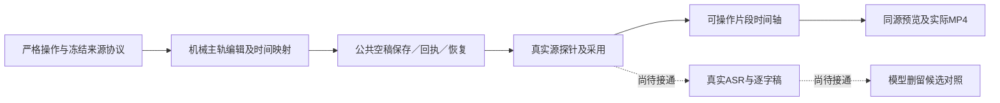

# T-850 粗剪工作台实施与自测记录

本记录截至 2026-10-02 的当场结果；任务仍进行中。

当前已有 v2 空稿协议、冻结源/转写身份协议和严格主轨操作；后台机械映射采用精确有理数累计输出时间，分割保留左实例、修边/重排保持身份、移除闭合间隙。文字删除核验真实词句粒度、转写摘要及选定实例，重复源实例不受影响。整批冲突不污染原稿。公共保存/读取/版本/回执/恢复支持空粗剪草稿；普通 save 禁止自造源目录、转写回执或替换旧快照，旧入口不能覆盖 v2。

| 当场检查 | 结果 | 证据目录 docs/research/evidence/t850 |
| --- | --- | --- |
| 新主轨操作契约 | 红测 1 FAIL / 1 PASS → 2 PASS | main-track-operations-red.log、main-track-operations-green.log |
| 冻结转写身份和范围 | 红测 1 FAIL / 3 PASS → 4 PASS | main-track-transcript-red.log、main-track-transcript-green.log |
| 时间映射/实例操作/文字删除 | 缺实现红测 → 4 PASS | main-track-service-red.log、main-track-service-green.log |
| 公共空稿保存与旧链回归 | 红测 2 FAIL / 14 PASS → 3 文件 30 PASS | main-track-public-red.log、main-track-public-green.log |
| 前端及所引生产代码类型 | 首轮 BigInt literal 目标不兼容，改为 BigInt 构造后 PASS | main-track-public-types.log |
| 后端全量类型 | FAIL：既有 runtime/Copilot/legacy 测试错误，无新增主轨文件类型报错 | main-track-backend-types.log |

## 2026-10-02 实际主轨与成片补验

已接通媒体探针原执行调度、冻结具体文件与字节摘要、用户采用原片、v2 同源预览/渲染编译、可视片段选择、分割、修边、删除、重排、历史恢复及请求回执恢复。时间轴采用共享有理数累计映射，并只渲染可见片段。可选图层未映射时保留原稿并提示，不阻断纯主轨输出。

| 当场检查 | 结果 | 证据 |
| --- | --- | --- |
| 前端交互、预览主时钟和草稿回归 | 3 文件 9 PASS | rough-ui-interactions-final.log |
| 主轨、编译、既有模板回归 | 3 文件 91 PASS | rough-final-regression.log |
| 真 ffprobe 经公共执行调度及原片采用 | 2 PASS，18 条其他测试按过滤跳过 | source-public-execution-final.log |
| 真 HyperFrames + FFmpeg 输出 MP4 | 1 PASS；1.5 秒、实际音轨、蓝/红/蓝画面与 880/440/880Hz 声音顺序正确 | rough-real-mp4-audio-visual.log、rough-actual-order-repeat.mp4 |

真实渲染先发现纯主轨被旧布局门拒绝，随后发现实例文件搬运后的引用未更新。本机 FFmpeg 9 与 HyperFrames 的旧 filter_complex_script 混音不兼容，导致引擎返回无声成片；正式 v2 输出现按冻结主轨区间确定性合成原片音轨、视频流直接复制。失败日志原样保留，未修改测试期望绕过音画检查。

独立代码复核进一步发现分割图层卡片 ID 重复、B-roll 入点重置与字幕复核提示丢失，已修正；新增联动用例、浏览器尺寸与交互验收仍待完成。真实 ASR settled 采用、逐字稿 UI、模型删留候选、旧工程显式转换、完整失败任务重试仍未完成。没有进行全部双账号实机旅程，也未验收 T1045 组合/画布/审核。本任务继续进行，不标完成，不声称全绿。
