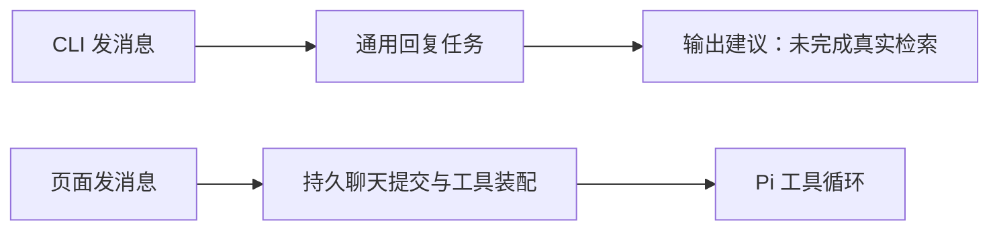

# T-933 已安装版本实际验收

2026-09-08 用户要求自行安装并检查，随后开启本次启动 CLI 完整访问。结论：安装和 Skill 注册正常，真实资料搜集验收未通过；不得据此宣称 Agent Runtime 业务已验收。

## 实际证据

- 已安装 `/Applications/CreatorOS.app` 1.1.0，进程 PID 95669；签名检查通过。候选及 sidecar 摘要见 T-932 交付记录，本轮没有重复覆盖安装。
- 公开 CLI `status`、`access status` 显示 installed / connected / full。
- 当前唯一账号 `acct-ae1a8346-9`；所有业务调用显式绑定此账号。
- `settings.prompts.list` 返回 10 个 method.*，全部 compatible。
- 创建独立验收会话 `ai-conv-80f6a933-78`，未绑定项目。要求搜 Uber / Palantir 官方工程文章、阅读正文并交付三篇带来源的阅读建议。
- `ai.conversations.messages.create` 产生原任务 `ai-task-80f6a933-83`。2026-09-08T14:20:50.496Z 提交，14:21:08.289Z 状态 succeeded，约 18 秒。
- 实际回答包含文档入口、博客首页和“建议在站内搜”“点开链接前二次确认”等建议；消息 parts 为空，无搜索或正文读取回执。没有交付要求的三篇已读文章，业务验收失败。

## 接线根因

公开 CLI 操作经 `backend/src/modules/ai/ai.transport.ts` 调 `createMessageWithReplyTask`。该方法在 `ai.service.ts` 创建通用 copilot.assist 任务，输入没有 chat.run 冻结装配。

页面入口 `frontend/src/app/api/chat/route.ts` 则调用 `durable.submit`，冻结 chat.sync 方法及工具，再经 `prepareDurableChatTurn` 装配。两条入口未统一；本轮 CLI 任务不能证明页面新工具循环有效，也不能把其成功状态当成资料搜集完成。

原始公开 CLI 回执保留于 `/tmp/t933-conversation.json`、`/tmp/t933-chat-result.json`、`/tmp/t933-messages.json`、`/tmp/t933-prompts.json`。本次只有一条模型任务；请求发送前的参数校验失败没有重发模型任务。

## 后续修复范围

公开发消息入口接入和页面同一持久聊天提交与工具装配，保留消息与任务绑定、账号归属、幂等和历史可读性。禁止只改提示词或将页面效果推断为通过。之后必须复验实际 skill.read、搜索、正文读取及最终交付。页面视觉与导航性能本轮未验收。全局 reconcile 仍按原有暂缓状态，不记为通过。
