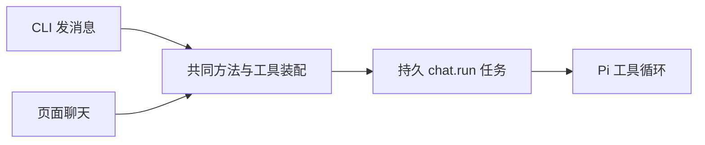

# T-934 公开聊天入口统一

用户确认：通用回复入口应退役。复用 T-930 Pi 单引擎、T-932 方法加载与 T-933 实际验收范围，不新增执行器、数据库或业务采纳权限。

公开发消息和页面均通过同一个 prepareChatReply 装配入口，使用 prepareDurableChatTurn 和 createChatTurnSubmissionService 创建 chat.run。CLI 的会话、项目及附件从当前账号服务读取；附件解析与页面共用。消息与任务同事务保存，成功提交后只唤醒 chatWorker。

2026-09-08 独立审查指出 PGlite 单连接事务内调用全局上下文读取会自锁，实施改为事务外准备源消息和冻结装配；事务内锁会话并比较历史摘要，变化则拒绝，消息及任务都不残留。项目归属在装配前检查，事务内不调用全局端口。

直接 ai.tasks.create(copilot.assist) 在已有幂等任务重放检查之后拒绝新建；旧任务和历史仍可读，不删除真实数据。不把 taskType 这个历史业务分类误认为第二执行器。

验证：真实 PGlite 五项测试通过（提交、任务失败回滚、跨账号拒绝、历史竞争拒绝、退役入口拒绝），其中装配主动读取全局 db，证明未在事务内自锁；frontend tsc 通过。尚需当前候选生产装配复核、打包与真机搜索验收，不能据此声明业务效果通过。

独立实现复核确认接线与字段一致，补上事务前 Worker 就绪检查。新路径真实 PGlite 保存点提交及回滚已通过；没有把旧测试改成空断言。

## 已安装候选

候选 `9d959b850534e70f4b217514661878f38ec855a8`，干净隔离工作树固定命令 `pnpm -C frontend desktop:package-local` exit 0。生产编译和包内 sidecar 启动 ready、GET / 200、browser hydration PASS；真实安装后 PID 9260 存在。

- 安装包 `/Users/zyongzhu/Downloads/CreatorOS-1.1.0.dmg`，SHA-256 `36292b83a0c27aa21f8211e5fe40805575a7ebc2391e015cce1f7a4c47fc3865`。
- 安装应用和候选 sidecar 摘要相同：`11837def9a0b93518cd840c5becd9c9db1cf963151527640c6e74eb0880c5463`。
- codesign deep strict exit 0，hdiutil verify VALID。本地 ad-hoc 签名，未公证、未发布。
- 日志 `/tmp/t934-package.log`、`/tmp/t934-dmg-verify.log`。
- 安装重启后公开 CLI 返回 CONNECTION_NOT_FOUND，要求本次启动开启完整访问。没有绕过授权，没有伪称真实联网复验通过；T-934/T-933 保持进行中，待用户开启后复用公开 CLI 验收。
