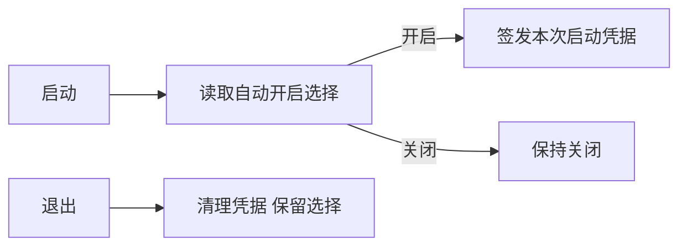

# T-936 CLI 自动开启

用户明确要求 CLI 自动开启，不再每次重启手动授权。默认启动开启，设置可随时关闭且持久保存关闭选择；重新开启后每次启动自动开启。偏好按现有 product/package 保存，仅含布尔值，不保存凭据。每次启动仍重新生成握手凭据、随机nonce，退出清理连接和凭据，不清理偏好；公开操作的账号、幂等与写入确认规则不变。

DEC：本次用户授权将“每启动临时授权”改为“默认自动开启且可持久关闭”。使用原CLI入口及权限文件写入函数，不引入第二条绕过登录的接口。

验证范围：偏好默认/关闭/重新开启、产品隔离、退出后偏好保留，设置按钮真实命令，类型及桌面编译，安装重启后的公开CLI连接。

独立评审已通过设计；实施保留“偏好损坏/身份不匹配时关闭”、关闭偏好保存失败仍撤销当前凭据、状态失败后回读真值。原生偏好测试1/1、设置UI4/4、CLI连接测试5/5通过；frontend及CLI类型检查通过。CLI access revoke同样记住关闭，退出清理不删除选择。
