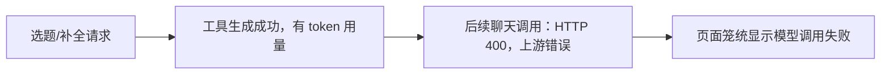

# T-958 旧版用户模型失败日志分析

范围：只读解密用户提供的三份2026-09-12日志，核对时间线和错误类型；不操作用户账户、不重放生成、不修改产品代码。验收：区分确定证据和待查假设，提供服务端排查索引。

## 结论

运行目录显示1.1.0，但不能据此定位精确构建提交。三份日志均完整解密；原文仅保存在本机临时目录，不提交用户原始日志。

时间均为北京时间（原日志UTC+8）。

| 时间 | 证据 | 判断 |
|---|---|---|
| 10:28:52 | 主日志28–43行，chat-34f39bbf20，CHANNEL_MODEL_TIMEOUT，耗时10507ms | 聊天调用超时；不证明服务端没生成或未计费 |
| 10:29:17 | 主日志45–55行，模型测试同样timeout | 不只业务提示词问题，模型连通性测试亦受影响 |
| 10:29:57–10:32:24 | AI_CREDIT_EXHAUSTED；聊天、3个重建任务和5个作品归因报额度不足 | 额度拒绝是这一时段明确阻断；真实余额/冻结/退款需服务账本确认 |
| 10:31:52 | CHANNEL_MODEL_NETWORK，查询生成结果时网络中断 | 单独的网络/查询失败，不能认定是用户网络还是中转网络 |
| 17:37:50→17:37:52 | -5日志42–61行，topic.generate ok，1276输入/689输出token，随后chat-f669fc7269 HTTP400/CHANNEL_MODEL_UPSTREAM | 工具已返回内容，后续聊天失败 |
| 17:40:09→17:40:10 | -5日志63–82行，topic.enrich ok，1538/602token，随后chat-29167e2bcf同错 | 同样模式 |
| 17:40:32→17:40:34 | -5日志84–103行，topic.enrich ok，1522/554token，随后chat-33ee4102db同错 | 同样模式再次出现 |
| 17:42:48 | -6日志21–23行，startup配置同步失败，bootstrap随即configured | 有恢复成功证据，不应视为持续未激活 |

## 证据边界与处理建议

- 三次均在工具成功后约1.2–1.8秒报错，优先排查工具结果回传后续请求与上游渠道状态。尚无原始响应正文、请求载荷及服务端请求ID，不能断定具体模型、tool message格式、reasoning字段或token长度有错。
- 当前源码有中转HTTP400包装upstream_error的专门测试，因此HTTP400本身不等于用户输入参数错误。旧包精确代码仍需构建指纹确认。
- 成功工具共记录4336输入/1845输出token；这些是日志使用量，不是已扣费金额。失败后整轮重试存在重新生成风险，需查候选保存与计费账本，不能直接建议反复点重试。
- 旧日志同轮先outcome=error又outcome=completed；completed只能代表生命周期结束，不能用于成功率统计。重复stream_error同一reference也不能算两个独立失败。
- UI没有呈现已成功的工具结果及失败阶段，造成用户感知整单失败；应保留可恢复候选，将后续说明失败与核心生成失败分开。
- 不能只让用户充值：下午工具生成成功后仍报错。也不能承诺只升级新版即可解决服务端上游失败。
- 服务端优先检索UTC09:37:50–09:40:35三条chat reference，核对同会话的上游响应、渠道/模型、工具回传、重试和计费；另核对UTC02:29–02:33额度拒绝及超时调用结算。客户端reference是否传到服务端尚待确认，可按时间和授权主体辅助关联。

旁支：抖音身份未解析、采集0条；启动AccountRequiredError；ONNX初始化警告。它们没有证据与三次聊天上游失败存在因果关系。
