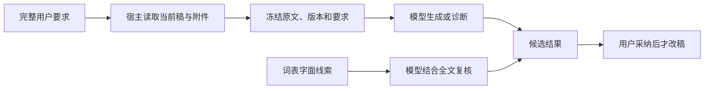

# T-959 阻断修复与安装版真实验收

2026-09-12，用户要求“阻断性的问题先优化”。候选代码 `1fc7c298`，已本地构建并安装 `/Applications/CreatorOS.app`，启动 PID 35955。没有发布、没有采纳 AI 候选、没有覆盖用户稿。

## 改动和结果

| 阻断 | 修复 | 安装版真实结果 |
| --- | --- | --- |
| 无 sourceRefs 时写稿要求在准备、入队、Worker 三处丢失 | 三层都保留完整原始要求；与模型建议分开标注优先级；附件与宿主当前稿一起冻结 | 子任务 `ai-task-8312f9fd-79` 收到 592 字符指令、83 字符用户消息和 879 字符原稿；生成 31 镜候选，保留自动射击、WASD、技能三选一、首领战，不再生成另一款跳跃平台游戏 |
| 已有稿件却按无稿诊断 | 宿主严格读取当前项目版本；归属、过期选区、取消和读取失败不能吞成空稿 | 父任务 `ai-task-8312f9fd-65` 成功，诊断能具体引用图→Blender→GLB→网页→游戏、WASD/射击等原稿内容，不再声称只看到标题 |
| QQ 键被词表硬改成导流 block | 词表只提供语义复核线索，保留模型判定和真实报告校验，模板 v2 | 审核子任务 `ai-task-8312f9fd-99` 成功；报告 `srreport:call_e6312db5-791b-4e19-8816-937940b082e6` 从旧版 block 变为 risk，明确识别为按键而非加 QQ 联系，未被词表再次强改成 block |

真实模型为当前配置的 MiniMax-M3；任务完成不等于内容质量合格。此次仅验收上述阻断范围。

## 没有掩盖的剩余问题

- 写稿父任务 `ai-task-8312f9fd-54` 两次猜错资料引用，宿主拒绝后模型自行改用真实引用并成功。引用边界没有放宽；仍有可优化的工具使用质量，不能声称零内部错误。
- 审核虽然取消强制 block，仍建议把 QQ 键改写以回避假定的机审风险，并将个人用时、效果描述等过度归入风险。没有证明这些平台规则推断正确。
- 诊断仍僵硬套用账号定位与“四件套”等要求，有选题偏见；本次只修复漏读原稿，不代表编导判断已经专业。
- 候选中“截图一”等安排和分期发布建议仍需人工编辑确认。没有把生成成功冒充可直接发布。
- Gemini thought_signature、网页研究和视频颜色等原实测遗留问题不在本次修复范围，保留 T-957 的失败样本。

## 检验与独立评审

- 写稿真实红测 2 failed / 12 passed；三层修复后相关 5 文件 233 passed，另完整 Worker 链 8 passed（含取消/未知回执/重试/保真授权等既有场景）。宿主组合测试覆盖长消息尾部要求、附件加当前稿、权限失败、过期版本、原文保真及伪引用拒绝。
- 诊断红测 5 failed / 11 passed；4 文件 31 passed，含真实当前稿 reader→host facets 和业务诊断 reader。
- 审核红测 5 failed / 12 passed；后端 48、模板/lint 8、人工审核 UI 19 passed；公开 trigger→prepare→Worker→报告链 3 passed，按 QQ 键的模拟语义 pass 与加 QQ 领资料的模拟语义 block 均保留同一真实词表线索，含一次 503 重试。这里是模拟模型协议测试，不冒充真实模型广告识别实测。
- 两组旧 Worker fixture 使用普通 JSON 与当前 Pi SSE 协议不匹配，已经修正 fixture 并实际重跑通过；不是通过放宽结果断言处理失败。
- 独立方案评审通过。首次代码复审发现长消息截断、附件排除当前稿，两项修复后复审通过；旧直接 dispatch 分支也共用指令保存函数。
- frontend 类型检查通过；backend 类型检查保留 15 处既有测试错误，本次文件无新增。边界扫描仍有 7 项既有违规（其中 live-chat-session 两项相对旧基线标新），reconcile 仍有 233 项既有错误，均保留 T-916，全局并非全绿。`progress done T-959:build` 也被范围外既有 complexity ledger 缺项拒绝，未手改为通过；T-916 保留该治理欠债。

## 安装及数据保护

- 本地打包 42 项检查通过，工作树冻结于 `1fc7c298`，四处版本均为 1.1.0。
- DMG：`/Users/zyongzhu/Downloads/CreatorOS-1.1.0.dmg`，SHA-256 `742dd5b68283c9010138bb95c32feef1af52970468dbb1e29bdc715c21698ac0`；hdiutil 校验 VALID，codesign deep/strict 通过。本地 ad-hoc 包，未经 Apple 公证。
- 安装二进制 SHA-256：`230890c1743ab69022265742f38d11d6eb1031f7e5611f3a5c0a4dd97ed1713b`。
- 正常退出后完整备份：`/Users/zyongzhu/.creatoros/backups/t959-20260912-062757/app-data`，1905 个数据库文件逐一 SHA-256 相等。
- 复测前后工件 `artifact-185382ce-676` 的当前版本始终为 `artifactversion-185382ce-678`，完整版本列表深比较一致（2 个版本）；候选保持待确认。
- 原始测试回执仅留 `/tmp/t959-live/`，未提交完整用户正文或签名媒体地址。其他测试日志在 `/tmp/t959-*.log`。
