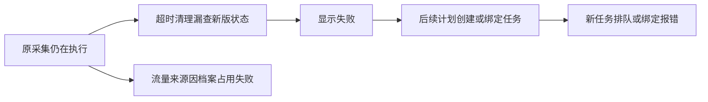

# T-982 升级后自动采集失败日志诊断

## 诊断结论

确认存在采集调度与持久执行迁移后的兼容缺陷。本机有“仍在执行却被标失败”的直接证据；用户端另有旧任务恢复缺字段和父子绑定冲突。流量来源同时存在真实浏览器档案占用失败。不能将全部报错归因于网络、未登录或额度，也不能仅靠重新打包解决。

两组日志均有 macOS 启动记录，“双端”指用户端与本机，不是 Windows/Mac 对照验证。用户安装包准确提交号尚不明确，不能断言由最后一次升级首次引入。关键源码与 V1.2 发布候选 fe5332cd91141071885732c3844da80430cf7f63 一致。

## 证据与时间线

解密用户三份、本机同日两份日志。官方 CreatorOS CLI 只读查询 ai.tasks.get、ai.tasks.steps.list、jobRuns.get、jobRuns.listByJob、scheduledJobs.list、projects.list、analytics.traffic.get，均限定指定账号。没有重放采集、取消任务、清库或解除浏览器锁。原始日志及密钥不提交。

以下均为 2026-09-14 北京时间（日志 UTC 加八小时）。

| 位置与时间 | 事实 | 解释 |
| --- | --- | --- |
| 用户 20:28:47、20:28:54 | flywheel 恢复失败，skillSnapshot expected object / received undefined | 旧对标任务缺新版恢复字段 |
| 用户 21:12:40 | self.detail 的 download.path 报页面或浏览器已关闭 | 详情采集中断，关闭者未确认 |
| 用户 21:54:17 | AbortError 栈含 stop、sidecar-lifecycle | 这一批中止伴随应用退出，不能全部当成独立采集故障 |
| 用户 22:02、22:05、22:08 | 连续“调度运行记录不属于此父任务” | 重复绑定失败，日志缺完整绑定对象 |
| 本机 22:18:22 | analytics.traffic.get 显示流量采集失败，原因是浏览器登录档案仍被占用 | 真实采集失败，旧数据仍存在 |
| 本机 22:24:00 | 原 job_run 被标 failed，理由 stale-run、无活跃执行 | 超时清理判失活 |
| 本机 22:36:25 → 22:37:25 | 同一已失败运行的进度从 12/20 更新到 13/20；AI 任务 runtimeStatus=running | 明确证明误判；本批流量保存 0、失败 13，基础指标已保留 |
| 本机 22:31:30 | 同作业出现新运行；对应 AI 任务仍 queued | 旧任务未停止又有任务排队，不能说两个浏览器已同时执行 |

内部追踪：原任务 ai-task-6fa4a22b-68，执行 exec_4f7edcaf-73fa-432d-8d48-2ad3b6b75c29，运行 run-b1a3b072-94c1-4302-8723-264f4b9bdae7；新任务 ai-task-82697853-2893，运行 run-74f651d6-15b8-409e-8e88-3e329a91db7b。

原任务步骤记录“新增 6 条、更新 15 条”，之后详情下载中断、部分数据待重试。用户日志有封面回退成功 10/10 和雷达同步成功记录。因此不是所有采集均失败，也没有依据声称数据丢失。

## 源码定位

1. **活跃任务查询漏掉新版采集执行，已确认。** `backend/src/modules/ai/ai.repository.ts:420` 的 listRunningTasksSystem 只查 executionTaskId IS NULL；`backend/src/application/scheduling/automation.ts:19` 的超时清理使用该结果，仅额外补每日选题状态。`backend/src/modules/scheduling/daily-topic-run.service.ts:50` 只覆盖 topic.daily，没有保护 self.metrics 等持久采集。scheduled-collection-scheduler 的 sweepStaleRuns 据此判失败，与本机状态矛盾吻合。排除持久任务的条件可追溯至 d527acf3e（9月5日），不能归咎于最近助手性能优化。
2. **复用旧子任务与新计划绑定存在冲突路径。** `backend/src/application/scheduling/automation.ts:109` 在 deduped 时仍返回旧执行，早于重叠跳过分支；scheduler 可复用跨计划的未完成运行。`backend/src/modules/execution/execution-scheduled-child.service.ts:33` 要求原 run.scheduledFor 与新父任务 scheduledFor 一致。用户报错与此路径吻合，但日志不足以判断长校验表达式中具体哪一项失败。不能删除归属校验来修复。
3. **旧任务缺恢复快照，已确认。** `backend/src/modules/ai-runtime/scheduled-flywheel-execution.service.ts:88` 直接校验 runtimeData.skillSnapshot 必填；恢复队列包含没有持久执行映射的旧任务。用户日志准确指向该字段。需要合法迁移或明确处理不可恢复旧任务，不能伪造授权快照。
4. **浏览器占用、页面关闭，故障确认但占用者未确认。** 当前不能确定是哪个手动窗口或采集器持锁。统一同步入口依次处理作品、评论、流量，保留已成功数据；不能强行删除锁或关闭用户浏览器。

## 修复与防复发要求

- 以持久执行状态及租约统一判断活跃、完成和失败，覆盖所有自动采集类型。
- 跨计划已有任务时跳过重叠调度；恢复原父子关联，保留账号、时间和账本检查。
- 对旧任务缺字段、已有部分结果、退出中止分别处理，避免无限恢复；保留已采数据。
- 查清浏览器持有者，协调同档案串行访问，覆盖退出、异常、取消释放资源，禁止盲目解锁。
- 回归覆盖超过清理阈值仍活跃、跨调度周期、旧任务缺字段、退出重启、下载时浏览器关闭、档案冲突和部分成功。须验证真实公共采集链路，不能只跑孤立 helper 单测。

## 完成边界

诊断完成，程序尚未修复，未重试原任务；用户准确版本及档案占用者待确认。没有代码变更，不宣称构建或回归通过。全局 reconcile 既有欠债 T-916 未在本诊断处理。续接发现脚手架 3.27.2 可用，本次仅收尾既有只读诊断，后续代码实施前按流程升级校验。

## 原始任务范围

用户提供三份9月14日加密日志，反馈用户与本机升级后均连续失败。读取并解密指定日志与本机同日记录，对齐原始错误、版本、时间、自动化执行阶段，查源码与改动历史判断是否同源回归。原始日志及密钥不提交，输出脱敏证据与明确诊断。当前先诊断，不重放任务、不修改用户数据。
