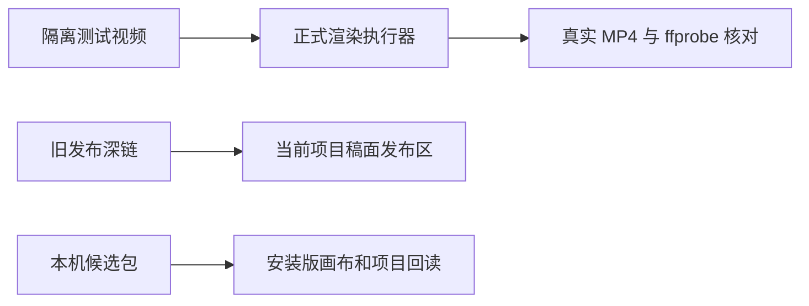

# T-993 无限画布本机候选包验收（2026-09-29）

## 候选与已验证结果

- 源码候选提交：`65781a811da57b50a3446fb74e081143bff317e6`；T-993 仍为进行中。
- 本机产物：`/Users/zyongzhu/Downloads/CreatorOS-1.2.0.dmg`；SHA-256 `abebecd7bcb760fbda9380b3ae39b21fbf5d55a5071245b09efe906fa90d651c`。`hdiutil verify` 返回 VALID；本包为 ad-hoc 签名，未 Apple 公证，未公开发布。
- DMG、构建目录 `.app`、当前安装的 `/Applications/CreatorOS.app` 均含 `Contents/Resources/THIRD_PARTY_NOTICES.md`，三份 SHA-256 一致：`164b46fc33639cb2e79cba8abea46e7daccc285d9c19343178823e8ec964e962`。DMG 校验时只读挂载，随后卸载。
- 无限画布 6 项浏览器 E2E 整组通过：保存/账号隔离、节点位置尺寸/群组移动/连线、视口与内容版本隔离、触控板滚动与组合键缩放、真实本地图片视频预览、旧 v1 文档/框选批量删除/撤销重做。前端类型检查与生产构建通过；旧入口制作台 B-roll 删除、发布排期、语义素材生成 3 项 E2E 通过；打包基础检查 4 文件 42 项通过。
- 公开 CLI 只读回执：安装版 `status` 为 `connected=true, mode=installed`，完整访问仍启用；`accounts list` 返回 3 个账号；`settings.models.list` 返回 12 条配置，GPT Image 2 与 MiniMax-H3 的 `hasSecret` 均为 true。未输出账号明细或凭据。

## 自动安装副作用与数据核对

本次执行 `pnpm -C frontend desktop:package-local` 以产出候选包。固定脚本在包生成后默认调用安装步骤：删除现有 `/Applications/CreatorOS.app`，把 staging 应用移动到该路径并自动 `open`。因此现有应用包已被候选替换并启动；此前向用户说明的“只构建不覆盖安装”没有兑现，必须如实保留此记录。脚本没有旧应用备份。本次未执行进一步安装、重启、回滚或清理。

运行中的新应用 PID 为 `49897`，版本 1.2.0。用户数据目录仍含 `db`、`.channel-model-config`、`.license`，数据库文件约 732 MB，公开 CLI 可读取账号和模型配置。由于无替换前数据快照，不能证明内容逐字节未变；也未在未选定账号的情况下读取作品明细。下一次只需产出包时应设置脚本已有的 `CREATOROS_LOCAL_SKIP_INSTALL=1`，并在执行前核对其含义。

## 仍待验收

- Windows NSIS 实包、Apple 公证、完整旧渲染与发布公共链、指定账号作品明细仍未验收。
- 全局 `reconcile` 与边界门卫有既有红项；本报告只陈述实际运行的聚焦验收，不宣称项目全绿。

## 缺表修复与第二轮安装版真实验收

- 2026-09-29 从已安装应用公开 CLI 复现：账号 `acct-ae1a8346-9` 调用 `canvas.list` 报 `relation "creative_canvases" does not exist`；同一安装包带有 `0101_creative_canvas.sql` 和 journal。旧库 journal 已记录迁移但表缺失的回归测试先红（实际返回 0 张表），修复后转绿：启动时检测三张画布表，缺表时在事务内重放已有 `0101` 的幂等 DDL，不修改 journal。测试覆盖旧数据保留、三张表恢复及二次重启幂等。
- 最终包 `/Users/zyongzhu/Downloads/CreatorOS-1.2.0.dmg` 的 SHA-256 为 `acdaa176930e0232d947d8f94d1fcce98dfa7d8188f52f71102eca6264270376`；`hdiutil verify` 为 VALID，安装版内嵌 tar 包含 `0101_creative_canvas.sql` 与 journal，MIT notice SHA-256 为 `164b46fc33639cb2e79cba8abea46e7daccc285d9c19343178823e8ec964e962`。旧候选 DMG 已保存在 `/Users/zyongzhu/.cache/creatoros/rollback/CreatorOS-1.2.0-before-canvas-fix.dmg`。`desktop:package-local` 更新了 `/Applications/CreatorOS.app`（最终 PID `67390`），原账号的 85 个项目在升级后仍可由公开 CLI 读取；最终包仍是本机 ad-hoc 签名、未公证。
- 安装版 `canvas.list` 已从缺表错误恢复为成功。以用户交由我选择的“月明水清深”账号创建验收作品项目 `project-ffa7b58e-109` 与关联画布 `e2223725-2c2a-4077-b428-76485160fea9`。四种真实模式分别对应任务 `ai-task-ffa7b58e-125`（文生图）、`128`（文生视频）、`297`（参考图生图）、`300`（首帧图生视频）；全部到达 `awaiting_confirmation/runtimeStatus=succeeded`，经显式采纳后为 `succeeded`。两种参考图模式的任务输入与画布索引都保留同一个冻结 `referenceFileId` 和 `referenceChecksum`。
- 通过公开 CLI 回读画布任务索引，四个节点均有对应真实 `resultAssetId`；目标项目 `materialLinks.list` 返回 4 条 asset 用料，图片与视频 `assets.get` 均为 active 且有 `currentFileId`。另一个账号 `acct-b944fd09-473` 的画布列表为 0，直读这张画布或其图片素材均返回 404。
- 旧库升级测试与画布服务测试共 7 项通过，用料服务测试 13 项通过，画布浏览器 E2E 6 项通过；前端 `tsc --noEmit` 与第二轮生产构建通过。`backend tsc --noEmit` 仍因既有 AI runtime / artifacts / execution 测试类型漂移失败，输出中未包含本轮 `db.ts` 或画布文件错误；不记为全绿。
- 项目用料按钮增加保存画布关联后再采纳与挂载的顺序，并显示目标项目名称；打开画布时读取项目用料关系，刷新后仍显示已加入状态。若素材采纳成功而项目挂载失败，界面分开告知两段结果，便于重试。项目用料的真实持久化已通过 `materialLinks.list` 回读。
- 最终安装后再次通过公开 CLI 回读：画布仍关联 `project-ffa7b58e-109`，共 5 个节点、revision 3；画布任务索引仍有 4 条真实结果；项目用料仍有 4 条 asset 关系。新增刷新状态逻辑后，关联项目浏览器用例再次单跑通过。
- `pmem sync` 成功。全局 `reconcile` 运行后仍有 235 个错误，首项是既有自治配置 `write_set` / verify 缺失；本轮未将其标为全绿。`reviewctl audit` 单独复核显示 T-993 当前 SPEC 的 SHA 与最近 review event 一致，但其绑定的宪法 SHA 已因后续宪法变化过期；重新开启第 4 轮需用户拥有的、精确绑定任务/哈希/变更 ID 的 review-cycle capability，不以本次普通验收记录冒充独立复审。另有 T-915 等历史回执/文档错误。T-993 保持进行中。

## 2026-09-29 旧链回归、真实渲染与第三轮本机包

- 候选源码提交 `064b7bf86792d16c6eef315d161d987bb8d2572d`。旧渲染执行器、模板、发布服务、项目用料 7 个文件共 180 项通过；当前稿面的制作/发布组件 7 个文件共 48 项通过。画布、发布物料回读、发布中心浏览器组合运行 8/9 项通过；第 9 项是仍按退役六阶段发布页断言的旧 `publishing-workspace.spec.ts`，该路由在 T-055a 已重定向到稿面。将它改为创建隔离项目并验证旧链接跳转到当前发布区后，单跑通过。此处没有宣称已经向真实平台发布。
- 在独立系统临时目录以 FFmpeg 合成 3 秒测试输入，调用正式 `createVideoRenderExecutor()`，真实经过工具链探测、素材预处理、模板、HyperFrames 捕帧与编码、faststart 和交付校验，产生 `final.mp4`。`ffprobe` 回读为 H.264、1280×720、24 fps、3.000 秒、481839 字节。首次运行在工具路径解析时暴露 ESM 中的裸 `require` 报错；改为 `node:fs` 标准导入后同一脚本成功。合成低复杂度画面的平均码率 1281 kbps 低于建议值，执行器只给质量提醒并保留可用成片。可重跑脚本：`pnpm -C backend exec tsx scripts/t993-render-smoke.ts`；不读取用户数据库、媒体或密钥。
- `ai-worker` 真实文件回退路径单测 6/6、类型检查通过；`frontend` 类型检查与旧发布深链 E2E 通过；打包预检 4 文件 42 项通过；`git diff --check` 通过。`boundary-scan` 仍报 7 条，其中 2 条“新违规”均位于本轮未修改的 `frontend/src/features/copilot/live-chat-session.ts`，属已有门卫基线漂移，不能记为通过。
- 第三轮本机候选 DMG：`/Users/zyongzhu/Downloads/CreatorOS-1.2.0.dmg`，SHA-256 `12768052d35ebc7cb11513167b942b72506a75b1b451919734ee9da90d2e1e7b`；`hdiutil verify` 返回 VALID。打包过程的 sidecar 启动冒烟、页面 200、浏览器 hydration 均通过。当前 `/Applications/CreatorOS.app` 已由脚本替换并启动（PID `76866`）；最初 CLI 查询在应用启动期间暂时返回 `CONNECTION_NOT_FOUND`，之后公开 `status` 恢复 `connected=true, access=full`。本机包为 ad-hoc 签名，未 Apple 公证。
- 已安装应用 `Contents/Resources/THIRD_PARTY_NOTICES.md` 与源码 SHA-256 一致，均为 `164b46fc33639cb2e79cba8abea46e7daccc285d9c19343178823e8ec964e962`；`codesign --verify --deep --strict` 返回 0。通过安装版公开 CLI 回读：验收画布仍为 5 节点、revision 3，关联项目 `project-ffa7b58e-109`；项目列表 86 条且含该项目；该项目 `materialLinks.list` 仍为 4 条。没有读取或更改其他用户作品的正文。
- Windows NSIS 当前候选的真机安装/升级与渲染尚无本轮证据；真实平台发布也未执行。`reconcile` 与独立 review receipt 仍需如实对账，不能以本轮 macOS 与隔离回归替代。
- 本轮 `pmem sync` 成功；完整 `reconcile` 退出 1，报 235 errors、0 warnings，首组仍是自治声明与各模块 `write_set`/verify 缺失。`reviewctl audit` 明确报 `T-993: review receipt 已过期：constitution hash 已变化`。本轮没有补造历史复审回执，也没有把任务状态改为完成。

## 第三轮安装版真实渲染任务

- 通过公开 `creatoros` CLI 在现有验收账号和项目内提交 `video.render`，输入为本轮画布真实生成并已采纳的 6.583 秒视频素材，账号和项目均显式指定。首个任务 `ai-task-57cd65ef-153` 因无对白字幕也未指定主视觉，被布局安全门拒绝，错误为“横屏无主视觉时间窗缺少可溯字幕”；这是输入不完整的真实失败，没有伪造字幕或重试同一无效输入。
- 第二个任务 `ai-task-57cd65ef-171` 把同一真实视频明确作为整段 `large_stage` 主视觉，复用真实素材并保留空字幕；它完成正式安装版执行，状态 `awaiting_confirmation`。`execution.tasks.get` 回读 `final.mp4`，大小 3352562 字节、约 6.6 秒、1280×720、24 fps；交付探针报告 H.264、`yuv420p`、bt709、平均码率 3876 kbps、`deliveryQuality.status=pass`。来源输入、任务 ID、项目归属均可在原账本追溯。
- 此次仅验证渲染候选，未调用 `execution.tasks.confirm`，没有自动把成片采纳进项目，也没有向平台发布。最终 DMG SHA 与上节一致，安装应用 PID `76866`。
