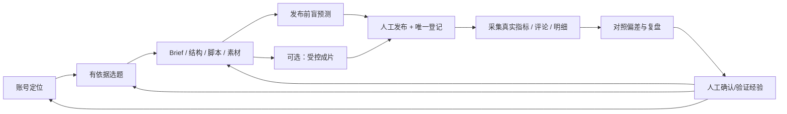
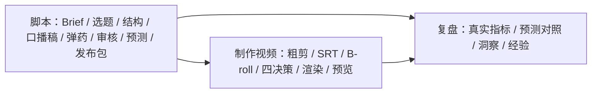
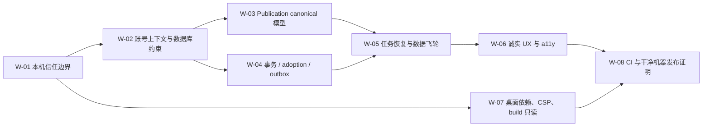

# CreatorOS 产品 PRD（产品宪法与发布验收单一真值）

> `status: current`
>
> `verifiedAt: 2026-07-15`
>
> `verifiedCommit: main@68443e4`
>
> `sourceOfTruth: product requirements`
>
> 本版基于 T-326 上线审查与 T-327 代码级架构复核，取代旧“两阶段、无制作”和“只准单一 AI Runtime”的口径。

## 0. 文档规则

本文件回答“产品应该是什么、什么算交付、什么条件允许上线”。实现事实以 contract、route、service、repository、schema、迁移和运行证据为准：

1. 文档与代码冲突时，先把冲突标为产品/实现差异；不能把 bug 写成需求，也不能把愿景写成已上线。
2. 功能状态只使用“已实现、部分实现、未实现、发布阻断”，不使用模糊成熟度百分比。
3. “已实现”只表示存在真实主路径，不代表通过发布门。
4. AI 候选、自动化成功、发布状态和指标都必须有真实数据证据；缺数据就显示 0、空或未知。
5. 详细实现链路见[功能模块地图](CreatorOS-module-and-workflow-map.md)，数据归属见[数据地图](CreatorOS-data-model.md)，上线缺口见[T-326 报告](research/2026-07-15-prelaunch-full-engineering-data-audit-research.md)。

## 1. 产品摘要

### 1.1 一句话定位

**CreatorOS 是面向中文抖音口播/观点视频创作者的、本地优先的编导式桌面生产系统。**

它帮助一个创作者管理一个或多个抖音号，从定位、选题、稿面、受控视频制作、发布登记，到真实数据采集、复盘和经验回流，让下一条内容比上一条更有依据。

### 1.2 核心承诺

- **AI 干重活，人做判断**：AI 产候选、草稿和决策，人编辑、确认、拒绝。
- **数据形成复利**：发布前预测，发布后采真实表现，用偏差形成经验并回到下一条内容。
- **本地数据主权**：项目、作品、评论、指标、知识、素材、会话和经验默认只存本机。
- **过程可恢复**：AI、采集、渲染等长任务能看到步骤，切页/刷新/重启后继续查看和处理。
- **诚实而非热闹**：没有真实数据就不画假图，没有真实执行就不显示成功。

### 1.3 当前发布裁决

当前代码功能面较完整，但 T-326 确认 4 个 Blocker、26 个 High、22 个 Medium、1 个 Low，产品处于 **NO-GO**。本 PRD 的“修复后目标”是重新申请上线审查的验收标准，不表示缺口已经关闭。

## 2. 用户与使用环境

### 2.1 目标用户

- 中文内容创作者，以抖音口播、观点视频和短视频为主。
- 单个操作者，持续产出并愿意让真实作品数据回流。
- 可能运营多个内容定位不同的抖音号。
- 希望保留本地数据与自有模型密钥，不接受平台托管全部创作资产。

### 2.2 当前不是目标用户

- 需要组织、成员、角色、邀请、审批和多人同时编辑的团队。
- 需要全功能专业 NLE、自由多轨时间线和复杂调色/音频工程的剪辑师。
- 需要云端 SaaS 随时跨设备同步全部素材的组织。
- 需要系统自动托管账号、无确认地批量发布内容的运营团队。

### 2.3 当前支持环境

- 正式目标：macOS 与 Windows 桌面端，Tauri + Next sidecar + 本地 PGlite/local-fs；两端均已完成完整验收。
- 开发/测试：本机 Web 形态可运行，但不能以“随机端口”替代鉴权。
- 平台：产品聚焦抖音；contract 保留其他 platform 枚举，不等于各平台适配已交付。

## 3. 用户要完成的工作（JTBD）

1. 当我不知道下条内容做什么时，系统基于我的账号定位、评论需求、热点、对标、收藏和历史经验给出有证据的候选。
2. 当我开始做一条内容时，系统帮助我补齐 Brief、结构、脚本和素材，而不是让我从空白表单开始。
3. 当我要做成片时，系统基于口播稿、粗剪、字幕和 B-roll 生成可编辑的编导决策并受控渲染，而不是把我困在专业剪辑器里。
4. 当我发布后，系统把平台作品唯一地绑定回正确项目，持续采集表现和评论。
5. 当我复盘时，系统把发布前预测、实际指标和观众反馈放在一起，沉淀可验证经验。
6. 当我做下一条内容时，系统只使用属于当前账号、已经确认或验证的经验，避免跨号串味和 AI 自说自话。

## 4. 产品飞轮



飞轮成立的最小单位不是一次 AI 生成，而是一条作品走完：**项目与脚本 → 锁定预测 → 唯一 publication → 真实指标 → 完成复盘 → 有证据 learning → 后续项目实际使用**。

## 5. 产品原则

### P-01 人工确认门

AI 和自主执行可以持久化运行账、带来源锚的外部采集证据，以及明确标为 pending/imported 的预设投影；
这些数据只是供用户判断的输入，不等于进入业务闭环。任何候选被采纳、预设转为 active 资产、形成
当前定位/正式选题/稿件/经验、执行发布/删除/修复，或被下游当作已确认结论使用，都必须由用户确认后，
经 backend service 带 ownership 守卫落库。拒绝候选不能留下 active 资产、经验或发布物。

### P-02 账号是数据归属，不是筛选器

`userId + accountId` 决定定位、项目、选题、发布、采集、指标、复盘、经验和自动化归属。普通页面不能用 `accountId=null` 表示“所有账号”；跨账号总览必须是显式产品能力。

### P-03 真实数据优先

指标、容量、模型、任务结果、账号连接状态和日期都取真实值。读取失败展示错误与重试，不能回退 fixture 冒充成功。

### P-04 本地优先、出网可解释

用户数据默认本地；允许出网的目的地必须可解释并最小化：用户配置的模型服务、抖音、激活/更新服务，以及以后明确开启的真实发布 adapter。
问题反馈不建设应用内上传链。CreatorOS 可以在本地整理并复制用户已预览的问题描述与最小诊断
摘要，并在用户点击后打开产品签名下发的 `supportUrl`。截图和加密日志由用户在外部反馈渠道中
主动选择；应用不得静默读取或上传，不得宣称外部渠道已经提交成功。

### P-05 可恢复优于假流畅

长任务统一有 task/run ID、步骤、明确终态、取消和重试。切页、刷新、应用重启不导致重复付费或重新生成。

### P-06 不做通用 NLE，做受控成片

CreatorOS 可以基于脚本、粗剪、字幕、素材和编导决策生成成片；不提供任意轨道、复杂关键帧、调色混音等专业 NLE 能力。

## 6. 成功指标

### 6.1 北极星指标

**每个周活跃账号在滚动 28 天内完成的“有效飞轮闭环作品数”。**

一条作品只有满足以下全部条件才计数：

- 有人工确认的项目和脚本版本；
- 发布前有 locked prediction；
- 有唯一、非空、归属正确的 publication；
- 发布后至少有一组完整真实指标；
- 有 completed review；
- 至少形成一条有证据、人工确认或验证的 learning；
- 后续项目上下文实际读取过该 learning。

### 6.2 支撑指标

- 首次绑定账号到首个发布包完成时间。
- publication 与项目正确绑定率。
- 已发布作品真实数据回收覆盖率与 P95 延迟。
- 有真实指标作品的复盘完成率。
- learning 在后续项目的实际应用率。
- AI 候选编辑后采纳率和直接采纳率。
- 异步任务切页/重启恢复成功率。
- 第四周仍完成飞轮闭环的账号留存率。

### 6.3 反指标

以下数字不能单独证明产品成功：AI 调用次数、生成字数、候选数量、页面停留时长、仅导入未复盘的作品数、原始播放/点赞量、功能数、prompt 数、假成功或永久转圈形成的表面活跃。

## 7. 当前范围与成熟度

| 功能域 | 当前状态 | 修复后发布目标 |
|---|---|---|
| 身份、激活、首启 | 部分实现 | 本机启动令牌与激活边界完整，干净机器首启可恢复 |
| 多抖音号 | 部分实现、发布阻断 | 所有账号级数据读写、唯一键和任务完全隔离 |
| 首页驾驶舱 | 部分实现 | 每张卡来自真实数据；辅助模块失败独立降级 |
| 定位 | 已实现主路径 | 当前账号定位版本可追踪，AI 候选不越确认门 |
| 选题 | 部分实现、发布阻断 | 五类来源有溯源，偏好/收藏不串号，立项原子幂等 |
| 项目与稿面 | 已实现主路径 | Brief、脚本、素材、审核、预测、发布登记可恢复且删除无孤儿 |
| 视频制作 | 已实现但发布阻断 | 四决策/渲染跨页恢复，ffmpeg 随包，执行隔离真实生效 |
| 发布与日历 | 部分实现、发布阻断 | publication contract、canonical anchor、重锚和日期/时区正确 |
| 采集与自动化 | 已实现主路径、可靠性不足 | 双号登录态/数据隔离、并发幂等、断点与限流恢复 |
| 指标/复盘/经验 | 部分实现 | 只读真实数据，预测不可事后改，经验有证据并回流 |
| 知识/素材/搜索 | 已实现主路径 | 元数据/对象/索引可对账，AI pending 资产不污染库 |
| ChatBox/AI/Pi | 部分实现、发布阻断 | 唯一 system prompt、隔离 loader、无假端口、工具最小授权 |
| 设置 | 部分实现、发布阻断 | 可见设置都有消费方；读取失败零 fixture；secret 不回传 |
| 桌面端与发布工程 | macOS/Windows 双端完整验收 | 对应平台安装、激活、核心创作链路、退出恢复与发布物真实可用 |

## 8. 信息架构与项目生命周期

### 8.1 一级导航

首页、定位中心、选题、项目、知识库、素材中心、发布中心、自动化、设置。账号切换器属于全局上下文；搜索和通知属于全局工具；日历可从发布中心进入。

### 8.2 三工作面



底层为兼容历史保存 `brief/research/planning/script/production/publishing/review` 七值；用户界面只展示脚本、制作视频、复盘。研究/策划是稿面里的职能，发布是稿面动作，production 是可选工作面。

## 9. 功能需求

每项需求的“当前状态”描述 AS-IS，“发布验收”描述修复后 TO-BE。

### R-IDENTITY 身份、激活与首启

- **当前状态**：部分实现。
- **用户故事**：首次使用者能激活应用、进入本机身份、绑定首个抖音号并看到明确下一步。
- **业务规则**：桌面激活与开发 Web 模式分开；激活失败不创建/修改领域数据；loopback API 必须有每次启动随机令牌并校验 Host、Origin、Content-Type。
- **商业化边界（DEC-REN-001）**：CreatorOS 不承载商品目录、价格判定、订单、支付、退款、
  佣金或结算，继续“不做变现中心”；新销售采用固定 12 个自然月年卡，并支持次年低价主动
  续费。CreatorOS 只展示签名授权状态并跳转 Thirdspace-growth 的购买/续费中心；
  Thirdspace-growth 是交易与续费规则真相，Thirdspace-activity 是授权期限真相。首购价和
  续费价由用户在 growth 后台配置，第二年及所有连续后续年度使用固定续费价；当前内测
  激活码保持原样，不自动迁移为正式年卡（DEC-REN-002/003）。
- **空/失败状态**：未激活、离线宽限到期、0 账号、账号探测失败分别展示，不用同一个“未绑定”覆盖。
- **发布验收**：干净 macOS 与 Windows 首启成功率 100%；无令牌/错误 Origin 的业务请求 100% 被拒；激活失败前后领域库 hash 不变。

### R-ACCOUNT 多账号与上下文

- **当前状态**：部分实现、发布阻断。
- **用户故事**：切换抖音号后，定位、项目、选题、发布、指标、评论、知识、素材、会话、经验和自动化全部跟随账号切换。
- **业务规则**：普通业务请求必须解析有效 account；已归档/伪造 account 返回 ownership error；全账号总览走显式 scope。
- **空/失败状态**：0 账号给绑定入口；账号失效保留本地数据并要求重连；不得回退到另一个账号。
- **发布验收**：双号各建立同名数据，全域交叉泄漏为 0；所有账号级唯一约束包含正确 account 维度。

### R-DASHBOARD 首页驾驶舱

- **当前状态**：部分实现。
- **用户故事**：用户打开首页就知道今天最值得做什么、哪些任务失败、哪些作品需要复盘，并能点击进入真实实体。
- **业务规则**：卡片来自 query-services 组合读；通知、趋势等辅助模块独立降级；0 待办不能自动推断“所有事情已完成”。
- **空/失败状态**：显示真实 0/—/错误卡，不编造多平台、完成态或增长。
- **发布验收**：每张卡可追溯到 operation/table；通知接口失败时首页仍成功渲染；切号后全部账号指标同步切换。

### R-POSITIONING 定位

- **当前状态**：已实现主路径。
- **用户故事**：用户能手动或通过 AI 访谈建立账号定位、查看版本并让下游选题和脚本使用当前版本。
- **业务规则**：AI 只产定位候选；确认才创建 statement；版本不可覆盖历史；每账号只有一个当前 profile 语义。
- **空/失败状态**：无定位只显示创建入口；AI 失败保留访谈输入；读取失败不显示 fixture 定位。
- **发布验收**：两个账号定位互不串；选题/脚本上下文 100% 注入当前号当前版本；未确认候选不改变当前定位。

### R-TOPIC 选题供给与候选池

- **当前状态**：部分实现、发布阻断。
- **用户故事**：用户能从评论、热点、对标、收藏和手动灵感获得有依据候选，补全、排序、淘汰并立项。
- **业务规则**：每张候选保留 source、证据和 account；AI 不直接灌库；偏好来自重复的人类淘汰/选择证据；promotion 原子创建项目。
- **空/失败状态**：区分今日无信号、作业未跑、采集失败、模型未配和 AI 无依据。
- **发布验收**：同一输入排序稳定；相同幂等键不重复候选；收藏/偏好双号不冲突；promotion 重试只产生一个 project。

### R-PROJECT 项目、Brief 与稿面

- **当前状态**：已实现主路径。
- **用户故事**：用户从手建或选题立项，补齐 Brief，组织论点、脚本、素材、审核、盲预测和发布包。
- **业务规则**：项目必须有 Brief；脚本版本化不覆盖历史；素材通过 material link 引用；审核报告有时间/版本；发布前预测锁定；AI 产物走确认门。
- **空/失败状态**：无脚本、无素材、无模型、审核过期、保存失败和导入作品未转录都有独立恢复动作。
- **发布验收**：刷新后 Brief/脚本/素材完整回显；AI 未确认前领域写入为 0；项目删除后的软引用孤儿为 0，需保留 learning 有来源墓碑。

### R-PRODUCTION 受控视频制作

- **当前状态**：已实现但发布阻断。
- **用户故事**：用户上传粗剪和 SRT、管理 B-roll，让 AI 生成四项编导决策，编辑后渲染、预览并确认成片。
- **业务规则**：不是通用 NLE；决策和渲染是持久任务；workspace 产物确认后才进入资产库；confirm/discard 幂等。
- **空/失败状态**：缺口播稿、粗剪、字幕、B-roll、模型、ffmpeg 分别说明；queued/running/awaiting/failed/cancelled 均可恢复；failed 停止轮询。
- **发布验收**：切页/刷新/重启任务恢复率 100%；重复 confirm 不重复资产；干净支持机器无需 Homebrew；network deny 与 env allowlist 负向测试通过。

### R-PUBLISH 发布、登记与日历

- **当前状态**：部分实现、发布阻断。
- **用户故事**：用户生成发布物料、在平台人工发布、粘链接登记，并按账号排期。
- **业务规则**：当前不宣称自动真发布；每个 publication 有合法 revision；同一 `(platform, externalId)` 只有一个 canonical publication，并且其 account 必须是该平台作品的真实属主；manual 项目优先于 imported 空壳；日历使用当前真实时间和明确时区。
- **空/失败状态**：无 revision、重复外部 ID、先采集后登记、平台失败、过去日期、时区不明均有明确补偿。
- **发布验收**：contract client 对 imported/manual publication 解析 100%；并发日拉/登记只有一个锚；re-parent 后指标/评论/复盘归正确 manual 项目；过去日期不可选。

### R-INGEST 采集与自动化

- **当前状态**：已实现主路径、可靠性不足。
- **用户故事**：用户能按账号扫码，定时或立即采指标、评论、作品明细、封面和逐字稿，并看到真实进度。
- **业务规则**：默认要求登录 profile/source/account 一致；唯一窄例外是用户显式创建
  `favorites_folder` 委托来源时，owner tuple
  (`ctx/source/run/task/item.accountId`) 与 collector tuple
  (`collectorAccountId/browserSessionRef/authDir`) 分别保持一致，collector 只读指定收藏夹、
  owner 决定数据归属，且不得扩展到其他来源或业务数据；run 在任何项目创建前取得幂等锚；
  限流按 channel 管理；0 新数据也是成功但不冒充新增。用户创建或启用来源/采集计划，即确认系统
  可以持续写入该范围内的原始证据、指标、评论、作品明细和 `source=imported` 历史作品预设；后者是
  真实外部作品的 evidence projection，不是用户正在创作的 active 项目。它可以自动幂等创建并用于
  展示真实历史数据，但转 manual/active、生成正式稿件、沉淀 learning 或驱动后续创作闭环仍须用户确认。
- **空/失败状态**：登录过期、限流暂停、断点、部分成功、无新数据、依赖缺失分别展示。
- **发布验收**：双号 cookie/profile 和数据隔离 100%；相同 `(job, scheduledFor)` 只有一 run；并发不重复建 imported project；重启后僵尸 running 可恢复。

### R-REVIEW 指标、复盘、校准与经验

- **当前状态**：部分实现。
- **用户故事**：用户把锁定预测与真实指标、评论放在一起，记录洞察，生成并验证可复用经验。
- **业务规则**：预测发布后不可改；metric snapshot/value 原子；AI 只产 learning candidate；只有已确认/验证且属于当前账号的经验进入下游；因果表述必须附证据。
- **空/失败状态**：无 publication、无 prediction、无 metrics、数据过旧分别显示；不使用 seed 补图。
- **发布验收**：snapshot child 完整率 100%；跨号对照为 0；confirmed learning 能在下一项目上下文命中；无证据字段保持空。

### R-LIBRARY 知识、素材与搜索

- **当前状态**：已实现主路径，部分发布阻断。
- **用户故事**：用户录入/上传真实资料，确认 AI 分类，管理标签关系，并跨项目、知识、素材、视频搜索。
- **业务规则**：对象字节、asset file 和 metadata 对账；知识/稿件版本化；搜索是可重建投影；本地文件读取有 realpath、敏感路径、二进制和大小限制。
- **空/失败状态**：对象缺失、预览失败、索引未建和空库有独立恢复动作；AI 拒绝后不留 active 资产。
- **发布验收**：元数据/对象一致率 100%；删除/恢复幂等；四类搜索只返回当前 scope 可见实体；索引清空后可全量重建。

### R-COPILOT 编导 ChatBox、AI 与 Pi

- **当前状态**：部分实现、发布阻断。
- **用户故事**：用户在全局、账号、项目和页面上下文中对话，调用受控工具，查看步骤并确认结构化候选。
- **业务规则**：模型按 capability 路由；每轮输出过 schema；外部网页/文件标为不可信数据；Pi 只用于适合的受控执行/自愈场景，使用唯一 CreatorOS system prompt、隔离 ResourceLoader 和显式工具白名单。
- **空/失败状态**：缺模型、schema 失败、工具超时、取消、刷新、注入命中和付费副作用失败可解释、可重试。
- **发布验收**：AI 直接写领域实体为 0；公共工具假成功为 0；Pi extension 自动加载数为 0；system prompt 端到端断言；副作用发生后不整体 fallback 重放。

### R-SETTINGS 设置、模型、技能与存储

- **当前状态**：部分实现、发布阻断。
- **用户故事**：用户配置真正有消费方的偏好、模型、技能、存储、主题、Web Session 和更新。
- **业务规则**：model preset 是起点而非锁定；自定义 provider round-trip；secret 只写不回；技能改动版本化可回滚；Web Session domain 严格规范化与 containment。
- **空/失败状态**：读取失败显示错误与重试；未知容量显示 0/未知；不得回退伪模型、伪磁盘。
- **发布验收**：可见设置都有真实消费方；secret 不出现在响应/日志；fixture 失败回退命中为 0；domain 路径攻击测试全部拒绝。

### R-DESKTOP 桌面运行、数据恢复与更新

- **当前状态**：macOS 与 Windows 桌面版均已完成完整验收。
- **用户故事**：用户安装、激活、升级、离线使用并保留本地项目与素材。
- **业务规则**：仅支持环境显示 Finder 等系统动作；sidecar 可信握手而非只测 TCP；严格 CSP；更新 URL/签名真实；构建过程只读；DB 错误不自动换空库。
- **空/失败状态**：单实例冲突、端口占用、升级失败、签名失败、磁盘满、迁移失败都保留原数据并给恢复路径。
- **发布验收**：干净 macOS 与 Windows 完成安装/首启/升级/断网/重启；数据不丢；日志 secret 为 0；build 前后用户数据 hash 和后台进程不变。

## 10. 跨域业务规则

### BR-01 单一写者

schema 与领域写入由 backend 拥有；frontend 经 RPC；worker/runtime 经 service port；模块间不跨 repository。

### BR-02 事务与幂等

项目创建、candidate promotion、AI/Execution 采纳、publication+revision、metric snapshot+values、rubric 版本、项目删除必须有事务或 Unit of Work。外部发布采用本地意图/outbox/平台执行/对账，不把远端副作用塞进不可回滚假事务。

### BR-03 删除与保留

归档优先；硬删枚举软引用闭包；对象文件在引用归零后 GC；外部发布事实和指标历史不因 UI 隐藏丢失；历史表在没有导出/迁移报告前不 drop。

### BR-04 读模型可重建

dashboard、search、notification count 等派生数据不能成为唯一事实；读取失败独立降级，投影可从领域表重建。

### BR-05 日期与时区

所有持久时间使用 ISO UTC；日历展示以用户设置时区换算；“今天”来自运行时 clock；测试通过注入 clock 固定，而不是在生产写死日期。

## 11. 空状态、失败状态与补偿标准

| 场景 | 必须显示 | 禁止行为 |
|---|---|---|
| 无数据 | 真实 0、空态、创建/绑定入口 | fixture、假增长、假完成 |
| 读取失败 | 错误摘要、重试、已加载内容保留 | 吞错后显示默认成功值 |
| 异步运行 | task/run ID、步骤、更新时间、取消入口 | 无期限转圈、离页丢任务 |
| 部分成功 | 成功/失败条数、失败记录、重跑范围 | 只显示“成功” |
| 登录过期 | needs_reconnect、扫码入口、数据保留 | 当普通失败无限重试 |
| 外部副作用未知 | reconciliation 状态、查询/重试 | 盲目重复发布/扣费 |
| 本地依赖缺失 | 缺失依赖和安装/修复动作，功能禁用 | 点击后才报模糊失败 |
| DB/迁移错误 | 原库保护、诊断、备份/恢复入口 | 自动切空库 |

## 12. 非功能要求

### NFR-SECURITY

- loopback API 使用启动级随机令牌，精确校验 Host/Origin/Content-Type。
- path/domain 经过规范化、containment、realpath、symlink 复查。
- Web reader/capture 阻断 loopback、私网、link-local、metadata IP，并逐次复查重定向。
- 不可信内容不能改变 system/tool policy；写类/付费工具需显式授权。
- execution network deny 由 OS/进程层执行；子进程只获环境 allowlist。
- Pi 使用隔离 ResourceLoader；Tauri 有 CSP；日志进入任何 sink 前脱敏。

### NFR-PRIVACY

- 用户创作数据默认只存本机；默认不收遥测。
- 模型 key 存 OS keychain 或受保护加密载体，不能明文出现在响应和日志。
- 提供备份、导出、恢复与删除说明；accountId/userId 是数据归属。
- 所有出网目的地有清单和用户可理解说明。
- 问题反馈只在用户点击后打开签名配置并净化过的 `supportUrl`；应用本身不上传描述、截图或日志。
  本地可复制的诊断摘要不得包含 Cookie、API Key、激活码、模型请求正文、聊天内容和文件路径。

### NFR-RELIABILITY

- 所有外部副作用有幂等键与补偿；长任务可恢复、取消、失败终止。
- timeout 杀完整进程树；scheduler、AI、execution、ingestion 使用统一终态语义。
- build、lint、测试、预渲染不连接/修改用户持久层。
- 任一辅助模块失败不得拖垮全局 layout。

### NFR-ACCESSIBILITY

- 目标 WCAG 2.2 AA。
- 交互使用 button/link/input；Dialog/Sheet 有 focus trap、Escape、焦点恢复。
- 键盘覆盖主要旅程；axe critical/serious 为 0。

### NFR-PERFORMANCE

- 冷启动到可交互 P95 ≤ 5 秒。
- 普通本地读请求 P95 ≤ 500ms；组合页 P95 ≤ 1 秒。
- 异步任务创建响应 P95 ≤ 1 秒，长任务不占用 HTTP 生命周期。
- 1,000 项目、10,000 知识/素材索引下搜索 P95 ≤ 500ms。
- 页面入口不因同步加载 Playwright、ffmpeg、Pi 等重依赖超过 readiness 门限。

### NFR-OBSERVABILITY

- requestId/taskId/runId/accountId 全链关联。
- 本地日志有大小、保留期、错误分类和脱敏策略。
- 能区分 succeeded+0 new、partial、needs_reconnect、failed。
- sidecar health 返回 nonce、版本和进程身份。

## 13. 发布门槛

| Gate | 覆盖 T-326 | 关闭条件 |
|---|---|---|
| `G-SECURITY` 本机信任边界 | B-01；RT-H01/H03/H04/H05/H06；RT-M04/M05 | path、loopback、SSRF、注入、network/secret、remote prompt 负向测试全绿，无绕过路径 |
| `G-DATA` 数据正确性 | B-02/B-03；DATA-H01～H09；DATA-M01～M03；RT-H10 | account 隔离、publication anchor、事务、幂等、删除、adoption、DB 恢复有约束和并发测试 |
| `G-RELIABILITY` Runtime/任务 | FE-H01；RT-H02/H07/H08；RT-M01/M02/M03 | 切页/重启恢复、Pi prompt、真实端口、scheduler 去重、fallback 和进程树终止可自动证明 |
| `G-UX` 诚实体验/a11y | FE-H02～H04；FE-M01～M07 | 生产 fixture 回退为 0；日期、错误、路由、通知、键盘和 a11y 验收全绿 |
| `G-DESKTOP` 可分发包 | RT-H09；RT-M06～M09；FE-L01；ENG-H03 | ffmpeg 随包、grants 固定 appData、日志脱敏、可信握手、CSP、平台门控、真实 updater |
| `G-ENGINEERING` 可重复发布 | B-04；ENG-H01/H02；ENG-M01～M03 | PR/main CI：Node25、typecheck、test、build只读、lint0、boundary0、E2E/a11y/visual/SCA 全绿 |

每个 finding 关闭必须同时具备：修复提交、根因级自动测试、真实运行场景、CI/证据 artifact、原复现路径转绿。baseline、skip、fixture 和口头确认不能关闭发布问题。

## 14. 需求追踪矩阵

| PRD | 功能地图 | 主要 operation/module | 核心数据 | 发布门 |
|---|---|---|---|---|
| R-IDENTITY | F-01 | identity/platform-account/ingestion login | users/sessions/activation/account/source | G-SECURITY/G-DESKTOP |
| R-ACCOUNT | F-01 | accounts + RequestContext | 所有 account-scoped 表 | G-DATA |
| R-DASHBOARD | F-02 | pages.dashboard/query-services/notifications | 组合读模型 | G-UX/G-RELIABILITY |
| R-POSITIONING | F-03 | positioning/ai | creator_profiles/statements | G-DATA/G-RELIABILITY |
| R-TOPIC | F-04 | candidates/audienceSignals/benchmark/trend/favorites/topics | candidate/signals/sources/preferences | G-DATA |
| R-PROJECT | F-05 | projects/artifacts/materialLinks/reviewRules/scriptReviews | project/output/artifact/material/prediction | G-DATA/G-UX |
| R-PRODUCTION | F-07 | productions/exports/execution/ai | production/export/ai task/asset | G-RELIABILITY/G-DESKTOP |
| R-PUBLISH | F-08 | outputs.publications/publications/calendar/accounts.cadence | publication/revision/calendar | G-DATA/G-UX |
| R-INGEST | F-09 | ingestion/scheduledJobs/jobRuns | source/run/record/metric/signal | G-DATA/G-RELIABILITY |
| R-REVIEW | F-10 | analytics/reviews/learnings/calibration | metrics/review/learning/rubric | G-DATA/G-UX |
| R-LIBRARY | F-06 | knowledge/assets/taxonomy/search/materialLinks | knowledge/asset/tag/index | G-DATA/G-SECURITY |
| R-COPILOT | F-11 | ai/execution/settings | conversation/task/result/step/model | G-SECURITY/G-RELIABILITY |
| R-SETTINGS | F-12 | settings + local routes | preferences/models/storage/skill/grants | G-SECURITY/G-UX |
| R-DESKTOP | F-12 | Tauri/activation/updater/build | appData/DB/object store/log | G-DESKTOP/G-ENGINEERING |

## 15. 修复实施依赖顺序

以下不是把大任务拆成长期“阶段”，而是上线修复的依赖拓扑；每个工作包都必须形成可运行、可验收的纵向闭环：



| 工作包 | 完整交付物 | 退出条件 |
|---|---|---|
| W-01 | loopback token/Host/Origin、Web Session containment、SSRF、untrusted content、Pi loader、execution network/env | 所有安全负向测试与原复现路径转绿 |
| W-02 | 服务端可读账号 session、RSC/RPC 同 context、account ownership、复合唯一与 backfill | 双号端到端全域串号为 0 |
| W-03 | imported revision、publication re-parent、manual canonical、指标/评论/复盘归属、登记/日拉并发 | 先日拉后登记和双并发测试只留一个正确项目锚 |
| W-04 | Unit of Work、adoption ledger、metric child 原子性、revision CAS、transactional outbox、删除矩阵 | 故障注入和重试不重复、不丢 child、不留孤儿 |
| W-05 | AI/Execution/Production/Review/Scheduler 统一恢复，真实飞轮读写与补偿 | 切页/刷新/重启恢复率 100%，任务全部有终态 |
| W-06 | fixture 清零、日期/时区、通知隔离、错误回滚、键盘/dialog/focus | E2E、a11y、visual 全绿且真实空状态通过 |
| W-07 | ffmpeg/Whisper 随包或预检、CSP、可信 sidecar 握手、日志脱敏、真实 updater、DB 恢复、build 只读 | 干净 macOS 与 Windows 构建安装及故障演练通过 |
| W-08 | Node 25 PR/main CI，typecheck/test/build/lint/boundary/E2E/a11y/visual/SCA | 六个 Gate 同时关闭并归档证据 |

## 16. 明确不做

- 不做通用专业 NLE、任意轨道编辑和复杂后期工程。
- 不做变现中心；购买/续费只允许跳转外部 Thirdspace-growth，CreatorOS 不拥有商品、价格、
  订单、支付、退款、佣金或结算真相（边界见 `R-IDENTITY/DEC-REN-001`）。
- 当前不做团队协作、多用户 SaaS、角色权限和云端托管用户创作数据。
- 当前不做开放式全网爬虫、代理池和任意网站自动化。
- 当前不做开放式自主 Agent 任意写源码、用户数据库或主机文件。
- 当前不把整段聊天无差别写成长期记忆。
- 当前不承诺自动真发布到抖音；MockPublisher 不是交付能力。
- 不承诺客户端 prompt/JS 对专业逆向完全保密。

## 17. 规划中与冻结能力

- Pi 记忆检索、会话续、跨会话偏好、对话式 skill 进化、MCP：T-315～T-319，未实现。
- 对话式剪辑与字幕文本校正：T-312/T-320，规划中。
- Pi 接管网页、自动化和剪辑：T-324，冻结。
- 单视频观众、来源、留存、关键时刻：D8b，未实现。
- 真实平台自动发布 adapter：未实现，不进入当前发布范围；这与 macOS/Windows 桌面版已完成验收无关。

## 18. 文档治理

权威顺序：

```text
产品需求：docs/产品定位.md
├── 实现链路：docs/CreatorOS-module-and-workflow-map.md
├── 数据真值：docs/CreatorOS-data-model.md
├── 任务状态：BACKLOG.md
├── 审查证据：docs/research/*
└── 历史设计：docs/superpowers/specs/*
```

- `2026-07-03-two-stage-project-design.md` 已被当前三工作面实现取代，只作历史决策记录。
- 七阶段 lifecycle 文档只解释底层兼容和设计原则，不是当前 IA。
- `2026-07-13-video-production-overhaul-design.md` 是受控成片的重要设计来源，实际状态仍以代码和本 PRD 发布门为准。
- multi-account、real-data、desktop 等 SPEC 是设计来源，不是完成证明。
- README 和产品进度摘要只能引用本 PRD，不独立定义范围或发布状态。

## 19. 术语

- **Project**：一条内容的创作工作空间。
- **ContentOutput**：项目中的具体内容产出。
- **Publication**：某平台上的真实作品事实。
- **Imported Project**：由真实历史作品导入的项目壳；有 manual 对应项目时不是 canonical。
- **Candidate**：选题候选；promotion 后成为项目。
- **Artifact**：可版本化稿件/结构化创作物。
- **Asset**：图片、视频、音频、文档、字幕等文件资产。
- **Learning**：复盘形成的可复用经验，需人工确认/验证。
- **Prediction**：发布前锁定的盲预测。
- **AI Task**：AI/Execution 统一任务账，包含步骤、候选和确认状态。
- **受控成片**：由脚本、素材和有限编导决策驱动的渲染，不是通用 NLE。
- **发布门**：上线前必须有自动和真实包证据的硬验收，不是文档勾选。
