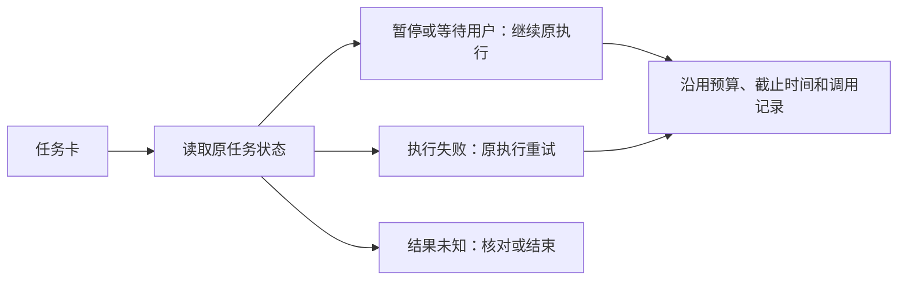

# Decision Log — CreatorOS

Record confirmations, assumptions, tradeoffs, accepted risks, and skipped stages so future agents do not need chat history.

## DEC-GROUP-1022（2026-10-04）：账号组统一多平台工作区与页面设计方法

**Owner**：user。**Status**：方向与执行已Confirmed；正式验收阻塞。后续执行授权见本节2026-10-04记录，无需再次确认视觉方向或实施。

**用户已明确**：以账号组承接同一创作者在多平台的账号与内容，全局切换改成切组，组内可查看总览、作品和数据，组管理在绑定账号入口；全面重构首页、运营分析与复盘。页面设计、重构和规范统一使用用户提供的oil-ui-pro 0.10.0，项目Skill已纳入`.agents/skills/oil-ui-pro/`并写入AGENTS.md。

**历史方案及后续授权**：[T-1022 SPEC](../docs/features/t1022-account-group-workspace.md)7节：每个旧账号先独立建组，用户再显式归组并选择主定位；历史资料按完整项目依赖闭包预览选入，共享文件保持原storageKey，通过明确资源引用授权组内读取；开放升级后写入后不自动降回旧schema。用户已明确不喜欢A/B新风格，认为原版更丰富；选择保留原版丰富工作台，只补账号组总览和多平台切换。A/B退出当前方向，原问候、五指标卡、三列六卡与侧栏底部账号入口保留。该视觉选择已Confirmed，不再询问A/B；用户进一步回复“认可，可视化的图需要设计的更好看一些”，确认原版增补并要求局部图表精修；随后明确指出图表连坐标都没有，要求可准确读数的坐标、刻度与单位。历史明细缺失时用已知范围或空态，不能用轮廓加数字轴假装日数据，不改变第7节历史迁移仍待确认的边界。

**依据与边界**：当前切换器与绑定入口仍为抖音，快手/公众号契约和公众号映射存在缺口。三轮独立SPEC评审已完成，四项归属/闭包/并发/回退缺口在方案层解决；第3轮绑定原版增补约束PASS[REV:2f179f8d9380]；评审PASS不替代用户迁移确认，也不证明生产实现、五平台登录采集发布或真实数据迁移已完成。当前只修改调研设计与流程工件，未执行真实库操作。现有全局reconcile失败沿T-1015/T-1018/T-916跟踪，新任务绑定工具glob问题登记T-1023。

**2026-10-04执行授权**：用户回复“ok 开始执行”，授权按已评审方案正式实现与验证。沿用第7节非自动合并默认：旧账号一对一初始组，主定位与历史资料在管理页由用户显式预览选择；原ID、storageKey与现有历史保留。此授权允许代码与隔离测试库迁移，不视为自动合并现有真实账号/资料或不备份就升级真实库。实施时将能力来源与未提供凭据的真机链路如实区分。

**2026-10-05实施记录**：沿用上述用户授权和已评审数据归属。正式页面组合实际 `pages.groupOverview.get`、`pages.dailyReport.get` 及原发布/项目服务，不另建SPEC候选表中的四个planned页面操作；最终公开调用链与机器旅程契约写入PAGE_SPEC。调度补齐按真实平台能力和成功绑定回执准入，转组只更新后续私有采集任务，历史run保持冻结组；归档组仅保留服务内可核验的既有私有采集权，不开放通用写入或外部allowArchived参数。新绑定提交后的任务初始化失败不撤销成功身份绑定。真实页面核心旅程已执行，正式frontend receipt仍因混合工作树无法绑定HEAD未放行；真实平台/安装版/原生200%继续待验，没有新增accepted-risk或自动真实库迁移授权。


**2026-10-05收尾状态**：启动/归档执行增量已独立复核关闭；后台合并362条及真实浏览器18检查点通过。pmem同步通过，全局reconcile保留33项旧漂移，沿T-916/T-1018/T-1015；正式提交绑定与真实平台、安装版、原生200%仍待验。taskctl已登记T-1022验收阻塞，未标完成、未提交混合工作树，未变更真实库授权边界。
---

## DEC-TEMPLATE-1021 (2026-10-04) — CreatorOS封面与小红书图文双模板库

**来源**：用户明确宿主为CreatorOS封面编辑区，指定`/Users/zyongzhu/Workbase/moonlit-skills/`为Skill源码，要求真人出镜与纯AI等多种封面、小红书图文两个模板库、行业分类、收藏提示词与风格，并授权浏览公开优秀作品及生成样例。

**已确认方向**：双库分别服务单封面与完整笔记；行业分类与画面类型独立。本人身份照片、风格参考和本期内容分别使用；公共库不得固化本人的照片。浏览研究只提炼方法，首批公共样图为原创AI示例，照片质感不冒充实拍证据。

**本轮明确纠偏**：用户补充画幅比例与统一oil-ui-pro 0.10.0后，进一步明确「结合我们的系统的发布功能去改」，拒绝独立系统式UI。复用现有项目稿面PublishPackSection/PublishPackageCta、右侧编导、原发布草稿Revision、素材中心和排期/登记链。独立HTML与UI生成图只留作研究，停止作为实施方向；无需再让用户挑全局布局。

**可评审接入方案**：[T-1021 SPEC](../docs/features/t1021-cover-template-library.md)。封面复用原任务/采纳链；图文候选及页恢复仍沿原ai/execution账本，最终正文、封面和页序归现有PublicationRevision，撤回另建Assets图文交付物服务。比例进入实际任务，模型身份与能力冻结共用原配置/凭据端口。真人身份失败不能生成陌生人替代。旧receipt `PASS[REV:8618b59024af]`只覆盖先前方案；本轮发布接入与比例合同已独立复核，第三轮`PASS[REV:f0f3fa0ff91b]`，仅为SPEC结论。

**无限画布补充**：用户认可原发布链接入方向，并明确当前系统是无限画布。创作空间沿既有画布，封面为画板、图文为页组，模板/素材/收藏为画布缩放层外的局部面板；比例是输出属性，不能与视口缩放混淆。正式正文、封面和页序仍归Publishing版本。见同任务[integration.md](../docs/features/t1021-cover-template-library/integration.md)补充。当前分支未定位该宿主，已向用户询问入口或代码位置，未自行新增画布引擎。`PASS[REV:f0f3fa0ff91b]`只证明此前发布合同复核，不覆盖此画布补充。

**待确认项**：私人收藏按当前创作账号隔离跨项目复用，还是本人所有账号共享，原问题仍待回复；本轮发布功能纠偏没有回答此数据范围。既有发布物料归属不再另开选择，遵守现有Publishing。

**验证边界**：14张封面/图文素材真实存在并已查看（12公共、2私人）；公共包排除私人图。原HTML本地收藏不证明CreatorOS接入。生成的两张工作区图已被本轮纠偏取代，不能做当前产品设计证据。未改生产代码、未完成正式链路验收、未发布或推送。

**Status**：结合现有发布功能的方向Confirmed；私人收藏范围待确认；更新合同独立复核通过，生产未实现。

---

## DEC-MODEL-057 (2026-08-20) — 官方受管生图提交断连以同一幂等号有界恢复

**来源**：本机 CreatorOS 1.1.0 日志中，三次封面与四次普通图片均在提交约 5 秒后以
`network/submit/retryable=false` 取消；同一配置约十分钟后又在 47 秒内成功，证明首个公共故障是
瞬时提交断连，而非提示词、模型或响应解析永久失效。

**决策**：

1. `displayModelKey=channel-managed` 的同步生图在提交阶段无 HTTP 响应且原因为 `network` 时，沿用
   原任务、原方案与同一 `Idempotency-Key`，按既有 1 秒、3 秒节奏最多恢复两次。
2. 用户自配中转站仍不重放提交结果未知的请求；官方受管视频也保持 provider job/checkpoint 语义，
   不因本次生图修复重新创建付费视频任务。
3. 已明确返回 408/425/429/5xx 的既有恢复不变；恢复不得重新生成封面方案、创建新任务或记录多个
   候选，最终失败继续诚实取消并保留诊断。

**Rationale**：PAT-003 AF-003 命中，现有生成任务就是正确的异步审计边界，应在原任务内恢复；
复用 T-891 的受控重试器即可。MOD-003 明确不适用于少量上游且有界重试足够的场景，因此不引入熔断器
或第二调用链。

**影响范围**：T-904、封面 runner、图片素材 runner、T-891 官方图片探针与可靠性回归；无数据库、
公共 operation、设置项或 UI 变化。

**Status**：Confirmed（用户 2026-08-20 要求继续根治图片生成不可用）。

---

## DEC-VIDEO-056 (2026-08-19) — 竖屏有真人源时以真人为主并让人脸常驻

**来源**：用户查看真实 1080×1920 成片后确认 116.6 秒视频抽样帧全部没有真人，并明确纠偏：
“竖屏以真人出镜为主，人脸常驻；这个效果不如上一个版本，要么回退再优化。”

**决策**：

1. 本决定取代 DEC-VIDEO-043/044 中“竖屏卡片接管时人物退出”和 T-896“人物框冲突时隐藏人物”的
   竖屏默认；横屏、`visualOnly` 和损坏输入的原规则不变。
2. 竖屏存在真实 talking-head 时，人物 beat 使用同一全幅基底；card 与非 overlay B-roll 期间同一人物
   收进固定左下角并持续可见。旧候选的 `speakerMode=hidden` 在渲染前兼容为 `pip_bottom_left`。
3. 素材完整 `contain` 的可读区域必须位于人物与字幕安全区上方；冲突时调整素材舞台，禁止再以隐藏
   人物换取质量门通过。AI 继续决定素材语义与时点，代码只落实用户确认的画幅偏好和几何边界。
4. 总导演将真人作为竖屏默认主画面，卡片/素材只能短时辅助，不能用 takeover 连续覆盖整片；模板仍
   对旧 direction 做最终人脸可见兜底，避免提示词升级无法修复历史候选。

**Rationale**：真实成片证明“每个 beat 均有主视觉”仍可能合成整片无人；用户留存优先于旧版单主语
审美规则。复用现有 renderer、同一 `#th` 媒体节点与固定 PiP 几何，不新增第二渲染链。

**Pattern-Ref**：PAT-001；**Asset-Ref**：现有 T-858/T-859 renderer 与 T-896 公共调用链。

**影响范围**：T-902、T-858/T-859 竖屏契约、素材匹配/总导演提示、props 组装、正式模板、安全门、
回归审计、全局 `video-editing` Skill。

**Status**：Confirmed（用户 2026-08-19 明确给出新默认）。

---

## DEC-RADAR-048 (2026-08-18) — 分页只控制传输批次，内容雷达总数必须消费 contract meta

**来源**：用户真机内容雷达明显存在超过 100 条对标内容，但“全部内容”和列表头均固定显示 100。
代码确认后端 `intelligence.items.list` 已返回过滤后的真实 `meta.total`，页面却通过会丢弃 meta 的
普通 client 只拿首批 100 行，并用 `items.length` 冒充总量。

**决策**：

1. 保留既有 `intelligence.items.list` 契约、账号归属守卫与服务端精确计数，不新增第二套 count 接口；
   contract client 增加通用 `requestListWithMeta`，供需要分页真相的页面显式消费同一 envelope。
2. 内容雷达首批继续按 100 条传输，左侧“全部内容”和当前筛选结果显示服务端真实 `total`；超过首批
   时提供“继续加载”，明确显示“已显示 X / 共 Y”，逐页追加并按真实 item ID 去重。
3. 来源、分类、搜索、逐字稿状态、选题状态与排序切换都回到第 1 页，并使用该次服务端查询返回的
   `total`；分页限制不得再成为任何可见总量。
4. 测试使用与运行时相同的持久服务/transport 建 101 条记录，断言第一页 100、第二页 1、两页总量
   均为 101；组件同时验证真实总数与第 101 条可继续读取。

**Rationale**：PAT-004 CF-001/003/004 命中：分页元数据跨前后端，继续复用共享 contract envelope，
不在页面私造 count；PAT-002 RF-002 命中：用户留存内容的计数必须由真实持久读模型证明，组件桩不能
代替服务层回归。`Asset-Ref: PAT-002`。

**影响范围**：T-887、contract list client、内容雷达首屏/筛选/加载更多、intelligence contract 回归。

**Status**：Confirmed（用户 2026-08-18 明确要求显示实际内容数量）。

---

## DEC-RUNTIME-054 (2026-08-18) — Whisper worker 显式消费分层 local-ai 解析契约

**来源**：T-885 用户 Windows 轮转日志确认 4 个不同作品均成功取流、抽出 2.86～3.62 MB 音频并
选择 `whisper-local`，随后在 140～167 ms 内稳定失败；代码复核发现主 server 加载了
`creatoros-module-resolver.cjs`，独立 `worker_threads` consumer 没有加载。

**决策**：

1. Whisper worker 从 sidecar 的受控 cwd 推导 `frontend/package.json`、随包 resolver 与 runtime root；
   只有 resolver 实际存在时才在 worker 内显式加载，传统 `node_modules` runtime 和开发态保持原行为。
2. 不通过 `NODE_OPTIONS` 继承任意代码，不复制第二套 Xenova/ONNX 依赖，也不把模型推理重新搬回
   sidecar 主线程；worker 继续单实例串行，避免本地 ASR 阻塞应用页面。
3. 本地失败仅跨边界传递稳定 `LOCAL_WHISPER_*` 分类码；用户文案继续隐藏用户名、绝对路径、stderr、
   token 与模型内部信息。
4. Windows closure 必须用随包 Node 启动真实 `worker_threads` consumer，并从 `local-ai/vendor` 加载
   `@xenova/transformers`；主进程直接 import 不再构成本地 Whisper 发布证据。

**Rationale**：PAT-004 CF-004 命中：打包层、主 server 与 worker 是独立运行时边界，必须共享一份
明确的模块解析契约。复用 DEC-RUNTIME-053 已验证的随包 resolver，不新增模块系统或依赖副本；
`Asset Index` 没有可直接替代 CreatorOS 分层 Node consumer 的 verified asset。

**Pattern-Ref**：PAT-004

**影响范围**：T-886、`multimodal-whisper-local.ts`、managed ASR 错误分类、Windows closure smoke。

**Explicit Limits**：本轮不自动重跑用户旧任务、不改用户模型配置、不下载数百 MB 模型做本机伪验；
Windows 安装包完整转写仍由目标平台流水线/真机验收。

**Status**：Confirmed（用户 2026-08-18 明确要求解决本地 Whisper 问题）。

---

## DEC-VIDEO-045 (2026-08-17) — B-roll 删除以当前分镜 revision 为真，旧成片只保留历史

**来源**：用户真机指出“这里删除了一个 B-roll，但实际成片还是使用了”，并要求根治反复出现的
分镜/成片不一致；既有 T-703 已确认人工删除或替换素材属于新的编导约束。

**决策**：

1. 新增窄写契约 `outputs.production.editingPlan.broll.remove`，参数只含 `outputId`、真实 `assetId`
   与 `expectedRevision`；服务端用 revision 比较并原子生成新的当前 plan，禁止前端只改组件状态。
2. 新 plan 同时清除 `decisions.broll`、`renderProps.broll`、`inventory` 与可能引用旧素材的 direction/
   director review，并持久化 `excludedAssetIds`；刷新、重试与局部调整都从这份真值恢复。
3. 被取代的 `sourceRenderTaskId` 与新 plan 解绑并尽力取消；旧任务即使晚到成功，只能留下历史文件，
   不得成为当前项目主成片。最终采纳前再核对任务 ID 仍属于当前 plan。
4. `material.match` 仍负责素材语义和重新统筹；确定性代码只落实用户明确排除的真实 ID、revision、
   引用完整性与并发安全。模型失败时不得从旧 base decisions 复活已删素材。

**影响范围**：T-881、production contract/service/transport、CLI destructive policy、video decisions
局部调整 runner、制作页恢复/删除/渲染收口与 render props 组装。

**状态**：Confirmed（用户 2026-08-17 明确要求删除后成片不能再使用该 B-roll）。

## DEC-RADAR-047 (2026-08-17) — 启动后受控并发清空全部逐字稿积压

**来源**：运行态只读核对确认逐字稿执行任务存在 645 条 `queued`，而当前启动恢复固定最多领取
20 条；用户明确要求应用启动后把全部历史积压纳入补跑，不再依赖反复重启。

**决策**：

1. 应用启动恢复不再设置 20 条总量上限，持续领取所有 `transcribe` 排队任务，直到队列为空。
2. “全部补跑”只表示全部进入持续消费范围，不表示 645 条同时调用；领取后固定最多两路并发执行，
   控制抖音取流、ASR 配额、本机 CPU 与数据库压力。
3. 复用既有持久任务、租约、重启恢复、失败分类与账号上下文，不新增第二套队列、不直接写库；启动恢复
   与请求后的即时执行允许同时存在，由原子 claim 保证同一任务只被一个执行者领取。
4. 单条失败或阻塞必须进入真实终态并继续处理后续任务；“队列清空”不等于伪装全部转写成功，页面仍
   按真实逐字稿状态展示需处理项。

**Rationale**：PAT-003 的 AF-002/AF-003/AF-004 命中：长耗时任务需要离开请求继续执行、重启续跑并
受控限流。复用项目现有数据库持久任务队列；MOD-006 仅借用“后台执行 + 重启补偿”的已验证原则，
不引入其文件存储实现，因为 CreatorOS 已有带原子 claim 的正式任务服务。

**Pattern-Ref**：PAT-003
**Asset-Ref**：MOD-006

**影响范围**：T-632、`transcript-runner.ts`、桌面启动 composition 与逐字稿队列回归测试。

**Status**：Confirmed（用户 2026-08-17 明确要求全部补跑）；安装版运行态积压归零仍需真实验收。

---

## DEC-VIDEO-044 (2026-08-16) — 竖屏素材段采用左下角人物 PiP，并以短交叠消除白闪

**来源**：用户验看 T-858 v5 短样片后明确反馈：“素材出来人物可以到左下角去，竖屏的话；然后尽量
少一些这种切换时的白屏，切换更丝滑一下。”

**决策**：

1. 本决定取代 DEC-VIDEO-043 对竖屏 B-roll 素材窗“人物完全退出、帧边界硬切”的限定；T-858 的
   AI 编导、主视觉唯一性、字幕重点词、静态舞台与预览确认门继续有效。
2. 竖屏主 B-roll 仍为唯一主视觉；人物在其时间窗内作为左下角辅助 PiP。人物使用同一连续媒体节点
   做几何缓动，相邻素材窗保持原位，不反复放大缩小。动态内容卡默认仍独占主舞台。
3. 人物、素材与动态内容之间使用短交叠淡化、几何缓动和媒体预加载；禁止以单帧硬开浅色素材、未加载
   首帧、浏览器默认背景或空舞台制造白屏感。真实素材本身的浅色 UI 不被改色或伪造。
4. 素材候选允许显式携带 `speakerMode`；字段缺失时只按本轮用户确认的输出画幅降级：竖屏主 B-roll
   为左下角 PiP，横屏仍隐藏人物。代码不根据文件名、关键词或内容类别猜创作选择。

**影响范围**：T-859、素材匹配结构化候选、video decisions runner、正式 props 组装器、竖屏
HyperFrames 模板、真实短样片与转场密集抽帧。

**Explicit Limits**：不把 PiP 推广成所有视频的全局强制默认；不改横屏；不让动态内容卡永久挂人物；
用户确认短样片前不重渲整片、不出安装包。

**状态**：Confirmed（用户直接修订预览方向）；实现前须通过 T-859 独立 SPEC 评审。

## DEC-VIDEO-043 (2026-08-16) — 主视觉接管时人物退出，不再自动缩成 PiP

**来源**：用户验看 T-858 方向后明确指出：“竖屏人物默认全屏；横版素材或动态 PPT 出现时，人物只在
对应时间窗内居中缩小，结束后精确回位。我觉得这个策略就是错误的，很奇怪。”

**决策**：

1. 本决定取代 DEC-VIDEO-042 第 3 条中“安全叠层/PiP 可作为主视觉默认形态”的部分；T-858 其余
   正式链路、AI 语义边界、字幕重点词与预览门继续有效。
2. 竖屏剪辑按 beat 保持唯一画面主体：人物口播时人物全画布；横版素材或动态内容画面接管时人物
   完全退出；结束后在时间边界直接切回同一份全画布人物基底。
3. 正式组装器不再为非开场录屏产出 `pip_bottom_left`；模板不再按素材或卡片时间窗生成 `#th` 的
   缩小、位移、圆角或放大回位 tween。旧候选字段只保留可读兼容，不决定新镜头语法。
4. PiP 仅能在未来由用户明确选择，或 AI 导演给出人物反应/指示动作的必要理由并通过单独产品契约后
   启用；本次不建立自动例外。

**影响范围**：T-858 SPEC、director schema/prompt/runner、正式 props 组装器、竖屏 HyperFrames 模板、
真实短样片和全局 `video-editing` Skill。

**状态**：Confirmed（用户直接否定旧策略）；修订 SPEC 须重新独立评审。

---

## DEC-VIDEO-042 (2026-08-16) — 剪辑优化必须落到 CreatorOS 正式决策与渲染链

**来源**：用户在要求学习外部视频制作 Skill 后明确纠偏：“要解决剪辑的问题，不光是更新 Skill。”

**决策**：

1. T-858 完整承接 T-856，直接修改 CreatorOS 正式 `video.decisions → video.render` 链；全局
   `video-editing` Skill 的学习结果只作为方法输入，不能作为任务完成证据。
2. AI 总导演负责整片 motion thesis、逐拍唯一视觉主语、运动与舞台交接；字幕 AI 负责真实重点词。
   代码只校验真实引用、溯源、时间、字符范围、画幅和安全边界，不用关键词或文件名替 AI 做创作选择。
3. 竖屏人物是统一基底，横版主视觉只做完整 contain 的全画布切走或安全叠层/PiP；回到人物时恢复
   同一几何。禁止上方横卡与右下人物割裂、纯黑断层、第二路动态背景、微小双语字幕和伪内容动效。
4. 用户预览确认前只生成真实生产时间线的代表性短样片、关键帧与接触表，不重渲整片、不出安装包。

**影响范围**：T-858、视频决策 prompt/runner、渲染契约、props 组装器与 HyperFrames 模板。

**状态**：Accepted（用户明确产品纠偏）；实现仍须通过 T-858 独立 SPEC 评审。

---

## DEC-RUNTIME-053 (2026-08-16) — HyperFrames 子进程显式消费分层运行时解析契约

**来源**：T-844 用户 Windows 安全日志确认两次正式成片都在 HyperFrames 启动阶段以
`ERR_MODULE_NOT_FOUND` 退出；Windows RAT 真渲染通过。代码交叉核对发现 RAT 使用
`--require creatoros-module-resolver.cjs`，生产执行器没有加载，而安全环境按设计不透传
`NODE_OPTIONS`。

**决策**：

1. Windows 少文件 runtime 中，生产 HyperFrames Node 子进程以绝对 argv 显式预加载随包的
   `frontend/creatoros-module-resolver.cjs`，并显式传递同一 `CREATOROS_RUNTIME_ROOT`。
2. 解析器不存在时在拉起子进程前明确失败并引导重装；不得恢复 `NODE_OPTIONS`、不得扩大密钥环境，
   也不得为绕过模块解析而复制第二套运行时依赖。
3. 开发态与传统 `node_modules` runtime 保持原启动参数，不把 Windows 分层契约强加给其他布局。
4. 生产 argv 与 RAT 真渲染 argv 用同一可执行测试锁定；子进程错误保留脱敏首尾、缺失包名和错误码，
   隐藏本机用户名。

**Rationale**：PAT-004 CF-004 命中：虽不新增业务 API，但打包层与生产执行器共享一个可追溯的跨进程
运行时契约；用明确 argv 和闭包契约测试守住，不能让打包 smoke 与真实消费路径各自定义。
`Asset Index` 没有桌面分层 Node runtime 的可复用模块，本轮复用项目已有 resolver 与 RAT，不新增依赖。

**Pattern-Ref**：PAT-004

**影响范围**：T-845、`video-render/executor.ts`、Windows closure RAT 测试。

**Explicit Limits**：不改用户项目/素材/模型配置；不自动重试旧任务；不在 macOS 本机伪造 Windows
安装包真机 PASS。

**Status**：active。

---

## DEC-COPY-792 (2026-08-12) — 资料驱动生成独立为 T-791，T-790 只改 Skill

**来源**：用户明确指出常见场景是交付一段杂乱资料、一个文件、一大段话或原有文案，让系统结合上下文和调整方向产出文案；标准结构应由写文案 Skill 决定，当前工具能力不健全。

**决策**：

1. T-790 恢复为 Skill-only：只做写作指令、上下文职责和方法顺序的人工 A/B 迭代，既有独立评审继续适用。
2. 新建 T-791 独立承担资料驱动工具链。普通 `generate` 必须能可靠消费本轮受信资料，包括消息长文、已确定性抽取的文本附件、项目内已确认文本和既有文案。
3. 用户本轮资料与调整方向优先于旧 Brief、定位、经验和旧对话；后者只作不冲突的辅助上下文，不能吞掉资料或被重新包装成本轮硬约束。
4. 写作结构、资料语义取舍和表达由 `script.draft` Skill/模型负责；代码只守来源、归属、长度/hash、顺序、预算、幂等、安全和采纳门。
5. “基于这篇润色”直接走带受信来源的生成候选，不等于 `verbatim`，也不需要为创建候选再次确认；“原文不改”继续走 T-727 的确定性保真路径。
6. T-791 允许增量修改现有工具入参、任务输入和 runner 传递；不新建产品页面、数据库或第二文档库，不改变稿面采纳门和 `shots[]` 输出契约。

**影响**：DEC-COPY-791 与 T-790 不再失效；工具输入/runner 的新增范围只属于 T-791，必须使用自己的 SPEC、评审、状态和验收证据。两项任务可独立验收，若写集重叠则串行协调。

**状态**：Accepted（用户明确产品裁决）。

## DEC-COPY-791 (2026-08-12) — T-790 只迭代现有写文案 Skill，loop 不做产品功能

**来源**：用户明确纠偏：“我需要的是迭代我们的写文案的 skill，而不是把这个做成功能”。

**决策**：

1. 撤回 T-790 下已起步的实验页面、API、数据库、运行配置和自动实验服务，不作为参考实现保留。
2. 唯一实施对象是现有 `script.draft` Skill 的写作指令、上下文职责与方法顺序；不改产品契约与运行时架构。
3. A/B loop 是 Skill 开发与回归方法：现版基线、单变量挑战、用户盲评、跨主题回归；它不向 CreatorOS 用户提供新界面或服务。
4. 前几轮评判只交付两篇完整口播文案；用户选 A/B/平局并说原因，模型不代替用户决定。

**影响**：旧 `DEC-COPY-790` 中“产品实验面、runtime profile、生产配置升级”的实施解读失效；其“单主题、单变量、人工先判”仅作为 Skill 迭代方法保留。

**状态**：Accepted（用户明确纠偏）。

## DEC-COPY-790 (2026-08-12) — 文案优化以单主题人工 loop 校准板块权重，不做声音指纹

**来源**：用户明确指出声音指纹没有必要，要求每次围绕一个主题只产出文案，通过微调参数反复运行；前几轮由用户评判，后续再增加自动 loop。最终目标是优化 CreatorOS 各创作板块的权重和工作流，而不是模仿个人语气。

**决策**：

1. T-790 删除声音指纹、历史本人稿风格模仿和“像本人”专门评分。
2. 一个实验固定一个主题及事实输入；每轮只改变一个主变量，只向用户展示 incumbent/challenger 两篇完整文案，分镜、画面、内部评分和参数说明不进入评判面。
3. 前期胜负由用户选择并记录原因；单主题只产生局部冠军，只有跨主题重复证据才能形成定位、素材、观点、结构、对标、经验、观众规则、公式、修订或模型参数的全局候选。
4. “权重”落实为进入与否、约束级别、上下文预算和工作流位置；禁止用关键词计分、字符串相似度或业务名称分支承担创作判断。
5. 自动 evaluator-optimizer 只有在人工偏好覆盖和保留一致率通过正式 Gate、且用户显式开启后才能运行；它只产候选，生产 prompt/工作流仍经用户确认并可回滚。

**参数确认**：用户于 2026-08-12 以“启动一下”确认采用 T-790 SPEC v2 的推荐默认值：人工单主题最多 6 轮、连续两轮无新冠军停止；全局候选至少 5 主题/12 次人工比较/胜率 70%；自动能力至少 30 次人工判断/10 主题/3 类型、保留一致率 80%、换序一致率 90%；自动 loop 每主题最多 4 轮且生产升级始终人工确认。

**状态**：方向与参数门已确认，授权进入独立 SPEC 评审；评审 PASS 前不进入 BUILD。

---

## DEC-REL-045 (2026-08-11) — Windows 渠道 closure 必须消费同一 Package Brand 输入

- **状态**：Accepted（用户明确允许修复，智溯AI本轮只构建 Windows）
- **背景**：T-776 证明旧渠道 workflow 在 Windows 上先按官方默认值构建 production closure，随后才读取渠道清单并设置 `CREATOROS_SKIP_SIDECAR_REBUILD=1`。结果原生标题、图标和安装身份是渠道品牌，WebView 内编译常量仍是 CreatorOS。
- **决策**：渠道 plan-only 必须从仓库内已提交、已校验的 PackageManifest 与 ICO 生成一份 staging 品牌编译输入。Windows production closure 的唯一一次 Next 构建通过显式文件路径消费该输入；构建完成后执行非视觉闭包证明，核对最终编译产物中同时存在预期品牌名与图标摘要。workflow 不硬编码任何渠道名，不把大图标 data URL 塞进 Windows 环境变量。
- **边界**：不改变运行时 Growth 验签品牌优先级，不修改产品 UI，不改官方 `desktop-release.yml`，不运行视觉截图校验。渠道 macOS 现有路径不因本次智溯AI Windows 重跑而触发。
- **复验**：两端 plan-only、渠道 workflow/brand 契约、Windows closure 计划测试必须通过；智溯AI Windows Actions artifact 必须完成 NSIS 真安装、主页面真启动、卸载与 `unsigned-accepted-risk` 证据。

## DEC-RADAR-046 (2026-08-09) — 内容雷达成功改写与选题淘汰后均可主动重试

**来源**：用户在正式发布候选收口时明确提出：内容雷达一键改写生成的文案不满意时需要支持重试；
选题采纳后如果在选题中心删除，原雷达条目不能断链，也应允许再次生成。

**决策**：

1. 复用现有 `previewTopic` 分段生成内核；同一逐字稿 hash 和定位版本下复用来源拆解与选题策略，
   每次用户主动点击只重新生成改写稿。
2. 新尝试使用新的 transform 与 operation key，不覆盖旧稿、旧 Candidate 或既有 Project；同一请求重放仍幂等。
3. 已确认 transform 继续提供重试入口；旧 Candidate 即使已淘汰，新结果也走既有采纳门创建新的 Candidate，
   不复活旧 ID。
4. 生成中旧稿只读保留，但禁止确认旧稿或再次触发重试；失败后允许用户再次点击，不做后台自动循环。
5. 本次复用现有操作样式，不修改视觉，不新增接口、数据表或模型提示词。

**Status**：用户已确认；登记 T-744，独立评审通过后实现，并纳入 V1.0 正式候选后再打包。

---

## DEC-REL-044 (2026-08-09) — Windows 45 秒首启改为性能观测，真实可用性仍失败关闭

**来源**：正式双平台 run `31318986792` 的 Windows 包在托管 runner 上用
51.752 秒成功加载主页，却被旧的 45 秒固定阈值判为失败。用户明确要求不对
偶发冷启超时作强硬限制，并要求提交后重跑正式 Windows + macOS 流水线。

**决策**：

1. 45 秒继续作为首启性能目标，超出时输出 `Write-Warning` 并保留
   `firstLaunchMilliseconds`，不单独阻断工件。
2. 120 秒内未出现 `MAIN_PAGE_LOAD_FINISHED`、进程提前退出、白屏、运行资源缺失、
   安装或卸载失败继续作为硬失败，不得上传为通过工件。
3. 本决策只改发布性能观测的阻断性，不放宽结构、安全、签名、公证、安装、
   真启动或非白屏门，不修改视觉。

**Status**：用户已确认；纳入 T-775 与 T-675 正式流水线口径。该实现最初与并行
会话中的飞书下载文档任务重用了 `T-742`；合并审计后保留原始事件，将 Windows 发布实现
重新登记为 `T-775`，不改变业务逻辑或验收口径。

---

## DEC-SEC-045 (2026-08-09) — 整包撤回未经逐项确认的 V1 安全行为变更

**来源**：发布候选收口期间，`888e1b1a` 一次性修改 141 个文件，把钥匙串、
AI 二次确认、blob 信任根、WebView/loopback、URL 读取、子进程环境、ASR 追踪与诊断
同时改为新路径，却没有在正式发布前向用户逐项说明并取得确认。已实际引发素材/封面
不可预览、买断产品出现付费/持久化确认、Windows 启动密钥争抢，以及用户保存
模型 Key 时仍因系统 master key 不可用而报 400。

**用户决策**：

1. 以 `888e1b1a` 之前的产品行为为基准，整包撤回该安全方案与只为补救它而新增的链路，
   不再用局部补丁继续叠加。
2. 用户自填模型 Key 恢复已验证的本机保存路径，保存和调用不访问 macOS Keychain /
   Windows Credential Manager，不弹系统密码框。
3. AI 模型生成、转写、归档和持久化不再设付费/持久化二次确认；继续保留用户
   对 AI 候选内容的采纳确认。
4. 保留用户已确认的产品功能、T-729/T-740/T-741、官方打包 Skill、macOS Developer ID /
   公证、Windows production closure、Windows 浏览器修复，以及 45 秒软警告/120 秒真启动硬门。
5. 本轮不改视觉、不提交、不推送、不打包；先向用户提交完整文件差异和本地验证证据，
   获得再次确认后才进入正式发布。

**Status**：用户于 2026-08-09 明确表示认可上述整包撤回边界；T-743 执行。

---

## DEC-SEC-043 (2026-08-09) — 用户自填模型 Key 不直接使用系统钥匙串

**来源**：V1 正式候选把用户在设置页填写的模型 API Key 迁入 macOS Keychain，导致捆绑的
`next-server` sidecar 在保存或使用时弹系统登录钥匙串密码框。用户明确要求暂时撤回该方案，
恢复无需系统授权弹窗的本地加密保存；该问题使当前安装包无法正常使用。

**决策**：

1. 用户自填模型 API Key 使用 CreatorOS 已有的本机 master key 做 AES-GCM 加密，并只把密文保存
   在本地数据库；浏览器、RSC、日志与普通导出不得获得明文。
2. Next sidecar 不再为用户自填模型 Key 读写 `com.creatoros.user-model-credentials.v1`，启动迁移也
   不访问该 service，避免保存、启动或模型调用触发系统钥匙串密码框。
3. 已经迁入 Keychain 的旧用户模型 Key 不自动读取、不删除。界面沿用既有“需重新填写”状态；用户
   下次保存新 Key 后，以本地加密密文替换数据库中的旧引用。
4. Growth/Activity 下发的渠道受管长期 Key 不在本次回退范围内，继续只进入系统 Keychain /
   Windows Credential Manager；数据库仍只保存不可逆引用与状态。
5. 不改视觉、不新增功能；当前已构建的 V1 安装包不得继续作为正式发布候选，修复验证后另行打包。

**取舍**：用户自填 Key 的防护强度回到“本机数据库密文 + 本机 master key”，弱于直接由系统
Keychain 隔离，但恢复买断桌面产品的无额外系统密码交互。受管渠道长期 Key 的更高安全边界不降级。

**用户确认**：2026-08-09，用户明确表示该系统钥匙串方案“暂时不要”“太折腾了，都没法用”。

**影响范围**：T-739（作为 T-731 FR-731-05 第 5 条的后续用户口径修订）、settings repository、
长期凭据迁移与聚焦测试。T-731 的历史评审工件不回写或伪造。

---

## DEC-AI-042 (2026-08-09) — 买断产品不设置付费/持久化二次确认

**来源**：V1 本地包把 `positioning.generate` 误归为副作用并弹“预计消耗”确认；确认后又因
ai@7.0.4 丢失审批签名而报错。用户明确纠正：CreatorOS 是买断产品，模型生成、转写、归档和
持久化能力应直接使用，不得因为预计费用或落库行为再限制一次。

**决策**：

1. 用户在可信聊天输入中要求模型生成、素材/封面生成、作品转写、网页素材读取/截图或抖音归档时，
   当前指令即授权执行，不再弹付费/持久化二次确认，也不在 CreatorOS 判断套餐或金额。
2. 继续保留不可信内容隔离：一旦模型读取网页、外部素材或本机文件，后续步骤只开放本地确定性
   只读上下文，不让外部提示词驱动生成、归档、转写、联网或本机文件读取。
3. 本机文件读取权限确认继续保留；它保护磁盘访问，不是收费门。ai@7.0.4 点击确认会覆盖并丢失
   HMAC signature，前端只在续跑请求副本中按 approvalId 恢复服务端原签名，后端照常验签。
4. AI 候选采纳门继续保留；它防止模型自动覆盖项目数据，不限制用户调用已购买的能力。

**Explicit Limits**：不改视觉；不新增额度、套餐、金额判断；不移除 SSRF、提示词注入隔离、
Keychain、loopback/CSP 或本机文件权限边界。

**Status**：用户已确认；纳入 T-736 BUILD。

```text
ID: DEC-PACKAGE-729
Date: 2026-08-09
Stage: T-729 BUILD
Type: package-public-link-authority
Decision: PackageManifest 分别声明包官网、包下载页、包人工反馈页和更新 manifest；构建入口将四者
          固化为当前包的公开配置。激活后的同类业务链接仍优先使用 Growth 已验签 runtime，缺失时
          只能回退当前包对应值，渠道包不得跨回 CreatorOS 官方。更新响应只提供 version/notes；
          自动反馈 API 只认构建期固定的唯一 Growth HTTPS authority 与固定 path，不从人工页面推导。
Rationale: PAT-004 CF-001/CF-004 命中：PackageManifest→构建环境→WebView/服务端反馈是跨脚本、前端
           与 Growth 边界且必须可追溯的协议，因此先修订清单契约并用解析、DOM 与服务端安全测试
           锁定，不允许散落硬编码或运行时猜测。资产索引没有 package-link authority 的可复用模块，
           本轮复用既有 PackageManifest 与 URL 校验入口，不新增依赖。
Pattern-Ref: PAT-004
Affected Artifacts: T-729、渠道包工厂 SPEC、PackageManifest、package-flavor、package-brand、
                    desktop-updater、问题反馈服务与设置/反馈入口测试。
Explicit Limits: 不改视觉样式、布局、图标或视觉快照；不把 machineId、激活码、ticket、Key 暴露给
                 Web/日志；不部署 Growth，不发布渠道包，不创建 tag 或 GitHub Release。
Audit Note: 候选分支早期曾把“前端零错误发布门”占用为 T-729；BACKLOG 已将该任务稳定别名为
            T-732。既有 `events.ndjson` 与 `GATE-T729-BUILD.md` 作为历史收据保持只读；本次渠道任务
            使用新的 SPEC/review 和 `GATE-T729-CHANNEL-LINKS-BUILD.md`，不篡改旧回执洗绿。
Owner: user+agent
Status: active
```

```text
ID: DEC-AI-727
Date: 2026-08-08
Stage: T-727 BUILD
Type: contract-and-execution-shape
Decision: `script.draft` 保留现有异步任务与候选确认链，但增加 `verbatim` 模式。模型只从本轮
          受信用户消息/文本附件清单选择 `sourceRef` 与可选精确锚点；服务端恢复原字符、计算
          hash 并写入 task input，runner 直接产 artifact_version 候选，不装配创作上下文、
          不调用写稿模型。普通 generate 模式零行为变化。
Rationale: PAT-004 CF-001/CF-004 命中：工具→组合根→任务 runner 是跨包、需端到端可追溯的协议，
           因此先在工具 schema 和任务输入形状中明确模式/引用/hash，不能仅加提示词。PAT-003
           AF-003 命中：保真导入也需要刷新可恢复、执行审计和统一确认门，继续复用持久异步任务，
           不另造同步写稿旁路。MOD-002 已核对但不借入保真路径：它适合普通非工具 LLM 调用，
           本需求恰恰要在 `verbatim` 模式彻底绕开 LLM；既有 generate 路径继续复用现有 provider。
Pattern-Ref: PAT-003, PAT-004
Asset-Ref: MOD-002（已评估；仅保留既有 generate 使用，verbatim 明确不使用）
Affected Artifacts: T-727 SPEC、chat-runner/chat-tools、script-runner、persistence-client、原文候选卡与测试。
Explicit Limits: 代码不用关键词/相似度猜创作语义，语义分界只由配置模型完成；不直接写稿面；不覆盖历史版本；
                 来源不唯一或已截断时 fail-closed，不退回模型重写。
Owner: user+agent
Status: active
```

```text
ID: DEC-WEB-672
Date: 2026-08-03
Stage: T-672 PLAN
Type: user-confirmed-public-commercial-boundary
Decision: CreatorOS 官网撤下全部公开价格、代理利润与作者个人联系方式。官网不再提供直营购买
          入口；价格、购买、代理和联系问题统一引导访问者联系向其推荐 CreatorOS 的授权合作
          伙伴，以保护代理的客户线索与利润空间。
Rationale: 公开零售价、进货价、利润和作者联系方式会让终端客户绕开代理，削弱代理推广意愿与
           成交空间。官网应成为代理可安全转发的产品说明页，而不是官方直销页。
Source: 用户 2026-08-03 明确要求“官网的价格下掉吧，包括我的联系方式，保护代理的利润”。
Affected Artifacts: T-668/T-671 公开范围、website/index.html、官网 FAQ、二维码静态资源与部署读回。
Explicit Limits: 内部代理价盘、Growth 商品、Activity 激活和既有代理身份不因官网下架而自动
                 变更；官网仍可公开产品能力、设备支持、一机一码和更新日志。
Owner: user+agent
Status: active
```

```text
ID: DEC-AGENT-671
Date: 2026-08-02
Stage: T-671 PLAN
Type: user-confirmed-channel-pricing
Decision: 用户以 599 元首购 CreatorOS 内测版后自动成为代理，不需要提交申请，不设置人工审核、
          加盟费或其他附加门槛。成为代理后进货价为 399 元/个，对外指导价为 899 元/个，
          代理首年每单账面价差 500 元；代理合作口径不提续费、续费分成或续费抽成。成为代理
          后进入“内测代理股东群”，并取得 CreatorOS 体系后续智能体产品的合作资格；各新智能
          体的具体价盘和交付规则在产品发布时另定。
Rationale: 用户希望代理收益简单、可直接解释，只赚首次销售价差，同时以长期产品合作资格增强
           内测代理的参与感，不在当前招商中引入续费结算复杂度。
Source: 用户 2026-08-02 最终纠正确认“没有提交申请一说，不要人为制造门槛”；首购 599 元后
        自动成为代理，进货价 399、指导价 899、进入内测代理股东群、后续所有智能体都有合作
        资格，并要求不要提续费。
Affected Artifacts: T-671 代理合作 SPEC；后续官网、代理招商物料、Growth 渠道商品与协议。
Explicit Limits: 399 元只适用于完成 599 元首购、自动成为代理后的后续进货；不得另设申请、审核、
                 加盟费或其他未确认门槛。
                 “代理股东群”当前是合作社群称谓，不构成工商股权承诺；未确认代理层级、最低
                 进货量、退换、官方直营、价格约束与售后责任前，不进入实现或公开承诺。
Owner: user+agent
Status: active
```

```text
ID: DEC-PRICE-668
Date: 2026-08-02
Stage: T-668 BUILD
Type: user-confirmed-public-pricing
Decision: CreatorOS 官网公开口径改为：内测群用户在 2026-08-10 前可按 599 元一次买断参与共创；
          内测结束后正式版为 899 元/年、次年续费 199 元/年，且不再提供永久买断。
          通用设备规则置于价格之前：一机一码，每个激活码仅绑定 1 台设备；当前支持 Apple
          芯片 Mac 和 Windows；Intel Mac 只能显示“适配推进中”。页面不展示基础版、Plus、
          Pro 或其他版本分级。购买意向通过现有联系方式私聊，确认后进入单独内测共创群。
Rationale: 现官网 1499 元永久买断、永久免费更新和笼统 Mac 支持已经与用户确认的商业规则冲突，
           继续公开会造成错误购买预期；静态官网应直接表达当前唯一价格真相。
Source: 用户 2026-08-02 连续确认价格海报、微信群通知及官网同步要求。
Affected Artifacts: website/index.html、T-668 SPEC、官网静态校验与部署读回。
Explicit Limits: 不修改支付、Growth 商品、Activity 激活、续费执行或换机契约；不承诺 Intel Mac
                 日期、免费更新、退款或多设备权益。
Owner: user+agent
Status: active
```

```text
ID: DEC-RADAR-642
Date: 2026-08-01
Stage: T-642 BUILD
Type: user-confirmed-creative-handoff
Decision: 仅内容雷达转出的选题携带“左侧对标逐字稿 + 右侧本账号改写初稿”；直接新建、
          常规 AI、评论/需求等正常选题链保持单稿流程。雷达改写初稿随 Candidate 和 Project
          作为 adaptedDraftSeed 传递，Project 首开直接显示；用户首次保存才物化为正式
          output_script 版本，之后共用既有编辑器、版本链和 script.draft，不创建第二套稿件状态机。
Rationale: 用户需要从雷达、选题到作品持续看到同一份对标与改写稿，但普通创作没有真实来源稿，
           强行套双栏会伪造依据并破坏原流程。seed 方案同时避免 promotion 跨模块创建 artifact
           产生半成功，销账复审 REV-002 的数据完整性风险。
Source: 用户 2026-08-01 明确提出左右对照并追问“直接创建选题也这样做吗？不是吧”。
Affected Artifacts: T-642 SPEC、雷达 transform/candidate/project brief 契约、选题详情、Project 稿面。
Explicit Limits: 普通选题不生成改写稿；左稿只读且不复制为正式稿；未采纳/未立项不写 Project；
                 首次保存失败保留 seed 并允许幂等重试。
Owner: user+agent
Status: active
```

```text
ID: DEC-ONB-637
Date: 2026-07-31
Stage: T-637 BUILD
Type: user-confirmed-information-architecture
Decision: 新手引导不再暴露文本模型配置和自动化任务。主线统一为绑定账号→确认账号情况→
          （已有作品账号）等待并查看历史项目→确定定位→监控对标→从对标创建选题→进入项目；
          新号跳过历史项目。设置页“重新打开”必须强制展示完整引导，即使全部步骤已完成。
Rationale: 自动化是后台基础设施，不是用户目标；用户需要围绕作品、定位、对标、选题和项目
           建立第一次成功体验。旧重新打开只清 hidden、又被 complete 自动隐藏，属于假按钮。
Source: 用户 2026-07-31 明确确认的引导顺序与“自动化用户完全不需要感知”。
Affected Artifacts: onboarding SPEC/状态机/数据装配/首页卡片、设置页重新打开入口与测试。
Explicit Limits: 不新增第二套自动化或后端持久化；不把 imported 历史项目算作用户新建项目；
                 历史项目确认按当前账号本地隔离。
Owner: user+agent
Status: active
```

```text
ID: DEC-POS-623
Date: 2026-07-29
Stage: T-623 PLAN / CONTRACT
Type: user-confirmed-product-semantics
Decision: 定位中心右上角统一为“新建定位母版”。确认后清空当前账号 profile 的画像、
          facets 与 downstreamRules，并以 statement_version_floor 建立新的当前母版边界；
          positioning_statements 继续不可变保留，边界之前的历史不再成为 currentStatement。
          随后只打开既有定位 AI 对话并预填从头访谈，不自动发送、不由 AI 直接写库。
          复盘页“帮我复盘”不再打开全局 Copilot，而是预填既有项目编导右栏，用户发送后
          复用 review.analyze。定位编辑点击外部不得关闭。
Rationale: 现有重新定位只清前端表单，旧规则仍会进入 AI 上下文；物理删除定位陈述又破坏
           不可变审计。复盘页已有右栏却再弹全局面板，造成双入口和会话混淆。
Source: 用户 2026-07-29 截图与明确指令。
Affected Artifacts: positioning contract/service/repository/schema、定位中心交互、项目阶段
                    DraftChatRequestProvider、复盘入口、相关测试与追溯。
Explicit Limits: 不删除历史定位陈述；不新增第二套 Copilot 或 review 工具；不自动发送
                 预填话术；AI 候选仍须用户采纳后通过 backend service 落库。
Owner: user+agent
Status: active
```

```text
ID: DEC-POS-632
Date: 2026-07-31
Stage: T-632 BUILD remediation
Type: user-confirmed-data-semantics-correction
Decision: “定位版本”必须可恢复完整母版，不再把只有一句话/关键词/产品锚的
          positioning_statements 冒充完整历史。新增只写一次的 masterSnapshot；重置前保存当前
          画像、facets、五类规则与陈述；恢复通过 backend 事务回写 profile 并追加新陈述版本，
          不修改旧历史。旧版确实没有快照的记录只提供“复制定位陈述”并明确缺失边界。
Rationale: 当前 reset 会物理清空唯一可变 creator_profiles，而历史行没有画像/规则，导致用户
           点击旧版本后表单仍为空，属于写真读空和潜在数据丢失。用户明确要求旧版本可恢复。
Pattern-Ref: PAT-002（RF-001 跨 profile/statement 原子恢复；RF-002 用户定位需重启留存；
             RF-004 正规 migration）。
Affected Artifacts: positioning resource/operation、0065 migration、positioning repository/service/
                    transport、定位中心历史交互、T-632 SPEC/Gate/测试。
Explicit Limits: 不覆盖或删除历史陈述；不伪造旧版缺失的画像/规则；不新增第二套定位模块；
                 AI 仍不直接写库。
Owner: user+agent
Status: active
```

```text
ID: DEC-LEARNING-001
Date: 2026-07-29
Stage: T-610 BUILD
Type: user-confirmed-product-semantics
Decision: 对话/复盘里由用户点击“采纳”或“存为经验”的内容，按当前用户与账号内的
          title+insight 稳定指纹去重，并直接成为 validated Learning，由知识库现有
          validated 投影立即展示；不再进入第二次裁决队列。AI 未经用户确认产生的候选
          仍保持 candidate。内容雷达保留跨轮次来源快照用于审计，但详情只按唯一 source
          展示，并回显最近采集时间与累计次数。
Rationale: 旧实现把已经经过用户确认的采纳再次降成 candidate，造成“已沉淀”但知识库
           不可见；刷新后还可重复插入。雷达详情把一个来源的三次历史快照误画成三条来源，
           与作品卡“1 个来源”的真实口径矛盾。
Source: 用户 2026-07-29 明确要求“经验需要去重，然后直接进知识库即可”，并要求核对采集
        是否去重。
Affected Artifacts: learnings.create 既有 operation 语义、Learnings service/repository、
                    learning migration、知识库 validated 投影、内容雷达详情来源证据。
Explicit Limits: 不新建第二套知识库表；不物理删除历史重复经验或跨轮次来源快照；不同账号
                 不互相去重；不同 source 发现同一作品时仍分别展示。
Owner: user+agent
Status: active
```

```text
ID: DEC-MODEL-619
Date: 2026-07-29
Stage: T-619 REMEDIATION / CONTRACT
Type: user-confirmed-authority-correction
Decision: Activity 的 config.pull ticket/introspection 只证明 projectKey/channelRef 与授权事实，
          不再提供权威 clientId。Creator 请求 Activity 时不得把自报 clientId 当授权依据；
          旧 ticket 响应若仍带 clientId 只兼容忽略。Creator 仅向 Growth 声明接受的
          extension/protocol，由 Growth registry 解析并签入最终 clientId；Creator 验签
          bundle 时继续强校验 Growth 签入的 creatoros.desktop 和协议。
Rationale: 应用/客户端目录唯一归 Growth，Activity 不拥有客户端目录，不能反向授权 clientId。
Affected Artifacts: T-606 Creator contract、creator-client-config-consumer-v1、Creator
                    config.pull request/parser/tests、T-619 validation、CHANGE_IMPACT。
Compatibility: 在 Growth/Activity 最终字段契约落定前，Creator parser 兼容旧响应字段但不信任；
               该兼容不允许恢复 request clientId，也不允许跨 locator 比较版本或 ETag。
Status: active（整改代码已验证；正式三端联调与独立复审前 release NO-GO）
```

```text
ID: DEC-MODEL-606
Date: 2026-07-29
Stage: T-606 PLAN / CONTRACT
Type: user-confirmed-authority-correction
Decision: CreatorOS 继续使用既有 config.pull ticket 和当前激活 locator。verified configured
          渠道 JSON 是当前模型配置权威，即使 Key/URL/model/provider 错误或模型调用失败也
          不回退本地；明确未配置、不可达且本次未取得 JSON、或安全校验失败时才使用本地。
          用户本地配置始终允许编辑并作为 inactive 备用。
Rationale: Growth T-086 最终契约与 2026-07-29 用户确认明确取代旧 T-575/T-604 设计。
Supersedes: T-575 的三键 parser/长期 Key 禁止/24h 远端 LKG；T-604 的 Gateway、短 bearer、
            introspection、alias routing、managed_locked 与远端 LKG 优先。
Invariant: Activity 只证明 projectKey/channelRef 授权；Growth-signed clientId 与其二者共同
           组成配置版本 locator。渠道 JSON/Key 不进入 URL、日志、错误、审计摘要或 Web 响应。
Authority: Growth docs/contracts/T-086-creatoros-managed-model-service.md
           SHA-256 be1d4546b080e8b30144e31dd20d2e094d82b66d3c57d0f6116782fb89650182；
           T-086-review-concern-resolution.md
           SHA-256 68bd438f9893a7c4508cff396274e893cb630d7ad488109e6b91430f18cdbc0f。
Status: active（独立评审通过前不得 BUILD）
```

```text
ID: DEC-PKG565-002
Date: 2026-07-27
Stage: T-565 PLAN / RAT
Type: user-confirmed-external-execution
Decision: 授权 agent 创建、推送并操作 T-565 的原生 Windows RAT 工作流；GitHub Actions
          费用不设上限，由 agent 根据验证需要持续运行和修复，直到 Product Gate 所需的
          Burn payload/cache/代理/中断、Win32 current/journal kill recovery 与 reparse
          containment 证据形成。
Rationale: T-565 重写 SPEC 的 cross-family Round 1 唯一未闭环 blocker 是原生 Windows
           可行性证据；本机没有 Windows/Wine/VM，私有仓 GitHub-hosted Windows runner
           是当前可执行的真实 Win32/NTFS 环境。用户明确回复“授权运行windows rat
           没有费用上限 你来操作”。
Pattern-Ref: PAT-001
Pattern Tier: T1（WiX Burn 直接采用 + CreatorOS 窄事务 worker；命中 BG-003 官方方案、
              BG-005 覆盖 acquisition/trust，worker 只补产品事务缺口）
Affected Artifacts: T-565 SPEC/review、Windows RAT workflow、RAT evidence、BACKLOG。
Explicit Limits: 仅授权验证和为验证所需的 branch/workflow push；不创建或发布 GitHub
                 Release，不对用户分发安装包，不将 RAT spike 冒充生产实现。
Supersedes: DEC-PKG565-001 的“不得触发付费 Windows runner”限制；其他限制继续有效。
Owner: user+agent
Status: active
```

```text
ID: DEC-PKG565-001
Date: 2026-07-27
Stage: T-565 PLAN
Type: user-confirmed-architecture-direction
Decision: 重选 CreatorOS Windows Runtime 交付架构。默认发布小型 Web Installer，同时保留
          完整 Offline Installer；两者使用同一签名分层 Runtime Image 与安装事务。setup
          必须完成全部必需 runtime 的下载/读取、校验、物化和 smoke；正式应用首启完整
          runtime 解压次数恒为 0。必须实质减少 node_modules/JS 散文件，不能只把原 tar
          改成联网下载。Windows 正式安装树不得保留通用 node_modules/源码项目结构；纯
          JS/JSON 优先 bundle，只有 Chromium、媒体工具、WASM、native addon、migrations
          等有真实路径要求的资产可进入签名 allowlist。安装失败不得显示成功或转移给首启修复。
Rationale: Windows 0.2.0 真机在安装后白屏约 30 分钟，已确认是在处理大量小文件。现有
           NSIS POSTINSTALL 失败后保留 tar、首启 AppData 兼容解压的 fail-forward 破坏
           “安装完成即可使用”与诚实失败边界；当前 runtime 26,381 个文件中 24,756 个来自
           node_modules，在线下载本身不能消除 NTFS/Defender 小文件成本。RAT-565-01 已证明
           高置信 prune 可把普通文件减至 16,381（-37.91%）且真实能力 smoke 通过，但距离
           ≤5,000 仍必须进行 production closure bundle；`pnpm deploy`/Next standalone/压缩
           容器都不能单独成为最终解法。
Architecture Refinement: 实际 Tauri 壳与四层 runtime 组成不可变、版本化 compatibility set；
                         固定 shortcut 只启动稳定 launcher，installer 在 pending set 真 smoke
                         后以单一 `current` 指针同时切换壳与 runtime。0.2.0 首迁移不信任旧 tar
                         为新 layer，必须全量取得新签名 layers，并在提交前保留 legacy fallback。
                         默认 Web 发布阈值：首装 ≤500 MiB、core-only 更新 ≤100 MiB、每成功
                         安装 CDN 成本 ≤US$0.10；超限阻断或另开 DEC。
Source: 用户 2026-07-27 明确要求“必须得 setup 阶段完成小文件的解压缩，并且必须合理的减少
        小文件”；在收到“默认 Web Installer + 保留 Offline Installer”的推荐与确认请求后
        回复“启动”。
Affected Artifacts: T-565、Windows runtime packaging、installer、updater、release workflow、
                    desktop startup resolver；替代 T-487 的 Windows 交付条款。
Invalidates: T-487/T-493 中“NSIS hook 失败后首启兼容解压可作为发布兜底”以及 T-487 已完成的
             Windows 零解压验收结论；macOS 交付条款不受影响。
Explicit Limits: 不触发付费 Windows runner、不发布安装包、不改变领域数据存储、不把必需
                 runtime 改成应用首启/功能首次使用时按需下载。
Owner: user+agent
Revisit Trigger: Windows 原生 RAT 证明 WiX Burn/少文件方案不可行，或用户改变在线/离线分发取舍。
Status: active
```

```text
ID: DEC-MC-002
Date: 2026-07-26
Stage: T-501 4-build
Type: user-confirmed-scope-reduction
Decision: T-501 只做现有模型设置页的轻量优化：减少普通用户配置项；“保存并测试”复用正式
          modelFor + streamText 并验证非空文本；补官方预设、New API/中转站、Responses、
          Kimi 开放平台与 Kimi Code 教程。
Rationale: 用户明确指出模型配置需求没有原方案复杂。当前 Settings、T-471 Responses 和
           settings.models.put/test 已经存在，继续建设八槽总览、向导、能力平台和付费探测
           会扩大范围、增加配置负担并偏离真实问题。
Source: 用户会话“优化一下就行了……减轻用户配置负担，优化配置测试通路，补充教程文档即可”，
        2026-07-26。
Affected Artifacts: T-501 BACKLOG/任务详情、替代范围、应用内手册、模型预设、连接测试组合层。
Invalidates: 旧 T-501 PRODUCT SPEC/CONTRACT/PAGE SPEC 中的八槽总览、配置向导、能力平台、
             费用与付费 effect 均不进入 BUILD；旧文档只作为历史审计材料。
Explicit Limits: 不新增页面/公开 operation/数据模型；不依赖 T-517；不触发图片或视频付费调用；
                 轻量测试只承诺基础流式文本，不冒充复杂工具调用全兼容认证。
Owner: user+agent
Revisit Trigger: 用户明确要求新增模型管理页面、能力平台、计费或付费 provider 验证。
Status: active
```

```text
ID: DEC-001
Date: 2026-06-20
Stage: 00-intake (orchestrator initialization)
Type: default-assumption
Decision: Initialize product-to-code-orchestrator as a MID-PROJECT TAKEOVER rather than from scratch.
         Existing markdown specs and the implemented frontend are mapped onto stages in
         ARTIFACT_MANIFEST.yaml instead of being regenerated.
Rationale: The repo already contains product docs, frontend/backend specs, a fully implemented
          frontend (127 files, passing lint/typecheck/tests), and 17 imported UI screens.
          Re-running stages 00-11 from zero would discard working artifacts.
Source: Repo scan on 2026-06-20 (docs/, frontend/, backend/, ui/, branch feat/frontend-implementation).
Affected Artifacts: orchestrator/ARTIFACT_MANIFEST.yaml and all stage rows.
Invalidates: none.
Owner: agent
Revisit Trigger: If the user wants a clean-room re-derivation with full traceability.
Status: active
```

```text
ID: DEC-002
Date: 2026-06-20
Stage: 00-14 (all pre-existing stages)
Type: default-assumption
Decision: Mark all pre-existing artifacts as `draft` (not `passed`), because none were produced under
         this orchestrator and none carry stable IDs or have had their stage gate run.
Rationale: State-machine rule: a stage may move to `passed` only when its gate has been run and
          confirmations recorded. That has not happened yet for any stage.
Source: rules/orchestrator-state-machine.md, transition rule 1.
Affected Artifacts: stages 00-14 in ARTIFACT_MANIFEST.yaml.
Invalidates: none.
Owner: agent
Revisit Trigger: Ratification pass — run each stage gate to promote draft -> passed.
Status: active
```

```text
ID: DEC-003
Date: 2026-06-20
Stage: 11-frontend-implementation
Type: tradeoff
Decision: Treat frontend implementation as verified-green on static checks (eslint 0, tsc 0, vitest
         all-green) but NOT release-verified, because `next build` and the full vitest/visual suite
         could not complete inside the sandbox (45s command limit; npm registry blocked).
Rationale: Static analysis passed cleanly; build/visual confirmation must run on the host.
Source: Sandbox verification run 2026-06-20.
Affected Artifacts: stage 11 + OPEN-002.
Invalidates: none.
Owner: user
Revisit Trigger: Host run of `pnpm verify`.
Status: active
```

```text
ID: DEC-004
Date: 2026-06-20
Stage: 00-14 (ratification pass, option A)
Type: scope-change
Decision: Ran the ratification pass. Extracted and assigned stable IDs from existing docs
         (68 FR, 24 NFR, 22 FLOW, 58 ENT, 9 IA, 18 PAGE, 42 COMP) into ID_REGISTRY.md and built
         TRACEABILITY_MATRIX.md. Ran each stage gate 00-14. Documentation stages pass on completeness;
         those requiring confirmation are set to `needs-user-confirmation` pending one batch sign-off.
Rationale: User chose option A to firm up the foundation with traceability before backend work.
Source: Repo docs + subagent ID extraction, 2026-06-20.
Affected Artifacts: ID_REGISTRY.md, TRACEABILITY_MATRIX.md, ARTIFACT_MANIFEST.yaml (stages 00-14).
Invalidates: none.
Owner: agent
Revisit Trigger: User confirms the extracted IDs/specs -> promote stages to `passed`.
Status: active
```

```text
ID: DEC-005
Date: 2026-06-20
Stage: consistency-gates (cross-artifact)
Type: accepted-risk
Decision: Cross-artifact consistency gate returns FAIL on the upstream->downstream orphan scan: every
         backend-bearing FR currently lacks an API operation and a backend test, because the service
         contract (stage 15) and backend implementation (stage 16) do not exist yet.
Rationale: Expected for a frontend-first project mid-build; not a defect, but it blocks any claim of
          end-to-end completeness. Recorded so it is not mistaken for done.
Source: TRACEABILITY_MATRIX.md > Orphan Scan; consistency-gates.md.
Affected Artifacts: TRACEABILITY_MATRIX.md (GAP-002, GAP-003), manifest consistency_gate.status.
Invalidates: blocks stage 17 (integration-release) until chains close.
Owner: user+agent
Revisit Trigger: After service contract (15) + backend TDD (16) close the broken chains.
Status: active
```

```text
ID: DEC-006
Date: 2026-06-20
Stage: 11-frontend-implementation (remediation)
Type: user-confirmation
Decision: FULL ALIGNMENT — the existing specs are authoritative; the implementation will be changed to
         match them. All P0 decision points resolve in favor of the spec:
         (R0-1) migrate UI primitives from @base-ui/react back to shadcn/ui on Radix (locked baseline);
         (R0-4) add all 13 missing domain entities to types + fixtures;
         (R0-6) align field/enum types to the data model (Learning.confidenceScore int; relationType free string);
         (R2-7) create the mandated directory structure (public/fixtures/, features/<page>/{components,tests}).
         Execute the full P0+P1+P2 backlog in REMEDIATION_BACKLOG.md.
Rationale: User chose "需要全量对齐" (full spec conformance) over amending specs to accept current code.
Source: User instruction 2026-06-20.
Affected Artifacts: entire frontend; REMEDIATION_BACKLOG.md; manifest stages 06-12.
Invalidates: current frontend visual baselines (must re-baseline after fixes, R2-9).
Owner: user
Revisit Trigger: If scope/effort (≈5-8 wks) forces a phased cut.
Status: active
```

```text
ID: DEC-007
Date: 2026-06-21
Stage: 11-frontend-implementation (remediation execution, host)
Type: scope-change / gate-result
Decision: Executed the DEC-006 remediation backlog on the host and re-ran the stage-09
         frontend-implementation gate. Result: PASS (with one documented residual). Stage 11 promoted
         draft/fail -> passed/pass; implementation_gate fail -> pass.
Work done:
  - INC-3 (host-only): migrated all 18 ui/* primitives @base-ui/react -> shadcn/ui on Radix
    (radix-ui 1.6.0); removed @base-ui/react; components.json new-york. 0 @base-ui imports remain.
  - INC-5 milestones A-D: de-dup ProjectStageStepper; extract analytics layer
    (AudienceBreakdown/RetentionChart/HorizontalBarsChart/InsightCard), resource layer
    (AssetCard/MediaPreview/AssetDetailPanel), SearchField; move Pagination/ViewModeToggle/SortSelect to
    components/navigation; rename to spec (PlatformIcon/InsightCard/RetentionChart/AudienceBreakdown);
    public/fixtures/ + canonical.json generator; pin Node 24 LTS. Shared components ~10 -> 20.
  - INC-1/INC-2/INC-4 (prior sandbox work) re-verified GREEN under full host build.
Verification: `cd frontend && pnpm verify` GREEN — ESLint 0, tsc 0, 398 tests (38 files), next build OK.
Residual (non-blocking, recorded in STAGE-09-GATE-RERUN.md): RISK-007 tail — single-use content
  components (ArtifactListItem/KnowledgeListItem/EvidenceCard/FileThumbnail/VersionCard) left inline per
  SPEC §8; FilterBar + per-page search unification (R2-3); ui/* sweep (R2-6); test-dir relocation (R2-7);
  stage-12 visual re-validation (R2-9, design-locked references).
Rationale: User chose full INC-5 scope; highest-value/lowest-risk component work executed in committed,
          individually-verified milestones. Visual re-validation is stage-12 and excluded from `pnpm verify`.
Source: Host execution 2026-06-21 on branch remediation/frontend-spec-alignment.
Affected Artifacts: ARTIFACT_MANIFEST.yaml (stages 11/12, increments, implementation_gate),
          STAGE-09-GATE-RERUN.md, entire frontend ui/components layers.
Invalidates: CODE_RECONCILIATION.md FAIL verdict (superseded by STAGE-09-GATE-RERUN.md PASS).
Owner: agent (DEC-006 user-authorized)
Revisit Trigger: Stage-12 visual validation; or if the user wants the R2 tail completed.
Status: active
```

```text
ID: DEC-008
Date: 2026-06-21
Stage: 15-service-contract (15a)
Type: scope-change / build
Decision: Advanced the pipeline (user chose "build the backend") by executing stage 15a — the
         FE↔BE service contract — as the foundation that unblocks all parallel module verticals.
Approach: Zod-first shared package `@creatoros/contract` (approach C), pure TS, transport-agnostic.
Work done (TDD, on branch feat/service-contract off remediation/frontend-spec-alignment):
  - Framework: envelope (SPEC §14) + primitives + defineEndpoint registry + typed client + Transport iface.
  - 15 modules (projects exemplar + 13 fanned out via a 14-agent workflow) of resource DTOs + operations,
    translated field-by-field from types/domain.ts; 4 page composition DTOs.
  - registry.test asserts the surface == SPEC §13 exactly (76 routes, each once, unique ids) — caught +
    fixed an ai/projects key collision and a GET /search duplicate (page layer owns it).
  - traceability.test: every endpoint traced; each GAP-002 named backend-bearing FR covered.
Verification: contract gate typecheck 0, 20 files / 60 tests green; frontend untouched (398 tests pass).
Result: stage 15 -> draft/gate-pass (15a); frontier -> 16-backend-tdd. Closes the CONTRACT half of GAP-002.
Not done (separate specs/plans): 15b (FE MockTransport + read migration + mutation wiring — makes the
  buttons real), stage 16 (backend TDD against these schemas), stage 17 (MockTransport->HttpTransport swap).
Source: User instruction 2026-06-21 ("选择2" — build the backend).
Affected Artifacts: contract/ package; ARTIFACT_MANIFEST stage 15/frontier; TRACEABILITY_MATRIX GAP-002.
Owner: agent (user-directed)
Revisit Trigger: Start 15b or stage-16; or reconcile fine-grained per-operation FR ids.
Status: active
```

```text
ID: DEC-009
Date: 2026-06-21
Stage: 15b (FE mock-backend) + AI-orchestration design/foundation + contract seam fix
Type: scope-change / build / gate-result
Decision: Under the /goal "启动workflow开发前后端程序 以及联调" directive, advanced the pipeline in
         workflow mode (sequential TDD pipelines, one agent per plan task, verify+commit, halt-on-fail).
Work done (branch feat/service-contract, worktree frontend-implementation):
  - AI EXECUTION LAYER (new): designed + built. Spec 2026-06-21-ai-orchestration-agent-sdk-design.md
    (unified Claude Agent SDK substrate; AITask=query() on a worker; in-process creatoros MCP tools;
    submit_candidate is the SOLE write boundary; confirmResult is AI-free; awaiting_confirmation added
    to AITaskStatus). Plan 2026-06-21-ai-orchestration-foundation.md executed Tasks 1-10 (Wave 1):
    new @creatoros/ai-worker package (state machine, candidate schemas, ports, context tools,
    config resolver, fake runner, orchestrator, confirm) — SDK-free, 27 tests green. Task 11 (real
    SDK query() runner + script-rewrite Skill + manual smoke) deferred (needs binary + API key).
  - 15b (Wave 2): executed plan Tasks 1-8 — MockBackend store (deterministic clone + seeded ids),
    MockTransport + lib/contract-client (composition root), Dashboard read seam + loop, Projects
    read+write handlers (§12), Projects page async reads, and the Projects buttons wired
    (createProject/transitionProjectStage/patch/archive + refresh). viewModel? seam + isActiveRoute
    gate preserved; no assertions weakened.
  - CONTRACT SEAM FIX: @creatoros/contract switched NodeNext .js specifiers -> bundler resolution
    (module:esnext/moduleResolution:bundler, extensionless across 36 files). NodeNext .js barrels were
    unresolvable by Next 16/Turbopack (dropped ENDPOINTS/createClient at build); the whole consuming
    stack is bundlers (FE Turbopack, stage-16 BE = Next.js, vitest). Supersedes DEC-008's
    "exports ./src/index.ts" packaging note (still source-direct; just bundler-resolved).
  - AITaskStatus: added awaiting_confirmation in contract primitives + frontend domain.ts.
Verification: frontend `pnpm verify` GREEN (lint 0, tsc 0, 420 tests + 1 todo, Turbopack build OK,
  all 18 routes); contract typecheck 0 / 61 tests; ai-worker typecheck 0 / 27 tests.
Result: FE now consumes the contract via MockTransport with real Projects mutations; the FE↔BE seam
  builds clean. Closes the FE half of GAP-002 for the Projects vertical. Frontier -> 16-backend-tdd.
Not done: 15b Task 9 manifest promote (this entry stands in); other FE verticals (reuse 15b foundation);
  AI worker Task 11; stage 16 backend; stage 17 MockTransport->HttpTransport 联调.
Source: /goal workflow execution 2026-06-21 (Waves 1-2).
Affected Artifacts: ai-worker/ (new), frontend/ (mock-backend + projects), contract/ (seam + status),
  docs/superpowers/{specs,plans}/2026-06-21-*; ARTIFACT_MANIFEST stage 15b/AI/frontier.
Owner: agent (user-directed)
Revisit Trigger: Start stage-16 backend TDD; or wire AI worker Task 11.
Status: active
```

```text
ID: DEC-010
Date: 2026-06-21
Stage: 17-integration (FE↔BE 联调 seam, thin slice over the 15b mock store)
Type: scope-change / build / gate-result
Decision: Brought the FE↔BE integration (联调) forward over the 15b mock store, ahead of full
         persistence, because a runtime gap demanded it: 15b client islands imported the
         MockTransport-bound client, which in the browser mutates a browser-LOCAL store the server
         never sees (and bundles the mock backend into the client). So island buttons did not truly
         persist across router.refresh(). The fix IS the integration.
Work done (branch feat/service-contract):
  - HttpTransport (lib/http-transport.ts): client-safe; POSTs {id,input} to /api/v1/dispatch.
  - Composition split: lib/contract-client.ts -> HttpTransport (browser islands; no server imports
    -> mock backend stays out of the client bundle); lib/contract-client.server.ts (server-only
    guard) re-exports an in-process MockTransport client (server pages/route);
    server/mock-backend/in-process-client.ts is the guard-free variant for in-process tests.
  - Route app/api/v1/dispatch/route.ts: RPC dispatch by endpoint id -> mockTransport over the SERVER
    store -> contract envelope. STAGE-16 SWAP POINT: replace the transport behind this route with a
    persistence-backed one; HttpTransport + contract + pages are unchanged.
  - Tests: route.test proves the create->persist->list round-trip; http-transport.test the fetch
    shape; vitest stubs server-only/client-only (guards stay live in the Turbopack build).
Verification: frontend `pnpm verify` GREEN (lint 0, tsc 0, 426 tests +1 todo, Turbopack build OK, 18
  routes); client-bundle audit: getStore/handlers NOT in client chunks (only a pre-existing
  shell-router->canonicalDataset import remains, out of scope).
Result: real HTTP FE↔BE round-trip over the contract for the Projects vertical; island mutations now
  persist server-side. The "swap a line at stage 17" promise is realized as "swap the transport behind
  one route." Frontier -> 16-backend-tdd (real persistence behind the dispatch route).
Not done: stage-16 real persistence (Drizzle/Postgres; the TDD-PLAN uses Testcontainers — a
  Docker-vs-pglite test-infra decision is pending before that wave); other FE verticals (reuse this
  seam + 15b foundation); AI worker Task 11.
Source: /goal workflow execution 2026-06-21 (Wave 3, done inline for RSC-boundary safety).
Affected Artifacts: frontend/ (lib/*, app/api/v1, mock-backend, pages, vitest.config, server-only dep).
Owner: agent (user-directed)
Revisit Trigger: Stage-16 persistence behind /api/v1/dispatch; or fan out the remaining verticals.
Status: active
```

```text
ID: DEC-011
Date: 2026-06-21
Stage: 16-backend-tdd (Projects persistence slice) + 17 live cutover
Type: scope-change / build / gate-result
Decision: Executed a real-persistence slice and cut the live app over to it, so the FE↔BE 联调 round
         -trip is durable SQL, not the in-memory mock (closing the gap the Stop-hook flagged).
Infra decision: pglite (pure-WASM Postgres) instead of the TDD-PLAN's Testcontainers — runs in vitest
         AND the Next server with no Docker; Drizzle schema/queries identical to a real Postgres.
Work done (branch feat/service-contract):
  - NEW @creatoros/backend package: Drizzle schema (projects, project_activities) + pglite db factory
    (in-memory for tests / dataDir-capable) + ProjectRepository (list/get/create/patch/archive/
    stage.transition/activity, replicating the mock §12 semantics, injected clock+id for determinism)
    + createPersistenceTransport (contract Transport; UnsupportedOperationError -> caller falls back).
    typecheck 0, 8 pglite-backed tests.
  - LIVE CUTOVER: frontend compositeTransport (server/persistence-client.ts) = persistence for the 7
    project-entity ops + mock for the rest, used by BOTH server pages (contract-client.server) and the
    /api/v1/dispatch route -> server reads and island writes share ONE pglite store -> a created
    project persists in SQL and survives router.refresh(). An ownership set keeps pglite out of the
    static build; next.config serverExternalPackages externalizes the WASM. Deterministic seed
    (canonical) + clock/ids keep test/visual parity.
Verification: frontend `pnpm verify` GREEN (lint 0, tsc 0, 427 tests +1 todo, Next build OK WITH pglite,
  /api/v1/dispatch route live); backend typecheck 0 / 8 tests; route.test proves create->persist(SQL)->
  list + mock fallback.
Result: a COMPLETE vertical slice through the whole stack now exists and is proven —
  contract -> FE (HttpTransport) -> /api/v1/dispatch -> compositeTransport -> pglite SQL -> envelope ->
  render, durable. The "swap the transport behind one route" promise is realized with real persistence.
Not done (now pure fan-out of a proven path): the other 6 project ops' outputs/tasks persistence + the
  other module verticals (Knowledge/Assets/Artifacts/Publishing/Analytics/Reviews/Learnings/AI/
  Notifications) — each = a Drizzle schema + repository + add ids to PERSISTED_OPS, reusing this slice;
  dataDir for cross-restart durability; AI worker Task 11 (real SDK runner); extract /api/v1 into a REST
  surface if a standalone backend service is wanted.
Source: /goal workflow execution 2026-06-21 (Wave 4, inline for DB+RSC-boundary safety).
Affected Artifacts: backend/ (new pkg), frontend/ (persistence-client, contract-client.server, route,
  next.config), pnpm-lock; ARTIFACT_MANIFEST stage 16/17/frontier.
Owner: agent (user-directed)
Revisit Trigger: Fan out remaining verticals/ops; add dataDir durability; AI worker Task 11.
Status: active
```

```text
ID: DEC-012
Date: 2026-06-21
Stage: program scope (七步整合设计 adoption)
Type: scope-change / user-confirmation
Decision: ADOPT docs/CreatorOS-七步整合设计.md (Seven-Step Integration Design) into the program.
         It extends (does NOT refactor) the 6-stage trunk: adds a positioning gate, a monetization
         loop, a Candidate/AudienceSignal topic-intel layer, a Prediction/Rubric calibration loop, and
         cross-cutting PlatformAccount/ContentCalendar/StageTemplate/AI-relay. Its hard constraints
         C-2/C-3/C-4 ARE our proven patterns (DEC-011 persistence path / DEC-009 AI candidate-confirm /
         Ingestion idempotency), so the new modules slot into the same foundation/module-template/
         contract-op/pglite fan-out with zero architectural conflict.
User decisions (2026-06-21):
  1. Adopt, phased per spec §8.
  2. The "monetization-weighted" directional change (§2.0/§4.4/§6.2) is BAKED INTO the base-module
     plans BEFORE Wave 2/3 launch (no retrofit): ContentOutput.content_role (traffic/trust/conversion);
     MetricValue.metric_key extension (profile_visit/lead/inquiry/conversion/revenue…);
     AudienceSnapshot.dimension_type += intent/paying; Learning.learning_type += conversion types;
     Dashboard/Publishing surface conversion/lead as first-class metric columns. Touches the Projects/
     Analytics/Reviews/Learnings/Publishing/Dashboard module plans (+ a small contract v0.3 for
     content_role on contentOutputResource & any enum/key additions that cross the wire).
  3. The 6 NEW modules (positioning, monetization, candidate+audience-signal, calibration,
     platform-account, content-calendar) are appended as Waves 5-7 AFTER the base 16 (Waves 1-4),
     in spec §8 priority order (P0: monetization+candidate+calibration → P1: positioning+
     platform-account+content-calendar → P2: stage-templating+AI-relay+eng-debt). Each gets a
     modules/<n>-<module>.md plan via the same generation+fan-out; needs a contract v0.3 op/DTO pass.
  4. ID governance: PRAGMATIC continuation (append new FR/ENT/etc. as new segments) — NOT the spec's
     formal C-1 freeze ceremony, consistent with how this build has proceeded.
Execution timing: edits to base-module plans (#2) happen AFTER the running Wave 1 (Taxonomy/
  Notifications/Search/Settings) completes and BEFORE Wave 2 launch, to avoid worktree contention.
Source: user instruction 2026-06-21 (pointed at the new spec, "看能怎么落地" + 3 confirming answers).
Affected Artifacts: docs/CreatorOS-七步整合设计.md (status→adopted); upcoming contract v0.3; base-module
  plans (Projects/Analytics/Reviews/Learnings/Publishing/Dashboard); new module plans (6); program waves.
Owner: agent (user-directed)
Revisit Trigger: Wave 1 done → bake the directional change into Wave 2/3 plans; after base waves →
  generate the 6 new-module plans + contract v0.3.
Status: active
```

```text
ID: DEC-013
Date: 2026-06-22
Stage: process (orchestrator workflow hardening + manifest reconciliation)
Type: scope-change / process-improvement
Decision: (A) Reconcile ARTIFACT_MANIFEST.yaml to repo reality, and (B) add an in-repo executable process
         layer so the manifest can never silently go stale again, modeled on industry practice.
Problem found (audit 2026-06-22): the manifest's `stages:` block was a frozen 2026-06-20 snapshot that its
         own DECISION_LOG (DEC-008..012) contradicted — it claimed backend "not-started / no code" while a
         real @creatoros/backend persistence slice, @creatoros/contract v0.4.0, an ai-worker, and a live
         FE↔BE↔SQL Projects round-trip already existed on feat/service-contract (317 commits ahead of main).
         Required artifact CHANGE_IMPACT.md was missing; API/TEST/MOCK/ASM IDs referenced but never
         instantiated; consistency_gate=fail was non-blocking; failing gate verdicts were "invalidated"
         rather than retained; the workflow definition lived only in an external, unpinned skill install.
Work done:
  (A) Manifest reconciled: header + project block (work_branch, topology, honest notes); stages 13/15/16/17
      corrected to match DEC-008..012; consistency_gate reason updated + marked blocking for stage 17;
      added reconciliation + reference blocks; OPEN-003 resolved, OPEN-004 (ID governance accepted-risk) and
      OPEN-005 (untracked control artifacts on wrong branch) added.
  (B) New orchestrator/process/ layer (in-repo, version-pinned — fixes "definition lives external/unpinned"):
      - reconcile.mjs: drift detector / executable gate. Validates manifest against JSON Schema, checks
        each build-claim against git+filesystem reality on the work branch, enforces the blocking-consistency
        rule (no `passed` downstream of a failing release-critical chain unless `accepted-risk`), and flags
        manifest staleness vs the latest DEC. Exits non-zero on drift (CI-as-gate).
      - manifest.schema.json: structural + enum validation for the manifest.
      - rules/orchestrator-state-machine.md: pinned copy of the external skill rule (reproducible audits).
      - README.md: best-practice mapping (CI-as-gate, Terraform/GitOps drift, policy-as-code, DO-178C
        bidirectional traceability, ADR immutable history).
  (C) Created CHANGE_IMPACT.md back-filling CI-006/009/012 (the previously-missing required artifact).
Policy set:
  - FAIL HISTORY IS RETAINED: a failed gate verdict superseded by a later pass keeps its record + a delta;
    it is NOT marked `invalidated`. (Corrects the DEC-007 pattern; anti snapshot-laundering, ADR-style.)
  - DRIFT IS CHECKED: trust the manifest only after `node orchestrator/process/reconcile.mjs` passes.
Rationale: User /goal — "参照业界优秀实现解决 orchestrator 工程问题，并修复 manifest 等问题."
Source: Two-agent audit (artifacts + repo reality) 2026-06-22; skill rules at
        ~/.skills-manager/skills/product-to-code-orchestrator/.
Affected Artifacts: ARTIFACT_MANIFEST.yaml, DECISION_LOG.md, CHANGE_IMPACT.md (new), orchestrator/process/* (new).
Invalidates: none (corrects bookkeeping; no code/spec change). Does NOT alter any DEC-001..012 verdict.
Owner: agent (user-directed via /goal)
Revisit Trigger: Backport the executable-gate + retained-history changes into the external skill; or commit
        the control artifacts onto feat/service-contract (OPEN-005).
Status: active
```

```text
ID: DEC-014
Date: 2026-06-22
Stage: process (long-running autonomous harness)
Type: scope-change / process-improvement
Decision: Add a long-running autonomous harness so the orchestrator can run UNATTENDED for hours/days to
         implement the remaining verticals, following Anthropic's official "Effective harnesses for
         long-running agents" (three-agent initializer/coding/evaluator + progress checklist + commit-per-step).
Work done:
  - progress.json — feature-grained task queue, DERIVED from work-branch reality via process/progress.mjs
    (not hand-written). 21 verticals; honest status: only `projects` persisted, 20 scaffolded, 0 e2e_verified
    (matches the ~30% maturity note). `e2e_verified` is human/evaluator-set, never inferred.
  - process/progress.mjs — generate (from git reality) / status / next (the loop's task picker).
  - process/harness/ — README (3-agent model + run via /goal, headless loop, or GitHub Action), init.sh
    (initializer), coding-agent.md, evaluator.md, settings.autonomous.json (permission allowlist +
    Stop-hook = reconcile.mjs, for unattended runs only — NOT always-on project settings).
  - rules §"Autonomous Mode": scope-envelope pre-authorization replaces synchronous per-stage gates; an async
    decision queue lets the loop continue on unblocked verticals while a human answers asynchronously.
  - Backported to the skill (both copies) so future projects inherit the harness.
Rationale: User asked to research Anthropic's official long-running-agent practice and make the skill support
         it. Research confirmed the three-agent harness + /goal + self-verification + fresh-context-per-step.
Source: anthropic.com/engineering/effective-harnesses-for-long-running-agents; Claude Code /goal; Agent SDK.
Affected Artifacts: progress.json, process/harness/*, process/progress.mjs, rules (updated), skill copies; a
         detailed KB doc written to ThirdSpace (03-知识).
Invalidates: none (additive process layer; no code/spec change).
Owner: agent (user-directed via /goal)
Revisit Trigger: Run init.sh and drive the loop; or wire the GitHub Action on feat/service-contract.
Status: active
```

## DEC-012 (2026-06-23) — page-spec 交互契约缺口补全

**背景**:用户撞见首页"最近发布"显示 publication id + 0 播放、"本周播放趋势"恒空、多 tab 未实现。
根因:`frontend/specs/page-specs.md` 只定义了组件树+视觉还原,从未定义每个按钮/tab 的动作+数据来源+状态。

**决策**(用户选「全量 17+ surface 交互契约」):产出 `frontend/specs/INTERACTION_SPEC.md` —— 对 22 个
surface 全量只读审计(6 并行 agent),逐元素定死 动作→数据来源(契约op)→状态。共 344 元素行、
158 处 ❌/⚠️ 缺口。已分 P0/P1/P2 backlog,按 3 波实现,每波跑 gate。

**影响**:08-page-spec 增补交互契约维度(此前 gate 仅覆盖视觉);11-frontend-implementation 据此分波做真。
**风险接受**:成熟的 Positioning/Monetization/Accounts/Calendar/Topics 本轮不动。

## DEC-013 (2026-06-23) — 全量做真:建缺的 AI producer + 新增后端 op

用户对两个范围决策均选最完整:① 无 producer 的 AI 产物区 → **本轮新建缺的 AI producer 节点**(趋势/竞品/证据地图等),不留 fixture、不止于空态。② 需新增的后端契约 op → **全部做真含重活**(独立观众读 op、calibration predictions.list、knowledge 归档/解关联、跨项目对比、文件字节上传/下载等)。

**含义**:CreatorOS 走向完整目标产品,23 个 GAP 全部做真。按 INTERACTION_SPEC「目标设计与实现方案」分波实现(Wave1 P0 首页+复盘 → Wave2 P1 工作台/中心 → Wave3 producer 缺口+P2),每波 typecheck+test+渲染 gate 后合并。多会话推进。

## DEC-015 (2026-06-24) — P1 持久化底座:内存 pglite → 真 Postgres + 版本化迁移

**背景**:用户指出整套被当成"假的"——根因之一是 DB 是内存 pglite(`new PGlite()`),重启即回 seed,无真持久化。产品化第一阶段(P1)。
**决策**(用户当时批准门控自治产物，历史等级为 L2；不是当前开发模式):运行时切到真 Postgres(`drizzle-orm/node-postgres` + `pg.Pool`,读 `DATABASE_URL`),本地用 docker-compose 起库;引入 drizzle migrator 应用版本化迁移。**Pattern-Ref: PAT-002**(REAL-FORCE 命中:用户数据留存 + 唯一约束 + 将来部署)。
**验收实证**:杀进程重启哨兵行幸存(数据持久);db:migrate 建 72 表 + `__drizzle_migrations` 追踪 + 幂等;backend 9/3skip + 真PG集成 3/3 + frontend 1335 零回归;reconcile exit 0。
**Owner**:agent(用户 /goal + 批准)。**Status**:active。**Invalidates**:none(运行时底座替换,契约/服务/UI 不变)。

## DEC-016 (2026-06-24) — 迁移基线用现有 DDL 拼 0000_init(非 drizzle-kit generate)

**决策**(B 级实现取舍,自治时定):初始迁移 `backend/drizzle/0000_init.sql` 由现有 23 个 `*_DDL` 按依赖序拼出(脚本 `gen-baseline-migration.ts`),而非 `drizzle-kit generate` 从 pgTable 定义重生成。**理由(Pattern-Ref: PAT-001 borrow)**:DDL 已验证可用、零 schema 漂移,避免"一次性补完 23 张 pgTable 定义"的高风险;pgTable-as-单一真源留作后续增量。**已知代价**:future schema 变更要么补 pgTable 再 generate,要么手写增量迁移。**Status**:active。

## DEC-017 (2026-06-24) — hybrid 驱动 + pglite 保留 external

**决策**(B 级):`buildPersistence` 按 `DATABASE_URL` 选驱动——有→真 Postgres(运行时),无→pglite(vitest/无DB 环境);两者应用同一套迁移。pglite 保留在 `serverExternalPackages`(运行时加载但不用),以避免为"运行时不 import pglite"做高风险文件拆分。**理由**:保住 1335 测试在 pglite 上的 100s 快反馈(混合测试策略),且 12 个导入 persistence-client 的测试无需真 DB。**Status**:active。

## DEC-018 (2026-06-24) — 真PG集成测试覆盖表选择

**决策**(B 级,微调 spec):真 PG 集成抽样覆盖 `users`(identity)+`ai_tasks`+`ai_task_results`,做跨表 ownership join,而非 spec 原写的 `projects`。**理由**:projects 表 NOT-NULL 列多、构造脆;ai_tasks→ai_task_results 父子关系的 ownership 链更干净地验证"跨表所有权 + node-postgres 驱动 + 连接池"。`TEST_DATABASE_URL` gate,未设则 skip。**Status**:active。

## DEC-019 (2026-07-23) — 正式支持 Responses，并保留 T-471 历史 Gate 缺口

**来源与确认**：用户明确要求 CreatorOS 支持 OpenAI Responses，并以仓库同级的本地
`Thirdspace-api`（New API fork）协议兼容为目标；2026-07-23 再次确认应按
`product-to-code-orchestrator` 补全流程。

**决策**：

1. `apiFormat` 正式包含 `openai_responses`；`openai_chat` 与 Responses 显式分流，任何一侧
   失败都不得自动降级成另一协议。
2. 使用 Vercel AI SDK 与 Pi 已有 Responses 实现，不自研第二套工具循环。
3. T-471 的代码提交 `94cc40bc` 保留；追溯性 SPEC 只恢复“需求→契约→实现→测试”关系，
   不声称它在代码之前存在。
4. 没有留下当场输出的 TDD 红测判定为 **历史 Gate FAIL（保留）**，不得补拍成 PASS。
5. 真实 New API token + 实际模型调用会产生费用，未经用户单独授权不执行；发布前真端到端
   保持 `RISK-011`。

**影响**：FR-069、FLOW-023、API-008/009、TEST-001..008；见 CI-013 与
`GATE-T471-RETROSPECTIVE.md`。
**Status**：active；历史 TDD fail retained，外部付费 E2E pending。

## DEC-020 (2026-07-23) — Codex/Claude 共用 product-to-code-orchestrator 入口

**来源与确认**：用户指出 CreatorOS 既有交付模式由 `product-to-code-orchestrator` 管理，
更换 Agent 宿主不应改变流程，并要求补充 `AGENTS.md`。

**决策**：

- `AGENTS.md` 对 Codex、Claude Code 和其他 Agent 一视同仁：先读 BACKLOG/SPEC，再加载技能、
  校验版本、执行 stage-router，最后才可改代码。
- BACKLOG 状态只经 `taskctl` 转换；`pmem` 仅同步项目记忆。
- SPEC + BACKLOG 是计划，不再用 writing-plans 文档替代。
- 历史证据不得伪造；缺失只能记 fail、pending 或用户确认的 accepted-risk。

**影响**：Agent 会话入口与流程治理，不改变产品行为、数据归属或物理架构。
**Status**：active。

## DEC-CR-001..010、014..015 (2026-07-23) — 内容雷达产品边界与用户确认

**来源与确认**：用户提出把旧“信号源”整体重构为位于定位与选题之间的对标监控/内容情报工作区，并在 2026-07-23 明确确认评论、逐字稿、首批平台、登录和稿件阶段边界；同日明确认可采用抖音热点宝作为关键词黑马上游的最终方案。完整定义见
`docs/superpowers/specs/2026-07-23-content-radar-restructure-design.md`。

**决策**：

1. `DEC-CR-001/003`：一级导航为「内容雷达」；对标博主、我的收藏、网页/RSS、黑马关键词统一归入该域。
2. `DEC-CR-002`：雷达只把外部情报转成自己的选题候选；用户确认后写选题池，不在雷达中创建 Project 或稿件。
3. `DEC-CR-004/005`：运行以真实 run 为准，失败、受阻与真 0 条分开；“全部作品”只指平台当前公开且当前会话可访问的内容。
4. `DEC-CR-006`：用户从已确认选题创建 Project 后，才可在 Project 脚本工作区生成/改写稿件；高相似候选不得采纳为正式稿件版本，必须修改或重新生成。
5. `DEC-CR-007`：逐字稿只能由用户单条或批量手动发起，全部异步排队；来源同步不自动转写。
6. `DEC-CR-008`：评论只取公开数量，不抓正文；数量获取困难时诚实降级为 `null/未知`，不填 0，不阻断作品基础元数据。
7. `DEC-CR-009`：首批支持抖音、通用网页与 RSS；网页/RSS 需要登录时引导用户打开受控登录会话，登录后重新测试，不保存明文凭据。
8. `DEC-CR-010`：关键词黑马采用抖音热点宝 `low_follower_breakout`“低粉爆款”官方策展榜单，弃用已证伪的抖音原始搜索路径。热点宝复用 canonical appData 下按账号隔离、可由用户清除的抖音 profile；情报/任务域只保存 `browserSessionRef`，不读取、复制或记录原始 Cookie/短时签名。通用网页登录态继续由既有 `browser-sessions` 专用服务加密管理，不与抖音 profile 混为一套。热点宝只提供候选，仓内 `detectDarkhorse` 的固定 48 小时三档规则负责最终命中；粉丝数缺失即排除，明确零粉只走绝对阈值分支且赞粉比为 `null`，官方 rank/score 只作证据；产品不把策展榜单宣称为全站穷举。
9. `DEC-CR-014`：任何来自他人的对标、收藏、黑马/爆款等外部视频必须保留可点击原视频链接；仅有标题/摘要不得转为选题。用户必须先手动完成异步转写，系统锁定一个不可变逐字稿版本与哈希，先做结构拆解，再结合定位生成选题候选。选题与后续 Project 均引用同一 transform/逐字稿证据；具体稿件生成或改写只在 Project 创建后发生，原逐字稿不得直接变成 Project 稿件，高相似候选仍须编辑或重新生成。
10. `DEC-CR-015`：增加“复制抖音分享链接单条建档”。用户粘贴分享链接并选择分类后，系统必须解析真实作品 ID、作者稳定身份和 canonical 视频 URL；已有作者复用同一博主节点并补齐所选分类 membership，未有则创建默认不监控的新节点。同一作品的短链/长链幂等去重。本操作只建档，明确不得自动发起逐字稿，用户仍需手动异步转写。

**Gate 状态**：产品口径及热点宝方案均已获用户确认，`RAT-CR-003` 已通过；`DEC-CR-010` 独立 delta review 经两轮 CONCERNS 修订后于 2026-07-23 PASS。用户同日授权开启落地实现，并在 BUILD 中补充确认 `DEC-CR-014` 的链接、逐字稿拆解和跨阶段证据口径，以及 `DEC-CR-015` 的分享链接单条建档；两项均沿用既有抖音只读权限与手动转写边界。
**Status**：resolved（PLAN gate PASS，进入 Contract）。

## DEC-CR-011..013 (2026-07-23) — 内容雷达 Contract 技术边界（已确认）

1. `DEC-CR-011`：内容雷达跨 frontend/backend/worker 且有多消费者，命中 `PAT-004 CF-001/002/003/004`，新增交换点全部先进入共享 Zod contract 与 operation registry；模块内私有纯函数才允许直写。
2. `DEC-CR-012`：情报、来源、快照和任务为跨重启用户数据，命中 `PAT-002 RF-001/002/004`，使用现有真实数据库与 Drizzle 迁移。统一长任务在 `execution` 模块增加 DB-backed claim/lease/heartbeat/checkpoint；`MOD-006` 因不支持计划、重试、优先级和真实 backpressure 不采用，也不提前引入 Redis/BullMQ。
3. `DEC-CR-013`：五类 adapter 只返回统一候选信封；`intelligence` service 负责幂等、合并、来源观察、快照和 run 聚合。热点宝 adapter 不拥有“三档黑马”业务规则，领域层复用修订后的 `detectDarkhorse`。

**Status**：resolved。用户已于 2026-07-23 认可整体方案并明确要求开启落地实现；该 Contract
形成 scope envelope，在不改变产品方向、数据归属、安全、服务契约和发布标准的前提下持续
进入 Build。用户同日再次确认分享链接按“分类 → 博主 → 视频”建档，已有博主复用、没有则
自动创建。

## DEC-PKG-01..05 (2026-07-23) — 桌面打包候选方向（待用户确认）

**来源边界**：用户要求把 CreatorOS 打包欠债合并调研，并补查 Tauri 官网的 Windows
最佳实践。用户尚未授权 RAT、正式实现、付费构建或 Windows 正式发布；以下均为
`needs-user-confirmation`，不是已生效决策。

1. `DEC-PKG-01`：继续把 Windows x64 作为证据补齐目标；所有退出条件达成前不得宣称正式支持。
2. `DEC-PKG-02`：优先验证 runtime 跟随 Tauri 标准 NSIS `$INSTDIR`；只有 RAT 证伪才采用独立 runtimeRoot 与第二套选盘 UI。
3. `DEC-PKG-03`：比较消费版 `currentUser` 与现有 `both`；是否取消默认 UAC 待 fixture 证据和用户确认。
4. `DEC-PKG-04`：明确 WebView2 缺失口径；在联网小包与约增加 127 MiB 的完全离线安装器之间待用户选择，不采用官方不推荐的 `skip`。
5. `DEC-PKG-05`：Windows 对外发布前接入 Authenticode + timestamp；未接入时只允许明确标注的内部未签名包，updater minisign 不冒充 OS 签名。

**证据**：`docs/research/2026-07-23-tauri-windows-packaging-official-practices.md`；
`docs/superpowers/specs/2026-07-23-desktop-packaging-first-launch-design.md`。

**影响**：Windows 安装路径、权限提示、离线口径、更新/回滚与发布标准；未确认前
T-487 保持 PLAN，不能进入 BUILD。
**Status**：needs-user-confirmation。

```text
ID: DEC-AUTO-001
Date: 2026-07-24
Stage: 1-plan / T-517
Type: user-confirmed-architecture-direction
Decision: CreatorOS 自动化必须成为内置系统底座，而不是继续扩展采集专用 sourceKind。采用
          “轻量 Automation Kernel + typed handler 积木”方向：数据库持久 job/run、唯一 ticker、
          timezone/misfire/overlap/retry、持久 claim/recovery、(userId,accountId) 归属；旧六类
          采集、内容雷达与持久后台任务迁为 handler；上下文健康先保留 typed conformance seam，
          待 T-516 领域契约通过后再注册生产 handler/job/UI。仓内已有 execution_tasks 的 lease/heartbeat/
          recovery 能力上收并演进为唯一 automation_run，不永久保留第二个通用执行状态机。
          AutomationGrant 只授权已声明副作用，不替代 P-01 人工确认门：无人值守只可写运行账、
          用户已委托来源返回且可验证的采集 evidence，以及 pending/imported 预设投影；它们不是
          active 业务闭环。用户创建或启用来源/采集计划即构成该已声明范围的持续确认，不要求每条
          指标/评论逐次授权。`source=imported` 历史作品壳属于 evidence projection，可幂等创建，
          但转 manual/active、形成正式稿件/经验或驱动后续闭环仍须用户确认。AI/规则形成的创作、
          语义归纳、偏好和修复一律只产 candidate/decision/manifest。handler 以
          domainWriteClass + operation allowlist 获得最小 service port；旧 enabled job 只有能证明
          用户曾创建/启用相同范围的来源/计划时才可迁移该采集授权，其他高风险 effect 不伪造 grant。
          参考 pg-boss、Graphile Worker、BullMQ、
          Temporal/DBOS 的成熟语义，但不直接引入 Redis、Mongo、外部 orchestration service、
          通用 DAG 或任意用户脚本。
Rationale: 仓内事实证明旧 scheduling 的 schema/wire/trigger/run 全部绑定采集与 ai_task，
           继续增加枚举会把兼容成本扩散给每个新业务。用户明确要求“属于系统底座，其他能力
           往底座上堆积木”；轻量自研可复用现有 PGlite/Drizzle 和本地运行语义，同时保留
           pg-boss/Graphile 的 durable queue、handler registry、稳定幂等键等正确模式。
Pattern-Ref: PAT-002, PAT-003, PAT-004
Source: 用户会话确认（含 2026-07-24 对 P-01/R-INGEST 的产品裁决：自动化数据是预设/证据，
        真正进入系统闭环才需要人确认）+
        docs/research/2026-07-24-creatoros-automation-kernel-oss-research.md，2026-07-24。
Affected Artifacts: T-517 replacement PRODUCT SPEC；SYSTEM_ARCHITECTURE；scheduling/automation
                    contract、backend Kernel、自动化页；T-514/T-516 的定时执行依赖。
Invalidates: 直接给旧 scheduled_job/sourceKind 增 `intelligence.sync` 或 `context.health`；
             每个业务自建 setInterval/cron/run history；automation_run 与 execution_tasks
             永久双写；T-516 DEC-CTX-005 中“原表直接泛化 jobKind”的未确认方案。
Owner: user
Revisit Trigger: replacement SPEC 独立评审证明 PGlite 上的原子 claim/恢复不可行，或真实产品
                 出现必须跨机器持续运行的已确认需求。
Status: superseded-in-part by DEC-ODR-001（“生产预设积木、唯一 ticker、人工确认业务闭环”的
        用户方向继续有效；`automation_run/AutomationGrant/effect` 物理路线不再是当前输入）
```

```text
ID: DEC-AUTO-002
Date: 2026-07-24
Stage: 2-contract / T-517
Type: architecture-data-contract
Decision: Automation Kernel 物理上采用八张归属表：automation_jobs、automation_runs、
          automation_run_events、automation_grants、automation_compatibility_mappings、
          automation_effects、automation_command_receipts、automation_cutover_state。
          automation_run 同时是 durable queue 与用户历史；attempt 用 run 计数 +
          严格 typed append-only event 表达，不另造第二执行状态表。command receipt 为 job/grant/
          migration mutation 提供跨重启幂等重放；effect ledger 逐网络/模型/领域副作用保存
          reservation/receipt；cutover control row 是 writer/ticker generation 的崩溃恢复真相。
          所有状态 CAS、lease/attempt 更新和 event/receipt 同事务。用户 RPC、runtime port、handler
          capability port 共用一套 typed contract；
          handler 只获得 manifest + grant + domainWriteClass 三重交集后的 operation allowlist。
          旧 scheduledJobs/jobRuns 只走单写 compatibility adapter。用户创建/启用同范围只读采集
          可以迁窄 grant；高风险/扩范围任务待重新授权。
Rationale: 单一 run 消除 execution_tasks/job_runs 的双真相；append-only event 保留取消、重试和
           reconciliation 证据；最小 capability port 同时满足账号 ownership、P-01 确认门和
           SYSTEM_ARCHITECTURE 模块边界。PGlite RAT 已证明最小 transaction/CAS/lease 原语可行。
Pattern-Ref: PAT-002, PAT-003, PAT-004
Source: T-517 confirmed PRODUCT SPEC；用户确认①（2026-07-24）；
        docs/research/2026-07-24-automation-kernel-pglite-rat.md。
Affected Artifacts: API-AUTO-001..027；automation contract/resources/schema/runtime；
                    scheduling compatibility；intelligence execution task migration。
Invalidates: automation_run + execution_tasks 永久双写；frontend 业务 ticker；
             handler 直拿 repository/通用写库；每条采集 evidence 逐次弹窗确认。
Owner: user+agent
Revisit Trigger: Contract review 证明 PGlite 无法支持同事务 event/CAS，或产品新增跨机器 worker。
Status: superseded by DEC-ODR-001（历史 Round 3 FAIL 保留；本决定从未激活，不再进入确认队列）
```

```text
ID: DEC-CTX-005
Date: 2026-07-24
Stage: 2-contract / T-516
Type: architecture-data-contract
Decision: T-516 拟采用四项物理裁决，待确认②统一签核：
          ① ContextFact 每轮重建，不复制业务真值；report/issue/candidate/event/manifest 写入
          canonical Drizzle DB。② 复用 scheduled_job/job_run 与唯一 tick 历史，但把现有采集
          专用 dispatch 泛化为 jobKind，context.health 是零 LLM 的独立 executor，不伪装成
          收藏/采集源，也不新增 timer。③ Publishing 暴露 canonical publication 窄读 port，
          Context 不跨 repository 拼表。④ creator_profiles 增加 revision；repair confirm/undo
          用 SQL CAS，AI/worker 只产候选，确认后由 backend positioning/context service 原子落库。
Rationale: 结果需要隔天确认和撤销，命中 PAT-002 RF-001/002/004；扫描需导航后继续且有终态，
           命中 PAT-003 AF-002/003；设置、backend、Publishing、Positioning、AI runtime 是
           多边界多消费者，命中 PAT-004 CF-001/002/003/004。复用真调度历史同时泛化执行器，
           比新增 timer 或把治理任务塞进采集语义更一致。
Pattern-Ref: PAT-002, PAT-003, PAT-004
Source: T-516 SERVICE CONTRACT 仓内可行性核查，2026-07-24。
Affected Artifacts: T-516 SERVICE CONTRACT；contract/context operations；backend context、
                    scheduling、publishing、positioning；settings/Copilot consumers。
Invalidates: 第二套调度/run 表；前端/localStorage 持有结果真值；Context 直读他模块 repository；
             无 revision 的先读后写伪 CAS。
Owner: user（确认②后 active）
Revisit Trigger: 独立契约评审发现 blocker，或用户不接受任一物理裁决。
Status: superseded by DEC-ODR-001（未获确认、从未激活；旧 report/issue/candidate/event 与独立
        confirm/undo 物理方案不再进入决策队列）
```

## DEC-FDB-001 (2026-07-26) — 问题反馈是用户确认的窄化出网，不建设客服平台

**来源**：用户要求“有个能反馈 bug 的渠道，且直接反馈给我”，并指出此前把它扩成客服工单、
多角色、复杂保留与删除编排已经跑偏。

**决策**：

1. 入口放在 CreatorOS 设置中；用户先预览描述、最多 3 张截图和是否附加加密日志，再明确点击
   “发送问题反馈”。未点击发送时反馈网络请求必须为 0。
2. Web 只调用 Tauri typed RPC；Tauri 固定本地附件快照、取得新鲜签名授权并上传，Web 不获得
   绝对路径、激活码或日志明文。
3. Thirdspace Growth 只提供一个私有开发者收件箱，复用现有管理员认证、私有对象存储、事务
   outbox 和 worker runtime；不建设客服角色、状态流转、用户在线回查或 legal hold。
4. 接收内容固定 90 天后删除；日志始终是开发者公钥加密的 `.enc`，只有开发者离线工具可解密。
5. 该窄化出网同步写入产品宪法 P-04 与 NFR-PRIVACY；以后如要客服协作必须另立需求并重新确认。

**用户确认（2026-07-26）**：用户明确要求直接反馈给开发者，并认可先纠正过度设计、后续再讨论
流程框架优化。

**Status**：superseded by DEC-FDB-002（历史产品裁决保留；Growth 上传/收件箱不再是 BUILD 输入）。

## DEC-FDB-002 (2026-07-26) — 撤销应用内上传，问题反馈复用已配置 supportUrl

**来源**：对 DEC-FDB-001 的最终可实现性审计发现，仓库没有可直接用于生产的 Growth 私有反馈
对象存储、通知 adapter 和所需 license proof；继续补齐会再次把“直接反馈给开发者”扩成新平台。
同时 CreatorOS 已经通过签名 channel config 下发、缓存并净化 `supportUrl`。

**决策**：

1. DEC-FDB-001 中关于 Tauri 上传、Growth 私有收件箱、截图/日志服务端保存和 90 天清理的决定，
   在进入 BUILD 前全部撤销；该决定保留为历史，不再作为实现输入。
2. CreatorOS 提供本地反馈弹窗：整理并复制描述与最小诊断摘要，打开已配置的 `supportUrl`，
   并可打开本机加密日志目录。
3. 真正提交发生在开发者已经配置的外部反馈渠道。应用不自动上传截图或日志，也不能把“外部页面
   已打开”显示成“反馈已发送”。
4. 未配置 `supportUrl` 时必须诚实提示，同时保留复制内容和打开日志目录的能力；禁止假按钮。
5. 后续若确实需要应用内上传、回执或工单协作，必须作为新需求证明现有渠道不足后重新确认。

**Status**：resolved（取代 DEC-FDB-001 的 BUILD 方向；T-518 回到 S 级直达入口）。

## DEC-ODR-001 (2026-07-26) — 四个过度设计任务统一退回最小现有能力路线

**来源**：用户明确表示近期方案“完全跑偏”，要求先统一解决具体问题，编排框架优化后议。独立审计
进一步证明旧方案重复建设执行器、反馈上传基础设施和文件平台；第一次瘦身又遗漏了部分已确认结果。

**决策**：

1. T-517 保留“生产预设积木”的用户方向，但撤销新 `automation_job/run`、八表 effect 平台和第二
   执行状态机。`scheduled_job/job_run` 继续管调度/展示；现有 `PersistentTaskService` 提供 durable
   task 原语，并补一套 typed handler registry 与单一轻量 driver。DEC-AUTO-001 中“必须新建
   automation_run/迁移为 Kernel”及 DEC-AUTO-002 的物理设计均被本决定取代。
2. T-516 保留设置入口、默认每周、可调/关闭/立即检查，以及“AI 起草修改、用户确认或调整后保存”。
   自动扫描只做确定性规则；AI 起草由用户主动触发，复用现有定位编辑、保存和版本历史，不新建
   candidate/event/confirmation/undo Saga。DEC-CTX-001/002 的用户结果继续有效，DEC-CTX-003/005
   中要求独立候选/撤销基础设施的实现解释由本决定收窄。
3. T-518 以 DEC-FDB-002 为准：复用 `supportUrl`，不建设 Growth 上传/工单。
4. T-519 保留默认文件夹、多级真实文件夹、“全部/最近/未归档”虚拟节点、多文件及既有 URL/文本
   导入、关系图/观点地图/全部、本地原文件与用户采纳门。实现先修 Assets upload ownership 和
   complete 幂等，不建设第二套上传/搜索/图谱。
5. 四份 2026-07-26 Replacement 是新的 PLAN 真相；旧 CONTRACT 全部保留为审计历史并关闭 BUILD。
   后续实现仍需新 CONTRACT、独立评审和确认②。

**Status**：resolved（用户范围重置；不授权修改 orchestrator engine，也不把四项功能伪报为完成）。

## DEC-REL-001 (2026-07-26) — 明日发布按核心逻辑 accepted-risk 进入 BUILD

**来源**：用户明确纠偏：不要因协议形式追求完美阻塞开发；UI、功能和核心逻辑没有大问题时
先实现、先发布，评审剩余完整性问题后补。

**决策**：

1. T-517、T-519、T-537 不再等待合同字段、示例和 scope ledger 的形式完美，按当前 PLAN 与
   replacement contract 直接进入隔离 BUILD。
2. accepted-risk 只覆盖协议完整性和扩展性，不豁免三条发布底线：T-537 不串 owner/collector；
   T-517 不重复/丢失运行且终态诚实；T-519 不产生跨账号或半写入文件。
3. 实现只复用现有 scheduled job/PersistentTask、Assets/Knowledge/Search/图和内容雷达 source，
   不新造第二状态机、上传平台、搜索平台、图谱平台或全局账号选择器。
4. 真实双抖音账号 RAT、完整真机 E2E 与剩余合同补账必须在最终发布说明中诚实列为待验收，
   不得把单测 fixture 冒充真实外部数据源证据。

**Status**：accepted-risk（用户授权先 BUILD；不等同于发布验收 PASS）。

## DEC-COL-001 (2026-07-26) — 内容雷达采用 owner/collector 双身份且不扩散到其他模块

**来源**：用户明确要求只有内容雷达需要指定采集账号，并要求主页、收藏夹、黑马三类登录型
来源均可选择；经营数据、评论、其他数据源与其他自动化任务不需要。

**决策**：

1. 当前工作区账号是所有 source/run/task/item/observation 的唯一 owner；采集账号只决定抖音
   adapter 使用哪份已绑定、active、同用户的本机登录态。
2. selector 只出现在 `creator_profile`、`favorites_folder`、`darkhorse_query` 的现有新增来源
   对话框；不得做成全局账号选择器，也不得改变 `self.metrics`、`self.detail`、comments、
   `web/rss`、分享链接或其他自动化任务。
3. 客户端只提交 `collectorAccountId`；服务端验属主、平台和状态后派生 opaque session。
   Cookie、profile 路径、签名及 `browserSessionRef` 不进入这三类公开契约、领域数据和普通日志。
4. 手动、首次、定时同步都消费 source 固化的 collector；任何异常都不得回退 owner 或伪装成
   成功 0 条。
5. T-496 的“仅收藏夹”失败工件由 T-537 替代。T-537 文档已三轮内部评审通过，但在两个真实
   active 抖音登录态完成 `RAT-537-01` 前，正式 PLAN/CONTRACT Gate 与全部 BUILD 保持 blocked。

**Status**：blocked（产品边界已确认；外部数据源可行性硬门未满足）。

## DEC-TSB-001 (2026-07-26) — 三系统权威边界、双入口与渠道生命周期

**来源**：用户要求根治 Thirdspace-growth、activation-manager、CreatorOS 三仓分工，并在
Growth DEC-050 新独立评审 PASS 后确认最终 lifecycle 与 AM exact contract。

**决策**：

1. Growth 是商业、渠道配置与官方产品 Bug 收件箱权威；AM 是 license/entitlement 与签名权威；
   CreatorOS 只负责产品、本地内容/日志、脱敏诊断、反馈交互和签名 runtime 的只读消费。
2. 产品 Bug 只读 `bugFeedbackUrl`；购买、续费、激活码交付售后只读
   `channelSupportUrl`。legacy `supportUrl` 严格只是 `channelSupportUrl` alias。
3. AM→Creator 唯一 runtime 是 signed `channelConfig` schema
   `channel-runtime-v2` closed 17 keys。Creator 按 raw digest/Ed25519/date/nonce →
   closed schema → `(projectKey,channelRef)` → RFC 8785 `sourceDigest` → version/digest 顺序验证。
4. Growth lifecycle 固定 `active→sales_disabled→terminated`。sales_disabled 的更高 snapshot
   令 purchase/renewal 为 null，保留 brand/support/download/official Bug；terminated 前必须由
   AM 把全部 active/non-revoked 授权原子改绑到明确 ordinary active target，报告满足
   `completed=affected,unresolved=0`。
5. Creator 不接收 tombstone、不自动 fallback、不猜 target。只在 AM 签名响应中出现新
   identity 后采纳。
6. 本地可信 runtime 并入现有加密 `.license` 快照原子保存；旧明文 `.channel-links`
   不自动信任或迁移。Creator 不自动上传日志、截图、用户内容或反馈正文。

**Invalidates**：DEC-FDB-002/DEC-ODR-001 中“Bug 复用 `supportUrl`”的字段语义；
T-396 的三键明文 cache 与单一 `supportUrl`；T-518 的 Bug 入口字段。T-531/T-532 与上传/
附件相关范围继续冻结。

**Evidence**：Growth canonical §5.1/§6/§7.3.1/§7.8..7.11 新周期 PASS；
AM API-AM-007/011/012；projection digest `sha256:b9512d…76d6d`；
reassignment fixture file SHA-256 `40a7bc44…2cc7`。

**Status**：implemented；Creator CONTRACT 三轮独立评审已收口，TDD/BUILD 与 consumer contract
tests 已完成。全局 `next build` 仍受当前 HEAD 中 T-535 已提交的 `instrumentation.ts`
code-frame panic 阻断，不影响本决策落地结论，但发布前必须由 T-535 清零。

## DEC-PLAT-001 (2026-07-26) — macOS 与 Windows 均为已完整验收桌面目标

**来源**：用户明确纠偏：Windows 版本已经完整验收，先前“不能完成验收”“仍待 Windows
实机验证”的当前口径均为错误信息。

**决策**：

1. CreatorOS 当前正式桌面目标为 macOS 与 Windows；两端均按已完成完整验收处理。
2. 当前生效的教程、产品定位、桌面 README、任务队列和规格索引不得再把 Windows 写成
   “未支持”“未实机验证”“不能验收”或发布范围外。
3. 旧 SPEC、旧评审与 README 中 P1 当时的验证范围可作为历史审计记录保留，但必须标明已被
   本决策和 2026-07-26 用户验收结论取代，不得继续作为当前状态引用。
4. 本决策记录的是当前发布验收结论，不反向补造未在当时发生的历史命令、测试日志或签名证据。
5. “CreatorOS 不自动发布到抖音”等真实产品边界继续保留；它与 Windows 桌面版是否完成验收
   是两件独立的事。

**Status**：resolved（事实纠偏；不新增产品范围）。

## DEC-FDB-003 (2026-07-26) — 发布前采用官方飞书表作为产品 Bug 降级入口

**来源**：用户在 test 包真机确认 Growth/AM 尚未下发反馈地址，并明确要求先写入飞书多维表格
入口，让用户手动提交和上传日志压缩包；应用内发送按钮禁用，暂不强制依赖 Growth。

**决策**：

1. `IssueFeedbackDialog` 仍优先使用签名 `bugFeedbackUrl`；字段为空或读取失败时，退到 CreatorOS
   内置的官方飞书反馈表 URL。该常量只服务产品 Bug，不得复用于购买、续费、下载或渠道售后。
2. 应用内“发送问题反馈”固定禁用，不调用产品反馈 POST；“打开反馈渠道”保持可用并通过可信
   desktop opener 打开系统浏览器。
3. UI 明确引导用户复制反馈内容、打开日志文件夹、压缩为 zip，再在飞书页面手动上传。
   CreatorOS 不自动读取、打包或上传日志，也不宣称外部页面已经提交成功。
4. 这是发布前 accepted-risk 降级；Growth/AM 的长期权威、签名 runtime 和三系统商业边界不变。

**Status**：accepted-risk（用户确认的临时发布降级；T-546）。

## DEC-TSL-001 (2026-07-27) — T-076-CREATOR 允许用户确认后的纯文字反馈，claim 未闭环不得完成

**来源**：用户明确要求让已发布 CreatorOS 成为三系统闭环终端，并固定 CreatorOS 只负责终端
交互、身份会话、权益领取入口、用户确认后的问题提交和本地脱敏诊断；Growth/AM 权威边界不变。
T-575 Round 1 独立评审指出该要求与旧 P-04“应用内发送固定禁用”冲突，并指出 disabled claim
adapter 不能冒充真实权益领取。

**决策**：

1. 更新产品宪法 P-04/NFR-PRIVACY：只有用户明确点击后，CreatorOS 才可把用户已预览并脱敏的
   问题纯文字提交到 Growth 官方收件服务，并只以 Growth 真实 `publicRef` 回显成功。
2. 渠道身份只能来自 AM 已验签授权上下文；Growth 决定渠道优先级。Creator 不上传日志、附件、
   截图、激活码、token、手机号、机器标识或其他用户内容。
3. `bugFeedbackUrl` 缺失、服务 health 未过或任一安全门关闭时，继续使用 DEC-FDB-003 的复制+
   官方飞书手动降级；打开网页不等于提交。
4. AM claim canonical 尚未落盘时允许先完成零出网 adapter、fixture 和 feature flag，但它们只是
   T-575 内部步骤。AM canonical、真实 provider、领取 UI、三仓正负 fixture 和真实联调未全部
   完成时，T-575 必须保持 blocked/未完成。
5. CreatorOS 不成为渠道、价格、订单、佣金、反馈优先级或 entitlement 真相源；不扩张
   `channelConfig` closed schema。
6. 当前已发布主功能优先：两项新能力默认关闭，任何异常先关远端签名门/capability；本任务不
   commit、push、deploy 或重新发布。
7. 后续主调度确认 AM final exact 已 Round 2 独立评审 PASS；并指出浏览器 owner API
   无法在禁止 deep-link/query/fragment/clipboard 的前提下把 claimToken 安全交给 Creator。
   Creator consumer 因此只预留 Growth API-210..212 device authorization + S256 PKCE：
   Creator 生成 session 并展示 user code，用户在 Growth 登录态完成 ownership+reauth 批准，
   Creator 持 device secret+verifier 轮询 API-212。approved no-store launch 到达后，在首次 AM
   consume 前，必须把 token/path/requestId/nonce/绑定语义摘要写入独立 OS 原生凭据
   pending-consume journal；这是 claimToken 唯一允许的短期持久化例外，禁止普通文件、数据库、
   URL、剪贴板、日志和遥测。AM 已锁同 requestId+同 consume digest exact replay；重启必须复用
   原请求，只有 `.license` 原子落盘并读后验真才删 journal。成功后只长期保存 AM Ed25519 验签
   通过的正式授权事实与既有 activation code。AM final descriptor/fixture SHA-256 分别为
   `52ce9b41…2d3`、`e4992497…384`，Creator 已逐字复制并 cmp；Growth API-210..212 PASS、最终
   device-flow fixture 一致和 Creator consumer 复审前，T-575 不进入 BUILD。
8. Creator Round 3 独立评审为 `CONCERNS`（0 blocker/2 major）。pending journal 删除条件收敛
   为 closed 状态表：`attempted` 后的取消、TTL、网络未知、坏签名和旧 `.license` 均不能删除，
   必须先 exact replay；本地成功但删除失败也先重放并把签名响应与本地快照逐字段核对。反馈直提
   由两门改为三门，新增不可伪造且未过期的服务 readiness；当前上游没有 Creator 可消费的 exact
   source/shape/TTL，登记 HARD-575-003。缺该门时 direct submit 固定 disabled，不由 URL、历史
   成功、telemetry 或 UI 猜 ready，也不新增通用健康平台。

**User confirmation**：用户 2026-07-27 的 T-076-CREATOR 明确授权。

**Pattern-Ref**：沿用 T-534/DEC-TSB-001 的现有可信边界，不新增第三方 flag 平台。

**Status**：resolved（方向变更已确认；仍须 T-575 独立评审与 contract gates）。

## DEC-TSL-002 (2026-07-27) — T-575 三轮后收敛裁决：不新增反馈 readiness 平台

**来源**：用户更新 `product-to-code-orchestrator` 至 3.7.0，并明确要求收敛审核、重新委派
Growth / Activation Manager / CreatorOS 继续推进。T-575 已完成三轮独立评审；按新规则不得
开启 Round 4，遗留问题由用户裁决。

**决策**：

1. Round 3 的 pending-consume journal 删除条件已按 closed 状态表修订，作为 BUILD 的
   fault-injection 验收条件，不再重复评审。
2. 不采纳“新增 Creator 可消费的独立 feedback readiness API/平台”这一实现扩张。
   “服务能力可用”由既有真实事务内联证明：CreatorOS 先取得 AM 签名反馈上下文，再调用
   Growth `API-170`；只有 Growth 返回并通过 closed-schema 校验的真实 `202 publicRef`
   才显示提交成功。
3. 任一步骤超时、断网、坏签名、上下文过期、Growth 非 `202`、回执不合法或服务降级，都必须
   保留用户草稿、显示未提交，并进入既有复制文字 + 官方反馈页的手动降级。历史成功、URL、
   telemetry、UI 本地状态不得冒充 ready。
4. 本裁决不新增 API、表、角色、健康平台或渠道字段，也不降低“失败不得冒充成功、用户明确
   确认后才出网、禁止附件/日志/激活码自动上传”的已确认验收标准。
5. T-575 可在 Growth API-210..212 契约 PASS 后进入完整 BUILD；任务仍须一次完成权益领取、
   签名渠道配置、纯文字反馈、真实回读、故障恢复和跨仓 E2E，不能把未完成部分静默延期。

**Risk disposition**：`avoid`（避免 reviewer 建议诱发的新 readiness 产品面），以现有
AM assertion + Growth authoritative POST receipt 的 fail-closed 事务作为最小结果约束。

**Status**：resolved（用户三轮后裁决；禁止 Round 4）。

## DEC-TSL-003 (2026-07-29) — T-575 只消费 Growth 签名产品配置，不扩展授权或 runtime 权威

**来源**：用户明确要求 CreatorOS 在 T-575 内从 Growth 拉取 product-specific opaque JSON，
由 CreatorOS 按产品协议解析；同时重申 Growth/Activity/CreatorOS 三方权威边界、24 小时离线
容错和 revoked/expired/replay fail-closed。

**决策**：

1. 采用 Growth 已独立评审 PASS[REV:d2895a3b6dac] 的
   `config-access-ticket-v1 + growth-client-config-bundle-v1`：Activity 只签短票并证明当前授权，
   Growth 保存/签名配置正文，Creator 只验签和解析。
2. `channelConfig` 继续只认 T-534 的 Activity signed `channel-runtime-v2`；Growth bundle 内六键
   不建立第二套 UI runtime。
3. Creator 首个产品协议固定为
   `creatoros.model-config@creatoros-model-config-v1`，只输出安全 modelPolicy；长期模型 key、
   支付/服务端 secret、激活码、原始设备标识和长期 bearer 禁止进入 bundle/LKG/UI/日志。
4. 仅 network/authority unavailable 可在 24 小时内使用 AES-GCM LKG；撤权、到期、重放、
   改绑、terminated、坏签名和版本倒退均 fail-closed，禁止 silent mock fallback。
5. 应用启动和授权事实成功落盘后异步 refresh；feature/config 默认关闭。真实联调前不得把代码或
   fixture 写成已上线。
6. 本决定是用户对 T-575 的新增明确裁决，复用 Growth 已审 exact contract；不重开
   DEC-TSL-002 已禁止的 T-575 Round 4。
7. Growth 已提交的单运行时重构 `a74b92e` 将 API-216 实际 transport 从 `/api/v2` 收敛到
   `/api`。Creator 同步改为 `/api/client-config/bundles/current`；本次只适配已提交的上游
   路径，不改变 ticket、验签、身份、缓存或 fail-closed 语义。用户 2026-07-29 已要求核实后
   收敛到 `main`。

**Status**：resolved（用户确认；进入 TDD/BUILD 与 live HTTPS 验收）。

## DEC-MODEL-001 (2026-07-28) — 内容雷达不新增专用模型配置面

**来源**：用户在 T-589 性能优化完成后明确指出“模型配置已经够多”，否决新增的
“内容雷达拆解模型”设置卡。

**决策**：

1. 内容雷达逐字稿拆解与选题转换统一复用既有 `topic.generate` / 默认文本模型配置。
2. 删除 `intelligence.topic-decompose` 专用模型 capability 的解析、设置卡和连接测试，
   不让性能优化转化为新的用户配置负担。
3. 保留与模型配置数量无关的性能改进：逐字稿 hash 复用拆解、输出预算、重试收紧、
   安全耗时日志和慢任务终态回显。
4. `intelligence.topic-decompose` 继续作为内部 Skill/Prompt ID 使用；它不再表示用户需要
   单独配置模型。

**User confirmation**：用户 2026-07-28 明确要求撤掉该配置项。

**Status**：resolved（配置面收敛；不改服务契约、数据归属或发布标准）。

## DEC-VIS-001 (2026-07-28) — 平台作品采用“仅确认公开才入库”的单一数据边界

**来源**：T-591 审计确认隐藏作品在项目/发布、指标、搜索和 AI 下游存在多套过滤口径及双写
漂移；用户随后明确要求“从数据源只采集未隐藏的作品，这样全局一致，下游不需要过滤”。

**决策**：

1. 抖音源适配器仍须在一次采集中临时观察公开、隐藏和未知状态，用于判断与发现恢复公开；
   但只有本轮明确公开的作品可以进入 CreatorOS 项目、发布、指标及派生数据域。
2. 明确隐藏的存量作品退出平台派生数据域；自动导入项目可整体清理，用户手工项目不得因平台
   状态变化被删除，只清理其平台发布及派生数据。
3. 未知状态 fail-closed：不新增、不误删。恢复公开依赖不受本地可见集合截断的源侧全量扫描
   重新采入。
4. 完成存量对账后，列表、统计、搜索、定位、复盘和 AI 不再各自维护 hidden 业务过滤；
   “显示已隐藏”产品入口退役。旧隐藏字段暂留作升级/回滚兼容，不再是下游真相。
5. 隐藏清理会删除本地平台指标历史，恢复公开后重新开始本地历史；账号汇总随当前公开集合
   下降属于已确认产品口径。
6. 该数据归属变更由 T-595 的窄 SPEC 独立评审通过后开工，T-592/593/594 并入同一任务收口，
   避免分别实现新的下游过滤。

**User confirmation**：用户 2026-07-28 明确确认全局统一到数据源边界。

**Pattern-Ref**：PAT-003（后台采集继续异步任务化）；PAT-004（collector → ingestion /
projects / publishing 跨边界走明确内部服务契约）。

**Status**：confirmed，待 T-595 独立 SPEC 评审。

## DEC-AUTO-001 (2026-07-29) — 内容雷达与全局自动化必须共用唯一调度基础架构

**来源**：用户再次明确指出“定时任务这里要统一一套基础架构，绝对不能两套”，并确认采用
T-517 / T-598 推荐的方案 A。代码核查确认当前生产组合根同时启动
`automation-driver` 与内容雷达独立 `intelligenceTimer`，与既有 `DEC-CR-016` 冲突。

**决策**：

1. 生产环境只允许 execution 模块的统一自动化 driver 判断账号级自动化作业是否到期；
   内容雷达不得保留独立 `setInterval`、cron、启动 due-source 扫描器或第二套运行记录。
2. 每个 `(userId, accountId)` 只保留一个系统托管的 `intelligence.sync` 聚合作业。自动化中心
   管账号级总开关、立即检查和聚合历史；内容雷达管来源级启停、频率、采集账号、手动同步及
   来源运行详情。
3. 旧 `benchmark`、`favorites` 作业与内容雷达来源重叠，切换时必须停用并完成生产者对账；
   `self.metrics`、`comments`、`self.detail` 与 `topic.daily` 仍作为不重叠的系统预设保留。
4. 到期发现、持久任务 claim/lease/recovery 与运行投影统一走
   `scheduled_job → job_run → PersistentTaskService → typed handler`。来源同步可以继续使用
   `source_sync` 子任务，但只能由 `intelligence.sync` handler 或用户手动操作创建。
5. 采用 forward-only 方案 A：enforce 后不允许旧二进制直接打开新数据库；故障通过同版本
   hotfix 或更高版本 roll-forward 修复。升级前快照仅作人工灾备，不得自动或静默覆盖当前库；
   恢复前必须停止写入、另存当前数据库并明确提示恢复点之后的业务写入会从恢复库中消失。
6. 本决策不授权云端常驻调度、不新增第三套执行状态机，也不允许为了兼容而保留第二个业务
   timer。

**User confirmation**：用户 2026-07-29 明确确认单一调度架构，并对推荐方案 A 回复“对的”。

**Risk disposition**：`avoid`（删除重复调度）；灾备恢复的数据损失风险通过默认 roll-forward、
禁止自动恢复、恢复前保全当前库和显式确认控制。

**Status**：resolved；解除 T-517 Delta SPEC `R2-01` 的用户裁决阻断，T-598 可进入 CONTRACT /
BUILD Gate。

## DEC-SCHED-001 (2026-07-29) — 项目是唯一排期入口，发布中心以日历承接节奏

**来源**：用户提出“选题 → 项目 → 发布排期”节奏规划，并在查看项目列表与发布中心截图后，
确认采用“项目行排期、发布中心删除重复列表并外移日历、首页待办提醒”的推荐方案。

**决策**：

1. 选题只负责形成内容候选，不直接排期；未发布、未归档项目是唯一排期入口，支持选今天或
   未来日期、改期和取消。
2. 排期真相归 `content-calendar`，必须建立真实 `projectId` 关系；项目不新增第二份发布日期，
   `targetCompletedAt` 不得冒充发布日期，项目名也不得再写进 `note` 冒充关联。
3. 发布中心移除与项目“已发布”重复的历史长表、搜索和筛选，以“过去真实 publication +
   未来项目排期”的月历作为左侧主区域，右侧保留真实表现摘要；旧 `/calendar` 兼容跳转。
4. 首页按排期、项目状态和真实发布事实派生逾期/今日/临近提醒；提醒不可手工完成，不重复写入
   task 或 notification，第一版不进入铃铛。
5. 第一版只选日期，不选时间；用户选定日期不得因时区漂移。排期只作规划与提醒，不自动向
   平台发布。

**User confirmation**：用户 2026-07-29 对完整推荐方向回复“认可”。

**Risk disposition**：`avoid`（避免选题、项目、日历、首页各存一份日期，以及发布中心/项目
双库存）；存量自由 entry 采取兼容展示和可审计补链，不猜测、不破坏性删除。

**Status**：confirmed；T-599 进入独立 SPEC 评审，CONTRACT / BUILD 尚未授权。

## DEC-AUTO-002 (2026-07-29) — 自动化中心只保留四个不重复的产品任务

**来源**：在 T-598 完成单一调度架构后，用户确认自动化任务语义继续收口，不向用户暴露
仅用于历史兼容、且与主采集任务调用同一 collector 的 `self.detail`。

**决策**：

1. 用户可见任务固定为“我的作品数据同步、我的作品评论同步、内容雷达自动同步、每日自动生成
   选题”四个。
2. `self.detail` 不再进入新账号 bootstrap、创建模板或自动化列表；存量 job 统一停用，
   `job_run` 历史保留用于排障和审计。
3. 作品后台明细能力不删除：`self.metrics` 继续复用既有 visible-only canonical collector，
   只删除重复的调度语义和入口。
4. `benchmark/favorites` 延续 DEC-AUTO-001：只保留历史兼容，不恢复为自动化任务。

**User confirmation**：用户 2026-07-29 对四任务口径明确回复“认可”。

**Status**：resolved；T-600 可直接按 T-598 既有 CONTRACT 做兼容任务退役。

## DEC-SCHED-002 (2026-07-29) — 排期复用共享契约与真实数据库，不建立 UI 日期副本

**来源**：T-599 从已确认 PLAN 进入 CONTRACT；项目、发布中心与首页需要共同读写项目排期。

**决策**：

1. 命中 `PAT-004` 的 CF-001/002/004：扩展现有 content-calendar Zod resource 与公开 operation，
   不在三个前端表面各写日期类型，也不新增 project schedule endpoint。
2. 命中 `PAT-002` 的 RF-001/002/004：排期是用户持久数据，依赖 active unique、ownership 与
   正规 migration，继续使用现有 Postgres/PGlite 同构 Drizzle 路径，不用内存状态。
3. 持久增量严格限制为 `project_id + planned_date`；旧 `planned_at` 只作兼容锚，产品显示与
   提醒只认 date-only `plannedDate`。
4. 真实发布仍归 publishing；公共 calendar transition 禁止手工写 `published`。

**Pattern-Ref**：PAT-004、PAT-002。

**User confirmation②**：用户于 2026-07-29 回复“确认”，授权按已评审 CONTRACT 进入 BUILD。

**BUILD 编号协调**：共享工作树中的 T-600 已占用 migration `0060`，T-599 顺延使用
`0061_project_schedule_calendar.sql`；只调整迁移文件序号，不改变 schema、数据归属或确认范围。

**Status**：confirmed；CONTRACT 独立 Round 2 评审 PASS，BUILD 已授权。

## DEC-CR-017 (2026-07-29) — 人工上传逐字稿复用当前作品的唯一逐字稿真相

**来源**：用户在内容雷达作品详情截图中明确要求“这里的逐字稿支持人工上传”。

**决策**：

1. “上传逐字稿”与“手动转写”并列，首批支持 UTF-8 `.txt/.md/.srt/.vtt`；浏览器只读本地
   文件并规范化正文，原文件不离开本机、不进入对象存储或第二套文件资产。
2. backend `intelligence` service 继续是逐字稿唯一写者；上传正文写入当前作品既有
   `ItemTranscript`，成功即为 `done/source=manual`，可直接进入现有拆解与选题生成。
3. 禁止覆盖 `done` 或 `queued/running` 的逐字稿；相同已完成正文的重试只返回既有资源，
   不同正文明确拒绝。由此避免改写已被选题或 Project 固定引用的来源证据。
4. 客户端按真实 `File.size` 拒绝超过 2 MiB 的文件；backend 不接收原文件，按收到的规范化
   正文重新计算 UTF-8 字节数并执行 2 MiB 上限，同时限制 500,000 字符。输入为空、乱码、
   任一上限超限、格式不支持或跨账号时零写入并给出可行动错误。取消文件选择零写入。

**Pattern-Ref**：PAT-004（跨 frontend/backend 的 typed contract）；持久化继续复用现有
Postgres/PGlite transcript 行，不命中新增存储方案。`MOD-001` 不采用，因为原文件不需要远端
保存。

**User confirmation**：用户 2026-07-29 明确提出人工上传入口，授权该产品增量。

**Status**：confirmed；T-603 须完成独立增量评审后才能 BUILD。

## DEC-CR-018 (2026-07-29) — 逐字稿在首个成功选题候选后永久锁定

**来源**：用户补充要求逐字稿支持粘贴、二次上传覆盖和重新转写，随后明确收敛为“一旦生成
选题了，这个逐字稿就捆绑了，就死了。这不能变了”。

**决策**：

1. 本决策只替代 `DEC-CR-017` 第 3 点的“已完成逐字稿一律禁止覆盖”规则；文件格式、正文
   上限、唯一写者和不保存原文件等边界继续有效。
2. 首个成功选题候选产生前，当前作品的唯一 `ItemTranscript` 可以通过粘贴、文件导入或重新
   转写被替换；产品不增加逐字稿版本表、历史记录或恢复旧稿能力。
3. “成功生成选题”以任一选题 transform 已产生可用 `outputSnapshot` 为准，不以用户确认进入
   选题池为准。候选一旦产生，即使后来取消或不采纳，逐字稿仍永久锁定。
4. 选题生成处于 `queued/running` 时只作临时写栅栏；任务失败、受阻或取消且没有候选产出时，
   逐字稿恢复可修改。
5. backend 必须在人工替换、重新转写和候选落地三处统一校验锁定条件；选题任务固定生成时的
   `transcriptHash`，防止并发替换造成候选与逐字稿错绑。

**User confirmation**：用户 2026-07-29 明确纠正为“一旦生成选题了，这个逐字稿就捆绑了，
就死了。这不能变了”。

**Build confirmation**：用户随后明确回复“你两个一起来实现吧，两个需求”，同时授权筛选排序
与逐字稿纠错/锁定按已记录方案进入实现。

**Status**：confirmed for BUILD；T-622 同一切片完成契约、backend、frontend 与测试。

## DEC-MAUTH-001 (2026-07-29) — 正式 CreatorOS 的模型配置由 Growth 渠道端完全托管

**来源**：用户明确要求 CreatorOS 模型配置从远程拉取、不支持用户自行配置，并进一步授权
CreatorOS 端实施。代码审计确认 T-575 仅完成签名配置拉取，现有设置与 AI runtime 仍读本地
`model_configurations`。

**决策**：

1. 正式渠道构建固定 `managed_locked` 权威；Growth 只控制 profile 与 capability alias，
   不能把正式客户端切回 BYOK。
2. 托管态设置页只读，服务端同步拒绝保存、测试、导入和导出；存量本地配置保留但忽略。
3. 全部模型能力通过 `EffectiveModelConfigPort` 求值，托管态禁止 DB、环境变量和内置云模型回退。
4. 长期 provider Key 永不下发客户端；Creator 只接短期 gateway session 的 typed port。
   上游 exact contract 缺失时默认 adapter 零出网并诚实不可用。
5. 开发/自托管构建默认保持 local，作为明确的构建级回滚；Web、数据库、header 或 Growth
   payload 无权切换正式客户端的权威。

**Pattern-Ref**：PAT-004（CF-001/002/004，跨 Settings/AI runtime/组合根使用 typed port）；
**Asset-Ref**：MOD-002（复用 provider-neutral resolver/adapter，不重写模型 SDK）。

**User confirmation**：用户 2026-07-29 回复“creatoros端的你来实现吧”。

**Status**：confirmed scope；T-604 SPEC/CONTRACT 独立评审通过后进入 BUILD。

## DEC-BOUNDARY-002 (2026-07-29) — Activity 最小运行快照不等于业务权威

**来源**：用户在评估 pure activationRef 全量迁移成本后，确认采用兼容折中方案，并要求把
产品边界写入项目，避免后续再次跑偏。

**决策**：

1. Activity 保留现有 project/channel 授权字段并继续负责激活码、设备、期限、撤权、签名和
   防重放；这些字段只是 Growth 下发的 opaque 运行快照，不要求现有用户重激活。
2. Growth 唯一解释范围标签对应的渠道、代理、客户、产品、应用目录、协议和模型配置。
3. CreatorOS 先取得 Activity 当前签名授权，再把凭证交给 Growth 获取配置；不得自报
   `projectKey/channelRef/clientId`，不得让本地缓存覆盖服务端撤权。
4. Activity 的 ticket/内省不得携带 `clientId`、应用目录或模型/商业字段；CreatorOS 只接受
   current v2 closed wire，并只信任 Growth-signed bundle 中的应用身份和配置。
5. pure activationRef 作为未来独立 breaking migration 保留，不在 T-606/T-620 删除字段、
   重发激活码或引入双协议。

**Status**：resolved；进入 T-620 增量复核和 BUILD。

## DEC-RCN-020 (2026-07-31) — 历史作品重建必须以真实逐字稿为执行前置

**来源**：飞书反馈 `rec27TB16PMMin` 的真实日志。40 条公开历史作品导入后，系统同时排
`transcribe.douyin` 与 `reconstruct.project`，后者先执行并统一因“D3 尚未绑定”失败；对话区
又逐任务显示失败，形成通知风暴。

**决策**：

1. 初始化重活仍只维护一套采集编排，但重建排队增加真实逐字稿门禁；图集占位锚不满足门禁。
2. `transcribe-runner` 在真逐字稿成功绑定后，通过组合根注入的后续端口立即、幂等地排对应项目
   重建；后续排队失败只告警并由下一轮补偿，不反向污染转写终态。
3. `reconstruct.project` 同一原因的批量失败按语义跨轮聚合为一张通知并显示真实数量；用户主动
   创作任务仍逐条展示。
4. 侧栏在短高度窗口把导航变为内部滚动区，账号与用户身份作为不可收缩底部区保留；AI 助手/
   存储提示卡属于次要信息，短高度时隐藏。

**数据与架构边界**：不新增表、不改 artifact 归属、不引入第二套任务系统；AI 仍只经既有
`ai.tasks.create` 排队，artifact 仍由 backend service 写入。

**User confirmation**：用户要求查看飞书最新日志并修复截图中的重复错误与低分辨率布局问题。

**Status**：confirmed for BUILD；由 T-638 承接。

## DEC-ASR-021 (2026-07-31) — 历史作品全量保留，逐字稿小批补齐，云端 ASR 必配

**来源**：用户明确确认“全部采集没问题，就慢慢采集”，同时要求 ASR 模型改成必配，并调研、
接入飞书反馈中的小米 MiMo 性价比方案。

**决策**：

1. 作品、指标与公开状态继续走唯一统一采集链全量入库；逐字稿不新建第二套自动化，只在该链
   尾部每轮最多补 5 条，成功后下轮幂等跳过，失败可后续补偿。
2. 用户手动单条提取保持高优先、不中断；重建仍以真实逐字稿为前置。
3. `transcribe.audio` 改为必配。未配置时后台排队前停止，手动任务返回设置指引，不再把普通用户
   无感知地切到本地 Whisper。显式旧配置仍保留兼容。
4. 小米 MiMo 作为独立 `xiaomi-mimo` provider，固定官方预设 model=`mimo-v2.5-asr`、
   baseUrl=`https://api.xiaomimimo.com/v1`；因协议是 `chat/completions + input_audio`，不得映射
   到既有 `/audio/transcriptions` multipart adapter。
5. MiMo 单次 base64 音频上限由内部 MP3 帧切分处理，不通过限制用户视频大小规避。
6. 设置页普通路径只要求选择 ASR 供应商、确认模型名和填写 Key；provider/baseUrl 进入高级设置。

**数据与架构边界**：不新增表、不改数据归属、不新增公开契约或调度器；AI 结果仍经 backend
service port 落库。

**Status**：confirmed for BUILD；由 T-639 承接。

## DEC-ASR-022 (2026-07-31) — ASR 是建议配置，未配置时回退本地 Whisper

**来源**：用户纠正 DEC-ASR-021 的“必配”表述：ASR 应放在设置页重点模型配置区并解释配置收益，
但不能成为使用门槛；用户未配置时仍应允许本地 Whisper 完成转录。

**决策**：

1. 本决定替代 DEC-ASR-021 第 3、6 条中的“云端 ASR 必配/未配停止排队”语义；其余渐进回填、
   MiMo 独立协议和长音频分段规则继续有效。
2. `transcribe.audio` 的解析顺序为“有效用户云端配置优先；完全未配置则 `whisper-local`”。显式
   云端配置存在但无效时仍诚实报错，不允许用本地回退掩盖配置错误。
3. 后台渐进回填与手动单条转写都可在未配置云端 ASR 时继续执行，不再把缺少云端配置当排队闸。
4. 设置页继续把 ASR 放在重点模型配置区，统一使用自然语言提示：“建议配置 ASR 转录模型，
   避免本地转录时间过长。未配置时仍可使用本地 Whisper，但处理较慢。”

**数据与架构边界**：不新增表、公开契约或调度器；只纠正解析默认值、排队条件和用户可见语义。

**Status**：用户已确认，T-641 进入 BUILD。

## DEC-COPILOT-023 (2026-07-31) — 项目引用绑定 ID 后只走单项目读取链

**来源**：用户指出 Copilot 的 `@` 引用展示冗长，且已选中具体作品后仍读取 49 条项目库并翻页查找，
质疑为何不直接透传作品 ID 调单条查询。

**决策**：

1. `@` 仅承担项目选择；可见正文不再复制完整 `@标题`，上下文标签改为“项目 · 短标题”。
2. 可信 `chatContext.projectId` 是当前引用对象的唯一权威。绑定后单项目工具缺省使用它，模型入参
   不能改绑到其他项目。
3. 绑定项目的回合不暴露 `context.projects`；直接复用现有 `context.project.detail`、
   `context.artifacts`、`context.artifact.text`，不新增平行 repo、operation 或数据库读路径。
4. 单项目档案保持有界，长正文继续窗口读取；这不是把“所有数据”无上限塞给模型。

**Status**：用户已确认，T-642 进入 BUILD。

## DEC-LICENSE-001 (2026-08-01) — 当前客户端只保留 Activity 激活码直接授权

**Decision**：CreatorOS 当前商业激活主线只有“用户输入激活码→Tauri `license_activate` 直连
Activity→Activity 校验、设备绑定并签发授权→本机保存→按可信 `channelRef` 拉取 Growth 渠道
配置”。不得要求用户登录 Growth、兑换商品、批准 entitlement claim 或再次生成授权。

既有 entitlement claim 实现暂不物理删除，作为未来订单权益场景的候选能力保留，但必须退出当前
导航、激活页面和发布验收；T-575 的渠道配置与问题反馈范围继续有效，用户权益领取 UI 由 T-643
接管并按本决定收口。

**Rationale**：当前核心商品就是激活码。把未来订单权益抽象提前暴露给用户，产生了没有经营价值的
第二次领取动作，也让同一个码被误解成兑换码、权益码和授权码三种东西。

**Status**：用户已确认，已创建 T-643；跨仓权威见 Growth `DEC-116/T-129`。

## DEC-PID-001 (2026-07-30) — CreatorOS 正式包只认 Growth 商品的构建期产品身份

**来源**：用户要求 Growth 创建产品、Activity 和产品客户端绑定同一个产品标识，并把日常操作
统一收口到 Growth Admin。

**决策**：

1. CreatorOS 正式包的 `projectKey` 固定由受控构建变量写入，当前唯一值为 `creatoros`。
2. `projectKey` 是公开产品身份，不是 secret；Growth→Activity 服务密钥永不进入 CreatorOS。
3. 正式运行时不得通过环境变量切换 `projectKey` 或关闭 Activity 严格签名校验。
4. release workflow 删除历史 `test` 项目标识；缺少合法产品身份时 fail closed。
5. entitlement claim 在跨仓真实 program gate 通过前保持默认关闭，不能用 workflow hardcode
   绕过发布准备度。
6. 既有 license-hardening `[gate-F2]` 的 runtime 弱验签只保留给 debug/`tauri dev`；
   `release`、`release-fast` 及所有可分发安装包中的 downgrade 权威被本决定废止。
7. 本地 identity receipt 只证明 T-635 BUILD，不授权开启 claim；生产启用必须绑定三仓实际
   release commit、HTTPS 部署、正式密钥和 live entitlement journey 的 T-575 program-gate GO。

**影响**：新增 T-635；收紧 T-575 正式发布身份，不改变现有一次性 claim、配置 pull 或产品反馈
契约。

**Status**：confirmed scope；SPEC 独立评审通过后进入 BUILD。

## DEC-MODEL-024 (2026-08-01) — 普通设置只暴露四类用户可理解的模型能力

**来源**：用户确认模型配置过多会增加理解和使用成本，并要求采用最低风险方案：只隐藏不需要的
配置入口，不删除底层代码、配置或兼容逻辑。

**决策**：

1. 普通设置页只展示文本模型、ASR 转录、文生图和文生视频。
2. 隐藏 `web.search`、`knowledge.search.embed`、`asset.classify`、`script.review`、
   `chat.fallback` 五张技术能力配置卡。
3. 不删除 capability、数据库行、历史密钥、模型解析或回退链；已有配置与渠道托管配置继续生效。
4. 清除指向隐藏配置卡的用户引导；发生能力降级时只说明真实结果，不要求普通用户理解内部路由。

**Status**：用户已确认，T-645 已按纯展示层收敛实施。

## DEC-REVIEW-026 (2026-08-11) — 文案审核是通用文本模型的工作，不再是独立模型能力

**来源**：用户指出正式版仍显示“语义审核未完成，请检查模型配置”，并再次确认系统已经没有
“审核模型”概念，所有文案审核均应使用当前文本模型。

**决策**：

1. `script.review` 只作为任务类型和 Skill 模板 ID，不再作为审核运行时的模型配置能力；审核
   runner 只解析 `default`。
2. 历史 `script.review` 配置行保留但不再被审核消费，不删除用户数据。
3. L1 与 L2 共同构成一次完整审核；L2 失败时任务失败且不保存新报告，禁止把 L1-only 结果标
   成 pass/risk/block 的完整审核报告。
4. 旧版已知 L1-only 报告不再显示为通过或参与当前审核结论，重新审核成功后由新报告覆盖。
5. 用户面不再出现“审核模型”“专用/非专用审核模型”的配置引导；只展示实际使用的文本模型。
6. 稿件改动后重审、审核三态、发布门与改写确认门均保持不变，且不改视觉布局。

**Status**：用户已确认；见 T-766 增量 SPEC，独立复审通过后进入 BUILD。

## DEC-AI-025 (2026-08-01) — 创作型 AI 工具结果优先、分段生成、局部修复

**来源**：内容雷达“逐字稿拆解→选题卡→改写稿”实测中，单次复杂结构化调用耗时
68–77 秒后因 `output_invalid` 整体失败。用户明确要求：这类内容不需要达到 100% 准确才允许
输出，应先给出可用结果，再由用户或后续步骤优化；同类工具统一排查。

**决策**：

1. 长文本创作、策划和改写类工具采用“结果优先”：拆成能独立展示的阶段，每阶段完成即通过
   backend service port 保存检查点；后段失败不删除前段结果。
2. 内容完整性与内容可见性解耦。非关键字段缺失、长度偏差或表达质量不足可以展示并允许编辑；
   只有采纳、发布、正式落库等副作用动作继续执行确定性完整性门槛。
3. 长稿正文优先使用流式/纯文本生成与最小非空校验，不再把长稿和多个复杂对象塞入同一个
   JSON schema。结构化阶段只保留真正需要机器消费的最小字段。
4. 禁止 SDK 自动重试、文本 fallback、阶段重试和整链重试叠加。创作型阶段默认一次主调用，
   可有一次解析降级；用户重试只从失败阶段继续。
5. 判断、评分、安全、归属和执行参数等控制型工具不适用“缺字段也当有效”。它们继续严格校验，
   但必须减少重复调用、记录字段级失败原因，并按单项跳过或明确失败，不能伪造结论。
6. T-642 作为首个落地链路；T-646 负责全项目审计、分级清单和后续治理顺序。不得在未审计
   消费端语义前全局放松 `runStructuredNode`。

**数据与架构边界**：不让 AI 直接写库，不新建第二套任务系统；阶段检查点仍由现有 backend
service 写入现有 JSON 快照。公开契约变化另行按实际需要评审。

**Status**：用户已确认；T-642/T-646 进入 BUILD 与审计。

## DEC-POS-652 (2026-08-01) — 定位前采对所有账号必经，选择优先，正式母版延迟切换

**来源**：用户要求重新设计定位前采：无论账号有无作品或历史内容是否混乱，都应通过调查
问卷帮助用户找定位；作品只作辅助，并允许从零开始。用户随后确认采用 SPEC 方案，并强调尽量
让用户通过多个选项完成回答。

**决策**：

1. 所有账号创建或重做定位时都先完成同一套六主题核心前采；历史作品数量只影响证据与追问，
   不再决定是否跳过访谈。
2. 用户先选择“沿用并优化 / 明确转型 / 从零开始”。从零开始时，旧定位和旧作品不进入候选
   生成上下文；系统不得按历史数据偷偷改变用户选择。
3. 访谈采用可见选项卡/chips 优先：互斥问题单选，目标、资源、形式和边界支持多选；每题保留
   “其他”“暂不确定”和非关键题“跳过”，自由输入只用于补充现成选项表达不了的事实。
4. 历史作品按代表样本读取，不等待全量逐字稿；联网资料与作品分析都作为带来源证据，用户可
   采纳、仅参考或移除。
5. 前采先生成 2～3 个可比较的定位方向。AI 只产候选，用户采纳后才经 positioning backend
   service 追加版本并切换正式母版。
6. 重新定位期间保留当前母版继续服务下游；“从零开始”表示不继承旧证据，不表示点击即破坏性
   清空。确需立即清空时使用独立的“停用当前定位”。
7. 联网调研只发送用户可见、可编辑的一条关键词检索或公开问题，用于补充行业、受众或 IP 参考；
   不得发送完整访谈、作品逐字稿、评论指标、旧定位、上传文件或本机路径，结果由用户采纳后才
   进入定位证据板。

**失效语义**：T-623“点击新建即清空再访谈”以及当前提示词“有作品老号不走完整访谈”由本决策
替代；历史快照/恢复、账号隔离和正式母版唯一真相不变。

**Status**：用户已确认产品方向；SPEC 独立评审 PASS（`REV:b990448fbe2d`）；BUILD 已完成，待用户验收。

## DEC-MODEL-026 (2026-08-02) — 当前版本采用渠道公开配置 + 用户本地 Key，托管子 Key后置

**来源**：用户确认中转站母 Key、子 Key创建、充值、额度与用量协议尚未最终落地；当前版本优先
验证激活后白标、渠道链接和公开模型配置，并继续由用户在 CreatorOS 输入自己的 Key。

**决策**：

1. 白标运行时与模型扩展保持独立。渠道只配置品牌/业务链接而不发布模型扩展时，CreatorOS
   继续显示并使用本地模型配置；不得因为存在白标就误判为渠道托管模型。
2. 渠道发布 `credential.source=user_input` 的模型扩展时，Growth 负责签名下发服务、连接、
   模型、协议与默认参数；CreatorOS 设置页把这些公开字段作为只读权威，只允许用户按
   `serviceId` 填写、替换和测试 Key。
3. 一份服务只收一次 Key；同一服务下多个 capability/connection 复用它。若样例配置声明四个
   独立服务，用户就分别输入文本、ASR、生图、生视频四把 Key。
4. 有效渠道公开模型扩展存在但某服务缺 Key时，界面明确提示补 Key；不得静默改用另一套本地
   provider/model。渠道完全没有模型扩展时，才进入完整本地自配模式。
5. 托管子 Key、Growth 充值履约和中转站额度/用量对账继续由 T-653 承接，但等中转站正式协议
   固定后再进入 SPEC/BUILD；本轮不创建回调、不下发子 Key，也不把母 Key带进客户端。
6. `growth-product-config-v1` 组合包当前仍要求 `channelService + productConfig` 同时存在；若只测
   白标，应使用现有渠道 runtime control，不得直接删除组合包中的 `productConfig` 假装兼容。

**Status**：用户已确认当前版本范围；T-645 承接公开配置 + 本地 Key运行时，T-649 承接白标与
链接，T-653 后置到中转站协议确定。

## DEC-MODEL-027 (2026-08-02) — 渠道模型按 capability 独立管控，完整才锁定

**来源**：用户进一步明确：即使产品有四类模型，渠道可能只管其中一部分。例如渠道没有返回
ASR，用户必须仍能自行配置 ASR；其他能力同理。只有渠道完整返回的能力才强制只读，白标缺失
则继续显示官方默认品牌。

**决策**：

1. `default`、`transcribe.audio`、`image.generate`、`video.generate` 分别裁决，不存在整份
   extension 一刀切的“全部渠道/全部本地”。
2. 渠道对某能力给出完整、引用闭合且当前客户端有 adapter 的公开配置时，该能力的公开模型参数
   只读，用户仅填写 service Key；缺 Key不得改走本地模型。
3. 渠道未给、给残、协议未知或 provider 未受当前客户端支持时，仅该能力恢复既有本地配置；
   本地配置不得因其他能力被渠道接管而隐藏或失效。
4. 同一 service 的 Key跨 capability 复用，按用户与可信渠道 scope 加密隔离；切换渠道不得串 Key。
5. 设置页、测试连接、同步/异步实际调用共用同一逐能力判定器，禁止 UI 与运行时口径分裂。

**取代**：本决定取代 DEC-MODEL-026 中可能被理解为“有效渠道扩展存在即整体权威”的表述，并
精确取代 T-606 契约 §2/§4/§5/§8 的整包 authority 语义；bundle 安全边界不变。

**Status**：用户已确认；增量 SPEC 已通过 `PASS[REV:5dfe24b42eb7]`，CreatorOS 本地实现与聚焦
Gate 已通过，正式签名渠道配置安装包 E2E 随下一次统一验收包执行。

## DEC-RADAR-028 (2026-08-02) — 雷达改写稿直接填入项目现有稿面

**来源**：用户验收内容雷达→选题→项目链路时发现，项目制作页仍可能显示空白稿面。用户确认
不为该链路新增一套复杂项目 UI；已经在雷达完成并采纳的内容应直接进入项目，让用户打开项目
就能看到并继续编辑。

**决策**：

1. 雷达 Project 尚无正式 `output_script` 时，现有脚本编辑器直接使用已确认的
   `adaptedDraftSeed`，不要求用户再次点击生成。
2. 右稿可见性与来源逐字稿读取解耦；来源读取失败只降级对照展示，不能把右稿降级为空白。
3. 已有正式脚本版本后，正式 artifact 是唯一正文真相，不再回灌 seed。
4. 选题核心字段继续复用现有 Project 选题卡；拆解、改写策略和事实风险保留在 evidence/reference
   并进入 AI 上下文，本轮不新增占据首屏的大型详情面板。
5. 普通手工选题和普通 Project 保持既有单稿链路，不自动填充雷达内容。

**Status**：用户已确认；纳入 T-642 当前 BUILD 与验收。

## DEC-RADAR-030 (2026-08-02) — Project 取消对标原稿双栏，统一透传一份口播稿

**来源**：用户在本地包验收时发现，Project 脚本页虽然右侧已有改写稿，但左侧对标原稿占据大量
空间且经常因来源读取失败显示空态；切到“制作视频”和调用项目文案审核时又被判断为“没有脚本”。
用户明确要求去掉左侧对比原稿，按既有协议只把已经生成的文案透传到项目各阶段。

**决策**：

1. Project 稿面统一回到单稿编辑器，不再渲染“对标原稿”左栏或移动端双稿页签。
2. 来源逐字稿、拆解、改写策略与哈希仍完整保留在 `contentRadarEvidence` 和不可变 reference，供
   溯源、后续生成和相似性检查消费；本决定只改变 Project IA，不删除证据。
3. 项目当前口播稿采用一个读取协议：已有正式 `output_script` 版本时读取正式稿；尚无正式版本
   时读取 `adaptedDraftSeed`；普通项目两者都没有才显示真实空态。
4. 脚本页、制作视频提词稿、项目文案审核、Project/Copilot 正文读取必须共用该协议，禁止再出现
   同一项目一处有稿、另一处说“产物清单为空”的分裂状态。
5. 用户首次保存后仍只创建一个正式 `output_script` 并进入既有版本链；不新增第二套稿件实体或
   让 AI 在未确认时直接写库。

**取代**：本决定取代 DEC-RADAR-642 / T-642 SPEC 中“Project 展示左原稿 + 右改写稿双栏”的
界面结论；雷达和选题阶段是否展示来源证据不受影响。

**Status**：用户已确认；纳入 T-642 当前 BUILD 与验收。

## DEC-SEC-029 (2026-08-02) — 桌面 verdict 先做可验证的基础加固，不用随机密钥伪造信任根

**来源**：用户询问 CreatorOS 与 VMProtect/WinLicense 的差距，并在明确客户端内置 verdict
签名私钥可被专业逆向提取后确认“先把基本的防护加上”。

**决策**：

1. 立即删除正式 Sidecar 中由环境变量触发的 smoke bypass；打包冒烟必须生成真实短时
   Ed25519 verdict token，和用户安装版走同一验签链。
2. 保留现有本地 verdict token 架构，但不再把 base64 私钥和 `[T451-BOUND]` sentinel 作为
   可定位字符串编进 Rust；改由 `build.rs` 严格解码、随机 mask 封装为 blob，Rust 运行时重组后
   立即清零临时 seed。
3. 增加最终安装产物泄漏 Gate：原始私钥、sentinel 或生产 bypass 任一出现即拒绝出包，且错误
   不回显密钥。
4. 不采用“每次启动随机密钥 + Sidecar 同时接收随机公钥”的伪加固，因为攻击者也能自签一套。
5. 本任务不宣称客户端私钥不可提取；真正移除客户端签名私钥，必须由 Activation Manager/Growth
   签发 purpose-bound 短期票据，并由未来模型中转站在服务端执行授权、额度与撤销终判。

**安全与范围确认**：这是既有安全契约的收紧，不改变用户激活体验、离线政策、数据库归属或公开
API；完整范围与诚实边界见 T-656 SPEC。

**Status**：用户已确认基础加固方向；待独立 SPEC 评审 PASS 后进入 BUILD。

## DEC-POS-031 (2026-08-02) — 定位前采联网默认使用国内中文语境，二次搜索替换未采纳候选

**来源**：用户以“国内智能体”作为可见关键词发起定位前采联网补充，却收到 Cafe Flora、Seattle
餐厅等英文境外结果；同时确认二次搜索不应继续混用上一轮未采纳候选。用户的主要目标客户位于
国内，因此默认检索范围需要与用户语境一致。

**决策**：

1. 定位前采联网补充默认使用“中国大陆 + 简体中文”；用户仍可显式切换为全球或语言不限。
2. 只把用户当前输入的短关键词连同公开地区/语言限定发送到搜索端，不拼接访谈答案、作品正文或
   其他本地资料。
3. 搜索 provider 负责召回，定位领域服务再按关键词相关性、中文内容和国内来源优先级筛选；明显
   无关的英文境外结果宁可不展示，不作为定位证据。
4. 每次搜索替换上一轮未采纳候选；用户已经点击“采用”的证据跨搜索保留，避免二次检索误删用户
   已确认事实。
5. UI 明示当前地区、语言和覆盖语义；空结果诚实提示用户细化关键词或放宽范围。

**Status**：用户已确认国内用户语境；作为 T-652 SPEC §6 的实现纠偏纳入 T-657 BUILD。

## DEC-REL-032 (2026-08-03) — Windows 正式发布恢复 production closure 并设置防退化硬门

**来源**：用户确认 Windows 2026-07-26 的少文件安装包明显快于当前约 1.08 GB 正式包，并要求
恢复当时的打包逻辑、以后统一沿用并重新生成安装包。对比证据证明差异来自正式流水线重新打入完整
依赖树，而不是业务能力增加。

**决策**：

1. Windows 正式发布与候选 RAT 共用仓内唯一的 `build-production-closure.mjs`；正式 job 不再运行
   Windows full `build-sidecar.mjs`。
2. 闭包必须保留 Chromium、ffmpeg/ffprobe、PGlite、ASR、Pi/Hyperframes 与 Next 动态路由等随包
   能力，不允许靠删除用户功能换体积。
3. 正式 NSIS、产品身份、授权验签、混淆/诱饵/版权盖章、Rust 壳 hardening、更新器与 release
   attestation 继续执行。旧 V8 bytecode 步骤因会重新制造 `node_modules`，只在 Windows production
   closure 下暂停；待其改成显式 vendor resolver 后再恢复，不能因此恢复完整依赖树。
4. 正式包设置失败关闭硬门：setup 不大于 600,000,000 字节、运行时不大于 3,500 文件、零
   `node_modules`、零链接/重解析点、安装不超过 300 秒、首次可用不超过 45 秒。
5. Windows 标准安装包只能在安装、首启非白屏和主动卸载全部通过后上传；失败轮只上传诊断证据，
   不能成为可分发工件。

**Status**：用户已确认；纳入 T-675 BUILD 与后续 Windows 默认发布标准。

## DEC-MODEL-032 (2026-08-04) — CreatorOS 展示真实模型并支持白名单内选择

**来源**：用户确认 CreatorOS 终端必须让用户看到实际使用的模型，并在渠道提供多个模型时支持
自主选择，不能只展示营销档位或隐藏真实调用对象。

**决策**：

1. Growth 已验签配置中的 `models[capability]` 是该能力唯一可选白名单；一项只读展示，多项使用
   普通下拉选择。
2. UI 同时显示模型展示名和真实 `model` 标识，不以“快速/高质量”等档位冒充实际模型。
3. 选择按账号、渠道 scope 与 capability 本机持久化；设置页、测试连接和真实调用共用同一结果。
4. 白名单移除既有选择时回退到唯一默认模型并明确提示；前端篡改不能调用白名单外模型。
5. 本决定并入 T-679，与受限子 Key和 Growth 配置消费一起验收，不创建第二套模型设置入口。

**T-679 最新补充（2026-08-04）**：Growth 唯一目标已收敛为一个
`credential.source=activation_managed` 的 `omnihi-main` service；文本、图片、视频三个
connection 共用同一 Activity 权益子 Key。CreatorOS 从 API-265 安全取得子 Key，不显示用户填
四套 Key 的交互；文本模型清单完全按 Growth 已验签数组动态展示和选择，当前为 13 项且
`minimax-m3` 是唯一默认。图片/视频各一项，首期无 ASR。

**Status**：用户已确认；契约已按 T-679 最新目标重派生，CreatorOS BUILD 进行中，真实跨仓 live
HTTPS 联调仍待验收。

## DEC-CONTEXT-033 (2026-08-04) — Copilot 工具层统一补齐项目全生命周期、历史检索与审核改稿闭环

**来源**：用户发现稿面已经采纳并显示 `output_script v6`，Copilot 调用 `context.artifacts` 却得到
`items: []`，继而错误判断“未采纳/没有稿子”；同时确认 Copilot 无法基于单项目读取稿面、分镜、
素材、封面、发布、指标留存与审核报告，也无法在当前项目对话中检索前几期作品。

**决策**：

1. 不另建第二套 Context，也不以接入 Pi 或更换模型掩盖数据缺口；在 T-099 既有 Context 读层内
   补齐一个项目全生命周期的索引、完整度与窗口读取协议。
2. 页面和 Copilot 必须使用同一个经属主校验的账号/项目上下文；权限、账号、数据库或契约错误不得
   再被吞成空列表。`error`、`partial`、`empty` 必须可区分并带 traceId。
3. 当前项目默认直读，不再拉全库重新寻找；用户明确要求“前几期/历史/之前发布”时，允许受限的
   历史项目搜索，并按真实发布时间检索项目及其稿面、封面、发布与指标。
4. 审核报告成为 Context 可读事实。用户明确要求应用审核建议后，由确定性 backend service 校验
   基准版本并追加一个可回滚的新稿版本；AI 仍不直接写库，并发稿面变化必须拒绝覆盖。
5. 系统提示词、工具注册与 JSON schema 建立自动一致性测试；工具不得宣称不存在的“全档”能力，
   模型不得从 taskId 或空列表推断用户是否采纳。

**Status**：用户已确认问题合并范围并要求登记统一任务；T-691 SPEC 已建立，因涉及服务契约与受控
写入命令，须独立评审非 FAIL 后才能进入 BUILD。

## DEC-SEC-034 (2026-08-05) — Growth 配置签名私钥仓库外保存

**来源**：用户授权生成 CreatorOS 渠道配置验签的 key 与 `keyId`，并要求把可复用信息保存到项目文档。

**决策**：

1. 生成独立 Ed25519 32-byte seed，`keyId` 为 `growth-client-config-20260805-01`。
2. 私钥只保存在仓库外、权限 `0600` 的本机文件；项目文档只记录其路径引用，不记录内容。
3. Growth 使用私钥签名；CreatorOS 和 CI 只持有 Base64 公钥与同一 `keyId`。
4. 公开材料写入 Growth 运维文档和 CreatorOS 发布手册；轮换必须先发布信任新公钥的客户端，再切换
   Growth 私钥，避免旧客户端突然无法拉取渠道配置。
5. 真实上线完成权仍属于 J-133 Program Gate，不能用本机签名成功替代真实部署与激活权益回执。

**Pattern-Ref**：none（沿用既有 T-133 Ed25519 服务契约，不引入新架构取舍）。

**Asset-Ref**：none（复用项目内 `ClientConfigBundleSigner` 与公开材料导出脚本）。

**Status**：用户已确认；T-697 已生成并验证材料，等待生产环境注入和真实 J-133 回执。

## DEC-MODEL-035 (2026-08-05) — 授权放行与渠道模型作用域完整性分开判定

**来源**：真实渠道激活成功后，Activity 的已签名响应缺少 `channelRef`。CreatorOS 因而无法构造
渠道作用域，却把下游错误吞掉并在设置页继续提示本地配置，造成“激活成功但受管模型无声失效”。

**决策**：

1. 授权放行不等于渠道身份完整；缺签名 `channelRef` 映射为稳定、脱敏的
   `activation_scope_missing`，不得伪造默认渠道，也不得因此否定已通过的产品授权。
2. 缺作用域时在任何 ticket/bundle/credential 请求前失败关闭，保留既有数据不改写；Rust、
   sidecar 与本地 route 只记录有限枚举的阶段、原因、触发源和状态。
3. 设置页显示明确阻塞原因与真实恢复动作：先调用 Rust `license_check` 重新校验 Activity 已签名
   权益，再重试本地配置同步；成功后刷新服务端渲染 authority。
4. 本地手工模型仍作为独立能力存在，但不再被文案描述为缺渠道身份时的正常解决方案。

**Pattern-Ref**：none（细化既有 T-679 fail-closed 与签名 identity 契约）。

**Asset-Ref**：none（复用现有 Rust 授权链、本地可信 route 与设置页 authority 卡）。

**Status**：用户已确认；纳入 T-701 独立 BUILD 与提交，不包含打包或发布。

## DEC-REL-036 (2026-08-05) — 多渠道独立品牌壳、集中签名与共享 Runtime 增量更新

**来源**：用户确认未来会有 N 个渠道需要专属应用名、图标与链接，希望只提供渠道资料即可自动
出包，并要求把增量更新正式落地；2026-08-05 对 T-694 的五项发行与安全决策逐项确认。

**决策**：

1. CreatorOS 统一集中签名，渠道方不持有更新私钥。产品级 Ed25519 release root 已在本机仓库外
   生成；私钥路径为
   `/Users/zyongzhu/.config/creatoros-release/keys/creatoros-update-root-20260805.pem`（权限 `0600`），
   公钥路径为同目录 `creatoros-update-root-20260805.pub.pem`，`keyId` 为
   `creatoros-update-root-20260805-01`，DER 公钥 SHA-256 为
   `54f51d62d88b4bf429acef9a21d869a9a0957e1695d79938c00bff7e869f8a4c`。仓库、构建日志和发布证明
   只允许出现公钥、指纹与路径引用，禁止出现私钥内容；该 root 只签 release keyset/package
   envelope，不与 Tauri updater minisign key 共用。
2. 每个渠道使用独立品牌壳和独立 OS 身份/数据/Keychain/更新命名空间，CreatorOS 公共 Runtime
   在所有渠道间共享；渠道授权仍由 Activity 已签名 `channelRef` 与包内 `expectedChannelRef` 校验。
3. 第一版更新源采用静态 CDN/对象存储，不建设更新后台。托管服务必须通过 HTTPS、Range、ETag、
   Content-Length、固定 origin 与重定向拒绝探针；阿里云 OSS/COS/Edge CDN 只在真实 endpoint 通过
   探针后启用，产品名称本身不视为兼容证据。
4. Windows Runtime 从安装目录安全迁入包级 `appDataDir`；迁移、健康检查或切换失败时保留旧版
   可启动，绝不清理数据库、授权、模型 Key、浏览器登录态、项目、知识或素材。
5. `packageRef/appIdentifier/keychainService/Windows UpgradeCode` 首次正式确认后写入
   `identity.lock.json` 并保持不可变；品牌文案、图标和业务链接可按新清单重新出包。

**Pattern-Ref**：none（采用 T-694 已通过独立评审的发行契约）。

**Asset-Ref**：none（复用 Tauri v2 updater、现有 release.mjs 与 runtime 打包链，新增确定性分块层）。

**Status**：用户已确认；T-694 获准进入 BUILD。静态托管的真实域名、桶路径和凭据尚未提供，只阻塞
真实上传/发布验证，不阻塞本地实现、dry-run、签名链和 hosting probe。

## DEC-VIDEO-037 (2026-08-05) — 视频制作画幅由本次制作选择，成片采纳后仍可版本化再制作

**来源**：用户确认制作视频时需要选择横屏或竖屏，并要求已经生成、预览或采纳进素材库的成片
不能锁死后续制作，仍须支持重新分镜与重新生成。

**决策**：

1. 制作页提供竖屏 `9:16` 与横屏 `16:9` 二选一，初值复用项目画幅；选择作为本次制作 revision
   的输入，不反向篡改历史分镜或历史成片。
2. 同一 orientation 必须进入 `video.decisions` 构图 facet、`VideoRenderProps.delivery`、预览比例和
   export resolution/aspectRatio；竖屏使用现有上半屏主体/下半屏信息区与字幕安全区，横屏复用现有
   左右分区，用户录屏/截图继续 `contain` 完整展示。
3. Production `ready` 与 execution/asset 已采纳均不是终态锁。制作页始终允许“重新分镜”和“按当前
   分镜重新生成”，每次新建 task 与 editing plan revision，旧任务和旧 asset 保留。
4. 新候选在用户采纳前不得替换项目当前成片；重新制作期间当前可用成片继续可见，符合既有
   preview → confirm → asset gate。

**Pattern-Ref**：none（复用既有 T-290 横竖屏布局和 T-703 版本化确认门）。

**Asset-Ref**：`video-editing` skill（口播主时钟、用户素材 contain、横竖屏安全区、预览门）。

**Status**：用户已确认；并入 T-703 BUILD 与本地包验收。

## DEC-REL-038 (2026-08-05) — macOS 正式流水线强制 Developer ID 签名与 Apple 公证

**来源**：用户明确要求把本机已具备的 macOS 证书与公证凭据接入 GitHub 流水线，同时要求本轮
只修改流水线，不触发远端运行。

**决策**：

1. `desktop-release` 的 macOS 正式 job 从 GitHub Actions Secrets 读取 Developer ID P12、P12
   密码、Apple ID 与 app-specific password；Team ID 和完整 signing identity 使用 Variables。
   缺任一配置立即失败，不再允许未签名/未公证的 macOS 正式工件进入 artifact。
2. CI 只在 `$RUNNER_TEMP` 创建一次性钥匙串和 `notarytool` profile。P12、密码和私钥不得进入
   仓库、缓存、artifact、release manifest 或普通日志；job 结束时无论成功失败都删除临时材料。
3. sidecar Runtime、Tauri App 与 DMG 使用同一 Developer ID 身份；Runtime cache key 纳入公开证书
   SHA-256 指纹，证书轮换后必须重建，禁止复用旧签名缓存。
4. 上传前必须同时通过 release manifest `signed/notarized` 证明、strict codesign、DMG 完整性、
   staple、Gatekeeper、挂载后内层 App 签名以及既有真实启动门。Windows Authenticode 保持独立任务，
   不因本决策被冒充为已完成。
5. 本轮只落代码、测试和运维说明，不执行 `workflow_dispatch`、tag push 或任何远端发布。

**Pattern-Ref**：`docs/superpowers/specs/2026-08-04-channel-package-factory-and-incremental-update.md`。

**Asset-Ref**：本机证书/公证凭据只作为 GitHub Secrets 的运维输入，文档不记录其值。

**Status**：用户已确认；纳入 T-709 BUILD，本轮远端流水线保持未运行。

## DEC-AI-039 (2026-08-06) — 通用智能体的语义选择统一归 Skill，确定性代码只守边界

**来源**：T-712 修复“用户上传素材未进入成片”时，一度用文件名 token、coverage 与 Jaccard 在
代码中给素材匹配场景。用户明确指出 CreatorOS 是通用智能体，匹配应复用现有素材匹配 Skill，
不能针对当前案例写死。

**决策**：

1. 意图理解、内容归类、素材/场景匹配、创作角度与画面取舍统一由可配置 Skill/模型负责；业务
   runner 不得用词表、关键词分数、字符串相似度或业务名称分支替代 AI。
2. 确定性代码只负责上下文归属、真实 ID、类型、范围、时间边界、幂等、安全和用户明确选择的
   落实；AI 仍只产候选，不直接写领域实体。
3. 视频链路中 `video.broll` 只规划画面需求，`material.match` 读取口播、场景、画面需求与真实
   项目素材，由 AI 返回 `assetId / sceneIdx / at / durationSec / reason / presentation`；其中
   `presentation` 决定 `full_frame / large_stage / overlay`，匹配失败保留人工指定，
   不阻断成片。
4. 确定性相似度若用于去重、协议纠错、输入恢复或安全校验，必须标记
   `SEMANTIC_BOUNDARY_ALLOW:` 并用测试证明没有参与创作选择。
5. 新增语义边界门卫并纳入 reconcile；当前门卫既扫描高风险启发式，也验证视频主链真实调用
   `material.match`，避免未来再次旁路 Skill。

**Status**：用户已确认；项目规则、架构图纸、教训账本与 T-712 实现同步生效。

## DEC-CREATION-040 (2026-08-08) — 退役独立“论点骨架”，历史数据只读保留

**来源**：用户认为项目稿面的“论点骨架”不是必须能力且造成冗余；T-725 完成跨 UI、Copilot、
AI task、写稿上下文、制作素材和历史 artifact 的影响调研后，用户明确回复“这个交给你来操作吧”。

**决策**：

1. 项目主链收敛为“准备素材 → 直接写稿”，退役论点骨架面板、“立论点”入口和
   `planning.thesis` 用户能力。
2. 新任务、新候选、新 artifact version、项目重建、写稿上下文和制作素材均不得再生成或消费
   `thesis_tree`；不能只隐藏 UI 后让旧树暗中影响新结果。
3. 历史 `thesis_tree` artifact/version、旧脚本、旧成片和任务不删除、不迁移、不改写；保留
   generic artifact 只读解析兼容，第一轮不物理删除枚举。
4. 写稿继续直接消费定位、选题、项目 Brief、用户资料、项目素材和内容雷达证据；制作继续消费
   脚本点名与项目 `materialLinks`，不得因退役 thesis 来源丢失项目素材。
5. 原论点树词面相似度预挂素材路径随能力退役而不可达；后续素材语义选择继续归
   `material.match` Skill/模型。

**Pattern-Ref**：none（删减已确认流程，不引入新机制）。

**Asset-Ref**：现有项目 Brief、project materials、`material.match` 与通用 artifact 历史读取。

**Status**：用户已确认；T-726 需通过独立 SPEC 评审后进入 BUILD。

## DEC-CREATION-041 (2026-08-09) — 恢复可选论点骨架，但只有显式采用才进入写稿

**来源**：T-726 上线方向确认后，有用户反馈“立论点”对复杂观点仍有帮助；用户进一步确认本次先
恢复固定四栏 UI 和适用场景引导，分场景框架以后再做。

**决策**：

1. 稿面恢复“论点骨架（可选）”以及真实的 AI 生成、编辑和保存能力；同时提供“跳过，直接写稿”，
   任何写稿、逐字稿导入、审核和制作都不以论点存在为前提。
2. 只有用户明确点击“采纳并用于写稿”后，当前 `thesis_tree` version 才写入
   `scriptBasis.status=adopted`；生成式写稿只读取带该标记的当前版本。历史无标记树默认零消费，
   用户可以查看后重新采用，也可以随时停止使用。
3. T-727 完整逐字稿的 `verbatim` 路径继续逐字保真，不读取论点、定位、Brief 或创作建议；显式
   采用的论点只影响后续 `script.draft(generate)`。
4. 恢复 `planning.thesis` 时删除旧 runner 的 token/Dice 素材预挂逻辑；制作/B-roll 继续不读取
   `thesis_tree`，项目重建不替用户生成或采用论点。
5. 本次固定“核心论点/支撑依据/证据/反驳”四栏，不做行业模板、字段改名或任意结构。分场景与
   自定义框架另记 T-731。

**Pattern-Ref**：DEC-AI-039（语义归 AI，代码只守边界）。

**Asset-Ref**：现有 `planning.thesis` 结构化模板、AI candidate 确认门、generic artifact version
追加链和受管文本模型解析。

**Status**：用户已确认；T-730 需通过独立 SPEC 评审后进入 BUILD。

## DEC-SUPPORT-042 (2026-08-09) — 激活清理工具保持纯本地且只服务内部开箱

**来源**：用户要求为已经绑定永久激活码的官方 CreatorOS v1.0 设备提供二次输入新码的清理工具，
并进一步明确不希望工具暴露激活服务器地址或引入复杂远端能力，最好只做本地激活清理。

**决策**：

1. 工具仅供内部开箱、客服换码和重复验收使用，不进入 CreatorOS 设置页，不提供普通用户自助入口。
2. 工具不包含激活服务器地址、不导入网络模块、不调用任何激活、解绑或换绑 API；输入新码仍由
   CreatorOS 主程序在重新启动后按既有授权流程完成。
3. 只允许精确处理本机激活快照、防回拨冗余点、过期渠道配置缓存和未完成的本地权益领取记录；
   数据库、项目、素材、账号、模型密钥、`machine-id`、`.master-key` 和工作区全部保留。
4. macOS 与 Windows 共用同一白名单脚本和 dry-run / 二次确认 / 运行中拒绝 / 清后验真机制；
   Windows 本轮只支持官方 CreatorOS，不猜测渠道包目录或共享状态。
5. 本工具不改变产品、服务契约、数据归属或发布流程，不作废任何既有阶段；测试必须静态断言源码
   不含 URL 或网络调用，并覆盖双平台防误删和幂等行为。

**Pattern-Ref**：none（复用 T-728 已验证的激活白名单，不引入新的远端或产品机制）。

**Asset-Ref**：`.agents/skills/reset-creatoros-activation/`、`tools/reset-creatoros-activation.mjs`。

**Status**：用户已确认；纳入 T-746 BUILD。

## DEC-SUPPORT-043 (2026-08-09) — 激活重置从独立工具改为产品内入口

**来源**：在确认普通 Windows 电脑需要独立 EXE 后，用户改变交付方向并明确要求“把这个做到产品
功能里”。本决策取代 DEC-SUPPORT-042 中“不进入产品 UI”的交付形态，但保留其纯本地与最小清理
边界。

**决策**：

1. 不再新增独立 EXE 或工具构建流水线；入口放在官方 CreatorOS 的“设置 → 账户 → 激活”卡内。
2. 用户点击“重新输入激活码”后只进行一次范围确认；原生层只接受无参数的固定白名单命令，清除
   本机激活快照、防回拨点和旧渠道缓存，不访问网络，也不接收或记录服务器地址与激活码。
3. `db/.auth/logs/machine-id/.master-key`、CreatorOS 工作区、系统密钥库模型凭据与全部业务数据必须
   保留；服务端消费、绑定、换绑和吊销状态不变。
4. 清理与授权心跳串行；原生命令持锁后必须先优雅停止旧 sidecar，使其 licensed token 与在途渠道
   配置刷新一起失效，再清白名单并由原生壳请求整体重启。即使重启动作异常，旧 sidecar 也不得继续
   放行；只有新启动的 activation-only sidecar 与既有激活页可输入新码。
5. 非 macOS 防回拨文件必须复用授权读端同一套 `HOME → USERPROFILE` 路径解析，重置端不得另行
   推导“Windows 用户目录”。
6. 不改激活页视觉、不新增服务端 API、不修改正式发布流水线；双平台正式包内的真实点击验证仍是
   发布前验收项。

**Pattern-Ref**：none（复用既有 Tauri 授权命令与 relaunch 能力，不引入远端机制）。

**Asset-Ref**：`frontend/src-tauri/src/license.rs`、`frontend/src/lib/shell-license.ts`、
`frontend/src/lib/desktop-updater.ts`、既有设置激活卡。

**Status**：用户已确认；T-746 SPEC 独立评审通过后进入 BUILD。

## DEC-VIDEO-038 (2026-08-10) — 正式成片只保留一次受控视频编码

**来源**：用户确认继续根治真实抖音作品的清晰度问题；
`docs/research/2026-08-10-video-delivery-industry-solutions.md`。

**决策**：

1. H.264 输入无损 remux，其他编码只做一次高质量 mezzanine；HyperFrames 以 high、PNG 抽帧和
   目标码率负责唯一一次正式交付编码，`final.mp4` 只 stream-copy。
2. 只有 H.264 安全 profile/像素格式/SDR 色彩 allowlist、全流 ffmpeg decode 与本次随包 Chromium
   metadata/首帧 smoke 同时通过才保留 remux；任一步失败自动切一次 mezzanine，mezzanine smoke
   仍失败才结束。HDR 必须真实 tone map 或失败关闭。ffprobe 对 H.264、用户已确认宽高、fps、`yuv420p`、BT.709、
   时长与精确最低交付码率失败关闭。
3. 失败只写现有任务安全错误字段并按 runner 现状清理沙箱，不承诺保留失败视频，也绝不进入可确认
   或可采纳状态。
4. 保持既有画幅与 fps 契约，不新增视觉或平台 preset。本轮不把缺少逐像素等价 reference 的 VMAF
   误用为运行时硬门。

**理由**：真实作品在上传前经历最多三代有损编码；仓库已锁定的 HyperFrames 0.7.54 原生支持所需
参数，无需更换框架。合成成片增加了字幕、卡片与裁切，直接对源视频跑 VMAF 会制造伪失败。

**Pattern-Ref**：PAT-001 T1（复用 HyperFrames/FFmpeg，CreatorOS 只加薄策略与质量 Gate）。

**Asset-Ref**：none（复用现有本地渲染依赖，不新增资产包）。

**Invalidates**：原 `video.render` 中“全部 CRF18 proxy 入链 + render_raw 再次 CRF18 转码”的实现
假设。

**Revisit Trigger**：需要新增平台 preset、让用户选择帧率，或建立有等价 reference 的 VMAF 固定样片。

**Status**：用户已确认；T-765 SPEC 独立评审通过后进入 BUILD。

## DEC-REVIEW-027 (2026-08-11) — 审核与盲预测按当前脚本版本判定新鲜度

**来源**：用户真实反馈“修改脚本后预测、审核都锁定，重新审核好几遍仍不能往下”；
`docs/superpowers/specs/2026-08-11-script-review-prediction-freshness.md`。

**决策**：

1. 历史审核报告和锁定盲预测继续不可篡改；脚本生成新版本后，旧结果只退出当前稿门禁，不删除、
   解锁或覆盖历史事实。
2. 审核新鲜度继续使用真实 `artifactVersion`；审核任务完成的 `router.refresh()` 必须让所有消费区
   接收新的 report id，同版本重新审核也能替换旧结论。
3. 盲预测新鲜度使用既有 prediction 与当前脚本版本的服务端 `createdAt` 比较；旧预测仍可查看，
   当前稿恢复“重新盲预测”入口。缺时间时不猜测。
4. 不新增 schema、迁移、远端接口或视觉布局，不取消当前版本真实 block 的发布硬门。

**Pattern-Ref**：PAT-001 T1（复用既有不可变版本、Prediction 与刷新链，只补读侧派生）。

**Asset-Ref**：none。

**Status**：用户已确认，进入 BUILD。

## DEC-ASR-014 (2026-08-11) — 所有在线 ASR 故障统一回退本地 Whisper

**来源**：用户明确确认“不管出什么问题，Whisper 都要兜底”；
`docs/superpowers/specs/2026-08-11-asr-universal-local-fallback.md`。

**决策**：

1. 没配置、未绑定、额度不足、lease 失败、鉴权、限流、网络、超时、服务异常、坏响应以及在线调用
   失败都不能阻断逐字稿；不可信在线配置直接丢弃并改用本地，不放宽在线安全校验。
2. 每段音频最多一次在线尝试和一次本地尝试；回退不得重领 lease、换幂等键或重复产生在线消耗。
3. 复用现有 `whisper-local` adapter、Transformers.js/ONNX worker 与随包 ffmpeg，只增加薄路由和运行时
   验收，不再创建第二套转写实现。
4. 本地 Whisper 自身失败时诚实显示本地失败并允许重试；不得伪造成功。正式发布前必须补双平台
   安装版短音频真转写，开发机 `require()` 通过不能代替真实推理。
5. 不新增弹窗、不修改视觉布局；额度入口可保留，但不再成为 ASR 转写门禁。

**理由**：现有按能力 adapter 已完整覆盖本地 Whisper，采用 PAT-001 T1 薄适配即可；新造 ASR 引擎会
增加包体、原生依赖和维护面，没有必要。

**Pattern-Ref**：PAT-001 T1（BG-005/BG-006：现有 adapter 覆盖解码、模型与统一结果合同且已被工厂隔离）。

**Asset-Ref**：none（技能资产索引无 ASR 专用模块，复用仓内既有实现）。

**Invalidates**：T-679/T-715 中“未绑定/额度不足作为 ASR 用户阻断”的既有消费语义。

**Status**：用户已确认；T-768 SPEC 独立复审通过后进入 BUILD。

## DEC-AI-043 (2026-08-11) — 参考封面按“最新且最关联”自动选择并直接生成

**来源**：用户提供正式版真实对话与本机日志，明确指出“最新发布作品”语义过弱，要求改为
“最新的且最关联的作品”，并恢复此前顺畅的文生图体验。

**决策**：

1. 参考历史作品生成封面时，候选只包含当前账号真实 `published`、有真实 `publishedAt` 且有
   `coverAssetId` 的作品；draft、无发布时间和无封面记录不得进入参考候选。
2. 创作相关性由编导模型结合当前项目标题、Brief、稿件和真实候选语义判断，相关性优先；只有
   相关程度相当时才用 `publishedAt DESC` 取更新作品。代码只负责属主、状态、真实 ID、排序和范围，
   不用关键词/字符串相似度冒充语义判断。
3. 用户已明确要求生成时，系统自动选择最佳候选并继续调用 `cover.generate`，不再把 A/B 选择抛回
   用户；没有合格参考封面时诚实停止，不静默改成无参考图生成。
4. `local.tools` 只探测 ffmpeg/node/python/git 等操作系统可执行文件，绝不用于探测 CreatorOS 的
   模型配置、服务端能力或 provider；生图配置与真实错误由 `cover.generate` 自己检查并通过任务卡返回。
5. 本次不新增视觉、不修改生图 provider/密钥存储、不改变用户采纳确认门。

**Pattern-Ref**：DEC-AI-039（语义归 AI，代码只守边界）。

**Asset-Ref**：既有 `context.publications`、`cover.generate(referenceAssetId)`、封面 runner 与生图
adapter。

**Status**：用户已确认，T-779 进入 BUILD。

## DEC-STO-001 (2026-08-11) — 任务素材副本优先使用文件系统写时复制

**来源**：T-780 本机磁盘审计确认，同一 `310,112,367` 字节素材在 7 个编导任务工作区中重复物化，
仅这一组就额外占用约 `2.02 GiB`；用户要求根治重复占盘。

**决策**：

1. 本地素材进入 execution sandbox 时，由 Assets service 在完成属主和当前版本校验后直接物化到
   受控目标；macOS 使用系统 `/bin/cp -c` 调用 APFS clonefile，Linux 优先 Node reflink。
2. 副本必须是独立 inode、可被任务单独修改，禁止 hardlink/symlink；不支持 clone/reflink、跨卷或
   远端 S3 时回退普通复制。权限、源丢失和磁盘满等真实错误继续失败，不伪装成兼容回退。
3. 视频 executor 将只读输入整理到 `work/media` 时复用同一薄适配，避免任务内部再次完整复制。
4. 本轮只阻止新任务继续产生物理重复；既有等待确认候选不静默删除或重写，仍由采纳/丢弃生命周期
   收口。若后续迁移存量，必须逐文件确认内容相同并原子替换，另行授权。

**理由**：Node 自带 `COPYFILE_FICLONE_FORCE` 在当前 macOS 实测回退为完整复制；系统 `cp -c` 对
`256 MiB` 文件只新增 `4 KiB` 物理空间，因此采用 PAT-001 T1 的平台薄适配，而不是引入原生依赖。

**Pattern-Ref**：PAT-001 T1（BG-003：macOS 系统能力；BG-005：覆盖 APFS clone，薄适配补 Node 缺口；
BG-006：统一 helper 隔离平台差异）。

**Asset-Ref**：none（资产索引的 MOD-001 面向 S3 presigned upload，不覆盖本地文件 CoW）。

**Status**：用户已确认，T-782 进入 BUILD。

## DEC-AI-044 (2026-08-12) — 外部 AI 与搜索采用节点级有界等待与可恢复错误分类

**来源**：T-784 标准版真实日志：分场/信息卡在约 90 秒失败，同端点曾于 83.86 秒成功；
Bing 存在等待 `networkidle` 超时，百度多次快速命中登录墙。用户确认继续优化剩余两项。

**决策**：

1. shared structured runner 保留 90 秒默认，只允许有真实耗时证据的节点显式覆盖，并在
   15–180 秒间统一限幅。本次仅 `video.scenes` / `video.cards` 放宽至 120 秒，不全局放宽。
2. provider 明确拒绝 `response_format` / `json_schema` / structured outputs 时，允许转入已有的
   `generateText → JSON 提取 → 同一 schema 校验` 路径。鉴权、网络、限流、超时原样失败；
   不绕过 schema，不把坏输出写成成功。
3. 搜索页导航改为 `domcontentloaded`，不再用可被广告/统计长连接永久拖住的
   `networkidle`。百度明确命中登录墙后，桌面当前运行期做默认 5 分钟、最长 10 分钟的冷却；
   冷却内直接尝试 Bing，到期重试百度。普通网络失败不进入冷却。
4. 两路引擎不引入完整断路器状态机；只保留有界登录墙记忆和真实 Bing 回退。
   两路都不可用时诚实失败，不用模型记忆伪造 URL 或联网证据。

**理由**：问题是外部能力耗时与错误语义不同，不是通用模型不可用。节点级限幅和明确协议分类
能减少误杀，又不会把真鉴权/网络故障吞掉。

**Pattern-Ref**：MOD-005（只对已分类的可恢复协议失败修复，致命错误 fail-closed）。双引擎数量少于 3，
根据 MOD-003 不使用全量断路器，仅采用有界冷却。

**Asset-Ref**：`product-to-code-orchestrator/decisions/assets/modules/MOD-005-structured-output-retry-loop`；
`product-to-code-orchestrator/decisions/assets/modules/MOD-003-circuit-breaker-3state`。

**Status**：用户已确认，T-789 进入 BUILD 并完成实现。

## DEC-AI-045 (2026-08-12) — 信息卡用可溯语义关系驱动既有 GSAP 视觉句子

**来源**：用户指出现有动效卡片视觉粗糙，主要表现为“一个字就冒出来了”，并确认由 Agent 完成一轮
Skill、契约、渲染与评分 Loop 的迭代。

**决策**：

1. `video.cards` 在既有 `kind/content/at/motion` 上新增可选 `visualPlan`，只表达 magnitude、contrast、
   sequence、cause_effect、replacement、statement 六种内容关系及 1–6 个原文片段。
2. 关系与片段的选择归 AI/Skill；代码只校验枚举、数量、时间、原文溯源与版式安全，并把明确关系
   落成固定 HyperFrames/GSAP 配方。禁止用关键词计分或字符串相似度替 AI 猜创作语义。
3. 坏计划只丢计划、不丢可溯旧卡；弱模型与历史候选继续按 `kind/motion` 兼容渲染。
4. 不新增页面、数据库、公开 API、第二套视频引擎或音效；继续沿用制作确认、主视觉互斥、人物完整
   展示和字幕安全区。

**理由**：当前问题不是缺少动画枚举，而是语义被压成单字符串后只能做通用容器动画。增加一个
向后兼容的内部语义计划，能让 AI 做创作判断、代码做可验证执行，同时不扩大产品表面与数据面。

**Pattern-Ref**：DEC-AI-039（语义归 AI，代码守边界）。

**Asset-Ref**：既有 `video.cards`、`videoRenderCard` 与 HyperFrames/GSAP renderer。

**Status**：用户已确认，T-794 进入 BUILD。

## DEC-AI-046 (2026-08-12) — 用户封面画面要求使用独立约束参数贯穿生成链

**来源**：用户要求封面工具支持自己写提示词，尤其能明确指定图里必须出现的人物、物体、场景、
动作、构图与排除项，并询问是否可作为参数传入。

**决策**：

1. 在既有 `cover.generate` 增加可选 `visualRequirements`，只承接用户本轮明确表达的画面要求；
   不把整段聊天或系统自动推断伪装成用户要求。
2. 该参数原样贯穿工具、chat runner、任务 `inputData` 与 cover runner，同时进入 `cover.brief`
   Skill 和最终生图 prompt。最终生图层必须再次注入，避免自定义 Skill 或结构化方案遗漏。
3. 用户主体、场景、动作、构图和排除项优先于系统自动视觉建议；事实、版权、安全和封面文案诚实门
   仍然优先。该字段不是数字、成绩、人物身份或新闻事实的可溯来源。
4. 留空保持旧行为；工具边界 trim 并有界裁到 1200 字。不新增页面、数据库、生成 provider 或第二套
   封面工具，继续走候选与用户采纳门。

**理由**：自由对话中的创作要求若没有一等参数，会在多层结构化调用中漂移或丢失；独立字段能保留
用户控制权，又不污染内容事实和系统上下文。

**Pattern-Ref**：DEC-AI-039（语义归 AI，代码守边界）。

**Asset-Ref**：既有 `cover.generate`、`cover.brief`、cover runner 与 image adapter。

**Status**：用户已确认，T-795 进入 BUILD。

## DEC-AI-047 (2026-08-13) — AI 可靠性恢复只复用已验证协议状态，不重放未知提交

**来源**：T-804 用户日志显示三类可靠性缺口：审核模型返回完整结论但 finding 漏字段导致整次失败；
视频决策后续节点失败后重试会重复执行已完成的分场/信息卡；封面方案完成后图片提交收到明确 503
仍直接失败。用户要求继续修复，并明确本轮不处理扣费。

**决策**：

1. 审核报告绑定产品固定 schema，对模型已返回的 finding 只做有界协议补全；不得新增 finding、改变
   verdict/severity 或用默认值把空报告伪装成成功。
2. 视频决策在任务 server-only `runtimeData` 固定键保存分场与信息卡断点。只有用户显式重试且来源
   任务、SRT、口播稿、画幅、素材清单、人工选择和凝固分镜指纹全部一致时才复用；语义选择仍由 Skill。
3. 封面生图仅对 provider 已明确返回且标记可重试的 submit HTTP 状态做一次短重试，并沿用同一
   幂等键。网络中断、超时等可能已受理但响应丢失的未知提交绝不重放。
4. 不修改积分、扣费、退款、计价或外部发布链路。

**理由**：三类问题都属于“可证明的协议恢复”，不是创作语义或计费策略。固定输出契约、输入指纹和
明确提交拒绝分类能减少空转与重复执行，同时保持失败关闭和数据真实性。

**Pattern-Ref**：MOD-005（结构化输出有界修复）；DEC-AI-039（语义归 AI，代码守协议边界）。

**Asset-Ref**：`product-to-code-orchestrator/decisions/assets/modules/MOD-005-structured-output-retry-loop`。

**Status**：用户已确认，T-804 BUILD 已实现并进入验证。
# DEC-REL-016 (2026-08-13) — 本轮问题验收后构建 CreatorOS 标准版 v1.1 双平台候选

**Status**：confirmed

**用户决定**：先解决并验收当前文稿、上下文、素材生成、视频动效与渲染问题；最后构建 CreatorOS
标准版 v1.1 的 macOS 与 Windows 发布包。

**执行边界**：

1. 仓库内部版本统一写为 `1.1.0`，用户界面与交付说明可简称 v1.1。
2. 发布冻结必须晚于本轮已确认前置 T-824、T-823、T-821、T-819、T-816 的完成与验收；
   不允许用“准备发版”跳过尚未验收的问题。用户已明确暂缓的 T-820、T-814 不作为本次发版前置。
3. 使用现有官方 `.github/workflows/desktop-release.yml` 的 `only=all` 双平台矩阵，产出 macOS DMG
   与 Windows setup.exe，并以当前候选 SHA 对应的真实签名、公证、安装、启动、卸载日志和 SHA-256
   为唯一证据。
4. 本次确认授权到：候选代码在冻结检查通过后非强推同步 main、触发正式双平台构建并下载 Actions
   artifacts。创建 tag、GitHub Release、更新 Activity/Growth/下载地址或向真实用户放量仍需发布时
   再次明确确认。

**任务**：T-824/T-823/T-821/T-819/T-816 → T-825。

# DEC-REL-017 (2026-08-13) — v1.1 改为先锁版并构建双平台候选

**Status**：confirmed，覆盖 DEC-REL-016 的执行顺序，不改其发布授权边界。

**用户决定**：先打包，尽快给用户使用 CreatorOS 标准版 v1.1；不再等待 T-824、T-823、T-821、
T-819、T-816 的后续真实用户验收完成后才进入构建。

**执行边界**：

1. v1.1 候选包含截至锁版时已经实现并有构建验证的 T-823、T-821、T-819、T-816，以及此前已
   提交的标准版能力；上述任务尚缺真实用户验收，作为本次候选的 accepted risk 明示保留。
2. T-824 所述“连续口播与制作分镜拆成两个 Skill”尚未形成成本确认、SPEC 与独立评审，不进入
   v1.1；用户明确暂缓的 T-820、T-814 同样不进入。
3. 候选整理提交并将四处版本统一为 `1.1.0` 后立即发布冻结；冻结期间不修改产品代码、测试、
   构建脚本、工作流或文档来修失败，任何失败退出冻结另立修复任务。
4. 本次授权仍只到：非强推同步 `main`、触发官方 macOS/Windows 构建、下载并验证 artifacts。
   创建 tag、GitHub Release、修改公开下载地址或真实用户放量仍须另行确认。

**任务**：T-825 当前优先；T-824/T-823/T-821/T-819/T-816 保留原状态和未验收事实。

# DEC-AI-048 (2026-08-13) — 本地验收包完成连续口播与制作分镜分责

**Status**：confirmed，覆盖 DEC-REL-017 中“T-824 不进入当前候选”的临时顺序；不改变 T-820、
T-814 暂缓决定，也不授权公开发布。

**用户决定**：除 T-820、T-814 外，把刚才未完成的事项在本地做好，再构建本地包由用户验证。

**决策**：

1. T-824 将现有一次 `script.draft` 模型调用拆为 `script.voiceover.compose` 与
   `script.storyboard.segment` 两次可配置语义调用；用户确认接受每次写稿增加一次文本模型调用和
   相应等待时间。
2. 用户入口、候选卡、采纳和稿件版本语义不变。第一步只写连续口播，第二步只能逐字切分并补制作
   字段；服务端用冻结正文 hash 守完整性，AI 仍只产候选。
3. 旧 `script.draft` 账号覆盖必须保留兼容路径，不自动迁移或静默覆盖；无旧覆盖的新任务进入两阶段。
4. T-816/T-819、T-821、T-823 已有构建实现一并进入本地验收包，由用户在真实项目验收；未验收前
   保留“待验”事实。
5. 本次授权仅到本地实现、自动化验证和本地 macOS 验收包；不推送、不创建 tag/GitHub Release、
   不更新公开下载地址或向用户放量。

**Pattern-Ref**：DEC-AI-039（语义归 AI，代码只守协议与完整性边界）；LED-017（明确保真必须有
冻结 source/hash 和执行时校验）。

**Asset-Ref**：既有 `script.draft` effective Skill snapshot、`runStructuredNode`、artifact candidate
与采纳链。

**任务**：T-824 → 本地验收包；T-820/T-814 保持暂缓。

# DEC-AI-049 (2026-08-14) — H3 生成片段进入现有分镜素材闭环，不建立第二套制作系统

**Status**：confirmed

**用户决定**：像现有文生图生成素材一样，在同一入口增加 MiniMax H3 文生视频；用户预览采纳后，
视频素材进入当前项目，并在后续分镜中使用。外部仓库主要借鉴提示词，不搬运行系统。

**决策**：

1. `MiniMax-H3` 作为既有 `video.generate` 的 v2 provider 能力接入；旧 MiniMax v1 保持兼容。
2. 在编导输入框现有快捷行增加“生成图片素材 / 生成视频素材”两个真实按钮。点击预填、不自动发送；
   发送后按可信 functionKey 强制 `context.artifact.text → material.generate`，先读当前确认稿和唯一段落，
   再分别以 image/video kind 生成，不能脱稿使用万能提示词。
3. 不新增逐镜批量生成页；复用现有 `material.generate`、`asset.generate` 与候选卡。首版 H3 只接纯
   文生视频，默认 6 秒/768P，不新增首尾帧或参考素材业务入口。
4. 复用 server-only provider checkpoint：提交未知不重发，已拿 job ID 只恢复查询。生成结果仍是
   pending candidate，采纳后才 active 并通过现有 material link 绑定项目。
5. 生成素材把有界视觉 prompt 写入既有 asset description；后续分镜由 AI 读取语义选择，用户明确
   assetId→sceneIdx 时继续作为硬约束，代码不做关键词/字符串匹配。
6. 外部 MIT 仓库只吸收 H3 提示词顺序、单镜单认知、连续运镜、缺陷限制和无音乐人声规则；不安装其 Python/FFmpeg
   运行链，不新增 `broll-plan`，不自托管 H3 权重。
7. 事实证据、精确文字/数据/UI 继续走真实素材或 HyperFrames。自动化实现不授权真实付费调用；
   真 H3 smoke 需另行明确预算。
8. 极端提交未知时旧任务不可自动重提；用户若在 MiniMax 控制台找到已付费成片，沿截图中现有
   “上传 / 管理素材”导入当前项目，再由分镜人工指定，复用同一素材链且不产生第二次 POST。

**Pattern-Ref**：PAT-001 T1（薄适配与提示词借鉴，而非整包收养）；PAT-003（异步状态机与 checkpoint）；
PAT-004（复用现有公开任务契约）。

**Asset-Ref**：MOD-002 configurable provider adapter；既有 `video.decisions`、`asset.generate`、
pending asset、material link、`material.match` 和 video renderer。明确不采用 MOD-006 文件队列，因为
CreatorOS 现有数据库任务链已提供更强的恢复与审计。

**任务**：T-836；详细契约见 `docs/superpowers/specs/2026-08-14-minimax-h3-storyboard-broll-integration.md`。

# DEC-MODEL-050 (2026-08-14) — 官方参考图独立路由，本地中转站兼容旧生图配置

**Status**：confirmed

**用户决定**：本地 Dudu 中转站原有图生图可以继续使用；OmniHi 主要属于 CreatorOS 官方渠道，
官方用户以后应使用渠道明确配置的参考图模型。当前改动是兼容模式，不能让本地自配用户失效。

**决策**：

1. 官方托管渠道带参考图时只消费已验签 `image.edit` capability；缺失时明确停止，禁止把
   `image.generate` 模型误送到图片编辑接口。
2. 本地自配优先读取显式 `image.edit`；没有时兼容回落到原 `image.generate`、`image.default`
   与 `CREATOROS_IMAGE_*`，保持 Dudu/OpenAI-compatible 既有用法。
3. 路由判断只依据 capability authority，禁止按 OmniHi、Dudu、模型名或 URL 字符串写死分支。
4. 本地包不修改 Growth、官方生产配置或真实用户选择；生产 v3 保存与权威回读仍由 T-831 后续闭环。

**Pattern-Ref**：DEC-MODEL-027（渠道模型按 capability 独立管控）。

**Asset-Ref**：MOD-002（可配置 provider adapter）及既有 `resolveMultimodalSpec`。

**任务**：T-831。

# DEC-DATA-051 (2026-08-14) — 局部改稿版本保护下沉为数据库原子条件写

**Status**：confirmed

**用户决定**：修复本地包审查发现的阻断性问题，不能让局部改稿采纳或撤销覆盖用户随后保存的稿件。

**决策**：

1. `artifact_versions` 追加与 `artifacts.current_version_id` 移动必须在同一数据库事务完成；
   带 `expectedCurrentVersionId` 时，指针更新必须在同一条 SQL 条件中比较当前版本。
2. 条件竞争失败抛 `ConflictError` 并回滚整个事务，不留下孤儿版本；不采用“先 GET、再无条件写”。
3. 撤销复用相同原子 CAS；补丁成功返回的 `previousVersionId` 必须来自实际成功写入时采用的当前版本，
   transport 不得在服务调用前另读一份可能漂移的旧值。

**Pattern-Ref**：PAT-002 RF-002 / RF-003（用户持久数据与并发写强制真数据库约束）。

**Asset-Ref**：既有 Postgres/PGlite 共用 Drizzle transaction 与 artifacts repository。

**任务**：T-833。

# DEC-MODEL-052 (2026-08-14) — MiniMax H3 Base URL 先规范化一次，禁止 404 后盲试提交端点

**Status**：confirmed

**用户决定**：本地包必须修复官方渠道 MiniMax H3 “生视频模型已配置但提交 404”的阻断；同时保留
官方直连与自建中转兼容，不能破坏旧 MiniMax v1 或 Seedance。

**决策**：

1. `video.generate` 保存的 Base URL 可为纯域名、`/v2` 版本根、完整
   `/v2/video_generation` 提交接口，或前面带中转路径的同类地址；代码先确定性归一到唯一 v2 根。
2. H3 提交与查询从同一个归一结果派生；设置页无计费鉴权探测复用同一解析器，禁止各自拼路径。
3. 兼容逻辑只处理已知协议后缀，不按供应商品牌、模型内容或业务词做创作判断。
4. 提交 404、网络错误或未知响应不得轮流试多个 POST 端点；保持一次提交和既有 checkpoint/人工恢复
   纪律，防止重复生成与重复计费。

**Pattern-Ref**：PAT-001 T1（薄适配）；PAT-003（异步状态机与 checkpoint）。

**Asset-Ref**：MOD-002 configurable provider adapter；DEC-AI-049 的 H3 v2 适配器。

**任务**：T-837。

# DEC-VIDEO-039 (2026-08-14) — 视频渲染取消固定总时限，横屏空窗使用静态氛围底

**Status**：confirmed

**用户决定**：视频仍在持续捕帧时不应被固定 30 分钟时限中止；全片第二路动态模糊人物背景没有必要，
应删除或显著降低成本。

**决策**：

1. `video.render` 允许显式声明 `timeoutSec: null`，表示没有固定总时限；其他执行任务继续保持原有
   有界超时，不能借此取消安全硬顶。
2. 无固定总时限不等于不可中止：用户丢弃任务仍通过既有 `AbortController` 立即打断 executor 和
   HyperFrames 子进程，失败/取消状态继续诚实收尾。
3. 横屏空窗不再复制一层全长口播视频并逐帧执行 42px 动态模糊，改用无媒体解码、无滤镜的静态渐变
   氛围底；前景人物、素材、信息卡和字幕层级不变，仍满足 T-839 的“空窗不退回纯黑舞台”。
4. 不自动重试已失败任务，不修改用户素材；先以 T-840 的 157 秒、4718 帧真实规模验证模板、捕帧
   吞吐、用户取消与关键帧，再进入本地打包。

**证据**：T-840 中任务 `ai-task-f9bc04eb-174` 在 `2430/4718` 且持续前进时被 1800 秒总时限中止；
同规模旧模板捕帧约 8.15 帧/秒，新动态模糊模板约 5.58 帧/秒。

**任务**：T-841。

# DEC-CLI-001 (2026-08-15) — CreatorOS 全部正式业务能力 1:1 暴露给 CLI

**Status**：confirmed

**用户方向**：希望有一个 CLI，让 Codex 在保持 CreatorOS 现有功能的情况下操作系统；随后明确纠正
受限方案：定位、选题、全部作品数据以及现有 Tool 的所有读写能力都要通过 CLI 暴露，只是在现有
Tool/contract 外再套一层，不接受“CLI 只读、每次写入回桌面 UI 审批”。
用户随后补充：账号切换、抖音导入也必须支持，后续会由 Codex 并行操控 3 个账号。

**裁决**：

1. `creatoros` 是现有 CreatorOS 的第二入口，不是第二套业务系统；CLI、MCP 和桌面 UI 统一走
   contract-first Gateway 与现有 backend service port，不直连数据库、不复制业务逻辑。
2. 当前 `@creatoros/contract` 注册的全部正式 operation 均自动可发现、可调用，包括读、写、确认、
   采纳、取消、删除和已存在的对外操作；没有 agent 专用隐藏业务子集。新增 operation 缺少 effect、
   确认语义、异步和幂等元数据时由穷尽测试阻断。
3. 用户在 CreatorOS 中开启当前启动生命周期的“CLI 完整读写访问”后，Codex 可按用户指令直接调用
   全部 operation，不为每个写动作创建桌面确认卡。`--apply` 以及破坏性/对外动作的
   `--confirm-impact <真实目标>` 是 CLI 调用语义和审计信号，不是扣留能力或要求返回 UI 审批。
4. P-01 的候选边界继续成立：AI 生成仍先产候选；用户在 Codex 对话中明确要求采纳/确认后，Codex
   可直接调用现有 adopt/confirm operation，真正领域写入仍由 backend service 带 ownership 守卫执行。
5. 完整能力只指正式 contract，不包含数据库/仓储直连、内部 route、应用私有文件、密钥、Cookie、
   任意 shell/文件系统、激活绕过或客户端伪造 user/account/effect。
6. 复用现有 `mcp-server` 的 schema/MCP 适配，但统一到同一连接发现、Gateway client、operation
   registry 和 JSON/错误协议；正式 CLI 随 macOS/Windows 桌面包交付，不依赖 Node/pnpm/tsx。
7. 多账号不能依赖桌面 localStorage 或进程共享“当前账号”：CLI 提供账号列表/默认切换，但 Codex
   自动化的每条命令必须显式携带 accountId，经既有属主咽喉校验。允许 A/B/C 并行调用并独立恢复
   task；抖音扫码绑定、本人作品/指标刷新和分享链接导入复用现有正式能力，结果严格按号落库。
8. 无原生幂等的写 operation 由 Gateway 在执行前登记；成功的 contract-valid response 用应用主密钥
   加密短存 24 小时供同 key/hash 跨重启恢复，之后只返回稳定 duplicate receipt 且绝不重放。缓存与
   普通审计分离，按 user/account/operation/key/hash 隔离，不缓存 contract 禁止返回的秘密。

**用户确认**：2026-08-15，用户明确表示“希望靠它有所有的读写能力”“定位、选题、所有作品数据，
通过 CLI 全部暴露出来”“像现在系统里面的 Tool，只是再套一层”，并补充“账号的切换、抖音导入”
也要支持，后续会由 Codex 并行操控 3 个账号。该确认使此前限制版 SPEC 与
PASS[REV:805cc308700e] 仅保留历史审计，不再授权实现。

**影响范围**：T-843、CLI/MCP、contract operation metadata、安装版连接描述、backend Gateway、
设置中的本次启动授权、显式多账号 RequestContext、抖音导入、最小 invocation 幂等审计与
macOS/Windows 打包验收。

**Explicit Limits**：不重做现有 UI；不建立第二业务系统；不直连数据库；不暴露密钥、内部 route、
日志或私有文件；不削弱激活、ownership、schema、响应脱敏和既有 AI 候选链。

**Pattern-Ref**：PAT-001 T1（借现有 MCP/JSON Schema 转换，补薄适配和安全边界）；PAT-003（复用
现有异步任务，不新增队列）；PAT-004 CF-001/002/003/004（CLI/MCP/frontend/backend 多消费者，
operation metadata 与 Gateway 必须契约优先）。

**Asset-Ref**：仓内现有 `mcp-server`、`@creatoros/contract`、`/api/v1/dispatch`、Tauri 随机端口与
启动级 handshake、`verifyAccountSelection`、抖音 ingestion、AI/execution task 与候选确认链；
资产索引无已验证 CLI/本机 IPC 模块，不新增
第三方 daemon。

**任务**：T-843；详细规格见
`docs/superpowers/specs/2026-08-15-creatoros-codex-cli.md`。

# DEC-VIDEO-040 (2026-08-16) — 原稿只作语义参照，真实口播粗剪必须由 AI 理解删留

**Status**：confirmed

**用户决定**：只上传保留气口、口误和重复试讲的原始口播录像后，系统可以利用已有口播稿辅助粗剪；
但真实拍摄会临场微调表达，不能用代码脚本逐字比对，更不能把“与原稿不同”直接判成错误，删留必须由
AI 理解真实语义。

**决策**：

1. 权威口播稿是 AI 的语义参照，不是逐字裁切模板。AI/Skill 必须结合原稿、实拍转写、前后语境和
   声学时间边界，区分正常临场改词、刻意强调、说错后重讲、废弃试讲与自然停顿。
2. 禁止用字符串相似度、关键词、固定词表、编辑距离或“未命中原稿”分支决定删除；这些确定性方法
   只能用于协议校验、候选去重或时间边界纠错，不能代替创作语义判断。
3. 确定性代码只负责真实 ID、权限、输入版本、音视频时间范围、剪点安全余量、时间码重排和用户已确认
   方案的执行；AI 只产带源时间段、删留结论和人话理由的候选，不直接覆盖原片或领域数据。
4. AI 无法确认、真实表达虽改词但语义成立、或重复可能用于强调时默认保留并提示用户；原始录像永久
   保留。用户确认后才生成新的粗剪资产与重排后的 SRT，后续分镜、B-roll、信息卡全部消费新时间轴。
5. 该能力是现有“受控自动成片”的可选输入简化，不扩张为通用多轨 NLE，也不取消当前手动上传粗剪
   与 SRT 的兼容路径。

**用户确认**：2026-08-16，用户明确要求“不要用脚本来做，要 AI 理解的，因为真实口播可能会微调文案”。

**架构依据**：`orchestrator/SYSTEM_ARCHITECTURE.md` §2.1“语义归 AI，代码守边界”；现有可复用资产为
口播稿、ASR/本地 Whisper、SRT、制作方案确认、FFmpeg/HyperFrames 与 execution task 恢复链。

**任务**：T-850；实现前补独立 SPEC、服务契约与独立评审。

# DEC-VIDEO-041 (2026-08-16) — “123 数字人”是独立的 AI 配音与口型驱动入口

**Status**：confirmed

**用户方向**：用户希望提供类似“轻语/123 数字人”的能力：用户只需面对镜头说一段“123123”，
系统就能按照目标口播稿生成配音，并把本人视频的口型重新驱动到新配音上，不必完整背诵口播稿。

**决策**：

1. 新能力定义为独立的“AI 数字人口播”入口：短视频负责提供本人形象、构图和自然动作参考；目标
   口播稿驱动 TTS/声音克隆与口型同步模型，生成可预览候选。它不冒充 T-850 的真人原声语义粗剪。
2. “说 123”与“克隆声音”是两份不同输入。产品必须按实际供应商能力如实显示形象样本和声音样本
   各自的最低时长、录制环境与质量要求；禁止把“十秒 123 可建形象”宣传成“六个数字必然足够
   可靠复刻本人声音”。用户也可改用明确选择的平台音色而不克隆声音。
3. 仅允许用户本人或已取得可验证授权的肖像与声音。首次创建形象、首次创建音色和每次改变用途时
   展示清楚的授权对象、用途、存储与删除说明；支持撤销和删除，不提供第三方冒充或公众人物复刻入口。
4. 模型输出只作为候选，不覆盖原始视频、原始录音或当前成片；用户确认后才成为制作素材并进入既有
   字幕、B-roll、信息卡和受控渲染链，不自动发布到外部平台。
5. 生成结果保留 AI 生成来源和所用形象/音色版本，失败可恢复、成本可见；供应商能力不足或样本质量
   不达标时应诚实提示重录/换音色，不用静默替代或伪造成功。

**用户确认**：2026-08-16，用户明确确认该逻辑，并举例“用户只用说 123123，然后自动给他改口型，
给他配音”。

**产品关系**：T-850 保留真人实拍声音并由 AI 理解删口误；T-851 以目标稿生成新声音和新口型。两条
路径均只在用户确认后输出标准口播轨，随后复用现有制作时间线和渲染能力。

**架构依据**：`orchestrator/SYSTEM_ARCHITECTURE.md` §2.1“语义归 AI，代码守边界”；当前仓内 AI
数字人制作卡仍为明确禁用的规划项，尚无正式口型同步或声音复刻业务链，不能把 UI 规划态冒充已实现。

**任务**：T-851；实现前补独立 SPEC、供应商能力探针、服务契约、安全/授权设计与独立评审。

# DEC-MODEL-054 (2026-08-17) — 图片编辑 multipart 省略可选数量参数，纯文生图 JSON 保留数字

**Status**：confirmed

**用户证据**：用户从真实 `image2-edit` 日志确认 `n=1` 的取值合法，但上游收到字符串
`"n":"1"` 后按整数 schema 返回 HTTP 400，并要求优化。

**决策**：

1. OpenAI-compatible 图片编辑继续使用现有 multipart 适配器上传参考图，不新增第二套 provider
   路由，也不把文件请求伪装成 JSON。
2. `FormData` 普通字段没有原生数字类型，传入数字仍会序列化成文本；CreatorOS 只消费一张编辑结果，
   因此从 `/images/edits` 请求省略可选 `n`，使用上游单图默认行为。
3. 无参考图的 `/images/generations` 继续使用 JSON，并显式发送真正的数字 `n: 1`；未知渠道设置不得
   透传，不能用 400 后盲试或重复计费 POST 做兼容。
4. 测试必须检查 Node 实际序列化后的 multipart wire body 不含 `name="n"`，不能只断言 TypeScript
   对象或配置中的表面类型。

**Pattern-Ref**：PAT-004 DG-001/002/003（修复既有适配器内部私有编码，不新增跨模块契约）；外部协议
仍由适配器边界集中落实。

**Asset-Ref**：MOD-002 的 provider 薄适配与白名单配置原则；本次复用现有
`multimodal-openai-images`，不引入新依赖或第二调用链。

**任务**：T-864；证据见 `orchestrator/T864-BUILD-VALIDATION.md`。

# DEC-RADAR-047 (2026-08-17) — 内容雷达的一次点击同时确认选题并创建项目

**Status**：confirmed

**用户决定**：内容雷达已经基于完整逐字稿生成了可检查的选题与改写初稿，用户希望直接点击
“一键升级项目”，不再先进入选题池做第二次确认；原“确认写入选题池”能力仍需保留。

**决策**：

1. “一键升级项目”这次主动点击同时构成候选确认与立项确认；系统不会自动批量立项，也不会在没有
   用户动作时把 AI 候选写成项目。
2. 前端只编排既有 `intelligence.transforms.confirmTopic` 与 `candidates.promote` 两个正式 operation，
   不新增平行写库接口；已确认候选跳过第一步，直接 promotion。
3. 两条入口共享同一 Candidate、Project Brief、`contentRadarEvidence` 与 Project intelligence
   reference 装配，来源作品、逐字稿哈希、拆解、改编策略和初稿种子口径不分叉。
4. `candidates.promote` 的成功重放返回既有 promotion/Project，避免弱网响应丢失后重复建项目；若
   candidate 状态与 promotion 关系已经不一致，则明确失败而不是猜测或再建一份。
5. 创建失败不清空候选；若候选确认已成功，页面回读该状态并允许直接重试立项。成功后直接进入项目。

**Pattern-Ref**：PAT-001 T0（复用仓内既有确认、promotion 与来源引用装配）；PAT-004
CF-001/003/004（跨前后端仍由现有共享 contract operation 承载，无新增直写协议）。

**Asset-Ref**：仓内现有 `intelligence.transforms.confirmTopic`、`candidates.promote`、
`ProjectIntelligenceReferenceService.attachFromPromotion`；资产索引无本业务更匹配的通用模块。

**用户确认**：2026-08-17，用户明确要求“内容雷达里面转写的选题，一键升级为项目，不需要经过
选题再确认”。

**任务**：T-870。

# DEC-RADAR-048 (2026-08-19) — 改写初稿是内容雷达进入选题与项目的最小创作门槛

**Status**：confirmed

**用户决定**：内容雷达的模型可能已经产出可用改写逐字稿，但观众痛点、核心冲突、内容形式等
结构化辅助字段并不总能一次齐全。用户确认“改写的逐字稿有了就可以升级”，不应让这些缺项阻断
“转为我的选题”或“一键升级项目”。

**决策**：

1. 两个主动作统一以带真实来源与生成 provenance 的非空 `adaptedDraft.contentText` 为最小创作门槛；
   辅助字段缺失以真实空值保存，进入选题/项目后继续补全，不写“待补充”等伪字段。
2. 候选标题存在时使用候选标题；候选标题为空时使用当前账号可读的真实来源作品标题。两者都没有时
   才明确阻止，禁止用默认标题、截取稿件或关键词规则替代创作判断。
3. 账号归属、来源 URL、当前 transform、逐字稿哈希、`adaptedDraft` 的 strategy/hash/template
   provenance、幂等与既有 promotion 一致性继续 fail-closed；本决策不放宽安全与证据门。
4. 前端只依据改写初稿决定按钮的创作完整度禁用态；后端 contract 与 service 同时接受缺失辅助字段，
   并以真实来源标题做确定性协议补位，防止绕过前端后仍被旧完整度门拒绝。

**用户确认**：2026-08-19，用户明确提出模型输出不全时“改写的逐字稿有了就可以升级”。

**Pattern-Ref**：PAT-001 T0（复用现有 confirm + promotion 主链）；PAT-004 CF-001/003/004（前后端
共享 contract 同步调整，不增加旁路写库）。

**Asset-Ref**：现有 `intelligence.transforms.confirmTopic`、`candidates.promote`、
`adaptedDraftSeed` 与 `ProjectIntelligenceReferenceService`。

**任务**：T-900。

# DEC-VIDEO-055 (2026-08-19) — 平均码率不足只提醒，不删除结构合格的可播放成片

**Status**：confirmed

**用户证据**：真实 `video.render` 已完成 HyperFrames 编码、faststart 整理与 ffprobe 结构校验，最终
平均视频码率为 `2890kbps`，低于固定建议值 `5000kbps`，旧质量门因此取消任务并删除候选。用户明确
要求立即修复，并确认“系统的可用性永远是第一优先级”。

**决策**：

1. codec、尺寸、fps、像素格式、BT.709、时长和探针可读性继续失败关闭；这些字段不合格代表交付结构
   损坏或不符合项目明确输出契约。
2. 平均码率低于 `minimumKbps` 只产生 `BITRATE_BELOW_RECOMMENDED` 诊断提醒，写入成功任务 manifest
   和步骤日志，不再抛错、不触发失败沙箱清理，用户仍可预览与采纳 `final.mp4`。
3. 继续把目标码率传给 HyperFrames，但不把 FFmpeg `-b:v` 的目标值误当成恒定最低值；是否需要二次
   编码由后续真实画质证据决定，本次不为追数字重复压缩已合格画面。

**Pattern-Ref**：PAT-001 T0（复用现有渲染与探针链，只调整错误分类）；LED-043（质量门不得反杀
上一版可完成的关键链路）。

**任务**：T-901。


## DEC-RUNTIME-055 (2026-09-04) — 统一 AI 执行与恢复，独立 Worker 承载自适应循环

**Status**：confirmed（架构方向与范围；具体实现契约待独立评审）。

**用户确认**：用户明确要解决系统庞大、AI 卡慢与频繁失败、无自动重试及搜索/浏览器缺少自我循环，在“模块化单体 + 独立执行 Worker + 统一工具，Pi 承担自适应循环，普通生成保留短路径”的建议后回复“认可”。

**决定**：复用现有数据与业务服务，backend 单独持有数据库；Worker 执行模型与受控工具循环，共用持久任务、取消、预算、检查点与错误恢复。自动重试处理瞬态故障，模型根据真实观察调整搜索/浏览器策略。AI 产候选，由用户采纳后领域服务写入。对话接同一执行机制但不统一改为额外规划循环；不将记忆/Skill 自进化与任意脚本自修改纳入本轮。

**约束**：SDK 替换本身不代表可靠性或提速；以同条件耗时、故障恢复、取消、恢复和旧旅程兼容验证。此确认不代表 SPEC 已过独立评审、产品已实现或已授权推送/部署。

**任务与契约**：[T-915 SPEC](../docs/superpowers/specs/2026-09-04-agent-runtime-refactor.md)。


### DEC-RUNTIME-055 实现记录（2026-09-05）：原任务恢复入口

依据已确认 T-915 R-03、R-04、AC-05，将现有 `execution.tasks.command` 接入执行卡；读侧透传已有 `executionTaskId`、`runtimeStatus`，暂停/等待用户恢复沿用原执行，未知结果仅允许结束。两个建任务入口的显式重试引用（`retryOfTaskId`、`spec.params.retryOf`）若指向已映射任务，拒绝复制重建，避免重置预算与未知提交记录。未映射历史任务维持原有重建路径。此记录落实原确认范围，不改变发布标准；浏览器真实授权来源、主进程崩溃后的资源回收及全量入口迁移仍待完成。



### DEC-RUNTIME-055 实现记录（2026-09-05）：真实浏览器授权

落实已确认 T-915 R-04 的“副作用沿用用户已有授权”，不把模型建议当作授权。`spec.params.browserAuthorization` 只触发网站范围确认；实际选择通过专用同源本机路由写入任务 server-only `runtimeData.browserAuthorizationGrant`，绑定任务、用户、账号、原请求指纹和首次授权时间。该路由不进入通用 operation、CLI 或模型工具目录。点击填写默认不勾选；用户可修正精确域名，或选择不使用浏览器继续。此路由隔离现有通用调用面，不宣称识别拥有本机权限、能伪造请求的任意程序或真人意图。

真实任务仍保留 queued，读侧附加 `authorizationStatus=awaiting_authorization|authorized_pending`。等待确认不冻结执行；已保存授权但准备失败仍保留只重试准备的入口。授权后首次执行 deadline 从不可变的 grantedAt 计算，恢复不刷新；无浏览器建议的原路径不增加确认或规划。grant 与冻结权限在实际绑定事务内双向一致校验；旧冻结快照无真实 grant 时，不能启动浏览器动作或读取登录态，不补造历史授权。


独立评审指出的空冻结覆盖并发授权、授权保存后准备失败失去入口两项均纳入本轮修复与回归；并非新的范围裁剪或全任务验收声明。

### DEC-RUNTIME-055 执行安排调整（2026-09-07）：优先业务落地，用户实测

用户明确要求尽快交付功能，暂不开展自动测试，由用户验证；当前优先解决自主规划缺失、执行卡慢和频繁失败。沿原架构继续接通正式聊天及 Pi 搜索/浏览器循环、统一失败恢复，保留普通生成短路径。暂停新增/重复测试与重复全局对账，不将测试或历史证据清理作为本次编码前置；仍保持账号归属、取消、预算和未知调用不盲目重放的运行逻辑。未执行的验收如实登记为待用户验证，不补造 PASS，不据此宣布完整 T-915 已完成。此调整不授权推送、部署或安装。

### DEC-RUNTIME-055 补充：2026-09-07 旧代码退役授权

用户明确允许破坏式代码更新、删除旧实现及架构拆分，要求加速。按已评审 T915 的单一持久执行权/Worker/后端服务边界实施，主动删除被替代的执行路径，不保留仅为旧实现而存在的兼容壳；仍有真实业务消费者的能力先迁移再删。继续暂缓自动测试，由用户实测，不把代码提交或构建当作验收 PASS。

### DEC-RUNTIME-055 补充：2026-09-07 高内聚、低耦合与消融

用户要求按高内聚低耦合设计，通过消融实验消除不必要功能。继续按业务域/执行资源明确模块职责；移除一项旧路径或封装后，与同条件基线比较依赖、构建产物或相关真实业务表现。局部消融对比获得授权，仍不执行全量测试或重复全局对账；静态无消费者和构建减重只能证明对应事实，不能据此宣称用户功能无用、业务等价或 AI 延迟提升。

## DEC-RUNTIME-058 · 2026-09-08 · T-921 结构化响应有界恢复

用户要求根治频繁中断、非安全输出限制和缺少自动恢复。共享节点在同次归一化后携真实 schema/原输出做最多 2 次格式修复，与完整度策略分开计数；创作合法对象不因 length 单独丢弃。未知供应商回执及取消不进格式恢复。沿用既有检查点、权限、采纳和账本边界；空改写正文只补该阶段 1 次。独立 SPEC 评审通过，用户暂缓业务自动测试；安装包与真实模型未验收。


## DEC-RUNTIME-059 · 2026-09-08 · T-923 持续任务执行

用户确认按 nomifun-desktop 对照开始优化。新主聊天冻结 Pi 执行引擎，新自主任务和雷达任务冻结 continuous 预算，取消默认整项次数/Token/时间上限；显式限制及旧任务冻结输入不变。SDK 仅承担单次聊天请求适配及仍有业务消费者的短节点。长度/空响应续跑、已知格式错误持续修复和阶段回放仍经统一账本；未知提交不盲目重放。保留单次无进展检测及取消，不将“没有总超时”实现为永不响应停止。

Pi 原生摘要会绕过既有账本，因此暂用可重建的历史窗口，完整回执保留；普通交付由配置 Skill 自检，不新增硬编码意图裁判。沿用用户暂缓业务自动测试与全局 reconcile 的授权，类型检查/独立代码复核不代替实际模型验收；本轮不打包安装。


## DEC-RUNTIME-060 · 2026-09-08 · T-924 页面展示缓存

用户要求给数据较多的选题/项目页及账号切换加缓存。显式页面客户端缓存 15 秒，并按用户、当前已校验账号、操作与查询参数隔离。公共写入前后清除该用户缓存，旧在途响应不回填。只缓存合法成功响应、限制条数和载荷大小；AI 与业务实时读取不启用缓存。选题页独立读取并行。后台直接服务写及跨进程更新依赖短 TTL，排期实时读取。沿用暂缓业务自动测试与全局 reconcile 授权；本轮类型检查，不据此宣称实际切换耗时已达标。


## DEC-RUNTIME-061 · 2026-09-08 · T-925 取消缓存数据 TTL

用户否决 T-924 的 15 秒过期，明确改为数据变更才更新，并要求本地打包。缓存保持进程内有界 LRU，但已完成数据不再按时间过期；读 backend 提交版本判定复用，填充前后核对版本。新增事务内修订号触发器覆盖缓存依赖，后台/跨进程写也可观察。公共写前后失效继续保留。guardrail 排序因当前时间衰减、overview 因跨域依赖保持实时读。全库单行版本会增加相关写事务锁争用，未实测不能宣称无影响。用户要求暂缓业务自动测试仍有效；改动提交后才进入 T-926 打包冻结。

## DEC-RUNTIME-061：T-930 统一 Pi 并退役旧模型执行

2026-09-08 用户明确要求：“旧任务兼容路径和部分AI SDK模型适配和大型组装文件……清理掉……都迁移到PI”。沿 T-915 Worker/后端服务边界实施；不删除用户任务、稿件和媒体。旧冻结任务保留账本身份，无网络读取/请求规范化不是第二套供应商执行。模型网络经 Pi，向量协议因 Pi 不提供而使用独立 HTTP 适配。短节点保留调用账本和请求编译语义，不强制加工具规划轮次。详情见 docs/superpowers/specs/2026-09-08-pi-only-runtime.md，独立评审 continuous_budget 在补齐旧调用身份条款后通过。业务测试和全局 reconcile 沿用户暂缓指示，不伪记实测通过。

T-930 补充：公开 CLI 核实本机 copilot.assist 仅7项且全部 succeeded 后，独立评审同意删除通用旧恢复方案，避免新增永久兼容层。旧终态保留可读；缺 Pi 标记的旧非终态在执行前明确升级受阻，不重发模型/工具、不抹账本。已 Pi 冻结任务正常恢复。此本地证据不推广到其它客户安装环境，详见 SPEC 最终升级边界。

## DEC-RUNTIME-062：作品点击授权后台升级为项目

用户明确要求每条内容雷达作品一键排队完成 AI 转写、拆解选题和生成文案，可连续加入多条。点击“升级为项目”即对该作品授权后台创建关联项目；文案仍保留候选，不自动覆盖正式稿或发布。队列属于 backend，沿用 execution_tasks/Pi/租约/控制命令；等待子任务让出执行槽。独立评审指出旧 confirmTopic/promote 非原子窗口，改用 projects 端口按 queueTaskId 原子幂等建项目，复用 topic_preview 已有改写初稿并关联来源，避免第二次写稿。前端仅持续刷新服务端进度，不用页面生命周期、缓存 TTL 或固定轮询总时长控制后台任务。详见 T-937 SPEC。

## DEC-RUNTIME-063：恢复定位切换原版本而非复制新版本

用户T-939反馈恢复每次新增定位。经独立评审，新增内部currentStatementId；恢复指向原statement并恢复profile快照，不生成恢复副本；NULL兼容旧max/floor语义。新创作仍max+1，reset与discovery CAS统一读取；恢复使用账号锁。已有历史和项目引用不变，不清理用户旧版本；公开响应结构不变。双端更新仅对标审计及明确流水线artifact隔离修正，不据此授权公开发布或生产自动更新。

## DEC-T944-01 · 2026-09-09 · 编导方法与内容目的推荐

用户要求借鉴 Hkm-Ip-agent 优化找对标、写稿与改写，并明确要求内置多种内容类型、按对标自动推荐。复用现有 traffic/trust/conversion 为流量型/信任型/获客型，表现形式保持独立自由文本；分类交给可编辑模型方法，不写关键词判断。雷达候选新增可选推荐类型/理由，确认只允许修改所选类型；原推荐和初稿来源单独保留。用户采纳后服务保存，升级后写稿以已选目的优先，旧稿为参考。确认后锁定雷达选择，不新增必填或质量失败门。

设计和实现经独立评审，增量结果同步问题已修复并复核。源码与局部功能回归通过；全局既有对账、边界、旧测试欠债保留 T-916。没有真实模型 A/B 或桌面包更新证据，不记为效果验收/发布完成。详见 `docs/features/t944-director-prompts.md`。


## DEC-T954-01 编导判断与流量反馈

2026-09-11，用户确认 T-954 方案并明确授权落地。复用脚本/复盘主干、Pi loop 与候选采纳，调整三个已有界面；新增本人作品流量来源的独立补采与口径展示。缺明细和内容审美建议不阻断基础采集、写稿、渲染、发布。专家方法为来源可追溯的候选知识，不计算私有算法分数。具体契约和验收见 docs/features/t954-director-content-loop.md。

## DEC-T957-01 · 2026-09-12 · 旧纯文本稿的精确局部候选

授权来源：用户要求排查截图中的 AI 失败并补测功能，随后明确“继续”；本决策落实该既有修复范围，不新增自动写稿权限。真实验收发现旧稿无段落记录，局部候选无法定位；不得用虚拟 full 段导致整稿截断。

独立设计评审 t957_patch_review 条件 PASS。工具新增可选的原文/版本/hash定位参数，公共采纳 JSON 保持原字段。仅无结构段的旧稿使用服务端构造的精确范围锚点；生成不写稿，用户采纳后服务重新核对账号、artifact、版本、hash、原文唯一性与整数范围，仅替换该片段并 CAS 追加版本。完整保留前后文，正文抽取与当前稿 reader 同源，正文副本/派生 HTML 不得覆盖新内容。拒绝全篇冒充局部、模糊归一化匹配、模型自报范围及跨版本覆盖。

既有结构段候选和安全重放保持原政策。纯文本没有稳定段 ID，首次采纳改变版本后其它旧候选必须重读生成；冻结任务不静默替换工具定义。真实用户数据只测候选，公共采纳/撤销和伪造/并发边界使用隔离数据库验证。

## DEC-T962 运营增量同步与独立RedFox研究能力

用户本轮明确确认：作品年龄按2/6/24小时分层，同步合并、雷达两小时且可编辑，RedFox独立设置密钥支持官方及自定义模型。保留原执行权与历史，通过各能力成功时间决定到期；原停用意图保留。RedFox网络由worker执行，经后端保管凭据，不走模型配置或宿主读工具。SPEC见t962-operations-sync-redfox.md；独立评审t962_review通过方向，水位/分页/续跑约束已纳入。

## DEC-T964 · 引导持久化与生产日报入口（2026-09-13）
用户确认修复引导重复出现、第三步闭环和真实首页日报入口。引导偏好从端口隔离localStorage迁至账号归属的后端状态，完成步单调保存，重看不重置；日报接真实只读服务投影与现有AI助手，不把静态预览日期数据植入生产。

## DEC-T965 · 恢复日报预览一致性及快速只读打开
用户实报并要求纠正：真实页面按T961/T962预览的信息结构实现，补齐原运营分析交付。复用按账号日期scope的AI会话和源消息/任务幂等，输入冻结、结果schema校验、分析生成显式触发；GET只读不付费，正文/缺数据不伪造，分析失败不阻断数据及导出。查询下推日期窗口与展示缓存不改变领域事实/执行权。

DEC-T965追加（用户2026-09-13明确）：运营报表支持单天/周/月/任意日期范围。旧date兼容，新增startDate/endDate成对互斥；范围包含起止日按北京时间，报告/分析/缓存/导出统一范围键；Ant Design日期组件中文/明暗适配且懒加载，项目排期复用单天模式。

## DEC-T966 · 周期运营导航与原结果恢复
用户2026-09-13明确要求运营移出首页，独立导航位于自动化上方；作品表、留存选项和指标来源统一所选周期，不固定7天。先按所选期间发布作品的累计表现实施并标注，期间新增口径已询问待回复，不编造历史快照增量。解析只机械提取唯一显式协议JSON，继续核对账号/日期/作品/源快照；允许前言/尾注与代码围栏，不发起模型重算。浏览器占用只等待已持有操作真实释放，不删除活动锁；本机旧版重试已真实采集成功，不能认定跨重启永久残留。

## DEC-T967 · 周期按钮与公开成绩战报
用户2026-09-13明确五项修正：周/月点击即切实际自然周期；去首页面包屑和头部重复图片导出；分享战报只展示公开成绩汇总及作品。沿用所选期间发布作品累计表现，作品归因关注不等于账号净增。分析语言约束由提示词落实，显示层仅机械翻译精确字段/资源ID，不修改运营判断。分享数据模型不读取内部分析，预览与PNG同源，缺值与覆盖明确。

## DEC-T968 · 日报 CSV 保存与日期空值
用户要求桌面端导出由用户选择目录，且格式改为 CSV。采用 Tauri 原生保存面板和受限单一导出命令：前端不获得任意路径写入权限，命令仅在用户刚选择的 `.csv` 路径写入，取消不落盘；远程 sidecar 仅获该命令权限。网页运行时无法使用系统保存面板，安全降级为浏览器下载。项目排期的空字符串统一视为未选择日期，用北京时间当天作为日历锚点。
## DEC-T969 · 聊天凭据与 RedFox 额度的可恢复状态

用户反馈 RedFox 热点请求被显示为“结果尚待核对”。公共 CLI 证明原任务没有模型调用、工具步骤或结果，因此不得把没有外部调用事实的配置失败伪装为未知结果。Worker 在模型凭据端口遇到 `LlmCredentialError` 时统一返回 `waiting_user`，不启动供应商调用；RedFox 官方业务码 3201 映射为额度不足，模型须提示用户补充或更换 RedFox 密钥额度。未知结果仍只保留给账本已有 started/unknown 调用的场景；原任务不自动重提。

## DEC-T974：容量观察与运行验收分离

用户于本轮明确认可 Windows 打包独立优化：文件数和安装包体积超参考值只告警，不代替功能判断；保留运行依赖、无链接/无node_modules、授权完整性、真实安装、启动、渲染和卸载硬门。依据 T-974 SPEC；不购买 Windows 签名，不创建公开 Release。

## DEC-T983-独立采集与优先级（2026-09-14）

用户最终明确拆开任务并区分优先级，覆盖此前保留统一同步的中间方向。采用作品100、流量80、评论40、封面与内容20；四项独立计划、状态和开关。保持原任务可续跑，不设整任务总超时；后台按账号两路并行，同账号按批次让出执行权。前向迁移配置与cover水位约束，不改已冻结执行或删除历史数据。独立架构评审通过；实现回归、共享浏览器复审及安装版验证状态以T983验收记录为准。

## DEC-T983-20260914 — 采集错峰与运行入口

用户当前明确要求：流量详情超时继续修复；两小时任务错峰；有活跃任务查看原运行，否则启动一次并查看。接受范围落实为默认00/15/30/45分钟，保留用户自定义非默认计划和关闭状态；服务端核对活跃运行，前端详情走本地打开并遵守LED-047。授权本地验证，未授权公开发布。

T983来源状态补充：真实页面对照证明部分旧作品只有正常指标卡且无来源组件。以unavailable明确表达平台未提供，而不是伪造比例或标为采集失败；保留历史来源和原采集时间，不按年龄猜测。独立审查确认登录/加载/未知结构不得降级，用户本轮修复授权覆盖此必要契约表达。

## DEC-T1000 · 周期运营方向的可选结构化扩展

用户明确要求周/月运营分析提供更多建议和战略方向。保留原有日报协议版本及缓存键，增加可选 `directions` 字段，旧缓存无需迁移；模型根据所选周期真实作品决定条数与内容，证据不足不凑数。页面将阶段内容取舍与单条实验分开展示；仅内部复盘使用，不进入分享战报或数据导出。实现和验收见 `docs/features/t1000-operations-strategy.md`。

## DEC-AW-1003 — 多步 Agent 与 NomiFun 能力迁移规格

用户明确确认 CreatorOS 应接受目标后连续执行，不需逐步“继续”，并要求参考自己参与开发的 NomiFun 工具及 browser_use。本轮只编写规格、拆任务与评审。保留 Pi core 与 execution_tasks；新增通用工具适配和产物链路，复用版本化 NomiFun 浏览器实现，账号隔离与 profile 唯一所有者不可绕过。具体实施选择及验证触发见 docs/features/t1003-agent-workbench.md；未批准发布或修改 NomiFun 源仓。

## DEC-T957-02 · Agent 对用户的失败表达与提示词收口（2026-09-25）

用户要求全面验收 AI 场景，并改进各 Agent 的系统提示词，避免助手把内部配置、错误和系统规则讲给用户。按本轮用户确认扩展 T-957：对话及直接面向用户的生成 Agent 采用共享的简洁表达规则，Agent 专属方法仍独立；未知原因保持未知，已确认的权限/配置/执行失败照实说明；内部异常不直接进入用户可见工具结果。以运行状态和可执行下一步替代自我诊断与提示词条款引用。Codex/Claude Code 只作清晰直达的风格参照，不复制非公开提示词。测试不得宣称未运行的模型/供应商或安装版场景通过。

## DEC-TRIAGE-1014 — 历史治理告警按真实适用范围销账

用户要求核对233项历史失败并关闭有证据的过期项。本轮明确DEC-015描述的是历史门控等级，当前开发仍为interactive（不改变产品Agent自主执行能力）。使用官方归档命令迁移98条已完成看板行，补78条搁置行的验收列为待验，并恢复评审回执绑定的SPEC链接。历史回执不重签、不降低receipt_policy、不修改有效教训命令、不扩大架构违规基线。当前仍失败的规格和测试分别沿T-916/T-1015追踪；完整清单见docs/verification/t1014-triage.csv。


## DEC-T957-03（2026-09-26）：连接续期与真实网页读取恢复

用户明确长期授权、CLI 自动启动，并要求继续执行；连接异常由源码与两天以上进程寿命证实为24小时租期未续期。恢复方式为正常重启；修复在原壳层身份校验与关闭偏好下自动续期，不改变 CLI 消费端的过期拒绝和账号边界。

用户追加“如果工具读取失败，应该修复工具的问题”。回读历史任务并用同一 Google 链接复现旧迁移页只抽896字，采用标准 meta refresh 的有界跟随，每跳保持 URL/权限/HTTP/登录检查。新增可选 `web.read.refresh` 供显式重新读取旧缓存，默认行为兼容，翻窗不重新抓取，历史素材和回执不删除。该扩展不改变领域数据归属或模型采纳权限。真机旧版本与源码工具探针分开记录；不把本地源码修复描述成已安装生效。

## DEC-T957-04（2026-09-26）：固定分页证据与实际登录域提示

用户继续要求深度优化和全面验证，并已明确工具失败应修工具。独立审查 review_read_recovery 确认同 URL 分页会切到全账号最新缓存、重复消耗全文额度，以及跳转登录墙丢失实际域名。分页沿既有任务账本引用原不可变证据，验证更早调用序号、归属、摘要与正文 hash 后切窗，不新增副作用和公开参数。私有 needs_login 契约添加可选 domain，宿主校验后仅用于显示，未授予读取或写入目标域会话的权限；旧载荷兼容原域。方案和实现经独立审查通过，补并发顺序、篡改、跨账号、九页预算、ACK 丢失及非法域名测试。跨域登录后的真实恢复、安装版新代码与模型质量验收仍未完成。


## DEC-T957-05 · 安装验收后的回复边界与最终来源展示（2026-09-27）
用户授权全面验收、发现工具问题继续修复。本轮真实模型显示纯文字请求被强制候选化、固定6–8条覆盖明确数量、无依据评级和内部工具名外露。修正模板职责与共享表达规则，意图判断仍由模型完成，不引入词表路由或输出删词。web.read 新增可选 asset.finalUrl，真实浏览器观察经URL与不可变摘要验证后透传；旧缓存缺省；原sourceUrl继续用于缓存、分页和素材采纳。read-only reviewer review_read_recovery 条件接受并复核；展示不授予会话/网络权限，非法最终地址省略但保留合法正文。用户已授权本地重新打包安装验收；无发布/真实稿件采纳。


## DEC-T957-06 · 按HTTP事实提示恢复方式（2026-09-27）
用户明确继续测试验证并已授权修复工具失败。安装版真实404回执携带loginSuggested=true，原错误串夹带工具指令。保持公开字段形状、替代来源与归属不变，仅401/403给可选登录建议；404/429/5xx不建议登录，确认needsLogin仍独立优先。前端按有效整数400–599翻译HTTP错误，并兼容旧true回执，避免展示旧内部恢复文字；无HTTP输入错误保持原文。不是按关键词裁剪模型回答，不改变任何会话权限。独立只读review_read_recovery审查，状态矩阵/公共宿主结算与重放/旧卡片均覆盖。真实模型的数量、计算和表达问题仍单独保留。


## DEC-T957-07：对话网页等待真实网站资源释放（2026-09-27）

- 依据：第四次安装双账号同站点实测失败，正式诊断为网站被另一任务使用；串行重试成功。用户已授权发现工具读取故障应修复并继续测试。
- 决定：仅对话readChatWebReadSession获取profile时，BrowserProfileBusyError在事务外最多等待60秒、250ms轮询；保留原acquire每轮归属/fence/deadline检查、成功后取消检查与第二次会话读取。其他错误不上重试，超时保留原transient回执。原持有者必须真实停止后才释放，不抢占、不TTL解锁。
- IPC：仅该端口使用现有任务deadline等待，不增加请求重投；否则原30秒超时会早于宿主等待而产生未知结果。取消/停机仍中断pending，原停止证明后释放路径不变。
- 独立只读评审review_read_recovery通过；要求覆盖获取后取消的释放断言，已补。真实双任务同域读取成功仍须第五安装包验证，不能由单测替代；不同域相互等待仍可能有界退出，不宣称无等待环。

- 停止竞争补充：扩展回归一次报告WORKER_TREE_OWNER_UNVERIFIED；确定性注入确认两处发送回调可在stop已开始后重复forceStop。独立审查同意仅增加!stopping，保留既有stop/grace/整树停止证明与失败传播。2红/3绿的复现后修复，既有归属核验未改。

## DEC-T1017 · 2026-09-30 · 内容雷达优先产出可用改写稿

用户明确反馈生成选题卡的步骤多、输出要求苛刻，核心价值是“按自己的定位快速改写别人的文案”，且首要关注可用性。产品主结果调整为基于真实对标文案和当前账号定位直接生成可编辑纯文本；来源拆解、改写策略和选题卡结构化字段降为可选补充，不得阻断首稿可见、编辑和复制。日志只证实 `topic_preview` 以 `output_invalid` 失败，未记录足够信息确认具体模型/供应商原因。

保持账号/来源归属、事实真实性、隐私安全、幂等冲突及现有相似性采纳规则；本决策不自动发布、不覆盖已采纳稿件，也不以低质量格式校验替代用户判断。`previewTopic.positioningVersionId` 改为可选且向后兼容：每次新任务由服务端解析并冻结当前完整定位母版；没有定位时使用通用改写并如实记录未应用定位，不伪造版本。为使简化后的首稿继续进入既有创作链，新写入允许使用 `rewrite_only` evidence：保存真实来源引用、快照/逐字稿哈希、定位是否应用/可用版本、改写稿 seed、模板版本和模型运行回执引用；拆解、策略及其 hash 仅为可选补充，不能用空壳伪造。主改写只有一个模型任务；选题卡不再自动生成第二个模型任务。Candidate、Project parser、seed reader 和 `script.draft` 必须识别该新变体，并在无策略时基于真实来源与已确认改写稿继续，显示证据缺项但不因缺少可选策略而整单失败；旧的完整 evidence 继续原样读取。新稿正文在生成时持久化，用户页面修改在显式采纳/创建 Project 时持久化。该变体不绕过现有事实、隐私或相似性采纳规则。

详细页面与服务行为以 `docs/features/t1017-content-radar-rewrite-first.md` 为准，须独立评审通过后实现。T-1017 对 T-642 / DEC-RADAR-048 的局部覆盖仅限新 `rewrite_only` 主链及其最小 evidence、当前定位解析和无策略 Project 写稿行为；旧 strategy-backed 记录、普通项目和 T-642 其余来源/采纳/Project 一致性要求继续有效。T-633 中的扫码恢复保留，雷达改写由 T-1017 承接。

T-1017 测试补充（2026-09-30）：用户明确要求测试。本轮覆盖纯文本、无定位、冻结输入、未知请求恢复、采纳响应丢失/并发、重试旧稿保留及 Project seed，上述处理落实既有可用性与幂等范围；来源标题只作为参考名称，不伪造 Project 核心信息。真实供应商和最终桌面旅程仍待验；全局旧测试/边界失败登记 T-1018，常规 script.draft 相似度缺项继续归既有 T-642；没有记录 accepted-risk。实测证据见 docs/verification/t1017-rewrite-first.md。

## DEC-T1019-DEFAULT-20261002

用户后续明确认可v02八格和方法并要求普通选题默认集成；配置editorialPolicy保留user_approved、认可来源及selection_method。原普通对话选题与持久/每日选题同读当前账号配置，模型返回当前gridVersion、两侧真实格子及gridRelationReason；缺失配对保留研究而不假称已审读推荐。策略认可不升级问题假设、作者测试、入口核验或候选接受状态。新增运营可视化需求完整登记T-1020，依赖T-1019先验收；已有四个本地heartbeat不得报告成系统UI完成。

## DEC-T1062-INTEGRATION-20261005：跨会话合同的整合依据

用户2026-10-05授权汇总CreatorOS相关会话、统一提交、本地打包并逐功能验证。T-1062第三轮独立规格复审PASS[REV:fd99fea0bb12]；未授权push、公开发布或自动合并真实账号资料。各来源的任务编号与事件分叉按来源归档，当前BACKLOG和审计链保留，不把原分支完成记录代签本包。

整合沿root:T-1022共享创作归group、平台事实冻结到真实account与group，空组可创作、归档只读、账号转组不搬旧内容。diagnostics:T-1020已评审发布外部锚采用user+account+platform+externalId；与root组权限共同生效，组读多匹配不得任取首行，真实唯一键和旧资料保留须在新收敛迁移实测。不依据标题/名字猜平台或合并记录。root已有快手手工登记只保留未验证目标身份，不创建核验凭证，采集/发布继续真实verified binding。公众号root规范wechatOfficial与diagnostics历史wechatOfficialAccount保留原事实/冻结输入，明确协议兼容；不把wechatVideo自动猜成公众号。

原生成请求落库丢回执沿真实旧attempt/task与冻结输入恢复；未落库新提交仍要求当前revision，不重写历史digest。三源migration SQL/tag/when原文保留，新增收敛使用真实新receipt和版本物理检查，首次建组与已有转组库分开；不得重播旧membership初始INSERT或伪造旧125receipt。四谱系公共启动与原ID/行数/storageKey/历史回执/二次启动均需当场证据。目前隔离原SQL已复现root与canvas跳过建表，仍为待修真红，不是验收PASS。

本条记录既有确认范围的冲突落实及来源追溯，不声称用户对代码逐项新签字。具体裁决及未验边界见docs/verification/t1062/merge-decisions.md、migration-red-evidence.md；最终安装验收由当场结果和用户实际确认决定。

## DEC-T1062-ROUGH-20261005：停顿候选的精确范围与听审采用

用户本轮明确要求像 ChatCut 一样支持粗剪及 Skill；既有 T-1062 有限范围已包含停顿处理。对照现有实现确认真实词句删留已存在，但相邻停顿缩短缺合同。新增 `docs/features/t1062-rough-cut-contract.md`（SHA256:460a5ff4a5718f6ac567eb06f2dc106f1e06125e7db6e69ffea17d943adc0665）经两轮独立静态合同评审，首次 CONCERNS 保留，源有理 timebase、组/父范围冻结及无音轨降级三项修订后 PASS，见 `docs/verification/t1062/rough-cut-contract-review.json`。

协议 3 只补后端冻结的相邻真实 timed-token gap，不开放模型任意时间范围；沿原候选/结算/原生工程采用、完整影响确认与单 Command 撤销。模型仅提待听审候选，真实播放与用户声明后才可缩短，gap 不是静音证明；不引入停顿阈值或词表替代 Skill。原协议 2 冻结字节、digest 与回执保持，不替历史证据改签。缺时码、变速、丰富效果及无可播放音轨保留手工路径。合同 PASS 不是实现、ASR、并发、播放器或安装版 PASS。

安装验证环境确认：用户2026-10-05答复“有专用测试用户，可以用于安装版验收”。后续核对该 macOS 登录用户和本次包内运行证据；不清现用用户资料、激活，不以开发服务冒充安装版，不代签用户验收。

安装环境更正（同日后续答复，覆盖上项）：用户明确“没有测试用户，就是当前登录的用户、当前安装的app，直接拿去测试就行”。本次安装版采用当前 macOS 用户及现装官方客户端环境；无需专用用户。切换候选包之前完整备份数据库、媒体引用与必要授权状态，保留激活和原资料；实际安装/启动/升级验收按本次包取证。该授权不扩大为对外发布或自动合并真实资料。

## DEC-T1062-MIGRATION-CLOSURE-20261005：迁移候选绑定与后续验收边界

最终迁移候选 `f8ce322d63e1844e6eff8595af85813e50d7d79d` 已通过隔离候选校验并由主会话 fast-forward 整合。独立最终复核 PASS，371/371 文件哈希匹配，354 个冻结 lineage SQL 和三个 journal 无漂移；独立提交副本重新生成的新增 DDL/catalog 与提交逐字一致。最终新增 SQL bytes 的六文件 43 项回归通过，包括 PGlite/PostgreSQL 四种基线、原安装包 0101 前缀、原数据核对、备份恢复、二次启动、转组及孤立资料保持。全部结果见 `docs/verification/t1062/preflight/migration-independent-review-final.json` 与 `migration-convergence-final-candidate.json`。

保留两次 FK 索引发现失败、Research Gate 实验及恢复、中间自有 WIP 提交/soft reset、暂存内容格式检查遗漏与最终重验，不把旧失败改写成历史 PASS。迁移租约已释放，T-1062 仍进行中；新增域服务组归属、粗剪协议 3、真实模型/原生操作及安装版逐项验收未通过。当前仅创建私有备份目录，未停止/替换现装客户端，未操作真实数据库。

## DEC-T1062-BACKEND-REUSE-BUDGET-20261005：新增域适配的精确复用边界

迁移整合后，后端、合同及既有 Worker 适配写集限定为 120 条必要/新路径、23 条条件路径及一个结果工件，不新增 SQL/journal，不修改前端页面或原生归档。已存在的 CLI 组参数和 projects 的事务锁读取继续复用；服务仍需落实空组、跨组、只读/归档、原父归属和冻结回执。粗剪只实现已独立评审的协议 3，协议 2 原冻结字节和摘要保持。准确路径和迁移 DDL 对照见 `docs/verification/t1062/backend-adaptation-scope.json`。

两个装配文件的四个复杂度标记经独立逐项复核，可在既有机制内接线：Worker IPC、凭据 resolver、既有语言工具链装配及 native dispatcher。预算精确绑定当前文件 SHA，不授权新 port、凭据保管/迁移/加密、运行时安装探测、二进制下载或进程拓扑；writer 改字节后须按真实 diff 和最终 SHA 再复核。该记录不是功能、测试或安装验收 PASS。

验证入口从候选自己的根目录执行声明的类型与公共链测试，使用独立临时目录、内存测试库、mock storage及限定 55422 的随机 PG 库；local storage fixture须自行使用临时根，环境变量不冒充覆盖用户自定义存储。所有失败保留，不使用旧日志代签新字节。此前归档原始输出时六个末尾空行触发格式告警，原始字节和告警均保留；Git自动hook因lefthook不在PATH未运行，后续必须显式执行实际Gate，不声称hook通过。

## DEC-T1062-ROOT-CLOSURE-20261005：补全已确认组域的实际公开根依赖

真实模板/CLI红测试后，调用图发现组合和转换依赖的projects创建回执及文章、图文、朋友圈根仍要求account；原moments模型结算还使用eq(accountId,NULL)。同一个T-1062范围补全这些实际依赖，不新建创作域/账本/SQL或改变归属方向。先暂停writer，保存20个WIP的base/current哈希，release lease，再按独立19路径审查补18条精确写集并重编译；不在活跃lease上扩大配置。独立报告首轮1条手抄摘要遗漏已保留并经19/19 git-show重采纠正。

新output group只从锁定父project派生；新共享创建account=NULL，旧账号行/唯一键/原digest与费用freeze保持。同组平台筛选不改owner，不同组隔离，旧同key多账号不能隐式首行。归档合法历史读与不可变候选投影不等同新写授权。此次只确认必要依赖闭包，产品实现/23组测试/真实ASR/安装版仍待验。第二份独立真实ASR音频也保留正文成功但末尾时码越界的负例，不裁剪、补写或认作词句成功。


## DEC-T1062-TRANSCRIBE-RECEIPT-20261005：回执键序不构成正文变化

沿用户2026-10-05授权的汇总、实现及逐功能验证范围，真实durable转写服务11项回归发生7失败/4通过。数据库JSONB回读与严格协议解析仅对象键顺序不同，却被原JSON.stringify判为不同，合法识别原文无法保存。独立只读审查后，scope173窄增execution-transcribe-workflow.service.ts一条成为174；原27验证组合和11项断言不缩减。

只在既有回执优先之后、实际工件保存之前校验原strict result schema并做结构值比较。原正文/原因/布尔值/额外字段拒绝、原账本、父归属、租约及取消均保持；不新增API/模型选择/DDL/自动采纳。真实红日志、源码及WIP摘要绑定见docs/verification/t1062/preflight/transcribe-workflow-structural-receipt-scope-review.json。该修复落实既有协议，不改变产品方向；用户安装验收和完整Gate仍待发生，不补造历史证据。


## DEC-T1062-RECONSTRUCT-SETTLEMENT-20261005：原调用结算不能被归档误拒

沿用户授权的整合、修复、提交、打包和逐功能验证范围，真实原任务完成闭包在模型账本已结算后被账号组归档门拒绝；实际AiService及structured准备还支持group任务accountNULL，而重建父锁仍要求平台账号。独立只读调用链及原源码摘要复核后，174窄增4个精确源成为178，不改变共享资料与平台事实归属，不新增API/SQL/WorkerSDK/账本/通用权限helper。

只对原ref、原冻结任务/业务/Skill身份和版本、真实model/N账本与已知usage、原group及imported父项目建立当前事务内的命名结算能力。普通用户create/append、foreign/搬组/取消/租约失效/未决调用仍拒绝；原成功回执重放不创建新产物或重计费用。当前红2是真可用性失败，但直接ledger.reserve并非完整generation协议；完整generation公共链与PG锁序须当场验，不回填历史PASS。精确独立报告及原失败见docs/verification/t1062/preflight/reconstruct-settlement-root-scope-review.json。

102条WIP已逐字节保护，原lease释放后重编译再恢复。此修订落实既有任务收口和组归属合同，不授权新的模型请求、外部发布或自动归组真实资料。当前客户端与用户数据未替换；本次scope准入不代表全27组合或安装验收通过。

## DEC-T1062-TEST-HARNESS-20261005：有限测试执行预算与原断言保留

真实原27第7次执行有六项PGlite冷迁移/服务组合达到默认5秒；独立范围评审同意统一backend Vitest case预算30秒，精确新增config为179条。技术补充见docs/features/t1062-backend-test-harness.md，原产品SPEC和三轮PASS receipt不变，不创建Owner=user的新review-cycle capability。此为已授权验收中的实现选择，不声称用户逐项批准该数值或功能已通过。原27 argv/顺序/命令20分钟、PG观察6秒、产品/模型deadline、所有断言和失败证据保留，无retry或skip新增。主控制面metadata提交和新隔离lease之后才允许config唯一修改，必须重新完整运行原27。用户最后确认当前登录用户与现装App用于验收，备份和当前数据保留仍为安装前置。


## DEC-T1062-PRODUCTION-PARENT-20261006：首载工程沿真实锁定父组创建

用户已授权本地候选整合、修复、提交、打包与逐功能验收。本次公开浏览器发现 production 首载遗漏父 groupId；增加两个精确后端路径落实既有共享组域及父归属合同，不改变产品方向、服务协议、SQL、归属规则或发布范围。独立候选审查后，先保存前端 WIP 全部字节，释放旧 lease，再提交控制面范围补充、同步隔离工作树并重新 claim；禁止在活跃 lease 上漂移 modules.config。

修复新 production 只承接已锁定真实父项目 groupId；旧 nullable 及错误行拒绝保留。候选有真实公共接口红/绿 7 项回归，完整 18 检查与安装版仍待发生。旧单账号浏览器夹具更新为公开真实组归属，不修改跨组、保存、刷新或媒体解码断言；旧孤立资料使用既有显式迁移，不隐式归组。此条记录授权范围内的实现依赖调整，不声称用户对代码另签确认。

素材预览同范围补充：追加唯一 `frontend/src/features/creative-canvas/canvas-asset-picker.tsx`，将已有真实 `currentFileId` 交给 exact 文件预览，不新增 API/owner 或媒体副本。真实组件 RED/GREEN 已保留，原图片 naturalWidth/视频 readyState 及跨组断言继续通过实际浏览器验证；当前无 active lease，补充独评后再提交该控制面增量与同步 writer，避免模块边界漂移。

## DEC-T1062-FIRST-ROOT-READY-20261006：初次根确认与合法任务可用性

用户已授权整合、修复与逐功能验收。真实trace显示组初始化归一取消正在创建的文章；本次7条精确前端路径补全既有根选择的初始化闭包，包含统一context、layout外modal与Copilot、真正可取消的公共contract请求、真实恢复和测试。初次根未确定时避免开放写入；已有合法原根遇列表错误/超时不被新门反杀，后续重试仅菜单回读不自动换根，同组dirty/native不卸载，显式跨组原确认/abort保持。原账号/组权限及旧nullable路径不变，不新增session/归属算法/业务协议或自动重发。

公众号夹具读取公开真实唯一active成员组并保两个原用例全部断言；新增首载真实延迟回归，原18命令与6native旅程保留。原native标题漏dirty同步只重建现有owned源及输出，不手补生成JS。静态独评通过后先保护全部WIP、释放租约、提交控制增量、同步writer，再干净workspace claim后逐字节恢复并应用已评审候选。先前仅Wechat一条TMP控制增量未应用、保留历史，现以本7条完整闭包替代。该记录落实授权范围内的可用性，不声称用户另签了代码或功能验收通过。


## DEC-T1062-PUBLIC-PORT-WIRING-20261006：实际组内保存与冻结传输兼容

沿用户已授权的整合、修复与逐功能验收，Attempt10 的真实 native 媒体初存公开响应揭示同事务 materialLinks 组合根遗漏项目 owner；另既有 http-transport 原17测试揭示用户级管理分支及空 frozenScope 兼容缺口。本次仅准入 `frontend/src/server/persistence-client.ts` 和 `frontend/src/lib/http-transport.ts` 两条生产读者的命名装配修复，并仅准入 `frontend/src/components/overlays/overlay-routing.test.tsx` 一条既有受保护测试的真实unit port proxy兼容。原LED-047实际162项中161通过、1失败，候选保全部原主体/断言和真实factory/signal/epoch/abort，其它LED0477文件不改，不新建产品或权限算法、不放宽组域、平台账号事实、精确文件、取消、epoch、lease或SQL。

项目 owner 只由同一 transaction 的公开 projects service 返回真实父行，素材仍由真实 assets 与 materialLinks 服务校验；HTTP 只恢复既有 user-scope/forceNewDouyin 与显式冻结空 scope，不从当前根补身份。生产各候选及 SPEC/DEC/module 由其他 Agent 独审；保全 WIP后释放租约、提交三路径控制增量、FF同步并干净 claim 后才允许应用。控制3路径使 module586/owned580+conditional1=effective581，snapshot795保持；protected214、explicitreadonly8仅对应上述三保护移出及HTTP唯一readonly移出，HTTP原测试仍只读。

保留实际两ASR首次save404、原17两红和所有原18失败。TMP公开调用集成红/绿仅证明真实service/transport及命名事务装配，不称浏览器、词级ASR、安装或听感通过。本记录落实已确认服务归属和可用性，不声称用户对这两行代码另签确认；完整原18及用户安装验收仍待发生。


## DEC-T1062-AAC-TIMING-20261006：原 AAC 可验证时间映射与完整手工降级

沿用户已经授权的ChatCut式Skill粗剪、整合修复和逐功能验收，Attempt13真实全文成功而词级失败。Research定位前置PCM-only/AAC→MP3 unverified，两个有界证据与只读校验闭合；新增独立内部v2标准零起点AAC物理receipt与显式strict union，旧v1及真实父/文件/组、请求/CAS/取消/账本保留。支持族由实际每文件packet/edit/decoder/resampler/WAV与实际工具链身份证明，参数化D/S/N，完整N输出不裁切、不pin端点；词边界精确换算且音频与视频双域拒绝，任一失败保全文，不做剪辑语义选择。无新公开API、IA、归属、SQL、模型配置或费用选择。

偏移Original22旅程按原安全降级合同仍请求word，取得真实text/无tokens/手工提示，零粗剪模型候选或自动采用；显式保存全文与真实手工修改，保存刷新核完整工程、revision/mediaRefs/source/exact摘要。普通AAC原word/真实gap/原声20采用旅程仍严格，Original18 argv与预算不变。精确6路径、module592/owned586+conditional1=587/source801等边界见SPEC；完整实现独评/TDD/公开链/安装听审待发生，不把Research恢复或静态评审称功能PASS。本条落实既有用户授权，后续一次性评审周期另需真实用户流程授权，不虚签Owner=user。


## DEC-106201 — 用户批准 T-1062 一次新规格复审（2026-10-06）

```text
ID: DEC-106201
Authorization-Kind: process-review-cycle
Task-ID: T-1062
Previous-Spec-SHA256: 00088921686a37da277f0bf04f0165ae83bcb93760d230566d68d9bc270bf05f
Previous-Constitution-SHA256: 86bc2c8add6a01ebf5b2ecf9de05d448770ca14a4e0bdbbf376fffc6387e3800
Allowed-Change-IDs: T1062-PARENT-MEDIA-PUBLIC-COMPAT, T1062-FIRST-ROOT-READY, T1062-PUBLIC-PORT-FREEZE, T1062-AAC-INTERNAL-V2, T1062-OFFSET-MANUAL-JOURNEY
Max-Cycles: 1
Nonce: 0d2280dc-a611-4158-91b4-e9c3548119ee
Owner: user
Status: active
Pattern-Ref: product-to-code-orchestrator/templates/DECISION_LOG_TEMPLATE.md
```

用户在本会话对“是否同意我开启这次复审并继续执行？”实际回复“同意”。本授权仅绑定上述五项已有产品范围内的补充与一次复审，继续修复、提交、本地打包及安装后逐项验证；不替代实际测试，不授权 Windows 分支推送或公开发布。授权原文见 `docs/verification/t1062/review-cycle-user-authorization.json`。原三轮及已销账问题保留。


## DEC-T1062-AAC-DUAL-DOMAIN-20261006：完整解码与可呈现音轨分别校验

本轮沿用户实际“同意”的 DEC-106201 复审及已授权六条实现范围继续，不新增授权用途或复审周期。安装包既有 b6.0 实测保留末帧完整1024样本而不返回 discard sideData，R5 按严格证据正常降为全文。保留该真实失败，新增严格独立 v2 证据族，记录真实缺失字段；可呈现音轨 S、完整已解码 D_dec 与实际全部输出 N 分别闭合，不把呈现域外407样本称静音或工具已报告padding。完整音频不裁切，每词按精确整数换算同时守真实 S 与视频边界；旧 v1/R5 schema 和六路径、原声20、正常word、偏移全文手工与原18不减。实际 N 尚待实现实测，不追溯签通过。

完整 SPEC 候选 0862053580d275458d434265e950d097332a894509af3c290d97fb6cdc5fed38、技术提案 8a1a8bc0657f93fc65116639ca30e19f25a672ffdade269ba897647ec6abe2ac 已由现有团队另一 Agent 独立静态复审，真实报告 a29b69619408937916896393892a2f1a0e1c4476dd882fe42c3ff2fcc5649da2，cycle2 round2 packet 保留。旧 TMP 五份权威缺失明确保留，CURRENT 四源真实复建、web lock 和 ASR 只准新当场证据及独评后重绑，不能重签历史或缩减验收。模块592不变；实现、完整浏览器、统一产品提交、安装及用户听审仍待验。


## DEC-T1062-AAC-OBSERVED-COUNT-20261006：按完整实际输出验证整数计数

沿 DEC-106201 用户实际“同意”的同一次 cycle2，round3 仅修正同六源内计数验证，不新启周期或扩用途。实际 b6 完整无补裁输出 N238933、D_dec716800、S716393，原唯一 ceil238934 的两项失败及原日志保留。完整原点、帧连续、实际flush、WAV/PCM与工具摘要闭合后，以精确 BigInt floor..ceil 最多两个相邻整数核对实际 N；不生成、不补、不裁样本。词级精确3n与整数时基仍同时守 S 和视频范围，未知或越域整份全文降级，旧v1/R5不变。

完整 SPEC cfbaf9e80e6c8b005899c9be2f06d080e66cc119a14be381b721850a4fd36a1c 已由另一 Agent 独立复核，报告8019a65cd05d18c7375dc392c561c13deb391ae55248892f8592effee006338e，合法空 finding recheck packet168c0b4a93a7ec89f9464484ff7a1fbb10ad8d9a9127bcd32d6b53b34f975a2e。592/587/801/214/8/31/414/12、Original18、22cases与原声20均不减；目前只允许实现和必须实际验证，未签真实模型、浏览器、出包、安装与听审。


## DEC-T1062-INSTALLED-HISTORY-IMPLEMENTATION-20261006：落实已有旧库兼容要求

Owner=agent 的机械实现选择，非用户typed capability，也不重置规格复审轮次。原批准SPEC cfbaf9不变：当前用户旧库保留与真实历史核验已在范围内。安装失败发现4个已执行旧身份，精确SQL和实际clone结构共同证明来源；新增archive-only，不引入历史业务代码。采用原三canonical加实际账本supplemental subset的参考catalog，原0128与fresh凭证行为不变，unknown/前缀/结构拒绝保持。完整105项单源不存在；两份非祖先来源如实标注为实际账本对应SQL。独立实现/scope评审不作为第四规格轮次，旧评审/研究事件不删除。公共工厂RED/GREEN及21回归实际发生，安装全功能仍待验。


## DEC-T1062-INSTALLED-CONTRACT-BOOTSTRAP-20261006：消除原合同初始化循环

Owner=agent 的机械实现选择，非用户typed capability或新规格复审。原已批准SPEC cfbaf9的真实安装和逐功能可用性覆盖本次修复。当前真实包账号/组成功但页面报creativeCanvasOperations初始化TDZ；独立Agent确认原源码直接操作入口亦实际exit1，不依赖混淆。原注册表与定义反向边移为叶子定义，原定义字节、公共重导出、操作schema/ID/注册顺序（含原重复展开）保留；40操作仅改定义import。43精确产品路径独立substep，不改原integration592、迁移283、原18或历史receipt，不放宽打包/安全/凭据。独评前不写产品；新回归、全合同与新包真实入口仍须现场验证。


同一DEC-T1062-INSTALLED-CONTRACT-BOOTSTRAP的测试发现校正：Node ESM新回归改为mjs后，旧Vitest仅匹配.ts，实际61/325不覆盖新42。独立复核准入既有config只追加精确mjs路径；当前44产品/45step，所有原测试/合同/范围保持，须重新实际62/367和3/49。Owner仍agent的机械测试装配，无新用户capability/规格周期。


## DEC-T1062-INTEGRATION-COMPLEXITY-REBIND-20261006：已有整合字节的机械预算重绑

Owner=agent 的机械控制记录，非用户 typed capability，不开启规格新周期。用户既有整合、修复、提交、本地打包及当前 App 逐功能验证授权、原 SPEC cfbaf9、原 integration592/801 和原18均不变。正常 claim 的11项拒绝已保留；7个当前文件全与既有67b4a27f整合提交相同，后续本地打包/历史兼容/合同 bootstrap 并未改变它们，复杂度账本旧SHA未同步。

独立只读报告 `/Users/zyongzhu/CreatorOS-local-acceptance/t1062-20261005-wm9zxxwl/integration-complexity-readonly-review-g3hiqp92/independent-review.json`，SHA256 `cab28137d8183a5c55ba2f7b8009c0a650522f29985c0480a501dc04e1364e0f`。本次只追加7文件的11既有类别当前SHA预算；原entries、历史baseline、SPEC、任务、scope、guard、markers和产品字节均原样保留。不扩大Rust/Bun工具链、凭据存储、二进制或进程权限；persistence-client仅为原PUBLIC-PORT-WIRING准入的同transaction公开父项目归属接线。

本条不把此前claim失败改签成功，不签Owner=user或新能力许可。ROOT独占控制面正常应用候选、前置校验及提交后才能正常claim原integration；仅治理记录变更无需重包，实际228安装包与后续控制HEAD身份区分。原18历史成功、missing/FAIL和当前安装验收仍按真实证据，不代签全局Gate、安装功能、模型、听审或用户验收。


## DEC-T1062-INSTALLED-CLI-RECEIPT-20261006：保留同一失败终态的公开回执

Owner=agent 的既有合同落实候选。当前为静态设计与精确准入候选，未应用、未 claim、未实现、未跑新测试；根会话复核并按正常控制提交和租约准入后才允许改产品。原批准 SPEC cfbaf9 不变，不消费 DEC-106201 或开启新规格周期。原 CLI FR-CLI-05、FR-CLI-06 与 API-CLI-002 已要求真实失败、原 requestId、失败不自动重试以及非零失败退出；T1062 的真实安装与逐功能验收覆盖本次装配修复。

真实安装记录显示：第一次业务拒绝 HTTP409，随后素材关联已完成，再查同一 key/input 的失败 invocation 却被 gateway 映为 HTTP200，CLI 丢失已有 receipt 后输出 ok:true/data:null，source 回读仍404。服务端原状态机不重执是正确的，保留全部旧失败原始证据。只准入三个生产文件和三个既有测试文件，共六条精确路径；gateway 将 failed receipt 映为非2xx，DispatchClient 与 CLI 只保留已有公开 receipt 的原 status、requestId、taskId/targetRefs 与既有布尔状态及 meta.requestId。失败不重执，running、未知结果、成功缓存和结果过期语义不改；不投影数据库 errorCode，不新增 DTO、SQL、operation、身份或权限机制。

原 integration592、installed-compatibility283、installed-contract-bootstrap45 路径与原验证命令逐项保持。六路径使用独立 installed-cli-receipt step，原 integration801 快照中两个 MCP 文件的旧记录保留为历史，不能签成新字节通过。预览/渲染问题不进入本候选。要求先取得真实公共调用链 RED，再执行最小修复与 GREEN、类型、旧安全/幂等回归和重新打包安装实测；本条不预签任何实际测试、安装或用户功能验收。


## DEC-T1062-INSTALLED-OVERLAY-CAPTURE-20261006：落实纯组剪辑叠层证明

Owner=agent 的既有行为实现选择；原SPEC cfbaf9、用户空组共享创作/本地安装验收授权与原592/283/45、801及Original18不变，不新开规格周期或用户typed capability。实际228包纯组手工save/get3成功，preview/render真实428未创建render任务；捕获仍requireAccountId是直接原因。新增独立3路径step（1生产、1既有测试、1说明），复用workspaceFilter与真实getEditor父授权，捕获/明细group取真实production并精确匹配，即便空明细亦不豁免。legacy仅保原无group+真实账号null/初始组边界，显式组没有null/账号兜底。可空版本metadata缺已验证值时保NULL，不能声称withWorkspaceWrite核验ctx epoch或据此授权。原v1摘要、exact文件、lineage、保存可选失败安全行为均保留。独立静态审查与实际RED/GREEN、公共调用、新包仍需分别记录；不改变旧数据库或平台账号操作。


## DEC-T1062-INSTALLED-RENDER-OWNER-20261006：按真实任务冻结归属执行合法渲染

用户既有整合、修复、提交、本地打包与当前App逐项验收授权继续有效。原SPEC cfbaf9字节不改。独立补充 `docs/features/t1062-installed-render-skill-owner.md` 的候选5648039c/独评262b7ccb静态GO；仅server-only sibling与确定性exec落实既有空组共享创作，没有新公开操作/DTO/角色/SQL、资料转归或新用户capability。实现与新包尚未通过。

同一次真实requireTask先授权后返回row owner/runtime；旧getTaskRuntimeData扁平值保持。Skill核真实owner/own stamp有效shape；执行、claim、物化和失败结算共用原归属，旧collection ctx/闭包成对保持。legacy缺stamp仅原服务范围兼容读取，初始组membershipVersion NULL原admission仍拒绝，普通/显式group不补版本或别名。公共跨filter回放只读原task，无重新dispatch入口保待验，不新入口/不删fingerprint，不阻断本次空组render修复。

独立step exact4、freshpacket/正常隔离writer claim、公共组合根实际RED后修复GREEN、原回归及独立实现审查后正常提交整合。root测试独立tmp workspaces/隔离DB，不触用户默认工作目录；原18/801/全局红/失败task111保留。新增ai.service现有daemon注释精确预算3d9a5e，独评f445d4e不授权未来机制；实现后仅ROOT据真实独评追加新hash。重新包安装成片按fresh真实计划/版本核验，历史7.5不作新成片预期。

## DEC-T1068-LOOPBACK-PROXY — 本地启动探测直连（2026-10-06）

用户要求修复已安装包启动超时并尽快交付可测试客户端。同一实际服务原reqwest builder返回代理502，no_proxy返回正常HTML；完成哨兵已在真实日志出现。仅在固定127.0.0.1启动探测client禁用代理，保留全部启动完成、页面、verdict与退出检查和超时常量。其他网络遵循原代理设置。正常评审和夹具回归后再冻结打包、备份及安装。原生窗口此前失败，不由公开CLI/HTTP成功覆盖。

### DEC-T1068-LOOPBACK-PROXY 收尾路由澄清

独立host分类报告efe4acc8确认本任务无UI页面设计或journey contract；初始验收待验误选UI路径，纠正单行非UI验收—，仍以两次真实HTTP原生窗口完成事件及用户已显示正常首页为收尾证据。ROOT是唯一实际writer，正式工具release原并行lease再普通claim/done记录实际集成；不更改门卫或全局mode，不伪造历史准入。固定打包入口实际自动安装，之前已备份；私有planned installer未执行，事实另列。完整T1062和原T734/全局红仍保留。


## DEC-T1069-INSTALLED-MEDIA-AND-BINDING（2026-10-06）

用户当前安装版明确要求视频导入慢/切Tab丢失修复、同类素材选择器重设计（追加模板本人照片截图）、当前组增加小红书等已装配平台账号。Owner=agent的机械实现选择落实该用户范围：保留原丰富紫色布局，共用图库Dialog/精确文件/全库字面搜索；项目内唯一活剪辑会话与人工CAS保存、隐藏暂停、原未知回执不重签；既有持久accounts.bind与原profile/collection事务接入真实local stage，目标组冻结，不自动转组，不造平台能力。对应用户请求即服务契约增量与组归属修复授权，不消费或制造新的Owner=user typed capability/规格周期。

SPEC 1e26068675610acbb86b212b2b4fd5c6ce7da3008d2821cdfb5e73e9f67ad41e 经独立同家族子代理只读完整评审，真实宪法86bc2c8a，formal initial PASS[REV:b3c513a0c65c]。此前record使用不存在的PRODUCT_SPEC.md失败，start仍待审拒绝，无产品开工；改用真实docs/产品定位.md并补核后才正常record/start。112路径精确闭包，无数据库迁移/新任务权/新媒体服务；主会话单写共享产品，辅助不推进控制面。现App保持运行；新包先SKIP_INSTALL=1，真实视觉/公共旅程/视频分段性能/扫码和安装验收均尚未完成，不把静态审核当PASS。

T-1069 开工机械核对：正常 claim 命中四个冻结文件的六类既有机制标记；独立逐字节核对与 5f6ab1bb 基点一致，只追加当前精确 SHA 的任务预算。旧条目保留，未修改门卫，未来生成物或源码哈希变化仍须独立最终 diff 复核；证据 docs/verification/t1069/mechanical-budget-review.json。

DEC-T1069 公共搜索注册补充：实际类型检查发现workspace-operation-scope穷尽表缺新ID，已独立复核SPEC补充236691550961；新增操作与assets.list同属group，保留原CLI归属校验和registry穷尽断言。无需新增用户方向确认。


## DEC-106901：切换页面保持剪辑宿主的两文件补充

用户在明确问题“是否同意新增一个评审周期，扩充 AppShell 及其回归测试两个文件”的紧邻回复为“继续”。本次记录仅落实该具体问答：一周期、两个精确路径，固定页面容器并通过真实视频切 Tab/保存/刷新验证；不授予未来通用继续权限，不改变产品方向、数据归属或原全部验收范围。

```text
ID: DEC-106901
Authorization-Kind: process-review-cycle
Task-ID: T-1069
Previous-Spec-SHA256: 75f01c51f9abb387f876b7cb7b785993e9d9f6dca6c99010443359bd766f6107
Previous-Constitution-SHA256: 86bc2c8add6a01ebf5b2ecf9de05d448770ca14a4e0bdbbf376fffc6387e3800
Allowed-Change-IDs: T1069-STABLE-SHELL-HOST
Max-Cycles: 1
Nonce: 376c98a7-c028-4c25-9488-0eeaf6abc17c
Owner: user
Status: active
```


## DEC-T1070-DIRECTOR-SCRIPT-WORKFLOW（2026-10-07）

用户实际验收明确授权修复Codex并把脚本→文章/图文/视频→右侧编导精调作为主流程，移除快剪/转换旁路。保留原丰富紫色方向、已有资料与合法保存导出；不授权发布、push或强制关闭未保存客户端。当前已确证外部聊天纯组读取错误和工具ID错配，精确三路径先独评、隔离RED/GREEN再实现；尚未补全的编导/三产物契约无写准入。本条记录用户产品请求与agent机械选择，不制造Owner=user的通用流程许可；原失败任务与历史验收证据保持，不代签真实Codex/新工作流完成。

## DEC-T1070-EXCLUDE-AUTO-VIDEO（2026-10-07）

用户当场回复：“视频初稿这个初不了 这个不做 也不能自动生成 做个按钮吧 除视频外的一键生成 这个是没问题的 然后再去微调”。当前完整范围因此改为确认脚本后按钮一键生成文章和图文；视频保留真实素材导入、原生时间线手动调整与右侧编导自然语言精剪。取消自动视频初稿、TTS、新视频生成任务及其配置/渲染扩展；不是拆分已确认需求。既有 Codex 纯组执行修复不变。该决策记录实际产品授权，不是 review-cycle/process capability，不消费或重置评审预算。

## DEC-T1070-STRUCTURED-SCRIPT-CONSUMER（2026-10-07）

原用户要求确认脚本后一键生成文章和图文，当前实际默认分镜视图会卸载唯一严格确认端口。独立范围复核准入原组件和测试两路径，技术补充见docs/features/t1070-director-script-workflow/STRUCTURED_SCRIPT_INTEGRATION.md，独评SHA49710fd73cf3448abf50252b65927a0f85a62153b525ddccb6307593feccf173。这是原授权的必要消费者正确性闭包，无新公共合同/表/owner/权限/任务/能力；原93合同及三轮PASS不修改、不reset、不新造Owner=user capability。实现沿同一token/save/current/read/UNKNOWN/generation约束，未知不盲目再append。未代签默认视图模型或安装验收。


## DEC-T1070-NOTE-PREVIEW-CONSUMER（2026-10-07）

用户原要求文章/图文候选可预览再采纳。独立实际视觉审读发现全文纵向与整卡横向被裁切；原通用挂载inline hidden覆盖NoteRelay原auto。原生排版挂载及测试两路径已独立范围复核准入，见docs/features/t1070-director-script-workflow/NOTE_PREVIEW_INTEGRATION.md，独评SHA534decbf7326bdcf3b49d6084a9bc01cbfada6695641c246fcd67fa7fbe37d0e。只恢复已存在的滚动策略；既有候选卡内有界宽屏只读预览沿原实例/分页/导出/CAS/UNKNOWN，不增加公共合同/表/owner/权限/任务/runtime/IPC，不修改原93合同和三轮PASS、不另造process capability或重开轮次。实现步骤97路径，模块保留原外部引擎路径。实际可读性与200%仍须实测，单测ready不能代签。


## DEC-T1070-CODEX-TOOL-HISTORY（2026-10-07）

原连续创作请求ai-msg-143a8c85-166在既有成功工具回执后被text-only prompt误拒，真实SDK转换和原waiting_user/CODEX_INPUT_MODALITY_UNSUPPORTED已独立核实。两原prompt消费者路径按必要闭包准入，补充CODEX_TOOL_HISTORY_INTEGRATION.md及独评5e415a9e552dba4c123bb657e6abaa41e20fed3d7774379cb8ca1d8ae8e8d781；原实现97变99，无新API/工具授权/runtime/多模态/评审周期。保历史角色/顺序/完整数据，不能当新授权；直接或结果中的多媒体仍unsupported。原任务与deadline保留，不续期、不靠清会话洗绿。

## DEC-T1070-NATIVE-PIXEL-VERSION

用户已要求真实自然语言剪辑并逐功能验证；原warm首帧仍0，已通过一次有界原事件证明decoded1但identity-only GPU缓存仍0。采用真实decoded timestamp的内部texture版本透传，保同帧/静态缓存并覆盖blur，不改公共合同、owner、runtime、依赖或CAS。七archive精确成员独评78c934b5...准入（PIXEL_VERSION_INTEGRATION.md）。机制选择已闭合，真实修复/采纳/导出与安装不代签。原研究一次实验、两具体trace验收0；按用户AGENTS只用taskctl恢复原任务（受支持resume子命令），不让研究工具另写看板。


## DEC-AI-1074（2026-10-08）：全系统编导工具与候选采纳闭环

**Owner**：user。**Status**：需求及执行授权Confirmed；精确SPEC真实独立初审CONCERNS后复核PASS[REV:19441710ae43]，同模型弱门，功能待验。

**来源**：用户要求全面测试优化AI助手的各功能操作，补缺口，参考Coze等优秀开源工具与提示词实践，明确必须支持画布创建、生图、自然语言剪辑，并继续执行。沿用用户此前当前安装App中性验收、本地打包、原版丰富紫色UI和oil-ui-pro、只一键生成文章图文而不自动视频初稿的授权。

**落实**：按T1074 SPEC在既有contract/原owner/execution账本上增加短发现、有限读取及单个严格操作候选；用户采纳只给来源摘要，原owner同事务写入并用原aiTaskResults唯一call回执读回。Canvas新建一次保存完整文档；生图沿原node预约/精确文件证明与冻结有限期限；Codex仅审计开放pure tools，提示词按真实目录装配。失败保真实outcome，避免空库/绿色成功假象。

**边界**：不任意RPC、不AI直写正式对象、不新增任务系统或候选表；删除、迁移、真发布、密钥仍由原功能具体授权；不push/tag/发布。开源参考是官方公开Codex/Coze Studio/Claude材料，Coze X/Code对应未确认，不声称隐藏提示词。独评原REV-001自动化已有任务语义已补正并复核关闭；未据调研或源码签安装版PASS。


### DEC-AI-1074-COMPATIBLE-OUTCOME（2026-10-08）

原用户要求真实全功能回执与持续使用，具体检查确认Pi流/完成和ACP终态必须同源且旧严格作品卡仍有效。必要消费者闭包增加原chat-worker可选展示版本、execution原投影及ACP原终态与两原公共测试五路径；无新业务权限、owner、任务、表或引擎。新任务冻toolOutcomeProjectionVersion=1，旧缺省原字节；不删除旧deepEqual，不回写已存事件。需实际独评复核新增精确路径后实施；现有初审REV-001保持关闭。


## DEC-106902：T-1074 精确9文件的一次补充独立复核

用户本轮明确回复：“同意这9个文件补一次独立复核”。沿用当前已审SPEC，补齐4项必要接入/保护措施；不新增用户功能、AI权限、发布授权或整个目录写集。本次授权只消费一次，原3轮及历史证据保留。精确范围见SPEC第8.1节。

```text
ID: DEC-106902
Authorization-Kind: process-review-cycle
Task-ID: T-1074
Previous-Spec-SHA256: a0ab7c395b59112819340eadf09a7b4aca142fed6733fb40621ff4bbd0f01b4b
Previous-Constitution-SHA256: 86bc2c8add6a01ebf5b2ecf9de05d448770ca14a4e0bdbbf376fffc6387e3800
Allowed-Change-IDs: T1074-CONSUMER-SCOPE,T1074-EDITOR-ADOPTION,T1074-CANDIDATE-LOCK,T1074-RADAR-PURE-READ
Max-Cycles: 1
Nonce: 0173eddf-4313-46d0-bda5-c0819d7ba8d1
Owner: user
Status: active
```

## DEC-AI-1075（2026-10-08）：安装全功能验收发现的两项原观察缺口

- 用户依据：用户要求“全面测试和优化AI助手…有gap及时支持”及本轮“全功能可用性稳定性验证”；沿既有当前用户/安装版中性验收授权执行。
- 精确范围：[T-1075 SPEC](../docs/features/t1075-installed-ai-observation-gaps.md)，独立前置PASS[REV:73a6052db08f]，仅8路径。原401生图任务保持pending与原task/attempt/link，不重新付费生成；原391标签版本猜测失败保留。
- 选择：system.read的assets.get补原owner真实tagTarget并前后DTO核一致；原生成证明查询纠正NULL账号并保留组/user/account及所有来源/文件验证。原public assets.get合同、工具schema/版本、凭据、原生执行及调度不改。
- 执行：主root串行；与T1074同文件的目录/方法变更分开记录，不增加独立writer。原persistence-client既有credential_store/language_toolchain/native_executable只复用，不扩凭据/宿主机制，按当前源SHA记录预算并在实现后独评重绑。
- 验收：真实RED/GREEN、公有owner/selector与标签回读，独立实施复核；新包前原备份/签名/镜像守卫。SOURCE通过不代签安装或全功能，全局旧红如实保留。

DEC-AI-1075 实施证据补充（2026-10-08）：独立源码PASS报告f4d108eb3cf9b9a64442035ac67406cac8965c764719b8a5b893f43801090b4b，8精确路径实际SHA复核；原私有PG全链87通过无跳过。仅原标签owner prepare注入，persistence当前SHA fd77fece7398b7c6318c7b8275c57c3cc6966c802dbd86440f25a158ff628c6d，原复杂度项重绑且历史条目保留。当前安装仍74883948，原401恢复/标签真实Pi/原生与两引擎未签，任务不完成。

## DEC-AI-1077 — 验收暴露的项目返回值修复

用户2026-10-08继续全功能验收，原401保留404的公开失败与原项目可读均已实际记录。独立前置PASS[REV:a36209c19783]准入T1077三个精确产品/测试路径，只将同事务原Projects.getProject返回给MaterialLinks；原公共签名、权限、数据归属、UI和生成预算保持。原文件凭据/Rust/进程marker是既有复杂度，沿原结构化账本绑定当前基点，不是新增这些能力。原401、原link、文件字节与失败记录保留，不重发生图，不push发布，不代签全功能。

DEC-AI-1077 实施补记：实际独立限定复核PASS（报告4404ad4e...），三个真实返回值与同事务归属不变；group共享任务不叠账号筛选、legacy仍叠account，前置泛称account拒绝已纠正。实际公共6/后端隔离PG18与最终类型通过；原全局红和安装/原401/全功能待验边界保留。
# DEC-T1080 · 2026-10-08 · 统一本地主分支和清理工作树

用户明确要求“把不用的worktree全部清理掉，代码都合并到主分支，然后再做构建，构建的时候不需要备份”。本轮先保存项目源码的Git来源和真实改动，再整合本地main及闲置目录；该授权覆盖原T1062封闭来源限制，不含推送/tag/公开发布。构建不创建当前应用/数据备份，不自动安装；既有备份和真实素材仍保留。活跃会话占用目录保留，不用删除目录中止会话；来源与冲突逐项记录，不能把旧候选或缺失验收洗成完成。

<!-- T1080：下列为本地main独有原记录，来源main12288cef；重复教训编号见整合报告 -->
## DEC-AI-037 (2026-09-21) — 模型生成超时与不完整输出必须由原 Agent loop 恢复

**来源**：用户提供内容雷达与 AI 助手真机截图并明确确认：除当前账号没有可用模型配置时直接提示并引导配置外，模型超时、输出不完整和临时服务故障不得成为用户手动重试的阻断终态，应在 Agent loop 内解决。

**决定**：

1. 用户提交一次生成后，timeout、network、明确可重试 HTTP 拒绝和结构化输出不完整统一沿原任务、原幂等标识、调用账本与检查点恢复；页面只展示自动恢复进度。
2. 单次调用保留安全超时，但持续生成任务不设会把任务直接变成 `failed` 的总截止时间。退避必须持久化且单飞，页面关闭或应用重启后继续原任务。
3. 当前账号不存在任何可用文本模型时进入 `waiting_user`，保留输入并直达模型设置；配置恢复后继续原任务。
4. 用户取消、输入损坏、权限/归属错误及有副作用外部操作的未知结果继续遵守既有安全边界，不伪造成功、不盲目重复提交。
5. 内容雷达和 AI 助手是本轮真机验收入口；同一防复发门覆盖后续模型生成入口。

**状态**：confirmed（用户 2026-09-21 明确要求立即落实）。

```text
ID: DEC-AI-727
Date: 2026-08-08
Stage: T-727 BUILD
Type: contract-and-execution-shape
Decision: `script.draft` 保留现有异步任务与候选确认链，但增加 `verbatim` 模式。模型只从本轮
          受信用户消息/文本附件清单选择 `sourceRef` 与可选精确锚点；服务端恢复原字符、计算
          hash 并写入 task input，runner 直接产 artifact_version 候选，不装配创作上下文、
          不调用写稿模型。普通 generate 模式零行为变化。
Rationale: PAT-004 CF-001/CF-004 命中：工具→组合根→任务 runner 是跨包、需端到端可追溯的协议，
           因此先在工具 schema 和任务输入形状中明确模式/引用/hash，不能仅加提示词。PAT-003
           AF-003 命中：保真导入也需要刷新可恢复、执行审计和统一确认门，继续复用持久异步任务，
           不另造同步写稿旁路。MOD-002 已核对但不借入保真路径：它适合普通非工具 LLM 调用，
           本需求恰恰要在 `verbatim` 模式彻底绕开 LLM；既有 generate 路径继续复用现有 provider。
Pattern-Ref: PAT-003, PAT-004
Asset-Ref: MOD-002（已评估；仅保留既有 generate 使用，verbatim 明确不使用）
Affected Artifacts: T-727 SPEC、chat-runner/chat-tools、script-runner、persistence-client、原文候选卡与测试。
Explicit Limits: 代码不用关键词/相似度猜创作语义，语义分界只由配置模型完成；不直接写稿面；不覆盖历史版本；
                 来源不唯一或已截断时 fail-closed，不退回模型重写。
Owner: user+agent
Status: active
```

```text
ID: DEC-WEB-672
Date: 2026-08-03
Stage: T-672 PLAN
Type: user-confirmed-public-commercial-boundary
Decision: CreatorOS 官网撤下全部公开价格、代理利润与作者个人联系方式。官网不再提供直营购买
          入口；价格、购买、代理和联系问题统一引导访问者联系向其推荐 CreatorOS 的授权合作
          伙伴，以保护代理的客户线索与利润空间。
Rationale: 公开零售价、进货价、利润和作者联系方式会让终端客户绕开代理，削弱代理推广意愿与
           成交空间。官网应成为代理可安全转发的产品说明页，而不是官方直销页。
Source: 用户 2026-08-03 明确要求“官网的价格下掉吧，包括我的联系方式，保护代理的利润”。
Affected Artifacts: T-668/T-671 公开范围、website/index.html、官网 FAQ、二维码静态资源与部署读回。
Explicit Limits: 内部代理价盘、Growth 商品、Activity 激活和既有代理身份不因官网下架而自动
                 变更；官网仍可公开产品能力、设备支持、一机一码和更新日志。
Owner: user+agent
Status: active
```

```text
ID: DEC-AGENT-671
Date: 2026-08-02
Stage: T-671 PLAN
Type: user-confirmed-channel-pricing
Decision: 用户以 599 元首购 CreatorOS 内测版后自动成为代理，不需要提交申请，不设置人工审核、
          加盟费或其他附加门槛。成为代理后进货价为 399 元/个，对外指导价为 899 元/个，
          代理首年每单账面价差 500 元；代理合作口径不提续费、续费分成或续费抽成。成为代理
          后进入“内测代理股东群”，并取得 CreatorOS 体系后续智能体产品的合作资格；各新智能
          体的具体价盘和交付规则在产品发布时另定。
Rationale: 用户希望代理收益简单、可直接解释，只赚首次销售价差，同时以长期产品合作资格增强
           内测代理的参与感，不在当前招商中引入续费结算复杂度。
Source: 用户 2026-08-02 最终纠正确认“没有提交申请一说，不要人为制造门槛”；首购 599 元后
        自动成为代理，进货价 399、指导价 899、进入内测代理股东群、后续所有智能体都有合作
        资格，并要求不要提续费。
Affected Artifacts: T-671 代理合作 SPEC；后续官网、代理招商物料、Growth 渠道商品与协议。
Explicit Limits: 399 元只适用于完成 599 元首购、自动成为代理后的后续进货；不得另设申请、审核、
                 加盟费或其他未确认门槛。
                 “代理股东群”当前是合作社群称谓，不构成工商股权承诺；未确认代理层级、最低
                 进货量、退换、官方直营、价格约束与售后责任前，不进入实现或公开承诺。
Owner: user+agent
Status: active
```

```text
ID: DEC-PRICE-668
Date: 2026-08-02
Stage: T-668 BUILD
Type: user-confirmed-public-pricing
Decision: CreatorOS 官网公开口径改为：内测群用户在 2026-08-10 前可按 599 元一次买断参与共创；
          内测结束后正式版为 899 元/年、次年续费 199 元/年，且不再提供永久买断。
          通用设备规则置于价格之前：一机一码，每个激活码仅绑定 1 台设备；当前支持 Apple
          芯片 Mac 和 Windows；Intel Mac 只能显示“适配推进中”。页面不展示基础版、Plus、
          Pro 或其他版本分级。购买意向通过现有联系方式私聊，确认后进入单独内测共创群。
Rationale: 现官网 1499 元永久买断、永久免费更新和笼统 Mac 支持已经与用户确认的商业规则冲突，
           继续公开会造成错误购买预期；静态官网应直接表达当前唯一价格真相。
Source: 用户 2026-08-02 连续确认价格海报、微信群通知及官网同步要求。
Affected Artifacts: website/index.html、T-668 SPEC、官网静态校验与部署读回。
Explicit Limits: 不修改支付、Growth 商品、Activity 激活、续费执行或换机契约；不承诺 Intel Mac
                 日期、免费更新、退款或多设备权益。
Owner: user+agent
Status: active
```

```text
ID: DEC-RADAR-642
Date: 2026-08-01
Stage: T-642 BUILD
Type: user-confirmed-creative-handoff
Decision: 仅内容雷达转出的选题携带“左侧对标逐字稿 + 右侧本账号改写初稿”；直接新建、
          常规 AI、评论/需求等正常选题链保持单稿流程。雷达改写初稿随 Candidate 和 Project
          作为 adaptedDraftSeed 传递，Project 首开直接显示；用户首次保存才物化为正式
          output_script 版本，之后共用既有编辑器、版本链和 script.draft，不创建第二套稿件状态机。
Rationale: 用户需要从雷达、选题到作品持续看到同一份对标与改写稿，但普通创作没有真实来源稿，
           强行套双栏会伪造依据并破坏原流程。seed 方案同时避免 promotion 跨模块创建 artifact
           产生半成功，销账复审 REV-002 的数据完整性风险。
Source: 用户 2026-08-01 明确提出左右对照并追问“直接创建选题也这样做吗？不是吧”。
Affected Artifacts: T-642 SPEC、雷达 transform/candidate/project brief 契约、选题详情、Project 稿面。
Explicit Limits: 普通选题不生成改写稿；左稿只读且不复制为正式稿；未采纳/未立项不写 Project；
                 首次保存失败保留 seed 并允许幂等重试。
Owner: user+agent
Status: active
```

```text
ID: DEC-ONB-637
Date: 2026-07-31
Stage: T-637 BUILD
Type: user-confirmed-information-architecture
Decision: 新手引导不再暴露文本模型配置和自动化任务。主线统一为绑定账号→确认账号情况→
          （已有作品账号）等待并查看历史项目→确定定位→监控对标→从对标创建选题→进入项目；
          新号跳过历史项目。设置页“重新打开”必须强制展示完整引导，即使全部步骤已完成。
Rationale: 自动化是后台基础设施，不是用户目标；用户需要围绕作品、定位、对标、选题和项目
           建立第一次成功体验。旧重新打开只清 hidden、又被 complete 自动隐藏，属于假按钮。
Source: 用户 2026-07-31 明确确认的引导顺序与“自动化用户完全不需要感知”。
Affected Artifacts: onboarding SPEC/状态机/数据装配/首页卡片、设置页重新打开入口与测试。
Explicit Limits: 不新增第二套自动化或后端持久化；不把 imported 历史项目算作用户新建项目；
                 历史项目确认按当前账号本地隔离。
Owner: user+agent
Status: active
```

```text
ID: DEC-POS-623
Date: 2026-07-29
Stage: T-623 PLAN / CONTRACT
Type: user-confirmed-product-semantics
Decision: 定位中心右上角统一为“新建定位母版”。确认后清空当前账号 profile 的画像、
          facets 与 downstreamRules，并以 statement_version_floor 建立新的当前母版边界；
          positioning_statements 继续不可变保留，边界之前的历史不再成为 currentStatement。
          随后只打开既有定位 AI 对话并预填从头访谈，不自动发送、不由 AI 直接写库。
          复盘页“帮我复盘”不再打开全局 Copilot，而是预填既有项目编导右栏，用户发送后
          复用 review.analyze。定位编辑点击外部不得关闭。
Rationale: 现有重新定位只清前端表单，旧规则仍会进入 AI 上下文；物理删除定位陈述又破坏
           不可变审计。复盘页已有右栏却再弹全局面板，造成双入口和会话混淆。
Source: 用户 2026-07-29 截图与明确指令。
Affected Artifacts: positioning contract/service/repository/schema、定位中心交互、项目阶段
                    DraftChatRequestProvider、复盘入口、相关测试与追溯。
Explicit Limits: 不删除历史定位陈述；不新增第二套 Copilot 或 review 工具；不自动发送
                 预填话术；AI 候选仍须用户采纳后通过 backend service 落库。
Owner: user+agent
Status: active
```

```text
ID: DEC-POS-632
Date: 2026-07-31
Stage: T-632 BUILD remediation
Type: user-confirmed-data-semantics-correction
Decision: “定位版本”必须可恢复完整母版，不再把只有一句话/关键词/产品锚的
          positioning_statements 冒充完整历史。新增只写一次的 masterSnapshot；重置前保存当前
          画像、facets、五类规则与陈述；恢复通过 backend 事务回写 profile 并追加新陈述版本，
          不修改旧历史。旧版确实没有快照的记录只提供“复制定位陈述”并明确缺失边界。
Rationale: 当前 reset 会物理清空唯一可变 creator_profiles，而历史行没有画像/规则，导致用户
           点击旧版本后表单仍为空，属于写真读空和潜在数据丢失。用户明确要求旧版本可恢复。
Pattern-Ref: PAT-002（RF-001 跨 profile/statement 原子恢复；RF-002 用户定位需重启留存；
             RF-004 正规 migration）。
Affected Artifacts: positioning resource/operation、0065 migration、positioning repository/service/
                    transport、定位中心历史交互、T-632 SPEC/Gate/测试。
Explicit Limits: 不覆盖或删除历史陈述；不伪造旧版缺失的画像/规则；不新增第二套定位模块；
                 AI 仍不直接写库。
Owner: user+agent
Status: active
```

```text
ID: DEC-LEARNING-001
Date: 2026-07-29
Stage: T-610 BUILD
Type: user-confirmed-product-semantics
Decision: 对话/复盘里由用户点击“采纳”或“存为经验”的内容，按当前用户与账号内的
          title+insight 稳定指纹去重，并直接成为 validated Learning，由知识库现有
          validated 投影立即展示；不再进入第二次裁决队列。AI 未经用户确认产生的候选
          仍保持 candidate。内容雷达保留跨轮次来源快照用于审计，但详情只按唯一 source
          展示，并回显最近采集时间与累计次数。
Rationale: 旧实现把已经经过用户确认的采纳再次降成 candidate，造成“已沉淀”但知识库
           不可见；刷新后还可重复插入。雷达详情把一个来源的三次历史快照误画成三条来源，
           与作品卡“1 个来源”的真实口径矛盾。
Source: 用户 2026-07-29 明确要求“经验需要去重，然后直接进知识库即可”，并要求核对采集
        是否去重。
Affected Artifacts: learnings.create 既有 operation 语义、Learnings service/repository、
                    learning migration、知识库 validated 投影、内容雷达详情来源证据。
Explicit Limits: 不新建第二套知识库表；不物理删除历史重复经验或跨轮次来源快照；不同账号
                 不互相去重；不同 source 发现同一作品时仍分别展示。
Owner: user+agent
Status: active
```

```text
ID: DEC-MODEL-619
Date: 2026-07-29
Stage: T-619 REMEDIATION / CONTRACT
Type: user-confirmed-authority-correction
Decision: Activity 的 config.pull ticket/introspection 只证明 projectKey/channelRef 与授权事实，
          不再提供权威 clientId。Creator 请求 Activity 时不得把自报 clientId 当授权依据；
          旧 ticket 响应若仍带 clientId 只兼容忽略。Creator 仅向 Growth 声明接受的
          extension/protocol，由 Growth registry 解析并签入最终 clientId；Creator 验签
          bundle 时继续强校验 Growth 签入的 creatoros.desktop 和协议。
Rationale: 应用/客户端目录唯一归 Growth，Activity 不拥有客户端目录，不能反向授权 clientId。
Affected Artifacts: T-606 Creator contract、creator-client-config-consumer-v1、Creator
                    config.pull request/parser/tests、T-619 validation、CHANGE_IMPACT。
Compatibility: 在 Growth/Activity 最终字段契约落定前，Creator parser 兼容旧响应字段但不信任；
               该兼容不允许恢复 request clientId，也不允许跨 locator 比较版本或 ETag。
Status: active（整改代码已验证；正式三端联调与独立复审前 release NO-GO）
```

```text
ID: DEC-MODEL-606
Date: 2026-07-29
Stage: T-606 PLAN / CONTRACT
Type: user-confirmed-authority-correction
Decision: CreatorOS 继续使用既有 config.pull ticket 和当前激活 locator。verified configured
          渠道 JSON 是当前模型配置权威，即使 Key/URL/model/provider 错误或模型调用失败也
          不回退本地；明确未配置、不可达且本次未取得 JSON、或安全校验失败时才使用本地。
          用户本地配置始终允许编辑并作为 inactive 备用。
Rationale: Growth T-086 最终契约与 2026-07-29 用户确认明确取代旧 T-575/T-604 设计。
Supersedes: T-575 的三键 parser/长期 Key 禁止/24h 远端 LKG；T-604 的 Gateway、短 bearer、
            introspection、alias routing、managed_locked 与远端 LKG 优先。
Invariant: Activity 只证明 projectKey/channelRef 授权；Growth-signed clientId 与其二者共同
           组成配置版本 locator。渠道 JSON/Key 不进入 URL、日志、错误、审计摘要或 Web 响应。
Authority: Growth docs/contracts/T-086-creatoros-managed-model-service.md
           SHA-256 be1d4546b080e8b30144e31dd20d2e094d82b66d3c57d0f6116782fb89650182；
           T-086-review-concern-resolution.md
           SHA-256 68bd438f9893a7c4508cff396274e893cb630d7ad488109e6b91430f18cdbc0f。
Status: active（独立评审通过前不得 BUILD）
```

```text
ID: DEC-PKG565-002
Date: 2026-07-27
Stage: T-565 PLAN / RAT
Type: user-confirmed-external-execution
Decision: 授权 agent 创建、推送并操作 T-565 的原生 Windows RAT 工作流；GitHub Actions
          费用不设上限，由 agent 根据验证需要持续运行和修复，直到 Product Gate 所需的
          Burn payload/cache/代理/中断、Win32 current/journal kill recovery 与 reparse
          containment 证据形成。
Rationale: T-565 重写 SPEC 的 cross-family Round 1 唯一未闭环 blocker 是原生 Windows
           可行性证据；本机没有 Windows/Wine/VM，私有仓 GitHub-hosted Windows runner
           是当前可执行的真实 Win32/NTFS 环境。用户明确回复“授权运行windows rat
           没有费用上限 你来操作”。
Pattern-Ref: PAT-001
Pattern Tier: T1（WiX Burn 直接采用 + CreatorOS 窄事务 worker；命中 BG-003 官方方案、
              BG-005 覆盖 acquisition/trust，worker 只补产品事务缺口）
Affected Artifacts: T-565 SPEC/review、Windows RAT workflow、RAT evidence、BACKLOG。
Explicit Limits: 仅授权验证和为验证所需的 branch/workflow push；不创建或发布 GitHub
                 Release，不对用户分发安装包，不将 RAT spike 冒充生产实现。
Supersedes: DEC-PKG565-001 的“不得触发付费 Windows runner”限制；其他限制继续有效。
Owner: user+agent
Status: active
```

```text
ID: DEC-PKG565-001
Date: 2026-07-27
Stage: T-565 PLAN
Type: user-confirmed-architecture-direction
Decision: 重选 CreatorOS Windows Runtime 交付架构。默认发布小型 Web Installer，同时保留
          完整 Offline Installer；两者使用同一签名分层 Runtime Image 与安装事务。setup
          必须完成全部必需 runtime 的下载/读取、校验、物化和 smoke；正式应用首启完整
          runtime 解压次数恒为 0。必须实质减少 node_modules/JS 散文件，不能只把原 tar
          改成联网下载。Windows 正式安装树不得保留通用 node_modules/源码项目结构；纯
          JS/JSON 优先 bundle，只有 Chromium、媒体工具、WASM、native addon、migrations
          等有真实路径要求的资产可进入签名 allowlist。安装失败不得显示成功或转移给首启修复。
Rationale: Windows 0.2.0 真机在安装后白屏约 30 分钟，已确认是在处理大量小文件。现有
           NSIS POSTINSTALL 失败后保留 tar、首启 AppData 兼容解压的 fail-forward 破坏
           “安装完成即可使用”与诚实失败边界；当前 runtime 26,381 个文件中 24,756 个来自
           node_modules，在线下载本身不能消除 NTFS/Defender 小文件成本。RAT-565-01 已证明
           高置信 prune 可把普通文件减至 16,381（-37.91%）且真实能力 smoke 通过，但距离
           ≤5,000 仍必须进行 production closure bundle；`pnpm deploy`/Next standalone/压缩
           容器都不能单独成为最终解法。
Architecture Refinement: 实际 Tauri 壳与四层 runtime 组成不可变、版本化 compatibility set；
                         固定 shortcut 只启动稳定 launcher，installer 在 pending set 真 smoke
                         后以单一 `current` 指针同时切换壳与 runtime。0.2.0 首迁移不信任旧 tar
                         为新 layer，必须全量取得新签名 layers，并在提交前保留 legacy fallback。
                         默认 Web 发布阈值：首装 ≤500 MiB、core-only 更新 ≤100 MiB、每成功
                         安装 CDN 成本 ≤US$0.10；超限阻断或另开 DEC。
Source: 用户 2026-07-27 明确要求“必须得 setup 阶段完成小文件的解压缩，并且必须合理的减少
        小文件”；在收到“默认 Web Installer + 保留 Offline Installer”的推荐与确认请求后
        回复“启动”。
Affected Artifacts: T-565、Windows runtime packaging、installer、updater、release workflow、
                    desktop startup resolver；替代 T-487 的 Windows 交付条款。
Invalidates: T-487/T-493 中“NSIS hook 失败后首启兼容解压可作为发布兜底”以及 T-487 已完成的
             Windows 零解压验收结论；macOS 交付条款不受影响。
Explicit Limits: 不触发付费 Windows runner、不发布安装包、不改变领域数据存储、不把必需
                 runtime 改成应用首启/功能首次使用时按需下载。
Owner: user+agent
Revisit Trigger: Windows 原生 RAT 证明 WiX Burn/少文件方案不可行，或用户改变在线/离线分发取舍。
Status: active
```

```text
ID: DEC-MC-002
Date: 2026-07-26
Stage: T-501 4-build
Type: user-confirmed-scope-reduction
Decision: T-501 只做现有模型设置页的轻量优化：减少普通用户配置项；“保存并测试”复用正式
          modelFor + streamText 并验证非空文本；补官方预设、New API/中转站、Responses、
          Kimi 开放平台与 Kimi Code 教程。
Rationale: 用户明确指出模型配置需求没有原方案复杂。当前 Settings、T-471 Responses 和
           settings.models.put/test 已经存在，继续建设八槽总览、向导、能力平台和付费探测
           会扩大范围、增加配置负担并偏离真实问题。
Source: 用户会话“优化一下就行了……减轻用户配置负担，优化配置测试通路，补充教程文档即可”，
        2026-07-26。
Affected Artifacts: T-501 BACKLOG/任务详情、替代范围、应用内手册、模型预设、连接测试组合层。
Invalidates: 旧 T-501 PRODUCT SPEC/CONTRACT/PAGE SPEC 中的八槽总览、配置向导、能力平台、
             费用与付费 effect 均不进入 BUILD；旧文档只作为历史审计材料。
Explicit Limits: 不新增页面/公开 operation/数据模型；不依赖 T-517；不触发图片或视频付费调用；
                 轻量测试只承诺基础流式文本，不冒充复杂工具调用全兼容认证。
Owner: user+agent
Revisit Trigger: 用户明确要求新增模型管理页面、能力平台、计费或付费 provider 验证。
Status: active
```

```text
ID: DEC-001
Date: 2026-06-20
Stage: 00-intake (orchestrator initialization)
Type: default-assumption
Decision: Initialize product-to-code-orchestrator as a MID-PROJECT TAKEOVER rather than from scratch.
         Existing markdown specs and the implemented frontend are mapped onto stages in
         ARTIFACT_MANIFEST.yaml instead of being regenerated.
Rationale: The repo already contains product docs, frontend/backend specs, a fully implemented
          frontend (127 files, passing lint/typecheck/tests), and 17 imported UI screens.
          Re-running stages 00-11 from zero would discard working artifacts.
Source: Repo scan on 2026-06-20 (docs/, frontend/, backend/, ui/, branch feat/frontend-implementation).
Affected Artifacts: orchestrator/ARTIFACT_MANIFEST.yaml and all stage rows.
Invalidates: none.
Owner: agent
Revisit Trigger: If the user wants a clean-room re-derivation with full traceability.
Status: active
```

```text
ID: DEC-002
Date: 2026-06-20
Stage: 00-14 (all pre-existing stages)
Type: default-assumption
Decision: Mark all pre-existing artifacts as `draft` (not `passed`), because none were produced under
         this orchestrator and none carry stable IDs or have had their stage gate run.
Rationale: State-machine rule: a stage may move to `passed` only when its gate has been run and
          confirmations recorded. That has not happened yet for any stage.
Source: rules/orchestrator-state-machine.md, transition rule 1.
Affected Artifacts: stages 00-14 in ARTIFACT_MANIFEST.yaml.
Invalidates: none.
Owner: agent
Revisit Trigger: Ratification pass — run each stage gate to promote draft -> passed.
Status: active
```

```text
ID: DEC-003
Date: 2026-06-20
Stage: 11-frontend-implementation
Type: tradeoff
Decision: Treat frontend implementation as verified-green on static checks (eslint 0, tsc 0, vitest
         all-green) but NOT release-verified, because `next build` and the full vitest/visual suite
         could not complete inside the sandbox (45s command limit; npm registry blocked).
Rationale: Static analysis passed cleanly; build/visual confirmation must run on the host.
Source: Sandbox verification run 2026-06-20.
Affected Artifacts: stage 11 + OPEN-002.
Invalidates: none.
Owner: user
Revisit Trigger: Host run of `pnpm verify`.
Status: active
```

```text
ID: DEC-004
Date: 2026-06-20
Stage: 00-14 (ratification pass, option A)
Type: scope-change
Decision: Ran the ratification pass. Extracted and assigned stable IDs from existing docs
         (68 FR, 24 NFR, 22 FLOW, 58 ENT, 9 IA, 18 PAGE, 42 COMP) into ID_REGISTRY.md and built
         TRACEABILITY_MATRIX.md. Ran each stage gate 00-14. Documentation stages pass on completeness;
         those requiring confirmation are set to `needs-user-confirmation` pending one batch sign-off.
Rationale: User chose option A to firm up the foundation with traceability before backend work.
Source: Repo docs + subagent ID extraction, 2026-06-20.
Affected Artifacts: ID_REGISTRY.md, TRACEABILITY_MATRIX.md, ARTIFACT_MANIFEST.yaml (stages 00-14).
Invalidates: none.
Owner: agent
Revisit Trigger: User confirms the extracted IDs/specs -> promote stages to `passed`.
Status: active
```

```text
ID: DEC-005
Date: 2026-06-20
Stage: consistency-gates (cross-artifact)
Type: accepted-risk
Decision: Cross-artifact consistency gate returns FAIL on the upstream->downstream orphan scan: every
         backend-bearing FR currently lacks an API operation and a backend test, because the service
         contract (stage 15) and backend implementation (stage 16) do not exist yet.
Rationale: Expected for a frontend-first project mid-build; not a defect, but it blocks any claim of
          end-to-end completeness. Recorded so it is not mistaken for done.
Source: TRACEABILITY_MATRIX.md > Orphan Scan; consistency-gates.md.
Affected Artifacts: TRACEABILITY_MATRIX.md (GAP-002, GAP-003), manifest consistency_gate.status.
Invalidates: blocks stage 17 (integration-release) until chains close.
Owner: user+agent
Revisit Trigger: After service contract (15) + backend TDD (16) close the broken chains.
Status: active
```

```text
ID: DEC-006
Date: 2026-06-20
Stage: 11-frontend-implementation (remediation)
Type: user-confirmation
Decision: FULL ALIGNMENT — the existing specs are authoritative; the implementation will be changed to
         match them. All P0 decision points resolve in favor of the spec:
         (R0-1) migrate UI primitives from @base-ui/react back to shadcn/ui on Radix (locked baseline);
         (R0-4) add all 13 missing domain entities to types + fixtures;
         (R0-6) align field/enum types to the data model (Learning.confidenceScore int; relationType free string);
         (R2-7) create the mandated directory structure (public/fixtures/, features/<page>/{components,tests}).
         Execute the full P0+P1+P2 backlog in REMEDIATION_BACKLOG.md.
Rationale: User chose "需要全量对齐" (full spec conformance) over amending specs to accept current code.
Source: User instruction 2026-06-20.
Affected Artifacts: entire frontend; REMEDIATION_BACKLOG.md; manifest stages 06-12.
Invalidates: current frontend visual baselines (must re-baseline after fixes, R2-9).
Owner: user
Revisit Trigger: If scope/effort (≈5-8 wks) forces a phased cut.
Status: active
```

```text
ID: DEC-007
Date: 2026-06-21
Stage: 11-frontend-implementation (remediation execution, host)
Type: scope-change / gate-result
Decision: Executed the DEC-006 remediation backlog on the host and re-ran the stage-09
         frontend-implementation gate. Result: PASS (with one documented residual). Stage 11 promoted
         draft/fail -> passed/pass; implementation_gate fail -> pass.
Work done:
  - INC-3 (host-only): migrated all 18 ui/* primitives @base-ui/react -> shadcn/ui on Radix
    (radix-ui 1.6.0); removed @base-ui/react; components.json new-york. 0 @base-ui imports remain.
  - INC-5 milestones A-D: de-dup ProjectStageStepper; extract analytics layer
    (AudienceBreakdown/RetentionChart/HorizontalBarsChart/InsightCard), resource layer
    (AssetCard/MediaPreview/AssetDetailPanel), SearchField; move Pagination/ViewModeToggle/SortSelect to
    components/navigation; rename to spec (PlatformIcon/InsightCard/RetentionChart/AudienceBreakdown);
    public/fixtures/ + canonical.json generator; pin Node 24 LTS. Shared components ~10 -> 20.
  - INC-1/INC-2/INC-4 (prior sandbox work) re-verified GREEN under full host build.
Verification: `cd frontend && pnpm verify` GREEN — ESLint 0, tsc 0, 398 tests (38 files), next build OK.
Residual (non-blocking, recorded in STAGE-09-GATE-RERUN.md): RISK-007 tail — single-use content
  components (ArtifactListItem/KnowledgeListItem/EvidenceCard/FileThumbnail/VersionCard) left inline per
  SPEC §8; FilterBar + per-page search unification (R2-3); ui/* sweep (R2-6); test-dir relocation (R2-7);
  stage-12 visual re-validation (R2-9, design-locked references).
Rationale: User chose full INC-5 scope; highest-value/lowest-risk component work executed in committed,
          individually-verified milestones. Visual re-validation is stage-12 and excluded from `pnpm verify`.
Source: Host execution 2026-06-21 on branch remediation/frontend-spec-alignment.
Affected Artifacts: ARTIFACT_MANIFEST.yaml (stages 11/12, increments, implementation_gate),
          STAGE-09-GATE-RERUN.md, entire frontend ui/components layers.
Invalidates: CODE_RECONCILIATION.md FAIL verdict (superseded by STAGE-09-GATE-RERUN.md PASS).
Owner: agent (DEC-006 user-authorized)
Revisit Trigger: Stage-12 visual validation; or if the user wants the R2 tail completed.
Status: active
```

```text
ID: DEC-008
Date: 2026-06-21
Stage: 15-service-contract (15a)
Type: scope-change / build
Decision: Advanced the pipeline (user chose "build the backend") by executing stage 15a — the
         FE↔BE service contract — as the foundation that unblocks all parallel module verticals.
Approach: Zod-first shared package `@creatoros/contract` (approach C), pure TS, transport-agnostic.
Work done (TDD, on branch feat/service-contract off remediation/frontend-spec-alignment):
  - Framework: envelope (SPEC §14) + primitives + defineEndpoint registry + typed client + Transport iface.
  - 15 modules (projects exemplar + 13 fanned out via a 14-agent workflow) of resource DTOs + operations,
    translated field-by-field from types/domain.ts; 4 page composition DTOs.
  - registry.test asserts the surface == SPEC §13 exactly (76 routes, each once, unique ids) — caught +
    fixed an ai/projects key collision and a GET /search duplicate (page layer owns it).
  - traceability.test: every endpoint traced; each GAP-002 named backend-bearing FR covered.
Verification: contract gate typecheck 0, 20 files / 60 tests green; frontend untouched (398 tests pass).
Result: stage 15 -> draft/gate-pass (15a); frontier -> 16-backend-tdd. Closes the CONTRACT half of GAP-002.
Not done (separate specs/plans): 15b (FE MockTransport + read migration + mutation wiring — makes the
  buttons real), stage 16 (backend TDD against these schemas), stage 17 (MockTransport->HttpTransport swap).
Source: User instruction 2026-06-21 ("选择2" — build the backend).
Affected Artifacts: contract/ package; ARTIFACT_MANIFEST stage 15/frontier; TRACEABILITY_MATRIX GAP-002.
Owner: agent (user-directed)
Revisit Trigger: Start 15b or stage-16; or reconcile fine-grained per-operation FR ids.
Status: active
```

```text
ID: DEC-009
Date: 2026-06-21
Stage: 15b (FE mock-backend) + AI-orchestration design/foundation + contract seam fix
Type: scope-change / build / gate-result
Decision: Under the /goal "启动workflow开发前后端程序 以及联调" directive, advanced the pipeline in
         workflow mode (sequential TDD pipelines, one agent per plan task, verify+commit, halt-on-fail).
Work done (branch feat/service-contract, worktree frontend-implementation):
  - AI EXECUTION LAYER (new): designed + built. Spec 2026-06-21-ai-orchestration-agent-sdk-design.md
    (unified Claude Agent SDK substrate; AITask=query() on a worker; in-process creatoros MCP tools;
    submit_candidate is the SOLE write boundary; confirmResult is AI-free; awaiting_confirmation added
    to AITaskStatus). Plan 2026-06-21-ai-orchestration-foundation.md executed Tasks 1-10 (Wave 1):
    new @creatoros/ai-worker package (state machine, candidate schemas, ports, context tools,
    config resolver, fake runner, orchestrator, confirm) — SDK-free, 27 tests green. Task 11 (real
    SDK query() runner + script-rewrite Skill + manual smoke) deferred (needs binary + API key).
  - 15b (Wave 2): executed plan Tasks 1-8 — MockBackend store (deterministic clone + seeded ids),
    MockTransport + lib/contract-client (composition root), Dashboard read seam + loop, Projects
    read+write handlers (§12), Projects page async reads, and the Projects buttons wired
    (createProject/transitionProjectStage/patch/archive + refresh). viewModel? seam + isActiveRoute
    gate preserved; no assertions weakened.
  - CONTRACT SEAM FIX: @creatoros/contract switched NodeNext .js specifiers -> bundler resolution
    (module:esnext/moduleResolution:bundler, extensionless across 36 files). NodeNext .js barrels were
    unresolvable by Next 16/Turbopack (dropped ENDPOINTS/createClient at build); the whole consuming
    stack is bundlers (FE Turbopack, stage-16 BE = Next.js, vitest). Supersedes DEC-008's
    "exports ./src/index.ts" packaging note (still source-direct; just bundler-resolved).
  - AITaskStatus: added awaiting_confirmation in contract primitives + frontend domain.ts.
Verification: frontend `pnpm verify` GREEN (lint 0, tsc 0, 420 tests + 1 todo, Turbopack build OK,
  all 18 routes); contract typecheck 0 / 61 tests; ai-worker typecheck 0 / 27 tests.
Result: FE now consumes the contract via MockTransport with real Projects mutations; the FE↔BE seam
  builds clean. Closes the FE half of GAP-002 for the Projects vertical. Frontier -> 16-backend-tdd.
Not done: 15b Task 9 manifest promote (this entry stands in); other FE verticals (reuse 15b foundation);
  AI worker Task 11; stage 16 backend; stage 17 MockTransport->HttpTransport 联调.
Source: /goal workflow execution 2026-06-21 (Waves 1-2).
Affected Artifacts: ai-worker/ (new), frontend/ (mock-backend + projects), contract/ (seam + status),
  docs/superpowers/{specs,plans}/2026-06-21-*; ARTIFACT_MANIFEST stage 15b/AI/frontier.
Owner: agent (user-directed)
Revisit Trigger: Start stage-16 backend TDD; or wire AI worker Task 11.
Status: active
```

```text
ID: DEC-010
Date: 2026-06-21
Stage: 17-integration (FE↔BE 联调 seam, thin slice over the 15b mock store)
Type: scope-change / build / gate-result
Decision: Brought the FE↔BE integration (联调) forward over the 15b mock store, ahead of full
         persistence, because a runtime gap demanded it: 15b client islands imported the
         MockTransport-bound client, which in the browser mutates a browser-LOCAL store the server
         never sees (and bundles the mock backend into the client). So island buttons did not truly
         persist across router.refresh(). The fix IS the integration.
Work done (branch feat/service-contract):
  - HttpTransport (lib/http-transport.ts): client-safe; POSTs {id,input} to /api/v1/dispatch.
  - Composition split: lib/contract-client.ts -> HttpTransport (browser islands; no server imports
    -> mock backend stays out of the client bundle); lib/contract-client.server.ts (server-only
    guard) re-exports an in-process MockTransport client (server pages/route);
    server/mock-backend/in-process-client.ts is the guard-free variant for in-process tests.
  - Route app/api/v1/dispatch/route.ts: RPC dispatch by endpoint id -> mockTransport over the SERVER
    store -> contract envelope. STAGE-16 SWAP POINT: replace the transport behind this route with a
    persistence-backed one; HttpTransport + contract + pages are unchanged.
  - Tests: route.test proves the create->persist->list round-trip; http-transport.test the fetch
    shape; vitest stubs server-only/client-only (guards stay live in the Turbopack build).
Verification: frontend `pnpm verify` GREEN (lint 0, tsc 0, 426 tests +1 todo, Turbopack build OK, 18
  routes); client-bundle audit: getStore/handlers NOT in client chunks (only a pre-existing
  shell-router->canonicalDataset import remains, out of scope).
Result: real HTTP FE↔BE round-trip over the contract for the Projects vertical; island mutations now
  persist server-side. The "swap a line at stage 17" promise is realized as "swap the transport behind
  one route." Frontier -> 16-backend-tdd (real persistence behind the dispatch route).
Not done: stage-16 real persistence (Drizzle/Postgres; the TDD-PLAN uses Testcontainers — a
  Docker-vs-pglite test-infra decision is pending before that wave); other FE verticals (reuse this
  seam + 15b foundation); AI worker Task 11.
Source: /goal workflow execution 2026-06-21 (Wave 3, done inline for RSC-boundary safety).
Affected Artifacts: frontend/ (lib/*, app/api/v1, mock-backend, pages, vitest.config, server-only dep).
Owner: agent (user-directed)
Revisit Trigger: Stage-16 persistence behind /api/v1/dispatch; or fan out the remaining verticals.
Status: active
```

```text
ID: DEC-011
Date: 2026-06-21
Stage: 16-backend-tdd (Projects persistence slice) + 17 live cutover
Type: scope-change / build / gate-result
Decision: Executed a real-persistence slice and cut the live app over to it, so the FE↔BE 联调 round
         -trip is durable SQL, not the in-memory mock (closing the gap the Stop-hook flagged).
Infra decision: pglite (pure-WASM Postgres) instead of the TDD-PLAN's Testcontainers — runs in vitest
         AND the Next server with no Docker; Drizzle schema/queries identical to a real Postgres.
Work done (branch feat/service-contract):
  - NEW @creatoros/backend package: Drizzle schema (projects, project_activities) + pglite db factory
    (in-memory for tests / dataDir-capable) + ProjectRepository (list/get/create/patch/archive/
    stage.transition/activity, replicating the mock §12 semantics, injected clock+id for determinism)
    + createPersistenceTransport (contract Transport; UnsupportedOperationError -> caller falls back).
    typecheck 0, 8 pglite-backed tests.
  - LIVE CUTOVER: frontend compositeTransport (server/persistence-client.ts) = persistence for the 7
    project-entity ops + mock for the rest, used by BOTH server pages (contract-client.server) and the
    /api/v1/dispatch route -> server reads and island writes share ONE pglite store -> a created
    project persists in SQL and survives router.refresh(). An ownership set keeps pglite out of the
    static build; next.config serverExternalPackages externalizes the WASM. Deterministic seed
    (canonical) + clock/ids keep test/visual parity.
Verification: frontend `pnpm verify` GREEN (lint 0, tsc 0, 427 tests +1 todo, Next build OK WITH pglite,
  /api/v1/dispatch route live); backend typecheck 0 / 8 tests; route.test proves create->persist(SQL)->
  list + mock fallback.
Result: a COMPLETE vertical slice through the whole stack now exists and is proven —
  contract -> FE (HttpTransport) -> /api/v1/dispatch -> compositeTransport -> pglite SQL -> envelope ->
  render, durable. The "swap the transport behind one route" promise is realized with real persistence.
Not done (now pure fan-out of a proven path): the other 6 project ops' outputs/tasks persistence + the
  other module verticals (Knowledge/Assets/Artifacts/Publishing/Analytics/Reviews/Learnings/AI/
  Notifications) — each = a Drizzle schema + repository + add ids to PERSISTED_OPS, reusing this slice;
  dataDir for cross-restart durability; AI worker Task 11 (real SDK runner); extract /api/v1 into a REST
  surface if a standalone backend service is wanted.
Source: /goal workflow execution 2026-06-21 (Wave 4, inline for DB+RSC-boundary safety).
Affected Artifacts: backend/ (new pkg), frontend/ (persistence-client, contract-client.server, route,
  next.config), pnpm-lock; ARTIFACT_MANIFEST stage 16/17/frontier.
Owner: agent (user-directed)
Revisit Trigger: Fan out remaining verticals/ops; add dataDir durability; AI worker Task 11.
Status: active
```

```text
ID: DEC-012
Date: 2026-06-21
Stage: program scope (七步整合设计 adoption)
Type: scope-change / user-confirmation
Decision: ADOPT docs/CreatorOS-七步整合设计.md (Seven-Step Integration Design) into the program.
         It extends (does NOT refactor) the 6-stage trunk: adds a positioning gate, a monetization
         loop, a Candidate/AudienceSignal topic-intel layer, a Prediction/Rubric calibration loop, and
         cross-cutting PlatformAccount/ContentCalendar/StageTemplate/AI-relay. Its hard constraints
         C-2/C-3/C-4 ARE our proven patterns (DEC-011 persistence path / DEC-009 AI candidate-confirm /
         Ingestion idempotency), so the new modules slot into the same foundation/module-template/
         contract-op/pglite fan-out with zero architectural conflict.
User decisions (2026-06-21):
  1. Adopt, phased per spec §8.
  2. The "monetization-weighted" directional change (§2.0/§4.4/§6.2) is BAKED INTO the base-module
     plans BEFORE Wave 2/3 launch (no retrofit): ContentOutput.content_role (traffic/trust/conversion);
     MetricValue.metric_key extension (profile_visit/lead/inquiry/conversion/revenue…);
     AudienceSnapshot.dimension_type += intent/paying; Learning.learning_type += conversion types;
     Dashboard/Publishing surface conversion/lead as first-class metric columns. Touches the Projects/
     Analytics/Reviews/Learnings/Publishing/Dashboard module plans (+ a small contract v0.3 for
     content_role on contentOutputResource & any enum/key additions that cross the wire).
  3. The 6 NEW modules (positioning, monetization, candidate+audience-signal, calibration,
     platform-account, content-calendar) are appended as Waves 5-7 AFTER the base 16 (Waves 1-4),
     in spec §8 priority order (P0: monetization+candidate+calibration → P1: positioning+
     platform-account+content-calendar → P2: stage-templating+AI-relay+eng-debt). Each gets a
     modules/<n>-<module>.md plan via the same generation+fan-out; needs a contract v0.3 op/DTO pass.
  4. ID governance: PRAGMATIC continuation (append new FR/ENT/etc. as new segments) — NOT the spec's
     formal C-1 freeze ceremony, consistent with how this build has proceeded.
Execution timing: edits to base-module plans (#2) happen AFTER the running Wave 1 (Taxonomy/
  Notifications/Search/Settings) completes and BEFORE Wave 2 launch, to avoid worktree contention.
Source: user instruction 2026-06-21 (pointed at the new spec, "看能怎么落地" + 3 confirming answers).
Affected Artifacts: docs/CreatorOS-七步整合设计.md (status→adopted); upcoming contract v0.3; base-module
  plans (Projects/Analytics/Reviews/Learnings/Publishing/Dashboard); new module plans (6); program waves.
Owner: agent (user-directed)
Revisit Trigger: Wave 1 done → bake the directional change into Wave 2/3 plans; after base waves →
  generate the 6 new-module plans + contract v0.3.
Status: active
```

```text
ID: DEC-013
Date: 2026-06-22
Stage: process (orchestrator workflow hardening + manifest reconciliation)
Type: scope-change / process-improvement
Decision: (A) Reconcile ARTIFACT_MANIFEST.yaml to repo reality, and (B) add an in-repo executable process
         layer so the manifest can never silently go stale again, modeled on industry practice.
Problem found (audit 2026-06-22): the manifest's `stages:` block was a frozen 2026-06-20 snapshot that its
         own DECISION_LOG (DEC-008..012) contradicted — it claimed backend "not-started / no code" while a
         real @creatoros/backend persistence slice, @creatoros/contract v0.4.0, an ai-worker, and a live
         FE↔BE↔SQL Projects round-trip already existed on feat/service-contract (317 commits ahead of main).
         Required artifact CHANGE_IMPACT.md was missing; API/TEST/MOCK/ASM IDs referenced but never
         instantiated; consistency_gate=fail was non-blocking; failing gate verdicts were "invalidated"
         rather than retained; the workflow definition lived only in an external, unpinned skill install.
Work done:
  (A) Manifest reconciled: header + project block (work_branch, topology, honest notes); stages 13/15/16/17
      corrected to match DEC-008..012; consistency_gate reason updated + marked blocking for stage 17;
      added reconciliation + reference blocks; OPEN-003 resolved, OPEN-004 (ID governance accepted-risk) and
      OPEN-005 (untracked control artifacts on wrong branch) added.
  (B) New orchestrator/process/ layer (in-repo, version-pinned — fixes "definition lives external/unpinned"):
      - reconcile.mjs: drift detector / executable gate. Validates manifest against JSON Schema, checks
        each build-claim against git+filesystem reality on the work branch, enforces the blocking-consistency
        rule (no `passed` downstream of a failing release-critical chain unless `accepted-risk`), and flags
        manifest staleness vs the latest DEC. Exits non-zero on drift (CI-as-gate).
      - manifest.schema.json: structural + enum validation for the manifest.
      - rules/orchestrator-state-machine.md: pinned copy of the external skill rule (reproducible audits).
      - README.md: best-practice mapping (CI-as-gate, Terraform/GitOps drift, policy-as-code, DO-178C
        bidirectional traceability, ADR immutable history).
  (C) Created CHANGE_IMPACT.md back-filling CI-006/009/012 (the previously-missing required artifact).
Policy set:
  - FAIL HISTORY IS RETAINED: a failed gate verdict superseded by a later pass keeps its record + a delta;
    it is NOT marked `invalidated`. (Corrects the DEC-007 pattern; anti snapshot-laundering, ADR-style.)
  - DRIFT IS CHECKED: trust the manifest only after `node orchestrator/process/reconcile.mjs` passes.
Rationale: User /goal — "参照业界优秀实现解决 orchestrator 工程问题，并修复 manifest 等问题."
Source: Two-agent audit (artifacts + repo reality) 2026-06-22; skill rules at
        ~/.skills-manager/skills/product-to-code-orchestrator/.
Affected Artifacts: ARTIFACT_MANIFEST.yaml, DECISION_LOG.md, CHANGE_IMPACT.md (new), orchestrator/process/* (new).
Invalidates: none (corrects bookkeeping; no code/spec change). Does NOT alter any DEC-001..012 verdict.
Owner: agent (user-directed via /goal)
Revisit Trigger: Backport the executable-gate + retained-history changes into the external skill; or commit
        the control artifacts onto feat/service-contract (OPEN-005).
Status: active
```

```text
ID: DEC-014
Date: 2026-06-22
Stage: process (long-running autonomous harness)
Type: scope-change / process-improvement
Decision: Add a long-running autonomous harness so the orchestrator can run UNATTENDED for hours/days to
         implement the remaining verticals, following Anthropic's official "Effective harnesses for
         long-running agents" (three-agent initializer/coding/evaluator + progress checklist + commit-per-step).
Work done:
  - progress.json — feature-grained task queue, DERIVED from work-branch reality via process/progress.mjs
    (not hand-written). 21 verticals; honest status: only `projects` persisted, 20 scaffolded, 0 e2e_verified
    (matches the ~30% maturity note). `e2e_verified` is human/evaluator-set, never inferred.
  - process/progress.mjs — generate (from git reality) / status / next (the loop's task picker).
  - process/harness/ — README (3-agent model + run via /goal, headless loop, or GitHub Action), init.sh
    (initializer), coding-agent.md, evaluator.md, settings.autonomous.json (permission allowlist +
    Stop-hook = reconcile.mjs, for unattended runs only — NOT always-on project settings).
  - rules §"Autonomous Mode": scope-envelope pre-authorization replaces synchronous per-stage gates; an async
    decision queue lets the loop continue on unblocked verticals while a human answers asynchronously.
  - Backported to the skill (both copies) so future projects inherit the harness.
Rationale: User asked to research Anthropic's official long-running-agent practice and make the skill support
         it. Research confirmed the three-agent harness + /goal + self-verification + fresh-context-per-step.
Source: anthropic.com/engineering/effective-harnesses-for-long-running-agents; Claude Code /goal; Agent SDK.
Affected Artifacts: progress.json, process/harness/*, process/progress.mjs, rules (updated), skill copies; a
         detailed KB doc written to ThirdSpace (03-知识).
Invalidates: none (additive process layer; no code/spec change).
Owner: agent (user-directed via /goal)
Revisit Trigger: Run init.sh and drive the loop; or wire the GitHub Action on feat/service-contract.
Status: active
```


## DEC-AW-1004 — 多步 Agent 实施授权与依赖边界

用户在 T-1003 独立评审 PASS 后明确授权于同一任务会话连续实施 T-1004～T-1013。以 `docs/features/t1003-agent-workbench.md` 为完整验收范围；保留 Pi core、`execution_tasks`、账号隔离和旧采集。NomiFun 只读参考提交 `e27bd5de9a58ce444032ef4e63bb753992555c4c`，在 CreatorOS 锁定来源与依赖，不修改参考仓。实施授权不包括推送、发布或外部系统改动。Windows 原生安装与升级证据仍须由 T-1013 当场取得；本机交叉编译失败不能冒充产品缺陷或验收通过。


## DEC-AW-1009 — 同一对话跨回合产物版本谱系

用户在补充规格独立评审 `PASS[REV:825f3a6d65da]` 后明确“都确认”，批准按 `docs/features/t1009-artifact-lineage-proposal.md` 实施同一对话跨回合修订。产物谱系归属用户、账号和对话；每个版本继续绑定真实任务、原工具调用和 Blob，旧版本保留。新增后端唯一谱系索引、原调用同事务结算、未知 Blob 持久对账、旧任务保守迁移、HTML 精确图片版本清单以及新旧协议排他切换。不同对话或账号不得串联；迁移受阻时旧版只读且不伪造新版本。该确认授权实现与本地验收，不包含公开发布、生产放量或修改外部仓库。


## T-916 历史规格回执复核授权（2026-09-21）

用户要求继续修复当前 reconcile 暴露的问题。以下一次性能力仅允许对绑定任务的当前 SPEC 与当前宪法执行独立复核；不得改写历史事件、跳过审查或冒充既有 PASS。

```text
ID: DEC-015
Date: 2026-09-21
Stage: process-review
Type: review-cycle-capability
Authorization-Kind: process-review-cycle
Task-ID: T-915
Previous-Spec-SHA256: b990a38a015698105d29d2da0cada4767b3be4bd09948cc5ef147621fb98d8ce
Previous-Constitution-SHA256: ab6003112be4c5b680fba05abf8326eaf59eeafd1613b4ca44464ef3d0cff126
Allowed-Change-IDs: SPEC-DRIFT,CONSTITUTION-DRIFT
Max-Cycles: 1
Nonce: ff11bd90-4588-44ed-85e4-498b9f5f1121
Owner: user
Status: active
```

```text
ID: DEC-016
Date: 2026-09-21
Stage: process-review
Type: review-cycle-capability
Authorization-Kind: process-review-cycle
Task-ID: T-859
Previous-Spec-SHA256: e6fe3ad73fa90859a3850b09e4ffd11fd82efdc1da7e1ee27899839d045981c5
Previous-Constitution-SHA256: e84f83b7e65a415ba7a2a4639188bc2fd2d682f42d3220107a119abdc39d2a77
Allowed-Change-IDs: SPEC-DRIFT,CONSTITUTION-DRIFT
Max-Cycles: 1
Nonce: 03366bd3-4852-44ba-9e39-a33c08dfa26b
Owner: user
Status: active
```

```text
ID: DEC-017
Date: 2026-09-21
Stage: process-review
Type: review-cycle-capability
Authorization-Kind: process-review-cycle
Task-ID: T-858
Previous-Spec-SHA256: ab768b979e62ab63199ee8d1014c993dcac7f51dfa92f15e627dacb33b2ceed1
Previous-Constitution-SHA256: 871570cc600267be82e2e1fbfa79d730fc51121810b8de262c5a49c876029b66
Allowed-Change-IDs: SPEC-DRIFT,CONSTITUTION-DRIFT
Max-Cycles: 1
Nonce: e7266c6d-fe58-4215-9a56-d1c82be92e71
Owner: user
Status: active
```

```text
ID: DEC-018
Date: 2026-09-21
Stage: process-review
Type: review-cycle-capability
Authorization-Kind: process-review-cycle
Task-ID: T-824
Previous-Spec-SHA256: 58355a1e3ae9f12a57279dfb67ba05d7e950b2aec1f3284aecaf8764339950c6
Previous-Constitution-SHA256: 871570cc600267be82e2e1fbfa79d730fc51121810b8de262c5a49c876029b66
Allowed-Change-IDs: CONSTITUTION-DRIFT
Max-Cycles: 1
Nonce: c2d657d0-27b9-4fb8-97fc-6e3ee65ea71b
Owner: user
Status: active
```

```text
ID: DEC-019
Date: 2026-09-21
Stage: process-review
Type: review-cycle-capability
Authorization-Kind: process-review-cycle
Task-ID: T-819
Previous-Spec-SHA256: d89d457083d1d2d0dd132429b3f65b8a8470f3feca2f44284080833b4754eecb
Previous-Constitution-SHA256: 871570cc600267be82e2e1fbfa79d730fc51121810b8de262c5a49c876029b66
Allowed-Change-IDs: SPEC-DRIFT,CONSTITUTION-DRIFT
Max-Cycles: 1
Nonce: ca9488d5-e93a-4c60-9f58-f9812be0bb00
Owner: user
Status: active
```

```text
ID: DEC-020
Date: 2026-09-21
Stage: process-review
Type: review-cycle-capability
Authorization-Kind: process-review-cycle
Task-ID: T-816
Previous-Spec-SHA256: b9490f4fac3f5f00ff1c32d26609e48d82b94b615ab3580f0b0d2a5df955548d
Previous-Constitution-SHA256: 871570cc600267be82e2e1fbfa79d730fc51121810b8de262c5a49c876029b66
Allowed-Change-IDs: SPEC-DRIFT,CONSTITUTION-DRIFT
Max-Cycles: 1
Nonce: 10f7f1c9-b65d-4c68-bf59-cff752140c5d
Owner: user
Status: active
```

```text
ID: DEC-021
Date: 2026-09-21
Stage: process-review
Type: review-cycle-capability
Authorization-Kind: process-review-cycle
Task-ID: T-768
Previous-Spec-SHA256: f0771cc886f5f56646b8431bf2e939952ecaa7297a05c0b888e23f7ffdb4fec2
Previous-Constitution-SHA256: 871570cc600267be82e2e1fbfa79d730fc51121810b8de262c5a49c876029b66
Allowed-Change-IDs: CONSTITUTION-DRIFT
Max-Cycles: 1
Nonce: 7ae1d4fe-b06e-497d-8f2c-7e531e85087d
Owner: user
Status: active
```

```text
ID: DEC-022
Date: 2026-09-21
Stage: process-review
Type: review-cycle-capability
Authorization-Kind: process-review-cycle
Task-ID: T-726
Previous-Spec-SHA256: 7e2e8d6b672ee2cea8f84c346ac23373f2fb15069bd8f32ab560370687b3e7c1
Previous-Constitution-SHA256: 871570cc600267be82e2e1fbfa79d730fc51121810b8de262c5a49c876029b66
Allowed-Change-IDs: CONSTITUTION-DRIFT
Max-Cycles: 1
Nonce: 35a3a05d-46f1-456d-bf72-025205408349
Owner: user
Status: active
```

```text
ID: DEC-023
Date: 2026-09-21
Stage: process-review
Type: review-cycle-capability
Authorization-Kind: process-review-cycle
Task-ID: T-703
Previous-Spec-SHA256: 70e49d3ae5a3e418fad77e80fa0a61054c42de5c0634cc20881cfd7a4f005320
Previous-Constitution-SHA256: 2afb9684d1ef531f56c5def2185c6cc7086c00aa3105bff0ce87fc5c81fc5fad
Allowed-Change-IDs: SPEC-DRIFT,CONSTITUTION-DRIFT
Max-Cycles: 1
Nonce: 2adcb180-5753-4ea0-a0c7-90fe3a81e26a
Owner: user
Status: active
```

```text
ID: DEC-024
Date: 2026-09-21
Stage: process-review
Type: review-cycle-capability
Authorization-Kind: process-review-cycle
Task-ID: T-691
Previous-Spec-SHA256: a4a57d75e372b01db3c0880f6791b98971a98d0abb44a3b29c07c1723752e232
Previous-Constitution-SHA256: 6a04d0b0fa6c123f7990f02685afeed38858494cc2501ec4bfbc742050ab97fd
Allowed-Change-IDs: CONSTITUTION-DRIFT
Max-Cycles: 1
Nonce: ac8673b6-158e-4b68-9431-6ec807c855d5
Owner: user
Status: active
```

```text
ID: DEC-025
Date: 2026-09-21
Stage: process-review
Type: review-cycle-capability
Authorization-Kind: process-review-cycle
Task-ID: T-656
Previous-Spec-SHA256: ca037dafc7b21ab04ce3ffe20502e7cc8862f14dc342a1e3db2437a67887f40e
Previous-Constitution-SHA256: d01469220b22455024bd58473a6ca9f307162b1317ba0fa5fe036b148f90362a
Allowed-Change-IDs: CONSTITUTION-DRIFT
Max-Cycles: 1
Nonce: fabb442c-61e4-4776-b796-dfdc6fceac56
Owner: user
Status: active
```

```text
ID: DEC-026
Date: 2026-09-21
Stage: process-review
Type: review-cycle-capability
Authorization-Kind: process-review-cycle
Task-ID: T-645
Previous-Spec-SHA256: c693c9a4ad1175d831512f493aabd4782603a21dda58f92fdca6c76e45989c4b
Previous-Constitution-SHA256: 76e9fa0fa2408bd5f512b640d01ad5a0c550702875abeeb4ddb648a07e0e6bca
Allowed-Change-IDs: SPEC-DRIFT,CONSTITUTION-DRIFT
Max-Cycles: 1
Nonce: 2564bde3-ee0e-4e82-b317-a784d856ceb2
Owner: user
Status: active
```

```text
ID: DEC-027
Date: 2026-09-21
Stage: process-review
Type: review-cycle-capability
Authorization-Kind: process-review-cycle
Task-ID: T-642
Previous-Spec-SHA256: e8c4568adfcd8dcf82c91468cd1dfde4c46899e128d1388c00001eddcb9b1442
Previous-Constitution-SHA256: 07c9b61b58ca970feff57f1647c30a32c4af4fc92063c9a87952771403376950
Allowed-Change-IDs: REV-002,SPEC-DRIFT
Max-Cycles: 1
Nonce: e9eec361-0bb6-41fb-aee9-1e0ebdd4b713
Owner: user
Status: active
```

```text
ID: DEC-028
Date: 2026-09-21
Stage: process-review
Type: review-cycle-capability
Authorization-Kind: process-review-cycle
Task-ID: T-635
Previous-Spec-SHA256: f00d4d7c0ecf1f7821fd336ce9278a12a168e1593417b1630527d458bcc929a3
Previous-Constitution-SHA256: 89a36038833bdaed0d6de3ca353725643aff8aa53e6e0c53933b7ebdf4b1ad9b
Allowed-Change-IDs: CONSTITUTION-DRIFT
Max-Cycles: 1
Nonce: 29cc5a99-7d6d-4301-bb87-c33c1124d26b
Owner: user
Status: active
```

```text
ID: DEC-029
Date: 2026-09-21
Stage: process-review
Type: review-cycle-capability
Authorization-Kind: process-review-cycle
Task-ID: T-652
Previous-Spec-SHA256: 381393efb2d2f63029b4d6df27522836b5bcbb7205429b9df13ccbd6d96f513e
Previous-Constitution-SHA256: 86bc2c8add6a01ebf5b2ecf9de05d448770ca14a4e0bdbbf376fffc6387e3800
Allowed-Change-IDs: REV-004,REV-005,SPEC-DRIFT
Max-Cycles: 1
Nonce: 21ee04c8-f878-41cb-9555-69ebd0454f44
Owner: user
Status: active
```

```text
ID: DEC-030
Date: 2026-09-21
Stage: process-review
Type: review-cycle-capability
Authorization-Kind: process-review-cycle
Task-ID: T-694
Previous-Spec-SHA256: 6ea31e784c68e7498c99f4bfd89f8231d3d4e545c345127acd6eeee961a3192b
Previous-Constitution-SHA256: 86bc2c8add6a01ebf5b2ecf9de05d448770ca14a4e0bdbbf376fffc6387e3800
Allowed-Change-IDs: SPEC-DRIFT,THREAT-MODEL-BINDING
Max-Cycles: 1
Nonce: d4f103ce-f2e9-4f0e-9f08-e599a5dca694
Owner: user
Status: active
```

```text
ID: DEC-031
Date: 2026-09-21
Stage: process-review
Type: review-cycle-capability
Authorization-Kind: process-review-cycle
Task-ID: T-707
Previous-Spec-SHA256: 274348c049ec609de8c6fd85ff5e1c35ccd888c4d3862a744e0167f8270d3c98
Previous-Constitution-SHA256: 86bc2c8add6a01ebf5b2ecf9de05d448770ca14a4e0bdbbf376fffc6387e3800
Allowed-Change-IDs: REV-003,REV-004,SPEC-DRIFT
Max-Cycles: 1
Nonce: 653e2dc9-8565-443c-8e94-d4a39c653707
Owner: user
Status: active
```

```text
ID: DEC-032
Date: 2026-09-21
Stage: process-review
Type: review-cycle-capability
Authorization-Kind: process-review-cycle
Task-ID: T-656
Previous-Spec-SHA256: a6a56eb9bdb5c7b19e59fee6bef2c8f8fdbca2d4276f1b49d7a9c7ea049bc1ac
Previous-Constitution-SHA256: d6611dbad51dc439d17e638fc2cab9283ad6a0d5557c183f82dad0aaedb05c28
Allowed-Change-IDs: PMEM-SYNC
Max-Cycles: 1
Nonce: 9135a313-e798-4475-b983-f80300305656
Owner: user
Status: active
```

```text
ID: DEC-033
Date: 2026-09-21
Stage: process-review
Type: review-cycle-capability
Authorization-Kind: process-review-cycle
Task-ID: T-635
Previous-Spec-SHA256: 5849ba840ce1352b97eb47a8d72b77397737242621d7e32170e2cd9e2a8d9402
Previous-Constitution-SHA256: d6611dbad51dc439d17e638fc2cab9283ad6a0d5557c183f82dad0aaedb05c28
Allowed-Change-IDs: PMEM-SYNC
Max-Cycles: 1
Nonce: 439e493a-98a7-42a6-8d4c-adc7b2fa0635
Owner: user
Status: active
```

```text
ID: DEC-034
Date: 2026-09-21
Stage: process-review
Type: review-cycle-capability
Authorization-Kind: process-review-cycle
Task-ID: T-703
Previous-Spec-SHA256: 1624f50bb9f70d475bec8c633a7cc6f46d0d94f8fe4e01ecf6abfced36420460
Previous-Constitution-SHA256: d6611dbad51dc439d17e638fc2cab9283ad6a0d5557c183f82dad0aaedb05c28
Allowed-Change-IDs: PMEM-SYNC
Max-Cycles: 1
Nonce: 51b2872d-f6c4-43df-b41a-c1a6f8741703
Owner: user
Status: active
```

```text
ID: DEC-035
Date: 2026-09-21
Stage: process-review
Type: review-cycle-capability
Authorization-Kind: process-review-cycle
Task-ID: T-691
Previous-Spec-SHA256: a4a57d75e372b01db3c0880f6791b98971a98d0abb44a3b29c07c1723752e232
Previous-Constitution-SHA256: d6611dbad51dc439d17e638fc2cab9283ad6a0d5557c183f82dad0aaedb05c28
Allowed-Change-IDs: PMEM-SYNC
Max-Cycles: 1
Nonce: e7356b91-2d2f-477f-a909-bf225c156691
Owner: user
Status: active
```

```text
ID: DEC-036
Date: 2026-09-21
Stage: process-review
Type: review-cycle-capability
Authorization-Kind: process-review-cycle
Task-ID: T-645
Previous-Spec-SHA256: d2e9fbef2dcb8228b3652d5f269024eada6cafbf62c03ec61ba26ad6e4418fd1
Previous-Constitution-SHA256: d6611dbad51dc439d17e638fc2cab9283ad6a0d5557c183f82dad0aaedb05c28
Allowed-Change-IDs: PMEM-SYNC
Max-Cycles: 1
Nonce: ef51bc98-82f0-463f-b6bb-ecde96654645
Owner: user
Status: active
```


## DEC-T1026-CLI（2026-09-21）公开验收入口

用户明确要求所有新增功能可通过 CLI 验证，授权补齐缺失入口、修复问题和本机覆盖安装。增加 `workbench.tasks.inspect/events`、`workbench.capabilities.list`、`workbench.artifacts.list/read/render/reconcile`；CLI 导出仅写用户指定本地路径并校验 SHA-256。复用现有账号鉴权、持久任务、产物服务及预览渲染，不增加执行权或数据库归属。

独立审查（Wegener，本轮实际发生）认可方向，指出读取隐式迁移、对账重试/跨任务回收、锁顺序和计划产物校验死锁；本任务修复并验证这些合入条件。只读入口不迁移账本，原操作对账可重复回读，恢复只限定目标任务。HTML 诊断报告实际降级，登记成功不等于图表完整。历史未验收项目继续保留缺口，Windows 无实机不得记 PASS。


## DEC-T1026-ANONYMOUS-ACT（2026-09-21）

用户要求新增浏览器能力全部可用并通过CLI验收；实际合法匿名scroll/click被底层crawl身份策略拒绝。沿原T1008受控工作台边界，仅由可信宿主为当前任务独占anonymous Hub启用已声明的七种交互。开关默认false、不可由序列化/模型输入开启；普通采集Hub、authenticated-replica、Debug、domain/epoch/ref/租约与外部操作授权均不扩大。Rust独立复核指出Act+evaluate需在Hub自身拒绝，已纳入修复与回归。此决定落实用户已授权功能与安全边界，不将“禁止阻断”解释为绕过授权或重复未知动作。


## DEC-T1027-CLI-RETRY（2026-09-21）

用户已明确授权新增功能缺少CLI入口时补齐。安装实测确认评论失败项没有公开重试入口，runNow无法解除作品级backoff。增加账号限定、有界IDs、基线CAS和幂等的失败清单/重试时间调整操作，复用原调度入口；保留历史与成功水位，不解除平台冷却。不读取或直接修写用户私有数据库，独立评审与正式契约回归先行。

同项实现发现仅提前少量作品的 retryAt 无法限制随后 runNow 的范围，其他作品可能同时到期。为可靠验收和用户真实选择，扩展现有 runNow 可选 publicationIds（仅评论，1–20、真实归属、每次任务固定选择），不改变定时作业配置；不同选择与已运行作业冲突，禁止悄悄复用为本次结果。该细案按既有用户授权落实，经独立评审后实现，未发生新的用户确认消息。


## DEC-T1026-FILE-RECEIPT（2026-09-21）

沿用户要求补公开 `workbench.files.reconcile`（taskId、原operationId；write/apply/gateway幂等），只用可信Native持久committed记录结算原文件调用，保留旧unknown快照、原键和费用。独审Wegener已放行协议A及生产自动恢复：复用已有单在途recoveryWake lane，有界轮转，停止时等待并拒绝迟到回写，只定点恢复该unknown_result任务，paused保持暂停。缺记录/prepared不伪报成功；观察协议B未实现、未通过，原99不解锁。新同会话后续修订可在独立task目录读取不可变v1并登记v2，不能作为99恢复通过的证据。Windows实机与断电持久性仍无实证。


## DEC-T1026-EXACT-ARTIFACT-COPY（2026-09-22）

按用户“所有新增功能通过CLI验收，缺入口补齐，生成问题继续修复”的既有授权，补现有`artifact.copy`对已登记HTML/Markdown/CSV/PDF的精确字节复制；沿同会话/账号、真实源版本、租约和原调用身份创建独立新artifact@1，原lineage与源任务文件不动。真实子任务242/261已证明让模型转写18KB报告会超时或抄错，不能把这种搬运当可靠恢复手段。此为确定性协议能力，不替模型做内容创作或替用户挑选源版本。

Socrates独立方案审查有条件通过：PNG既有2MiB守卫保留，其余支持格式沿登记20MiB；HTML必须冻结并逐项校验源依赖闭包及宿主生成的原相对路径基准，嵌套copy保留原基准。渲染不得扩大图片归属、网络或脚本权限。旧冻结工具目录不回写，新任务才采用扩展。真实红绿及完整公共调用链验收仍待完成；这不是已发布或已通过的记录。未发生额外用户确认消息，不伪造确认。


## DEC-T1027-CONTROLLED-DIAGNOSIS（2026-09-22）

真实七包仍无评论响应，现有公开入口无法在同一个采集身份页面核验导航契约；用户已要求CLI缺口补齐并持续修复。采用新增`analytics.comments.diagnose`窄领域入口，单真实publication、同账号原采集profile/lease、固定主页及有界导航候选观察/选择/关闭。不开放任意URL、selector、JS或私有CDP；先看真实DOM证据，再由Agent判断并选择真实引用，代码仅守身份、生命周期、范围与幂等。

Socrates已实际独审通过完整方案：close只依session归属、不被作品状态变化挡住；诊断只获取平台准入、不把观察成功report为采集成功或清退避；持久CLI gateway的pending/unknown重放不重新派发；observe原子换generation、旧ref拒绝。自然网络仅有界白名单协议证据，不返回凭据/评论正文/未知字段值；无法硬限读取的body明确unavailable。TTL本身不释放未确认停止资源，不把诊断可用等同平台采集通过。具体约束和红绿门在T1027 SPEC，未新增application空转发层。无额外用户确认消息，不冒称完成。

### DEC-T1027-DIAGNOSIS-ROOT-COVERAGE

第八安装CLI诊断只能观察首个顶部nav，不能据此判断评论入口不存在。沿用户既有全功能测试与修复授权，增加有界多语义root与覆盖事实；不增加任意动作或正文读取权限。具体预算/旧ref约束见T1027 SPEC追加段，经Wegener前置独审PASS后实现、Carver做最终复核。未收到新的用户确认消息，不把实现裁决写成新确认。

### DEC-T1027-OBSERVATION-FAILURE（2026-09-22）

第九安装原诊断catch丢失阶段，实际构建模块隔离Chromium未复现该故障。落实用户持续修复与CLI验收授权，增加可选固定observationFailure四值，按阶段和自有timer来源分类，成功省略，禁止公开raw异常；保持原deadline/权限/平台预算。Carver前置条件PASS，具体约束与红测见T1027 SPEC。此为现有授权内的可观测性补齐，无额外用户确认消息，当前并未证明安装版失败根因或采集成功。

### DEC-T1026-TERMINAL-FAILURE-FINALIZATION（2026-09-23）

第九安装task256公开CLI真实453call快照显示：正常安全retry修复已创建准确284→retryOf283；随后plan已无pending/running，模型stop后因Pi将failed计划步骤纳入unfinished而继续自动loop，反复重试持久回执为额度耗尽的外部调用并重写报告。模型通常进展改变revision，旧相同progressToken停滞守卫未触发。主线已从正式CLI pause，未知453与全部既有费用/回执保留。原提案为增加一次工具禁用模型收尾调用；Hypatia独立复审指出其可能遗漏已有正文、不能跨重启持久化、摘要/历史可能不全且与强制工具序列冲突，故该提案废弃。

修订方案不增加模型调用：Pi loop 在失败步骤已终态且无 pending/running/waiting_user 时仅返回失败 step IDs；后端在现有聊天完成事务中重验当前计划与账本，按固定可信标题写入持久 partial 回复。execution 模块通过纯校验端口拥有计划语义；新任务冻结策略版本，符合终态失败却漏传 IDs 必须拒绝。历史 stop 是否有后继按所有后续聊天 root 状态判断，以保留 rejected/superseded 的历史续行提示；提交资格要求候选是最新 settled root stop，任意后继都阻止部分提交。消息、completion、两个 task 状态、text-start/delta/end 流事件与 finish metadata 原子一致，重复提交幂等；没有模型正文时仍能由宿主说明完成。缺策略版本的旧任务保持legacy v0、不回填；公开CLI已确认task256仍paused，453 unknown，所以不迁移、不绕过checkpoint，以新隔离任务验收v1。Hypatia与Ptolemy独立复审均认可这些边界。具体验收见 T1026 SPEC。

<!-- T1080：下面保留workbase6b1322af独有决定/教训；撞号映射见resource-control-resolution。 -->
## DEC-T1066 — 两分钟下限与由内向外的超时预算（2026-10-06）

用户明确授权将全系统超时最短设为两分钟、全部调整并沉淀Skill。为实现“避免外层先中止”的目标，技术关系采用外层等待大于内层全部预算并留结算余量，已在聊天解释；不把用户原句“内层大于外层”伪称正确设计或另一次用户确认。单次正执行/结果等待默认及覆盖值最低120秒，保留更长已有预算；退出资源回收若是有限执行等待同样逐项落实下限，主动取消signal仍即时生效。间隔、租约、TTL及输入时长不属于执行超时。原持久绝对deadline不因下限重置，continuous由原信号、归属、心跳监督。长转录端口继承任务执行预算；前端超时只结束观察，不伪造后台失败或重建任务。独立SPEC已真实复审通过，未授权push、发布或安装版覆盖。

主树125bc864完整产品功能作为代码基线，与T-1063-release-pipeline远端1.2.0流水线分支分开；不以旧发布代码覆盖主树新功能。更新Skill支持版本3.27.3，旧T-1003和T-1019非terminal glob分别按实际匹配文件收窄为明确路径，以运行现有调度器，不扩大写权限。更新后reconcile实测62项失败/1告警（含既有边界、过期回执、历史LED欠债），记录原始日志；不把本任务聚焦通过写成全局全绿。

T-1066-timeout-policy集成补充：独立复审回执REV:13310516269c通过后关闭全部并行lease，扩充精确pnpm-workspace.yaml、pnpm-lock.yaml、patches/**写集再生成Packet。HyperFrames 0.7.54以既有patchedDependencies持久修复，没有换版本；锁文件排除无关eslint peer重算。保留零值、授权TTL、秒单位上界及取消后500ms强杀宽限，正常关闭外层覆盖原protocol预算并加10秒。真实公共CLI隔离渲染与补丁应用检查均有当场日志。

正式持久新任务创建/首次绑定使用新预算归一，历史deadline和缺deadlineAt的旧预算回推不变；新worker/agentic默认30分钟覆盖素材准备组合，原30分钟和continuous不缩短/续期。已授权T-1063-release-pipeline五个人为desktop-release job上限兼容移除，平台限制保留。分区tooling原Node/Vitest入口错误如实保留失败，并校准为实际89项通过的Vitest入口，不删除旧startup断言。通用Skill本地提交4b5406d7/3.27.4，项目支持update已复制3.27.4；旧看板双活动表导致strict receipt migration阻断记录，不伪称更新收尾全绿。


## DEC-T1069-1070 · 2026-10-07 · 修复完整模型回执兼容与转录整理可靠性

用户在T-1068-radar-transcription隔离复现后明确「修复根治一下」，授权本轮两项源码修复与隔离回归、本地提交；不要求指定真实账号。沿用Pi 0.80.7既有依赖补丁，在同一次HTTP响应内兼容完整Chat Completion JSON，不增加请求、不改变模型选择、数据归属或外部付费副作用。共享转录节点补validator，保留原schema/template摘要与后端回执回放；已确认的拒绝和坏输出沿既有原文降级路径，未知/在途回执仍守原状态且不自动重发。当前服务与错误码形状不变，不新增公开端口/表/角色；不自动改用户已暂停任务、安装或发布。具体规格须独立评审，机器回归确认后才记录修复完成。


## DEC-T1072 — 本地授权与归属

用户在 Growth 会话中已采纳产品低摩擦手机号登录和双设备，并要求与重构合并实施；最新回复“认可，我授权”确认 Activity 精确本地范围。CreatorOS 本地配套属于已采纳范围，无需重问；仅隔离候选及测试，不含生产、公开包发布或真实授权写入。先完成可执行 SPEC 独立评审，保留既有账号页方向与 oil-ui-pro，功能文字至少16px。


## DEC-T1073 · 2026-10-07 · 已复现资源缺陷同轮修复

用户在全面排查后明确要求“修复”，授权T-1073规格中8处源码缺陷、隔离测试及本地提交。内部消费确认与单调水位收敛回执，背压只限制传输缓冲，缓存仅回收闲置完成会话，后台与页面读取共享在途并真实停止。保留原任务ID、账号/scope/fence归属、幂等与收费、跨页回复、完整历史、审批和合法大输入；不新增公共服务契约或运行时，不安装、访问真实账号/库/媒体、推送或发布。独立评审REV:3b0b0c1dc9ce已通过；当前开发为Worker、前端、后台隔离写分区和主会话响应流整合，不是范围分期。历史全局门债保持原归属，不能把本轮聚焦通过记为全绿。

T-1073门适用性补充（2026-10-08）：独立只读复核确认本已审源码/隔离修复规格没有正式frontend-journey-contract，父行误登记的待验更正为—。不新增页面/主要流程，不安装或读取真实账号/模型，合成组件/HTTP浏览器证据只证明隔离层级；不是正式UI旅程PASS，且AC-001..009、实际消费者、全部适用门仍须执行。

T-1073会话归属补充（2026-10-08）：无审批卡的等待状态经SDK既有message-metadata通道传递真实executionTaskId/status，前端只信与本轮响应头回执匹配的状态。用户明确停止且服务端接受取消后，释放对应本轮的本地会话控制关联；这不是持久任务cancelled断言，cancel_requested仍保留原任务真实状态。失败保留原关联，迟到旧停止回执不能中断新回合或新scope。此为既有取消/资源归属兼容修复，不新增公共读取、操作或后台轮询。

T-1073收尾补充（2026-10-08）：全部隔离lease已关闭后，父写集收窄为本轮实际44个源码/测试文件及规格/证据路径，不覆盖其它运行时或Copilot文件；主响应流整合测试新增实际消费者读集。按用户AGENTS.md明确要求将8处资源生命周期教训登记LED-061及reconcile可执行检查，只约束源码回归，不新增运行时质量门、公共服务契约或发布标准。精确哈希预算只覆盖已审规格实际清理/私有确认及合成证据，不扩大历史基线。

<!-- T1080 device原独有决定；源审计原字节另档。 -->
## DEC-T1069-1070 · 2026-10-07 · 修复完整模型回执兼容与转录整理可靠性

用户在T-1068-radar-transcription隔离复现后明确「修复根治一下」，授权本轮两项源码修复与隔离回归、本地提交；不要求指定真实账号。沿用Pi 0.80.7既有依赖补丁，在同一次HTTP响应内兼容完整Chat Completion JSON，不增加请求、不改变模型选择、数据归属或外部付费副作用。共享转录节点补validator，保留原schema/template摘要与后端回执回放；已确认的拒绝和坏输出沿既有原文降级路径，未知/在途回执仍守原状态且不自动重发。当前服务与错误码形状不变，不新增公开端口/表/角色；不自动改用户已暂停任务、安装或发布。具体规格须独立评审，机器回归确认后才记录修复完成。

<!-- T1080 pipeline原独有决定；源审计原字节另档。 -->
## DEC-T983-20260914 — 采集错峰与运行入口

用户当前明确要求：流量详情超时继续修复；两小时任务错峰；有活跃任务查看原运行，否则启动一次并查看。接受范围落实为默认00/15/30/45分钟，保留用户自定义非默认计划和关闭状态；服务端核对活跃运行，前端详情走本地打开并遵守LED-047。授权本地验证，未授权公开发布。

T983来源状态补充：真实页面对照证明部分旧作品只有正常指标卡且无来源组件。以unavailable明确表达平台未提供，而不是伪造比例或标为采集失败；保留历史来源和原采集时间，不按年龄猜测。独立审查确认登录/加载/未知结构不得降级，用户本轮修复授权覆盖此必要契约表达。


## DEC-T1063 — 安装制品生成与额外验收分离（2026-10-06）

用户本轮明确要求取消Windows和Mac出包人为超时及阻断检查，并重跑Windows；随后澄清所指版本就是1.2.0。此确认覆盖DEC-T974中的旧发布硬门及packaging技能默认冻结限制：制品路径保留真实编译、资源组装与实际签名/公证；额外类型、课程、运行时、渲染、安装、启动、卸载、清单验收默认不运行，安装包生成后先上传，可显式选运行额外验收且失败仅留报告。没有执行的验收记not-run，不伪报PASS。项目不设置出包job timeout或自动取消在途构建；GitHub平台自身硬上限仍存在。

改动只在codex/t1063-release-pipeline隔离树，基于远端已发布1.2.0代码，不纳入T-1062候选，不触碰真实账号、激活、用户媒体或安装的CreatorOS.app。远端推送新分支和workflow_dispatch须明确授权；不推main，不新增版本/tag/Release、不更新生产下载。


## DEC-T1063-RESUME — 回读既有人类授权后继续Windows制品构建（2026-10-06）

T-1063-release-pipeline前段已经修改并提交出包链，但没有实际新的Windows run。现在回读源会话的人类原始请求及精确turn，确认其明确要求改完后重跑Windows；必要候选分支推送和workflow_dispatch按已有授权执行，原始证据见docs/verification/t1063/authorization.json。仅codex/t1063-release-pipeline候选、only=windows与默认关闭额外安装验收；main、版本、tag、Release及真实用户放量不变。原技能双平台main发布路径按用户Windows专门任务收窄，运行与制品日志如实保留，失败仍按T-1063-release-pipeline已授权出包链范围处理；产品逻辑、签名与权限规则不作为出包修复范围。未把T-1066-timeout-policy运行时修复并入或宣称安装生效。


T-1063-release-pipeline验收分类复核：独立review_spec只读确认它是workflow/构建脚本任务，无页面交互与frontend-journey-contract；按BACKLOG_TEMPLATE“非UI任务为—”仅纠正该行验收元数据，状态仍由taskctl按实际run/制品证据完成。此纠正不免除SPEC的非空setup、精确SHA、版本/体积/hash、检查与失败记录；未执行的Windows安装/GUI/卸载、Mac实跑仍明确未执行。此规则不应用于实际更改UI观察行为的T-1066-timeout-policy。证据见docs/verification/t1063/acceptance-classification.json。

## DEC-T1086/T1087/T1088 — 本地验收缺口的原服务与账本修复（2026-10-09）

用户已要求全面验证和及时补齐 AI 系统操作缺口、持续修复启动卡顿，并将审计过的代码本地整合 main 后无备份构建。该授权覆盖本轮实际确认的普通消息准备顺序、项目现有原生剪辑工程只读发现、密钥 FD 真 EOF 错等与终态同参失败账本校验。T1086扩展固定新版只读目录，旧冻结V1完整定义和功能目录沿原权限恢复；新工程分页按当前真实revision继续，读取不解锁写工具。T1087只区分EOF和EAGAIN，不缩短执行预算或修改用户密钥。T1088保持每条调用原完整digest校验，使用原宿主binding参数判断同参，不信任Worker自报。方案分别已登记SPEC并走真实独评/测试，未取得实施或安装证据的状态保留待验；该记录不授权push、Release或公开发布，也不授权采纳待确认图像401。


## DEC-T1089 — 真实初始账号组三来源归属修复（2026-10-09）

用户持续授权全功能可用性验证与及时修复、main整合和无备份本地构建。真实resolver/正式transport诊断证明已登记账号只选账号的合法入口遗漏会话/文章/图文归属；独立SPEC初审REV:ecf84d18be49确认仅0130版本三来源trigger与可证明旧NULL的精确回填，不新增authority或改旧任务/payload/digest/消息/账本/状态。正常版本与实际PG NOWAIT整轮回滚/锁后重采验收保持严格边界；原T1086测试不改。非UI分类独评确认仅更正验收元数据为—，不代签父T1062UI/Codex/全部功能。context-compile缺绑定，按已审SPEC只追加T1089精确pending项；原T1083不兼容glob不迁移，不重写旧状态。本记录不授权发布或图401采纳。

## DEC-T1090 — 按原冻结历史恢复完成与候选来源（2026-10-09）

用户持续授权全面可用性/稳定性验证和及时修复缺口、本地main提交、无备份出包；原T1090诊断实际确认同时间消息排序导致原回执replay来源冲突。正式SPEC仅恢复可信业务task的原historyMessageIds顺序，保留当前owner、全部历史内容摘要、冻结execution映射、lease/fence和原账本，不改变contract/schema、原任务输入或权限，不以任意ID排序重写旧冻结历史。任务沿原T1090进入精确修复与独评，新增绑定只记pending，不改变旧模块状态或glob。此记录不授权图401采纳、发布、私有cookie旁路或更改用户稿件。

## DEC-T1091 — 公开编导的显式引擎与已保存目标（2026-10-09）

用户继续验证并已授权全面补齐AI各功能、Codex与自然语言精剪、文章图文联合创作、本地main及无备份出包。本轮公开describe和原owner确认固定Pi且没有目标参数；沿同一已授权入口补可选engine/严格目标，不绕过本地页面来源保护或增加保存权限。公开联合生成目标由原owner标记实际public-request来源，不伪称页面current-click；原UI/旧冻结均保持。候选仍须明确采用，图401、真实稿件、平台登录/采集/发布、凭据不动。SPEC独评后才改产品，当前只建立候选与精确pending绑定。

## DEC-T1093 — 按真实失败校准编导功能方法（2026-10-09）

用户持续授权全面可用性稳定性验证、缺口修复、本地main及无备份出包。T1091新包实际Codex四类候选与Pi文章图文成功；Pi原生与联合失败均保留真实原任务、参数和严格回执。新任务只校准原功能方法prompt的数字类型、首次读取及同任务改参纠错与诚实状态，不改变工具schema/description/version/hash、Worker循环、owner、执行预算或采纳权限。当前仅登记SPEC与精确pending绑定，独立初审/真实RED后才实施；旧失败不抹除，unknown/running不新键重发，未采用候选、图401、原生UI及平台凭据/发布保持原界限。

### DEC-T1093-CONTEXT — 串行交互式实施与既有Task Packet阻断

2026-10-09：实际编译缺progress绑定、官方generate因T1026旧glob exit2，已登记T1083。遵循3.29 v3-4-build的单人交互不生成包；root串行产品/测试，独评只读辅助，以显式implementation context-plan、精确写集和正式评审守边界。保留原失败，未手改progress/旧glob、未改产品范围或减少实际安装验收。


## DEC-T1094 — 真实部分完成读合同与消费者收口（2026-10-09）

用户持续要求全功能稳定性验证、缺口及时修复、main整合和无备份本地构建，当前再次要求继续验证。实际原Pi200已可信partial，公开六态合同拒绝而消息/结果可读；独立盘点确认不能把partial冒称成功或失败以触发重发。新增公共partial并收口旧观察消费者属于既有授权的必要修复，不改变原completion/owner/任务/账本/写权限。候选与原数据保留，无自动重发/采用；正式SPEC独评后串行实施与真实安装原任务回读，父全功能验收仍据实保留。

## DEC-T1095-A — 发现问题及时建任务并修复（2026-10-09）

用户原话“有问题的创建 task 及时修复”，承接本轮全功能验证。当前已登记 T1095（Pi联合候选缺口）、T1096（旧文章/任务归属回归）、T1092及T1081/1082/1083等既有根因；继续沿独立SPEC/评审、真实修复与原链路验收推进，不把登记问题当作修复完成。原task200已有限partial，不重写其回执或用新的键重放未知任务。对已知终态缺陷，修后可在同一已选中性组/项目用明确区分的修复验收意图产生候选，仍不自动采用；未成功不能签PASS。

## DEC-T1099-A — 新任务安全错误与未交付末次失败如实结束（2026-10-09）

用户要求“有问题的创建 task 及时修复”，已有全面AI可用性验证、本地main整合、无备份出包及当前App验收授权。T1095真实Pi task222参数纠正后因文章共同脚本来源缺失被拒，宿主吞掉明确原因且零候选被记成功。T1099只冻结新任务安全业务错误格式，指导模型复制实际read来源并保真实末次失败；旧任务、来源/权限/版本守卫、采纳规则及工具定义保持。独立SPEC通过后串行实施/真实公共Worker回归，再新包中性组明确修复验收意图；无成功候选不能完成T1095，不用新键重发旧/未知任务。不自动采用、不生成视频、不push/tag/发布或操作凭据。

## DEC-T1100 — 原completion测试显式声明旧格式（2026-10-09）

用户要求问题建任务及时修复。T1099实际扩大回归发现两个旧兼容场景未声明旧任务格式，不能以改产品partial规则或删断言通过。仅隔离fixture显式删除新外层标记并追加当前partial回放验收，原断言/预算和用户任务保持，独评后串行实施。既有main/无备份本地包授权不变，不扩产品或采纳权限。


## DEC-T1104 — 运行时展开诊断忠实性（2026-10-09）

用户明确要求“有问题的创建 task 及时修复”，已有全功能稳定性验证、本地main及无备份构建授权。T1102同包已恢复首页，但首次底层原因UNKNOWN；T1104只修tar错误链被转String丢失和清理Result被忽略的确定性诊断缺口。唯一Rust文件，不增加重试、删除对象、质量门、超时或公共契约，不触碰当前运行App/用户数据/凭据。先独立SPEC和真实tar错误RED，再修复及原路径回归；本任务源码完成不代签首次根因、Pi联合创作或安装生效。T1103两次隔离研究已用尽，截断保真仍真实FAIL，继续最小兼容设计而不盲改parser或第三次实验。

## DEC-T1101 — 画布生成与三平台绑定采集局部修复（2026-10-09）

用户本轮四张截图明确授权素材缩略图、在途防重/重生成确认、连线填默认参考、平台表内扫码、删除刷新与重复框、各平台错峰自动化。沿原界面、公开服务与数据归属；候选只引用原file，不自动采纳。基于main 68dfffb3隔离工作区实施，不改其他活跃会话或真实profile/数据，不推送、出包、安装或发布。SPEC已独立只读复核PASS；root串行写，辅助Agent仅只读评审/分析，非并行产品writer。平台错峰采用原两小时频率内不同分钟，既有用户关闭与自定义计划保留。

- DEC-T1101-RECOVERY（2026-10-09）：独立复核证实预约已存/task未创建的真实失败窗口。明确继续原提交复用持久冻结输入与原attempt，不用当前编辑替换它；仍守原owner/版本/引用和当前写权限。失败采集owner仅释放queued/running为partial并使旧租约失效；真实cancelled才取消，保留公开原execution retry。属于用户生成防重复与平台独立采集授权范围的恢复闭合，不扩公开契约。

## DEC-T1101-MAIN — 已授权来源并入 main 与独立再验

用户已明确全部本地代码合并到main、清理闲置worktree、无备份构建并逐功能验收。T1101来源f97a80da已独立完成，产品19/测试13路径与当前main无交集；root按T1080独立来源复核有限GO合并。来源✅/PASS只归原树，原events/review-events逐字节外部归档并保留Git祖先；不拼接或重哈希主链。main新增T1101待验记录，正式initial→start→实际组合验收，原失败另列。T1104源码诊断已验收，首次启动根因UNKNOWN与Pi漏参T1103仍保留；当前App和真实Cookie/媒体不变。

## DEC-T1105 — 当前组共享资源读取生命周期修复

用户“有问题的创建 task 及时修复”及全功能验证授权适用本项已复现缺陷。只修UI读取epoch/单在途/加载终态，原服务/权限/归属/写操作/历史保持；页面布局沿用既有oil规范。当前main实际6PASS/1FAIL诊断，前两个0test外部加载失败保留。先独评SPEC，再正式start和实际公共页面RED/GREEN；与当前T1101码面没有产品路径交集，不代签安装/真实库或全局旧债。

## DEC-T1107 · 平台公共回归遵循现已确认的账号事实锚

用户2026-10-09要求问题及时建task并修。沿T1062既有DEC的user+account+platform+externalId，不新增归属变更。实际公共探针A完整DTO不变、B新记录归属B；独立诊断错误结论已撤回，原报告/勘误保留。不据旧C09user级假设改产品或放宽权限；只校准六ID目录和不同账号同ID合法/同账号跨项目409，保原跨账号404。

## DEC-T1105-EVIDENCE · 如实区分公共基线和组件红测

正式浏览器实现前实际exit0、基线PASS，未复现spinner；已发生StrictMode与延迟切组组件4FAIL作为有效前置RED。仅校准验收证据叙述，不减功能要求、权限、写集、观察预算或旅程覆盖；原browser-red命名/回执仍保留且明确非RED。独立复核后重新record，不伪造页面失败。

## DEC-T1108 · 保存成功后记录连线参考，未知旧选择保留

用户要求全功能验收发现问题及时建task修复，适用于实际中断save却提前记已处理的缺陷。仅UI生命周期/保存回执后标记及原T1101公共回归预算；新标记核对正式保存内容，旧未分类标记不猜用户意图，不删旧key。既有详情连线区加真实次要恢复操作，明确点击才用原连线参考，手选/清空、候选确认、原任务与权限保持。oil原规范与页结构不变，不扩合同/数据归属/自动生成，不接真实模型或用户库。根串行产品写，先独评SPEC，后真实RED/GREEN与独立实现/操作复核；完成源码提交后沿父任务授权main无备份统一出包。

## DEC-T1112 — 纯账号组读取已有 AI 工作台能力目录（2026-10-09）

确认来源：用户明确以账号组为共享创作工作区，要求“全面测试和优化 AI 助手对于系统各个功能的操作”“有 gap 或者有欠缺的及时支持”，并再次要求“有问题的创建 task 及时修复”。879646 新安装版真实公共读取暴露能力目录错误要求平台账号。只调整该已有只读操作的 group 声明及 transport 入口，落实既有纯组权限；保留原真实 user/group 校验、归档读取、CLI 审计与其它七项工作台账号门。无新增 operation、响应字段、数据存储、写权限、模型费用或原参数公开读取合同；T1103 不因此恢复或完成。独评后真实 RED/GREEN，main 无备份新包安装沿父授权验收，不 push/tag/发布。

## DEC-READ-T1114：原任务已结算模型调用的最小只读摘要（2026-10-09）

确认来源为本会话用户“全面测试和优化 AI 助手对于系统各个功能的操作…有gap及时支持”“全功能可用性稳定性验证”“有问题的创建task及时修复”，及main无备份构建安装授权。新独立GET仅按原workspace owner与AI/会话/源消息/摘要闭包读取已结算调用，公开长度/段数/严格JSON与等价结论，不公开正文、字段名、digest或密钥，不取得租约、模型调用或业务写。落实既有诊断目标而非新执行策略；先正式SPEC独评、真实RED/GREEN、独立实现复核、main包对原task272读取。供应商原wire仍UNKNOWN，研究卡两实验上限保留，不改parser、不重发、不声称候选修好。无页面变化，不push/tag/发布。

## DEC-T1115：原归档验收入口的真实默认预算（2026-10-09）

沿用户“全功能可用性稳定性验证”“有问题的创建task及时修复”和既有两分钟执行规范授权。T1114完整对账后原入口复现lease beforeAll默认10秒失败，四例未执行。只把backend Vitest默认test/hook与同入口两个显式it预算提高至120秒，保已有更长预算、PG隔离、权限和所有断言/退出语义。先独立SPEC审核，实际原命令59例及共享CAS回归、规范检查和完整对账后独立最终复核；不修改产品任务deadline或用户数据，不重新打包仅配置变更，不代签T1116根因或全功能。

## DEC-T1117 — 按既定素材预览与中文反馈要求修正画布两处遗漏

用户持续授权全功能验证、发现问题创建task及时修复，既定素材选择以预览为主、页面统一oil-ui-pro。当前实际截图发现保存异常英文直出及参考field展示flag遗漏；范围只复用原中文收口、传递/闭合既有showIdentity，不变业务/归属/schema/数据。精确SPEC独评先于实施；没有新视觉方向或新的付费执行。不得把当前2PASS或后续UI修复代签T1103原wire/两稿候选。

## DEC-T1119/T1120 — 修复验收派生产物与错误观察时机

用户持续授权发现问题登记并及时修复；当前真实失败已独立保留。仅处理本机两份损坏派生dev类型并原生产/开发消费者重建，及一次已有浏览器reload的DOM就绪时机。无产品方向/归属/schema变化，不需要用户重新确认素材/模型动作。先独评精确SPEC再实施，不删原失败或断言，不改TS/Gate/budget，不与dev消费者并行执行类型生成。没有新视觉方向或App/DB备份。

## DEC-T1127-01 当前分析功能来源整合

2026-10-09，用户授权代码合主分支、全功能验证并发现问题立即建task修复。T1124独立审计发现来源T1106分析/cron/图表12路径增量未入main；仅按T1127当前SPEC独评后移植并重验，不继承来源状态，不补历史，不随整branch覆盖封面/日历/微信功能。现有App保持d712已交付包，后续源码稳定提交后重新冻结构建，无备份与公开发布。

## DEC-T1130-01：验收适用性记录与已审局部图表范围一致

T1127登记时误标待验，实际任务只要求局部组件的合成五日Chrome回放而无journey contract。独立当前审查明确路径B可行：仅校正为—，不虚构non-fixture/refresh/back，不删任何原组件、像素、视觉、公共后端、类型、LED047、static、timeout或完整对账要求。不改任务状态、SPEC、验证器、业务契约、源码或已安装包。本记录是调用元数据修正；T1127完整对账当前43失败/两新增仍需诊断，不代签完成。详见T1130与独立review。


## DEC-T1133-01 制作验证协议校准

- 时间：2026-10-09T14:18:14.104453+00:00
- 授权：用户已要求全功能验证及“有问题的创建 task 及时修复”；保持现有缩略图选择、账号/资产归属和导出规则。
- 结论：只修改 T1133 SPEC 明确的两个测试文件，保原业务断言并加强独立契约集合、真实同owner结果资产、越权拒绝、保存读回和完成幂等。无产品/契约/数据归属/UI变更。
- 准入：独立初审 REV-001 正式保留；模块绑定补齐后真实 recheck PASS，再由 reviewctl 和 taskctl 留事件。不能以校准冒签模型、安装、全局失败或新包。


## DEC-T1136-01 · 当前main排期布局整合

用户既有整合/全功能验证/有问题建task及时修复授权，仅共享Dialog单列收缩和排期断点/必要select收缩；不改IA/服务/归属/发布标准，不签来源PASS。独评后原当前Chrome尺寸RED与正式保存回读；UI沿oil-ui-pro0.10.0。产品尚未修改。

## DEC-T1159-001 当前微信来源整合与真人执行边界（2026-10-10）

用户已授权汇总会话代码到main并继续全功能验证、发现问题及时建task。本次依T1158独立准入整合source293d冻结56路径，不搬控制记录、不重置wechat-statistics-visible-section两实验预算。保原0报告/未知导航，独立隔离契约、归属、页面、调度与离线包验证可继续；真人binding/同步/真实scheduler及安装触发等原研究resume。当前浏览器交回问题尚无答复，不从等待推断授权。本文记录既有方向与范围，不增加审批点；源码移植仍先当前SPEC独评。

## DEC-T1165-001 既有平台身份拒绝恢复（2026-10-10）

用户已授权全功能验证及有问题立即建task修复。原T1020明确SCOPE_MISSING拒绝并引导重连；当前正式dispatch将该码丢为string，扫码恢复未显示。本次只补固定既有码映射原400，沿用既有页面与后端权限，无新IA/归属/HTTP状态或发布标准，独评后原公共错误链与完整Chrome复验。原真人微信研究预算与暂停不改变。

## DEC-T1168-1169-001 已授权验收缺陷恢复（2026-10-10）

用户“有问题的创建task及时修复”与持续全功能验收授权适用：T1168仅修当前身份恢复文案/主动作与已有24px token；T1169仅修转组浮层回焦。独立视觉与Cua原报告/原图保留。两项先独立SPEC及真实RED，现成执行/归属/任务/能力均不扩展；不新增扫码、采集、模型调用或用户数据写入，原真人微信研究暂停保持。


## DEC-T1194-001 安装当前新包与清理旧测试制品（2026-10-10）

用户本轮明确要求安装当前新包并删除旧测试安装包，继续使用当前登录用户，无需备份。该明确授权覆盖T1191产包时暂不安装/启动的边界：仅替换并启动核验过的d91079d6本地1.2.0包，按实际清单删除旧客户端制品和空包装目录；不删账号/项目/素材/激活/诊断/失败证据，不改变微信或上传研究暂停，不做正式公开分发。产品代码与现有构建保持冻结。

## DEC-T1199-001 账号组定时任务真实范围与只读计划资格（2026-10-10）

用户本轮要求查清并修复其它已绑定媒体任务不可见。独立SPEC复评PASS 5c94501638b4eb12c77402c5600d81ddb13c16e02e86c318f9694d7bf3da8415。采用账号组全量任务与明确本地平台/账号筛选；新增只读accounts.collectionPlanReadiness，沿现有启动证据合同且不宣称当前登录。已有任务原ID、scope、排期及历史不变，新的共享去重包含旧nonnull行；普通创建原白名单不扩大，不在真实组自动补齐/启用/运行。实现/真机尚待验，不以SPEC通过代签。

## DEC-T1199-002 / T1200-001 实现闭包与实际验收边界（2026-10-10）

沿本轮明确修复/整页重设计以及既有 main 合并、本地无备份构建安装授权。T1199 的目标资格读取使用实际成员上下文；仅归档账号历史走纯组读取，写操作保原账号拒绝，错误及迟到状态隔离经独评后实际回归。T1200 统一资料库、经验与关联、IP实战课，不改变知识归属、AI候选采纳或原功能合同；独立任务走查与三轮视觉评审实际发生。真实账号未自动创建/启用/运行；归档历史为明确隔离夹具。实际200%缩放及新安装版功能尚未覆盖，不改变验收标准、不完成父任务。只提交已审源码及真实证据后冻结本地构建，不推送、打tag或公开分发。

## DEC-T1201/T1202-001 非UI测试合同的适用性校准（2026-10-10）

两任务只校准既有测试文案且保留完整错误/保存控制断言，产品行为文件没有对应修改，SPEC未含frontend journey contract。独立只读适用性复核PASS后仅把初建时误填的验收待验校准为—，状态仍走taskctl及真实148/160例与全局失败证据；T1199/T1200产品任务仍待验。T1199后端类型检查新增TS2345缺query/body，原失败保留，独评后仅补测试实际EndpointInput必填空键，不改断言/产品/schema。

## DEC-T1212-T1214-001 自动化故障诊断与安装见证（2026-10-11）

用户已授权发现bug建task修复、全功能逐项验收、本地当前用户新包装安装无备份。固定export_*只细化既有字符串progress的机械阶段，不增公开端点/schema/默认权限/超时/重试或数据归属；阶段消息/日志为白名单，通知不能反杀合法导出，原fence事务保护progress-only。平台只关闭可见弹窗的显式关闭控件，保我知道了原路径，不能猜授权/删遮罩/force。原月明失败真实modal遮挡与系统下一次成功86均保留。先前pending诊断禁止人为重发；在原run均终态且新包已安装后，已有全功能验收授权支持一次正常公共runNow新验收，明确新ID、无pending冲突并保存真实结果。新操作不冒称旧任务恢复或全功能已通过；私有DB/CDP/凭据、外部发布和暂停平台研究不扩开。

## DEC-T1210-T1214-002 非产品UI任务验收列适用性校准（2026-10-11）

T1210/12/13/14初建误填验收待验，taskctl实拒绝普通evidence说明并试读为frontend report；失败原样保留。独立适用性审PASS核四SPEC均无frontend-journey-contract、精确产品写集只在backend和frontend/src/server，没有改变本应用页面/组件/布局或UI consumer。平台静态Chromium为外部自动化夹具，不冒充产品UI两viewport；真实公共链/安装、隔离PG、原回归证据全部仍适用。参照DEC-T1201/T1202-001仅四行验收列校准—，状态继续taskctl及审计事件，不修改Gate/断言或补造UI报告；全局27FAIL/T1204、T1215/16/1196仍保留。
