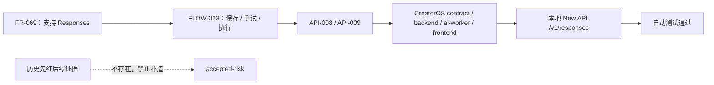

# T-471 OpenAI Responses 协议追溯 Gate

> 运行日期：2026-07-23
> 补正任务：T-483
> 功能提交：`94cc40bc`
> 判定：**功能回归通过；历史流程证据 accepted-risk；项目级 reconcile 被既有 BACKLOG 膨胀阻断。**

## 1. 大白话结论

CreatorOS 的 Responses 支持目前有正式 SPEC、稳定 ID、决策记录、影响分析和
实现回归证据。CreatorOS 到本地 New API 的协议兼容测试通过，没有调用真实付费模型。

这不等于 T-471 当时完整走过了流程：代码是在 SPEC 和 TDD 红测之前完成的，历史上
不存在的红测、评审和状态事件不能补造。因此，本报告把“当前可重验的功能正确性”和
“无法补回的历史流程证据”分开判定。

## 2. 工件 Gate

| 检查 | 结果 | 证据 |
|---|---|---|
| 正式产品 SPEC | PASS | `docs/superpowers/specs/2026-07-23-openai-responses-protocol-design.md` |
| 决策与历史缺口 | PASS | `DEC-019`、`DEC-020` |
| 稳定 ID 与追踪 | PASS | `FR-069`、`FLOW-023`、`API-008`、`API-009`、`TEST-001..008` |
| 变更影响分析 | PASS | `CI-013` |
| 原 writing-plans 文档 | PASS | 已从当前树删除，Git 历史保留原始记录 |
| 历史前置 SPEC review | ACCEPTED-RISK | 当时未执行，不能事后伪造 |
| 历史 TDD 红测 | ACCEPTED-RISK | 当时未保留红测证据，见 `RISK-011` |

## 3. 新鲜技术验证

| 范围 | 命令/结果 | 判定 |
|---|---|---|
| Contract | `pnpm --filter @creatoros/contract test`：23 files / 126 tests | PASS |
| AI worker | `pnpm --filter @creatoros/ai-worker test`：33 files / 261 tests | PASS |
| Backend Responses 链 | 5 files / 49 tests | PASS |
| Frontend 设置与连接测试 | 3 files / 61 tests | PASS |
| Windows sidecar 协议模块 | 1 file / 4 tests | PASS |
| 四工作区 typecheck | contract、ai-worker、backend、frontend 均退出 0 | PASS |
| 本地 New API 兼容 | `oai_responses`、OpenAI channel、advancedcustom 等 Go tests 退出 0 | PASS |
| 物理边界 | `boundary-scan.mjs`：无新增违规 | PASS |
| 双向追踪 | `orphan-scan.mjs`：T-471 链为 `RISK`，0 error | PASS |

测试环境是 Node `v22.22.2`，仓库声明 contract 需要 Node 25、frontend 需要 Node 24；
本轮命令全部通过，但引擎版本偏差作为环境说明保留，不伪装成目标版本验证。

## 4. 未执行项

- 未调用真实 New API 模型，也未消耗外部模型额度；这是用户明确的成本边界。
- 未触发 GitHub Actions、Windows 或 macOS 付费构建。
- 未做真实供应商的端到端流式响应测试；需要用户授权额度后另行执行。

## 5. 项目级流程 Gate

`backlog-health.mjs` 当前报告活动 `BACKLOG.md` 约 129.5KB，超过 60KB 硬限，并有
51 行超过单行硬限。`backlog-compact.mjs --dry-run` 显示已完成区已无可机械归档项，
因此必须进行保留语义的人工压缩。该既有欠债登记为 `T-484`。

这项全局失败不否定 T-471 的功能验证，但会让项目级 `reconcile` 不能全绿。T-483
只能在报告该阻断后按“补正完成、全局 Gate 未清”收口，不能声称整个仓库流程健康。
