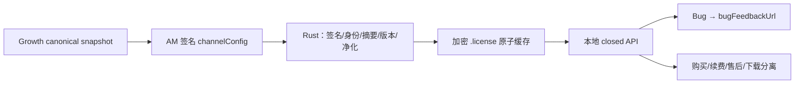

# T-534 BUILD / 验收门证据（2026-07-26）

## 结论

CreatorOS 消费端实现、定向测试与正式 `next build` 均通过。先前来自当前 HEAD 中 T-535
`frontend/src/instrumentation.ts` 的唯一发布构建阻断已经复现并根治：Turbopack 在为中文
运行日志生成 code frame 时，按字节索引截进 UTF-8 中文字符内部而 panic。T-535 只把
instrumentation 的运行日志改为稳定 ASCII，并新增源码契约回归；没有修改 T-534 的业务契约、
runtime config 数据归属或消费逻辑。

## 代码事实

- Rust 只在 raw digest、Ed25519、date、nonce 已通过后处理 runtime。
- v2 必须是 closed 17 keys；`supportUrl === channelSupportUrl`。
- `sourceDigest` 使用 RFC 8785 JCS；positive 567 bytes 与 negative 571 bytes 向量逐字验证。
- `(projectKey, channelRef)` 与 AM 已签名 identity 绑定；低版、同版不同摘要不更新。
- AM 签名改绑到新 `channelRef` 时，只有新 identity 的合法配置可采纳；不存在本地 fallback。
- legacy v1 只接受 closed 4 keys，只映射 `supportUrl → channelSupportUrl`，Bug/续费不可用。
- URL 保留合法 query/fragment，禁止 userinfo、port、IP、localhost、非 ASCII host 与路径穿越。
- runtime 与授权快照一起写入加密 `.license`；无 master key 时丢弃 runtime，绝不明文降级。
- 生产路径不再写/读 `.channel-links`；旧 TS reader 与 `/local/support-channel` 已删除。
- `IssueFeedbackDialog` 只读取 `bugFeedbackUrl`；激活页只读 `channelSupportUrl`；设置页把
  purchase/renewal/channelSupport/download 分开。null 只显示“当前未提供”。
- 打开外链与日志目录都带启动握手头；桌面 403/失败不绕过可信 adapter 调 `window.open`，
  只有 route 明确返回 `desktop:false` 才允许 web/dev 兜底。
- 仍是“复制 → 打开页面 → 用户粘贴提交”，没有自动上传，也不把“已打开”写成“已提交”。

## 测试与运行态证据

- 红测：
  - contract 新 schema 缺失 → `localChannelRuntimeResponse` undefined；
  - frontend 新 reader/route 缺失 → import resolution failure；
  - Rust 新 consumer 缺失 → `parse_signed_channel_runtime` 编译失败。
- T-535 发布构建红测（修复前真实重跑）：
  - `pnpm --dir frontend build` 失败；
  - Turbopack `next-code-frame/src/highlight.rs:1011:45` panic；
  - 明确报错 `end byte index 93 is not a char boundary`，位置落在
    `PLAYWRIGHT_BROWSERS_PATH` 中文运行日志的“渲”字内部。
- T-535 修复后：
  - `pnpm --dir frontend build`：PASS；Turbopack 编译、TypeScript、静态页生成全部完成；
  - desktop 启动相关 Vitest：5 files / 46 tests PASS；
  - 新增回归锁定 instrumentation 所有运行日志为 ASCII、固定哨兵逐字一致且只在 verdict、
    生命周期守护与 Chromium 初始化之后输出；
  - 密钥缺失/不匹配 fail-fast、最终包 key 校验与 release workflow 契约继续通过。
- `cargo test --lib`：131 passed。
- `cargo check --lib`：PASS；仅既有 `decoy_gate.rs` dead-code warning。
- T-534 定向 frontend：6 files / 48 tests PASS。
- T-534 定向 contract：1 file / 2 tests PASS。
- `node orchestrator/process/orphan-scan.mjs`：0 errors（存量 planned/untraced 项仅 warning）。
- `node orchestrator/process/reconcile.mjs`：0 errors / 0 warnings。
- frontend `pnpm test`：255 files passed；2493 passed，1 todo。
- contract `pnpm test`：25 files passed；136 passed。
- frontend `next typegen && tsc --noEmit`：PASS。
- 目标 ESLint：0 errors；仅既有测试文件未使用 `within` warning。
- 本地真实 HTTP：
  - `GET /api/v1/local/channel-runtime` → 200；
  - `Cache-Control: private, no-store, max-age=0`；
  - 未激活时返回 closed `runtimeState=unavailable` 七字段 body。
- 浏览器控制面尝试访问本机 dev server 时连接面隔离，未获得可声称的真机页面交互证据；
  外链降级由 jsdom 组件测试锁定，不把该尝试写成 Browser PASS。
- fixture：
  - Creator/AM projection 文件 `cmp` 一致，SHA-256
    `d98f467af4251bb65b5e632375faae8dc1c988f0db6458396c366f762632f4de`；
  - Creator/Growth source vector 文件 `cmp` 一致，SHA-256
    `e68669e32c5334dce9319214d9f502c00061691820c59d41a7f7cc839afcba01`。

## 未伪报项

- 没有真实 Growth/AM 生产凭据，因此未向生产 AM 发 activate/status，也未打开真实第三方反馈页。
- 本轮遵照 T-535 授权边界，没有制作正式安装包、替换本机已安装 App 或重跑安装包真机启动；
  因而不把 production build PASS 写成新安装包真机 PASS。
- build 仍输出既有 Edge Runtime / NFT 动态文件追踪警告，但命令 exit 0；本轮没有关闭
  Turbopack、切换降级构建器或隐藏警告。
- 工作树含用户/其他任务并行修改；本次只纳入 T-535 修复、回归测试、taskctl 审计事件与本门
  结果更新，T-534 业务契约及其余任务改动均未清理、覆盖或混入提交。
